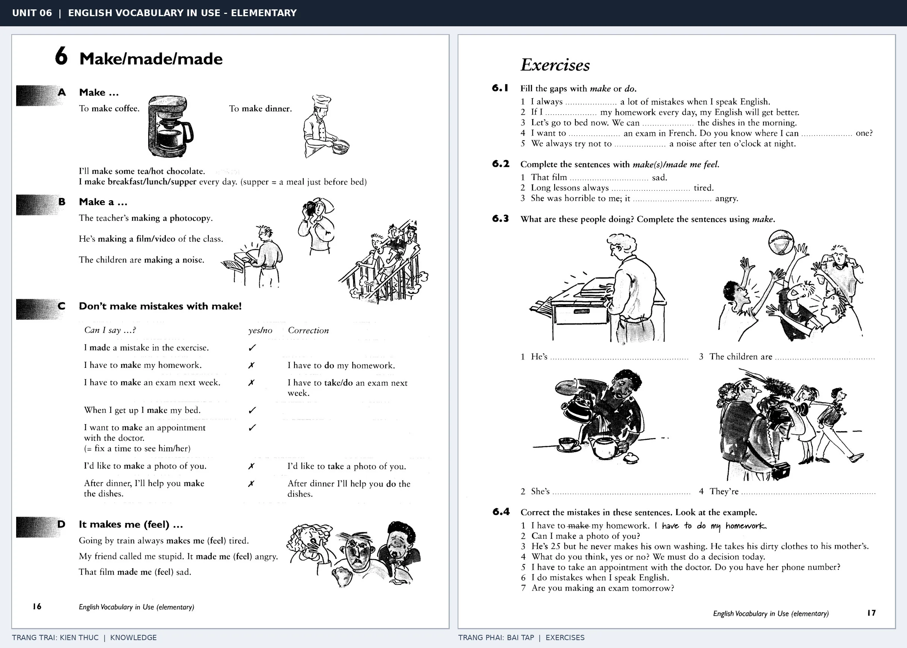

# Unit 06 — Make/made/made: Make và sự tạo ra

*Trang trái cung cấp kiến thức và ví dụ; trang phải là phần Exercises của Unit tương ứng. Có thể phóng to ảnh để làm bài tập gốc.*

> **Module 02:** Động từ trong đời sống  
> **Phạm vi:** English Vocabulary in Use — Elementary, Unit 6; trang in 16–17 (PDF trang 19–20).  
> **Hình thức:** Tự học từ vựng A1–A2 · Giảng giải tiếng Việt · Luyện câu và bài tập.

## 1. Tóm tắt và mục tiêu

Make nhấn mạnh tạo ra sản phẩm, kết quả hoặc gây ra trạng thái. Học theo collocation: make a mistake nhưng do homework; make dinner nhưng do the washing-up.

Sau bài này, bạn có thể:

- Giải thích nghĩa và cách sử dụng những từ, cụm từ cốt lõi của chủ đề **make và sự tạo ra**.
- Chọn đúng cách diễn đạt trong câu tiếng Anh đơn giản thay vì dịch máy móc từng từ.
- Tự đặt ít nhất ba câu thực tế và hoàn thành phần Exercises ở trang sách bên phải.

## 2. Kiến thức và từ vựng cốt lõi

Đọc kỹ từng mục. Với từ nhiều nghĩa, nghĩa ghi trong bảng được giới hạn ở cách dùng cần cho bài học này.

| Từ/cụm từ tiếng Anh | Nghĩa tiếng Việt |
| --- | --- |
| **make coffee** | pha cà phê |
| **make dinner** | nấu bữa tối |
| **make a mistake** | mắc lỗi |
| **make a photocopy** | phô tô |
| **make a video** | làm video |
| **make a noise** | gây tiếng ồn |
| **make an appointment** | đặt lịch hẹn |
| **make my bed** | dọn giường |
| **make friends** | kết bạn |
| **make someone happy** | làm ai đó vui |
| **made** | đã tạo ra |
| **make tea** | pha trà |

### 2.1. Ghi nhớ theo nhóm và ngữ cảnh

**Nhóm từ thứ nhất:** make coffee (pha cà phê), make dinner (nấu bữa tối), make a mistake (mắc lỗi).

**Nhóm từ thứ hai:** make a noise (gây tiếng ồn), make an appointment (đặt lịch hẹn), make my bed (dọn giường).

Hãy ghép từ với tình huống sử dụng thực tế. Khi gặp cụm từ có nhiều thành phần, ưu tiên ghi cả cụm kèm một câu ví dụ trong sổ từ vựng.

### 2.2. Mẫu câu song ngữ

**Ví dụ 1.** She is making coffee.

→ Cô ấy đang pha cà phê.

**Ví dụ 2.** The bad news made me sad.

→ Tin xấu khiến tôi buồn.

Đọc từng câu thành tiếng, che phần dịch tiếng Việt và thử nói lại ý bằng lời của mình. Sau đó thay một chi tiết trong câu để tạo ví dụ mới.

## 3. Luyện tập ứng dụng

**Bài A — Nhớ từ trong ngữ cảnh.** Không nhìn bảng, hãy viết tiếng Anh tương ứng với các ý sau:

1. Pha cà phê: __________
2. Phô tô: __________
3. Dọn giường: __________

**Bài B — Dịch và biến đổi câu.** Dịch hai câu dưới đây sang tiếng Anh trước khi nhìn mẫu câu ở trên:

1. Cô ấy đang pha cà phê.
2. Tin xấu khiến tôi buồn.

**Bài C — Viết cho bản thân.** Viết ba câu mới về cuộc sống của bạn, mỗi câu sử dụng một từ/cụm từ khác nhau trong bảng. Đọc lại để kiểm tra giới từ, cách chia động từ và trật tự từ.

**Bài D — Thực hành theo sách.** Quan sát phần **Exercises (trang phải)** trong ảnh ghép: giải bài tập trên giấy hoặc một file riêng, sau đó so sánh với các ví dụ ở trang trái. Những bài yêu cầu thông tin cá nhân không nhất thiết có một đáp án cố định.

## 4. Câu hỏi ôn tập trắc nghiệm

*Mỗi câu có một đáp án phù hợp nhất. Hãy tự trả lời trước khi đọc phần giải thích.*

### Câu 1

Bạn muốn diễn đạt **“nấu bữa tối”** bằng tiếng Anh. Chọn cách nói phù hợp nhất.

A. make dinner

B. make friends

C. made

D. make a video

**Đáp án:** A. **Giải thích:** “make dinner” diễn đạt “nấu bữa tối” trong chủ đề này.

### Câu 2

Cụm từ **“make a noise”** có nghĩa nào trong bài học?

A. đặt lịch hẹn

B. gây tiếng ồn

C. mắc lỗi

D. kết bạn

**Đáp án:** B. **Giải thích:** “make a noise” được dùng với nghĩa “gây tiếng ồn”.

### Câu 3

Khi cần nói **“kết bạn”**, chọn từ/cụm từ nào?

A. make a mistake

B. make friends

C. make tea

D. make a photocopy

**Đáp án:** B. **Giải thích:** Cách dùng đúng trong bài là “make friends”.

### Câu 4

Chọn câu tiếng Anh diễn đạt đúng nhất: **“Cô ấy đang pha cà phê.”**

A. I do my homework every evening.

B. We have lunch at twelve.

C. She is making coffee.

D. Take an umbrella because it is raining.

**Đáp án:** C. **Giải thích:** “She is making coffee.” là câu tương ứng với tình huống đã nêu.

### Câu 5

Ý nghĩa phù hợp nhất của câu **“The bad news made me sad.”** là gì?

A. Cô ấy nói tiếng Anh rất tốt.

B. Bạn có thích quần vợt không?

C. Tin xấu khiến tôi buồn.

D. Mời vào.

**Đáp án:** C. **Giải thích:** “The bad news made me sad.” có nghĩa là “Tin xấu khiến tôi buồn.”.

## 5. Tổng kết và kiểm tra hoàn thành

Bài **The bad news made me sad.** giúp bạn sử dụng vốn từ về **tin xấu khiến tôi buồn.** trong câu tiếng Anh thực tế. Giá trị quan trọng nhất không chỉ là biết nghĩa, mà là nhớ **cách kết hợp từ và ngữ cảnh sử dụng**.

- [ ] Tôi đã học bảng từ/cụm từ và đọc thành tiếng các ví dụ.
- [ ] Tôi đã hoàn thành ba phần luyện tập A, B, C.
- [ ] Tôi đã làm trang Exercises trong ảnh ghép và 5 câu trắc nghiệm.
- [ ] Tôi đã ghi các từ dễ nhầm vào sổ để ôn lại sau 1–3 ngày.

---

[← Unit 05: Do trong câu hỏi và công việc](05-do-did-done.md) · [Unit 07: Come: đi đến phía người nói →](07-come-came-come.md)

[↑ Trở về mục lục khóa học](../../MUC_LUC.md)
