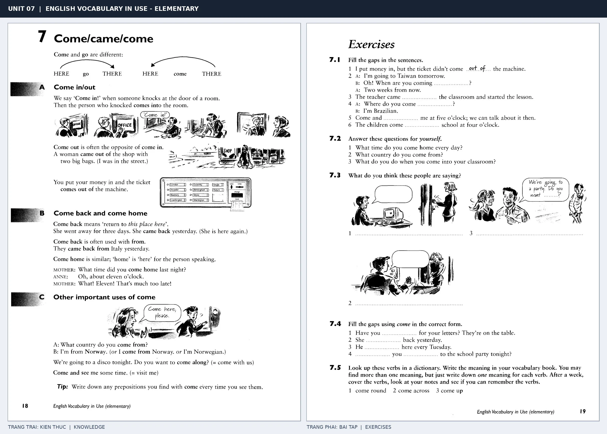

# Unit 07 — Come/came/come: Come: đi đến phía người nói

*Trang trái cung cấp kiến thức và ví dụ; trang phải là phần Exercises của Unit tương ứng. Có thể phóng to ảnh để làm bài tập gốc.*

> **Module 02:** Động từ trong đời sống  
> **Phạm vi:** English Vocabulary in Use — Elementary, Unit 7; trang in 18–19 (PDF trang 21–22).  
> **Hình thức:** Tự học từ vựng A1–A2 · Giảng giải tiếng Việt · Luyện câu và bài tập.

## 1. Tóm tắt và mục tiêu

Chọn come khi chuyển động hướng về người nói hoặc nơi đang được coi là điểm quy chiếu; go thường hướng ra xa. Come back là quay lại chỗ này, còn go back thường nhấn mạnh quay về một chỗ khác.

Sau bài này, bạn có thể:

- Giải thích nghĩa và cách sử dụng những từ, cụm từ cốt lõi của chủ đề **come: đi đến phía người nói**.
- Chọn đúng cách diễn đạt trong câu tiếng Anh đơn giản thay vì dịch máy móc từng từ.
- Tự đặt ít nhất ba câu thực tế và hoàn thành phần Exercises ở trang sách bên phải.

## 2. Kiến thức và từ vựng cốt lõi

Đọc kỹ từng mục. Với từ nhiều nghĩa, nghĩa ghi trong bảng được giới hạn ở cách dùng cần cho bài học này.

| Từ/cụm từ tiếng Anh | Nghĩa tiếng Việt |
| --- | --- |
| **come in** | đi vào |
| **come out** | đi ra |
| **come back** | quay trở lại |
| **come home** | về nhà |
| **come from** | đến từ |
| **come along** | đi cùng |
| **come and see** | đến thăm |
| **come here** | đến đây |
| **come to school** | đến trường |
| **come late** | đến muộn |
| **came** | đã đến |
| **come with us** | đi cùng chúng tôi |

### 2.1. Ghi nhớ theo nhóm và ngữ cảnh

**Nhóm từ thứ nhất:** come in (đi vào), come out (đi ra), come back (quay trở lại).

**Nhóm từ thứ hai:** come along (đi cùng), come and see (đến thăm), come here (đến đây).

Hãy ghép từ với tình huống sử dụng thực tế. Khi gặp cụm từ có nhiều thành phần, ưu tiên ghi cả cụm kèm một câu ví dụ trong sổ từ vựng.

### 2.2. Mẫu câu song ngữ

**Ví dụ 1.** Please come in.

→ Mời vào.

**Ví dụ 2.** She came back yesterday.

→ Cô ấy đã quay lại hôm qua.

Đọc từng câu thành tiếng, che phần dịch tiếng Việt và thử nói lại ý bằng lời của mình. Sau đó thay một chi tiết trong câu để tạo ví dụ mới.

## 3. Luyện tập ứng dụng

**Bài A — Nhớ từ trong ngữ cảnh.** Không nhìn bảng, hãy viết tiếng Anh tương ứng với các ý sau:

1. Đi vào: __________
2. Về nhà: __________
3. Đến đây: __________

**Bài B — Dịch và biến đổi câu.** Dịch hai câu dưới đây sang tiếng Anh trước khi nhìn mẫu câu ở trên:

1. Mời vào.
2. Cô ấy đã quay lại hôm qua.

**Bài C — Viết cho bản thân.** Viết ba câu mới về cuộc sống của bạn, mỗi câu sử dụng một từ/cụm từ khác nhau trong bảng. Đọc lại để kiểm tra giới từ, cách chia động từ và trật tự từ.

**Bài D — Thực hành theo sách.** Quan sát phần **Exercises (trang phải)** trong ảnh ghép: giải bài tập trên giấy hoặc một file riêng, sau đó so sánh với các ví dụ ở trang trái. Những bài yêu cầu thông tin cá nhân không nhất thiết có một đáp án cố định.

## 4. Câu hỏi ôn tập trắc nghiệm

*Mỗi câu có một đáp án phù hợp nhất. Hãy tự trả lời trước khi đọc phần giải thích.*

### Câu 1

Bạn muốn diễn đạt **“đi ra”** bằng tiếng Anh. Chọn cách nói phù hợp nhất.

A. come along

B. come out

C. come and see

D. come here

**Đáp án:** B. **Giải thích:** “come out” diễn đạt “đi ra” trong chủ đề này.

### Câu 2

Cụm từ **“come along”** có nghĩa nào trong bài học?

A. đến thăm

B. đi cùng

C. đã đến

D. đến muộn

**Đáp án:** B. **Giải thích:** “come along” được dùng với nghĩa “đi cùng”.

### Câu 3

Khi cần nói **“đến trường”**, chọn từ/cụm từ nào?

A. come to school

B. come and see

C. come late

D. come here

**Đáp án:** A. **Giải thích:** Cách dùng đúng trong bài là “come to school”.

### Câu 4

Chọn câu tiếng Anh diễn đạt đúng nhất: **“Mời vào.”**

A. Please come in.

B. She is making coffee.

C. Take your books to school.

D. How do you get to work?

**Đáp án:** A. **Giải thích:** “Please come in.” là câu tương ứng với tình huống đã nêu.

### Câu 5

Ý nghĩa phù hợp nhất của câu **“She came back yesterday.”** là gì?

A. Mang theo ô vì trời đang mưa.

B. Cô ấy nói tiếng Anh rất tốt.

C. Cô ấy đang pha cà phê.

D. Cô ấy đã quay lại hôm qua.

**Đáp án:** D. **Giải thích:** “She came back yesterday.” có nghĩa là “Cô ấy đã quay lại hôm qua.”.

## 5. Tổng kết và kiểm tra hoàn thành

Bài **She came back yesterday.** giúp bạn sử dụng vốn từ về **cô ấy đã quay lại hôm qua.** trong câu tiếng Anh thực tế. Giá trị quan trọng nhất không chỉ là biết nghĩa, mà là nhớ **cách kết hợp từ và ngữ cảnh sử dụng**.

- [ ] Tôi đã học bảng từ/cụm từ và đọc thành tiếng các ví dụ.
- [ ] Tôi đã hoàn thành ba phần luyện tập A, B, C.
- [ ] Tôi đã làm trang Exercises trong ảnh ghép và 5 câu trắc nghiệm.
- [ ] Tôi đã ghi các từ dễ nhầm vào sổ để ôn lại sau 1–3 ngày.

---

[← Unit 06: Make và sự tạo ra](06-make-made-made.md) · [Unit 08: Take: thời gian, phương tiện và mang theo →](08-take-took-taken.md)

[↑ Trở về mục lục khóa học](../../MUC_LUC.md)
