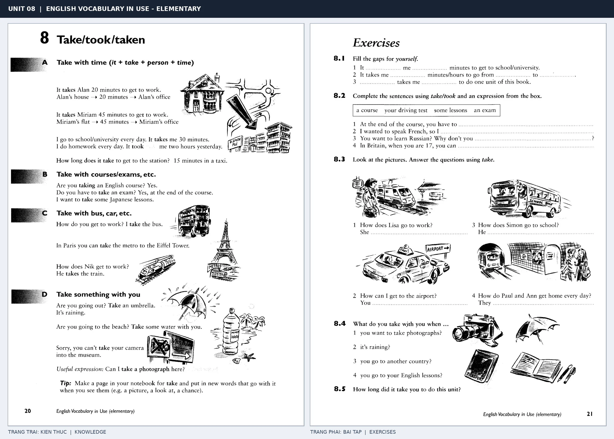

# Unit 08 — Take/took/taken: Take: thời gian, phương tiện và mang theo

*Trang trái cung cấp kiến thức và ví dụ; trang phải là phần Exercises của Unit tương ứng. Có thể phóng to ảnh để làm bài tập gốc.*

> **Module 02:** Động từ trong đời sống  
> **Phạm vi:** English Vocabulary in Use — Elementary, Unit 8; trang in 20–21 (PDF trang 23–24).  
> **Hình thức:** Tự học từ vựng A1–A2 · Giảng giải tiếng Việt · Luyện câu và bài tập.

## 1. Tóm tắt và mục tiêu

Mẫu It takes + người + khoảng thời gian + to V diễn tả thời gian cần để làm việc. Take cũng thường xuất hiện với phương tiện, khóa học, kỳ thi và đồ vật mang theo.

Sau bài này, bạn có thể:

- Giải thích nghĩa và cách sử dụng những từ, cụm từ cốt lõi của chủ đề **take: thời gian, phương tiện và mang theo**.
- Chọn đúng cách diễn đạt trong câu tiếng Anh đơn giản thay vì dịch máy móc từng từ.
- Tự đặt ít nhất ba câu thực tế và hoàn thành phần Exercises ở trang sách bên phải.

## 2. Kiến thức và từ vựng cốt lõi

Đọc kỹ từng mục. Với từ nhiều nghĩa, nghĩa ghi trong bảng được giới hạn ở cách dùng cần cho bài học này.

| Từ/cụm từ tiếng Anh | Nghĩa tiếng Việt |
| --- | --- |
| **take the bus** | đi xe buýt |
| **take a train** | đi tàu |
| **take a taxi** | đi taxi |
| **take an exam** | tham gia kỳ thi |
| **take a course** | theo học khóa học |
| **take lessons** | tham gia các buổi học |
| **take an umbrella** | mang ô |
| **take a camera** | mang máy ảnh |
| **take a photo** | chụp ảnh |
| **take a long time** | mất nhiều thời gian |
| **it takes** | mất thời gian |
| **take water** | mang nước |

### 2.1. Ghi nhớ theo nhóm và ngữ cảnh

**Nhóm từ thứ nhất:** take the bus (đi xe buýt), take a train (đi tàu), take a taxi (đi taxi).

**Nhóm từ thứ hai:** take lessons (tham gia các buổi học), take an umbrella (mang ô), take a camera (mang máy ảnh).

Hãy ghép từ với tình huống sử dụng thực tế. Khi gặp cụm từ có nhiều thành phần, ưu tiên ghi cả cụm kèm một câu ví dụ trong sổ từ vựng.

### 2.2. Mẫu câu song ngữ

**Ví dụ 1.** It takes me thirty minutes to get to school.

→ Tôi mất ba mươi phút để đến trường.

**Ví dụ 2.** Take an umbrella because it is raining.

→ Mang theo ô vì trời đang mưa.

Đọc từng câu thành tiếng, che phần dịch tiếng Việt và thử nói lại ý bằng lời của mình. Sau đó thay một chi tiết trong câu để tạo ví dụ mới.

## 3. Luyện tập ứng dụng

**Bài A — Nhớ từ trong ngữ cảnh.** Không nhìn bảng, hãy viết tiếng Anh tương ứng với các ý sau:

1. Đi xe buýt: __________
2. Tham gia kỳ thi: __________
3. Mang máy ảnh: __________

**Bài B — Dịch và biến đổi câu.** Dịch hai câu dưới đây sang tiếng Anh trước khi nhìn mẫu câu ở trên:

1. Tôi mất ba mươi phút để đến trường.
2. Mang theo ô vì trời đang mưa.

**Bài C — Viết cho bản thân.** Viết ba câu mới về cuộc sống của bạn, mỗi câu sử dụng một từ/cụm từ khác nhau trong bảng. Đọc lại để kiểm tra giới từ, cách chia động từ và trật tự từ.

**Bài D — Thực hành theo sách.** Quan sát phần **Exercises (trang phải)** trong ảnh ghép: giải bài tập trên giấy hoặc một file riêng, sau đó so sánh với các ví dụ ở trang trái. Những bài yêu cầu thông tin cá nhân không nhất thiết có một đáp án cố định.

## 4. Câu hỏi ôn tập trắc nghiệm

*Mỗi câu có một đáp án phù hợp nhất. Hãy tự trả lời trước khi đọc phần giải thích.*

### Câu 1

Bạn muốn diễn đạt **“đi tàu”** bằng tiếng Anh. Chọn cách nói phù hợp nhất.

A. take a camera

B. take a course

C. take a train

D. take water

**Đáp án:** C. **Giải thích:** “take a train” diễn đạt “đi tàu” trong chủ đề này.

### Câu 2

Cụm từ **“take lessons”** có nghĩa nào trong bài học?

A. tham gia kỳ thi

B. mang ô

C. chụp ảnh

D. tham gia các buổi học

**Đáp án:** D. **Giải thích:** “take lessons” được dùng với nghĩa “tham gia các buổi học”.

### Câu 3

Khi cần nói **“chụp ảnh”**, chọn từ/cụm từ nào?

A. take a photo

B. take an umbrella

C. take a taxi

D. take lessons

**Đáp án:** A. **Giải thích:** Cách dùng đúng trong bài là “take a photo”.

### Câu 4

Chọn câu tiếng Anh diễn đạt đúng nhất: **“Tôi mất ba mươi phút để đến trường.”**

A. We are going to stay at home on Sunday.

B. It takes me thirty minutes to get to school.

C. Please bring your guitar to my house.

D. We go to school on foot.

**Đáp án:** B. **Giải thích:** “It takes me thirty minutes to get to school.” là câu tương ứng với tình huống đã nêu.

### Câu 5

Ý nghĩa phù hợp nhất của câu **“Take an umbrella because it is raining.”** là gì?

A. Cô ấy xem tivi mỗi tối.

B. Mang theo ô vì trời đang mưa.

C. Tôi thường dậy lúc bảy giờ.

D. Cô ấy đã quay lại hôm qua.

**Đáp án:** B. **Giải thích:** “Take an umbrella because it is raining.” có nghĩa là “Mang theo ô vì trời đang mưa.”.

## 5. Tổng kết và kiểm tra hoàn thành

Bài **Take an umbrella because it is raining.** giúp bạn sử dụng vốn từ về **mang theo ô vì trời đang mưa.** trong câu tiếng Anh thực tế. Giá trị quan trọng nhất không chỉ là biết nghĩa, mà là nhớ **cách kết hợp từ và ngữ cảnh sử dụng**.

- [ ] Tôi đã học bảng từ/cụm từ và đọc thành tiếng các ví dụ.
- [ ] Tôi đã hoàn thành ba phần luyện tập A, B, C.
- [ ] Tôi đã làm trang Exercises trong ảnh ghép và 5 câu trắc nghiệm.
- [ ] Tôi đã ghi các từ dễ nhầm vào sổ để ôn lại sau 1–3 ngày.

---

[← Unit 07: Come: đi đến phía người nói](07-come-came-come.md) · [Unit 09: Phân biệt bring và take →](09-bring-brought-brought.md)

[↑ Trở về mục lục khóa học](../../MUC_LUC.md)
