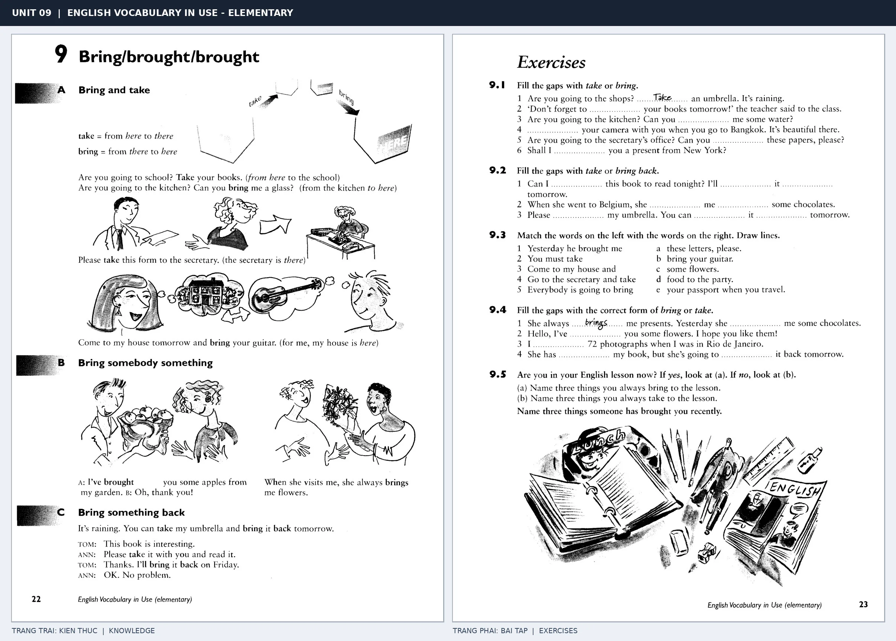

# Unit 09 — Bring/brought/brought: Phân biệt bring và take

*Trang trái cung cấp kiến thức và ví dụ; trang phải là phần Exercises của Unit tương ứng. Có thể phóng to ảnh để làm bài tập gốc.*

> **Module 02:** Động từ trong đời sống  
> **Phạm vi:** English Vocabulary in Use — Elementary, Unit 9; trang in 22–23 (PDF trang 25–26).  
> **Hình thức:** Tự học từ vựng A1–A2 · Giảng giải tiếng Việt · Luyện câu và bài tập.

## 1. Tóm tắt và mục tiêu

Hãy tưởng tượng hướng di chuyển: bring đưa vật về phía người nói/địa điểm đích; take đưa vật rời khỏi vị trí đó. Cần dựa vào ngữ cảnh thay vì chỉ dịch cả hai thành 'mang'.

Sau bài này, bạn có thể:

- Giải thích nghĩa và cách sử dụng những từ, cụm từ cốt lõi của chủ đề **phân biệt bring và take**.
- Chọn đúng cách diễn đạt trong câu tiếng Anh đơn giản thay vì dịch máy móc từng từ.
- Tự đặt ít nhất ba câu thực tế và hoàn thành phần Exercises ở trang sách bên phải.

## 2. Kiến thức và từ vựng cốt lõi

Đọc kỹ từng mục. Với từ nhiều nghĩa, nghĩa ghi trong bảng được giới hạn ở cách dùng cần cho bài học này.

| Từ/cụm từ tiếng Anh | Nghĩa tiếng Việt |
| --- | --- |
| **bring** | mang tới |
| **take** | mang đi |
| **bring back** | mang trở lại |
| **take back** | mang đi trả |
| **bring flowers** | mang hoa tới |
| **bring a gift** | mang quà tới |
| **bring your guitar** | mang đàn ghi-ta tới |
| **take your books** | mang sách đi |
| **bring me a glass** | mang cho tôi một chiếc cốc |
| **bring somebody something** | mang thứ gì cho ai |
| **take something with you** | mang theo thứ gì |
| **brought** | đã mang đến |

### 2.1. Ghi nhớ theo nhóm và ngữ cảnh

**Nhóm từ thứ nhất:** bring (mang tới), take (mang đi), bring back (mang trở lại).

**Nhóm từ thứ hai:** bring a gift (mang quà tới), bring your guitar (mang đàn ghi-ta tới), take your books (mang sách đi).

Hãy ghép từ với tình huống sử dụng thực tế. Khi gặp cụm từ có nhiều thành phần, ưu tiên ghi cả cụm kèm một câu ví dụ trong sổ từ vựng.

### 2.2. Mẫu câu song ngữ

**Ví dụ 1.** Please bring your guitar to my house.

→ Hãy mang đàn ghi-ta đến nhà tôi.

**Ví dụ 2.** Take your books to school.

→ Mang sách của bạn đến trường.

Đọc từng câu thành tiếng, che phần dịch tiếng Việt và thử nói lại ý bằng lời của mình. Sau đó thay một chi tiết trong câu để tạo ví dụ mới.

## 3. Luyện tập ứng dụng

**Bài A — Nhớ từ trong ngữ cảnh.** Không nhìn bảng, hãy viết tiếng Anh tương ứng với các ý sau:

1. Mang tới: __________
2. Mang đi trả: __________
3. Mang sách đi: __________

**Bài B — Dịch và biến đổi câu.** Dịch hai câu dưới đây sang tiếng Anh trước khi nhìn mẫu câu ở trên:

1. Hãy mang đàn ghi-ta đến nhà tôi.
2. Mang sách của bạn đến trường.

**Bài C — Viết cho bản thân.** Viết ba câu mới về cuộc sống của bạn, mỗi câu sử dụng một từ/cụm từ khác nhau trong bảng. Đọc lại để kiểm tra giới từ, cách chia động từ và trật tự từ.

**Bài D — Thực hành theo sách.** Quan sát phần **Exercises (trang phải)** trong ảnh ghép: giải bài tập trên giấy hoặc một file riêng, sau đó so sánh với các ví dụ ở trang trái. Những bài yêu cầu thông tin cá nhân không nhất thiết có một đáp án cố định.

## 4. Câu hỏi ôn tập trắc nghiệm

*Mỗi câu có một đáp án phù hợp nhất. Hãy tự trả lời trước khi đọc phần giải thích.*

### Câu 1

Bạn muốn diễn đạt **“mang đi”** bằng tiếng Anh. Chọn cách nói phù hợp nhất.

A. take

B. bring flowers

C. take back

D. brought

**Đáp án:** A. **Giải thích:** “take” diễn đạt “mang đi” trong chủ đề này.

### Câu 2

Cụm từ **“bring a gift”** có nghĩa nào trong bài học?

A. mang quà tới

B. mang theo thứ gì

C. mang sách đi

D. mang cho tôi một chiếc cốc

**Đáp án:** A. **Giải thích:** “bring a gift” được dùng với nghĩa “mang quà tới”.

### Câu 3

Khi cần nói **“mang cho tôi một chiếc cốc”**, chọn từ/cụm từ nào?

A. bring somebody something

B. bring flowers

C. bring a gift

D. bring me a glass

**Đáp án:** D. **Giải thích:** Cách dùng đúng trong bài là “bring me a glass”.

### Câu 4

Chọn câu tiếng Anh diễn đạt đúng nhất: **“Hãy mang đàn ghi-ta đến nhà tôi.”**

A. Please bring your guitar to my house.

B. Do you like tennis?

C. The plane took off at noon.

D. I do my homework every evening.

**Đáp án:** A. **Giải thích:** “Please bring your guitar to my house.” là câu tương ứng với tình huống đã nêu.

### Câu 5

Ý nghĩa phù hợp nhất của câu **“Take your books to school.”** là gì?

A. Tin xấu khiến tôi buồn.

B. Làm ơn vặn nhỏ nhạc.

C. Mang sách của bạn đến trường.

D. Tôi làm bài tập về nhà mỗi tối.

**Đáp án:** C. **Giải thích:** “Take your books to school.” có nghĩa là “Mang sách của bạn đến trường.”.

## 5. Tổng kết và kiểm tra hoàn thành

Bài **Take your books to school.** giúp bạn sử dụng vốn từ về **mang sách của bạn đến trường.** trong câu tiếng Anh thực tế. Giá trị quan trọng nhất không chỉ là biết nghĩa, mà là nhớ **cách kết hợp từ và ngữ cảnh sử dụng**.

- [ ] Tôi đã học bảng từ/cụm từ và đọc thành tiếng các ví dụ.
- [ ] Tôi đã hoàn thành ba phần luyện tập A, B, C.
- [ ] Tôi đã làm trang Exercises trong ảnh ghép và 5 câu trắc nghiệm.
- [ ] Tôi đã ghi các từ dễ nhầm vào sổ để ôn lại sau 1–3 ngày.

---

[← Unit 08: Take: thời gian, phương tiện và mang theo](08-take-took-taken.md) · [Unit 10: Các cách dùng đa dạng của get →](10-get-got-got.md)

[↑ Trở về mục lục khóa học](../../MUC_LUC.md)
