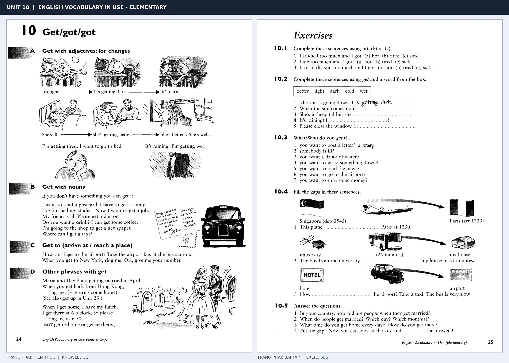

# Unit 10 — Get/got/got: Các cách dùng đa dạng của get

*Trang trái cung cấp kiến thức và ví dụ; trang phải là phần Exercises của Unit tương ứng. Có thể phóng to ảnh để làm bài tập gốc.*

> **Module 02:** Động từ trong đời sống  
> **Phạm vi:** English Vocabulary in Use — Elementary, Unit 10; trang in 24–25 (PDF trang 27–28).  
> **Hình thức:** Tự học từ vựng A1–A2 · Giảng giải tiếng Việt · Luyện câu và bài tập.

## 1. Tóm tắt và mục tiêu

Get + adjective chỉ sự thay đổi trạng thái, get + noun thường liên quan đến nhận/lấy/kiếm, và get to + place là đến địa điểm. Học nghĩa theo cả cụm, đừng gán một nghĩa duy nhất cho get.

Sau bài này, bạn có thể:

- Giải thích nghĩa và cách sử dụng những từ, cụm từ cốt lõi của chủ đề **các cách dùng đa dạng của get**.
- Chọn đúng cách diễn đạt trong câu tiếng Anh đơn giản thay vì dịch máy móc từng từ.
- Tự đặt ít nhất ba câu thực tế và hoàn thành phần Exercises ở trang sách bên phải.

## 2. Kiến thức và từ vựng cốt lõi

Đọc kỹ từng mục. Với từ nhiều nghĩa, nghĩa ghi trong bảng được giới hạn ở cách dùng cần cho bài học này.

| Từ/cụm từ tiếng Anh | Nghĩa tiếng Việt |
| --- | --- |
| **get tired** | trở nên mệt |
| **get wet** | bị ướt |
| **get dark** | trở nên tối |
| **get better** | khá lên |
| **get a job** | kiếm được việc |
| **get a newspaper** | mua hoặc lấy báo |
| **get a taxi** | bắt taxi |
| **get to school** | đến trường |
| **get married** | kết hôn |
| **get up** | thức dậy |
| **get on** | leo lên phương tiện |
| **get off** | xuống phương tiện |

### 2.1. Ghi nhớ theo nhóm và ngữ cảnh

**Nhóm từ thứ nhất:** get tired (trở nên mệt), get wet (bị ướt), get dark (trở nên tối).

**Nhóm từ thứ hai:** get a newspaper (mua hoặc lấy báo), get a taxi (bắt taxi), get to school (đến trường).

Hãy ghép từ với tình huống sử dụng thực tế. Khi gặp cụm từ có nhiều thành phần, ưu tiên ghi cả cụm kèm một câu ví dụ trong sổ từ vựng.

### 2.2. Mẫu câu song ngữ

**Ví dụ 1.** It is getting dark.

→ Trời đang tối dần.

**Ví dụ 2.** How do you get to work?

→ Bạn đi làm bằng cách nào?

Đọc từng câu thành tiếng, che phần dịch tiếng Việt và thử nói lại ý bằng lời của mình. Sau đó thay một chi tiết trong câu để tạo ví dụ mới.

## 3. Luyện tập ứng dụng

**Bài A — Nhớ từ trong ngữ cảnh.** Không nhìn bảng, hãy viết tiếng Anh tương ứng với các ý sau:

1. Trở nên mệt: __________
2. Khá lên: __________
3. Đến trường: __________

**Bài B — Dịch và biến đổi câu.** Dịch hai câu dưới đây sang tiếng Anh trước khi nhìn mẫu câu ở trên:

1. Trời đang tối dần.
2. Bạn đi làm bằng cách nào?

**Bài C — Viết cho bản thân.** Viết ba câu mới về cuộc sống của bạn, mỗi câu sử dụng một từ/cụm từ khác nhau trong bảng. Đọc lại để kiểm tra giới từ, cách chia động từ và trật tự từ.

**Bài D — Thực hành theo sách.** Quan sát phần **Exercises (trang phải)** trong ảnh ghép: giải bài tập trên giấy hoặc một file riêng, sau đó so sánh với các ví dụ ở trang trái. Những bài yêu cầu thông tin cá nhân không nhất thiết có một đáp án cố định.

## 4. Câu hỏi ôn tập trắc nghiệm

*Mỗi câu có một đáp án phù hợp nhất. Hãy tự trả lời trước khi đọc phần giải thích.*

### Câu 1

Bạn muốn diễn đạt **“bị ướt”** bằng tiếng Anh. Chọn cách nói phù hợp nhất.

A. get married

B. get a taxi

C. get to school

D. get wet

**Đáp án:** D. **Giải thích:** “get wet” diễn đạt “bị ướt” trong chủ đề này.

### Câu 2

Cụm từ **“get a newspaper”** có nghĩa nào trong bài học?

A. xuống phương tiện

B. mua hoặc lấy báo

C. trở nên tối

D. bị ướt

**Đáp án:** B. **Giải thích:** “get a newspaper” được dùng với nghĩa “mua hoặc lấy báo”.

### Câu 3

Khi cần nói **“kết hôn”**, chọn từ/cụm từ nào?

A. get a job

B. get a newspaper

C. get wet

D. get married

**Đáp án:** D. **Giải thích:** Cách dùng đúng trong bài là “get married”.

### Câu 4

Chọn câu tiếng Anh diễn đạt đúng nhất: **“Trời đang tối dần.”**

A. Do you like tennis?

B. It is getting dark.

C. I have to go to class today.

D. Please turn down the music.

**Đáp án:** B. **Giải thích:** “It is getting dark.” là câu tương ứng với tình huống đã nêu.

### Câu 5

Ý nghĩa phù hợp nhất của câu **“How do you get to work?”** là gì?

A. Chủ nhật chúng tôi định ở nhà.

B. Bạn đi làm bằng cách nào?

C. Hãy mang đàn ghi-ta đến nhà tôi.

D. Tôi đi làm bằng xe đạp.

**Đáp án:** B. **Giải thích:** “How do you get to work?” có nghĩa là “Bạn đi làm bằng cách nào?”.

## 5. Tổng kết và kiểm tra hoàn thành

Bài **How do you get to work?** giúp bạn sử dụng vốn từ về **bạn đi làm bằng cách nào?** trong câu tiếng Anh thực tế. Giá trị quan trọng nhất không chỉ là biết nghĩa, mà là nhớ **cách kết hợp từ và ngữ cảnh sử dụng**.

- [ ] Tôi đã học bảng từ/cụm từ và đọc thành tiếng các ví dụ.
- [ ] Tôi đã hoàn thành ba phần luyện tập A, B, C.
- [ ] Tôi đã làm trang Exercises trong ảnh ghép và 5 câu trắc nghiệm.
- [ ] Tôi đã ghi các từ dễ nhầm vào sổ để ôn lại sau 1–3 ngày.

---

[← Unit 09: Phân biệt bring và take](09-bring-brought-brought.md) · [Unit 11: Cụm động từ →](11-phrasal-verbs.md)

[↑ Trở về mục lục khóa học](../../MUC_LUC.md)
