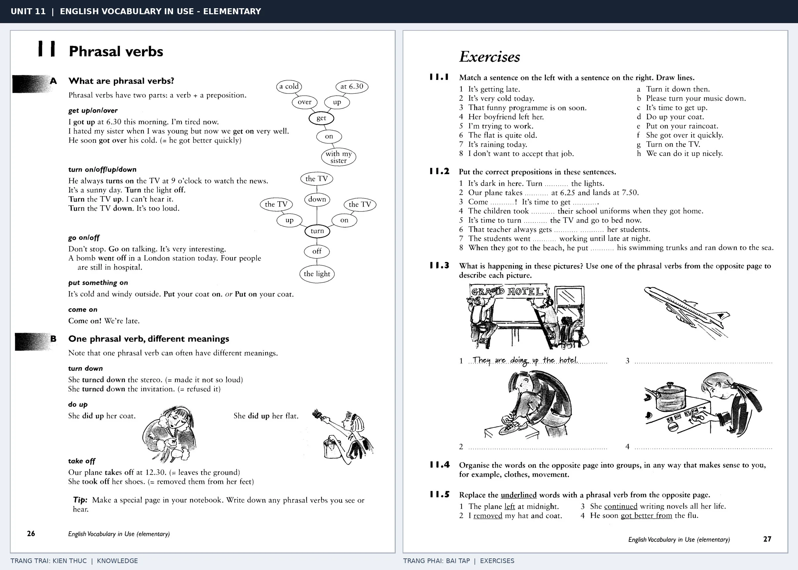

# Unit 11 — Phrasal verbs: Cụm động từ

*Trang trái cung cấp kiến thức và ví dụ; trang phải là phần Exercises của Unit tương ứng. Có thể phóng to ảnh để làm bài tập gốc.*

> **Module 02:** Động từ trong đời sống  
> **Phạm vi:** English Vocabulary in Use — Elementary, Unit 11; trang in 26–27 (PDF trang 29–30).  
> **Hình thức:** Tự học từ vựng A1–A2 · Giảng giải tiếng Việt · Luyện câu và bài tập.

## 1. Tóm tắt và mục tiêu

Phrasal verb là động từ đi cùng tiểu từ, tạo ra nghĩa mới. Cùng một động từ có thể đổi nghĩa rất mạnh khi thay on, off, up hoặc down, vì vậy cần đặt vào câu thực tế.

Sau bài này, bạn có thể:

- Giải thích nghĩa và cách sử dụng những từ, cụm từ cốt lõi của chủ đề **cụm động từ**.
- Chọn đúng cách diễn đạt trong câu tiếng Anh đơn giản thay vì dịch máy móc từng từ.
- Tự đặt ít nhất ba câu thực tế và hoàn thành phần Exercises ở trang sách bên phải.

## 2. Kiến thức và từ vựng cốt lõi

Đọc kỹ từng mục. Với từ nhiều nghĩa, nghĩa ghi trong bảng được giới hạn ở cách dùng cần cho bài học này.

| Từ/cụm từ tiếng Anh | Nghĩa tiếng Việt |
| --- | --- |
| **get up** | thức dậy |
| **get on** | hòa hợp hoặc lên xe |
| **get over** | bình phục hoặc vượt qua |
| **turn on** | bật |
| **turn off** | tắt |
| **turn up** | vặn to |
| **turn down** | vặn nhỏ hoặc từ chối |
| **put on** | mặc vào |
| **take off** | cởi ra hoặc cất cánh |
| **go on** | tiếp tục |
| **go off** | reo chuông hoặc nổ |
| **do up** | cài hoặc buộc |

### 2.1. Ghi nhớ theo nhóm và ngữ cảnh

**Nhóm từ thứ nhất:** get up (thức dậy), get on (hòa hợp hoặc lên xe), get over (bình phục hoặc vượt qua).

**Nhóm từ thứ hai:** turn up (vặn to), turn down (vặn nhỏ hoặc từ chối), put on (mặc vào).

Hãy ghép từ với tình huống sử dụng thực tế. Khi gặp cụm từ có nhiều thành phần, ưu tiên ghi cả cụm kèm một câu ví dụ trong sổ từ vựng.

### 2.2. Mẫu câu song ngữ

**Ví dụ 1.** Please turn down the music.

→ Làm ơn vặn nhỏ nhạc.

**Ví dụ 2.** The plane took off at noon.

→ Máy bay cất cánh lúc giữa trưa.

Đọc từng câu thành tiếng, che phần dịch tiếng Việt và thử nói lại ý bằng lời của mình. Sau đó thay một chi tiết trong câu để tạo ví dụ mới.

## 3. Luyện tập ứng dụng

**Bài A — Nhớ từ trong ngữ cảnh.** Không nhìn bảng, hãy viết tiếng Anh tương ứng với các ý sau:

1. Thức dậy: __________
2. Bật: __________
3. Mặc vào: __________

**Bài B — Dịch và biến đổi câu.** Dịch hai câu dưới đây sang tiếng Anh trước khi nhìn mẫu câu ở trên:

1. Làm ơn vặn nhỏ nhạc.
2. Máy bay cất cánh lúc giữa trưa.

**Bài C — Viết cho bản thân.** Viết ba câu mới về cuộc sống của bạn, mỗi câu sử dụng một từ/cụm từ khác nhau trong bảng. Đọc lại để kiểm tra giới từ, cách chia động từ và trật tự từ.

**Bài D — Thực hành theo sách.** Quan sát phần **Exercises (trang phải)** trong ảnh ghép: giải bài tập trên giấy hoặc một file riêng, sau đó so sánh với các ví dụ ở trang trái. Những bài yêu cầu thông tin cá nhân không nhất thiết có một đáp án cố định.

## 4. Câu hỏi ôn tập trắc nghiệm

*Mỗi câu có một đáp án phù hợp nhất. Hãy tự trả lời trước khi đọc phần giải thích.*

### Câu 1

Bạn muốn diễn đạt **“hòa hợp hoặc lên xe”** bằng tiếng Anh. Chọn cách nói phù hợp nhất.

A. go on

B. turn off

C. put on

D. get on

**Đáp án:** D. **Giải thích:** “get on” diễn đạt “hòa hợp hoặc lên xe” trong chủ đề này.

### Câu 2

Cụm từ **“turn up”** có nghĩa nào trong bài học?

A. tiếp tục

B. vặn to

C. bình phục hoặc vượt qua

D. cởi ra hoặc cất cánh

**Đáp án:** B. **Giải thích:** “turn up” được dùng với nghĩa “vặn to”.

### Câu 3

Khi cần nói **“cởi ra hoặc cất cánh”**, chọn từ/cụm từ nào?

A. get on

B. take off

C. put on

D. turn on

**Đáp án:** B. **Giải thích:** Cách dùng đúng trong bài là “take off”.

### Câu 4

Chọn câu tiếng Anh diễn đạt đúng nhất: **“Làm ơn vặn nhỏ nhạc.”**

A. Please turn down the music.

B. Do you like tennis?

C. We are going to stay at home on Sunday.

D. The train arrived on time.

**Đáp án:** A. **Giải thích:** “Please turn down the music.” là câu tương ứng với tình huống đã nêu.

### Câu 5

Ý nghĩa phù hợp nhất của câu **“The plane took off at noon.”** là gì?

A. Máy bay cất cánh lúc giữa trưa.

B. Trời đang tối dần.

C. Tôi đi làm bằng xe đạp.

D. Tin xấu khiến tôi buồn.

**Đáp án:** A. **Giải thích:** “The plane took off at noon.” có nghĩa là “Máy bay cất cánh lúc giữa trưa.”.

## 5. Tổng kết và kiểm tra hoàn thành

Bài **The plane took off at noon.** giúp bạn sử dụng vốn từ về **máy bay cất cánh lúc giữa trưa.** trong câu tiếng Anh thực tế. Giá trị quan trọng nhất không chỉ là biết nghĩa, mà là nhớ **cách kết hợp từ và ngữ cảnh sử dụng**.

- [ ] Tôi đã học bảng từ/cụm từ và đọc thành tiếng các ví dụ.
- [ ] Tôi đã hoàn thành ba phần luyện tập A, B, C.
- [ ] Tôi đã làm trang Exercises trong ảnh ghép và 5 câu trắc nghiệm.
- [ ] Tôi đã ghi các từ dễ nhầm vào sổ để ôn lại sau 1–3 ngày.

---

[← Unit 10: Các cách dùng đa dạng của get](10-get-got-got.md) · [Unit 12: Các hoạt động hằng ngày →](12-everyday-things.md)

[↑ Trở về mục lục khóa học](../../MUC_LUC.md)
