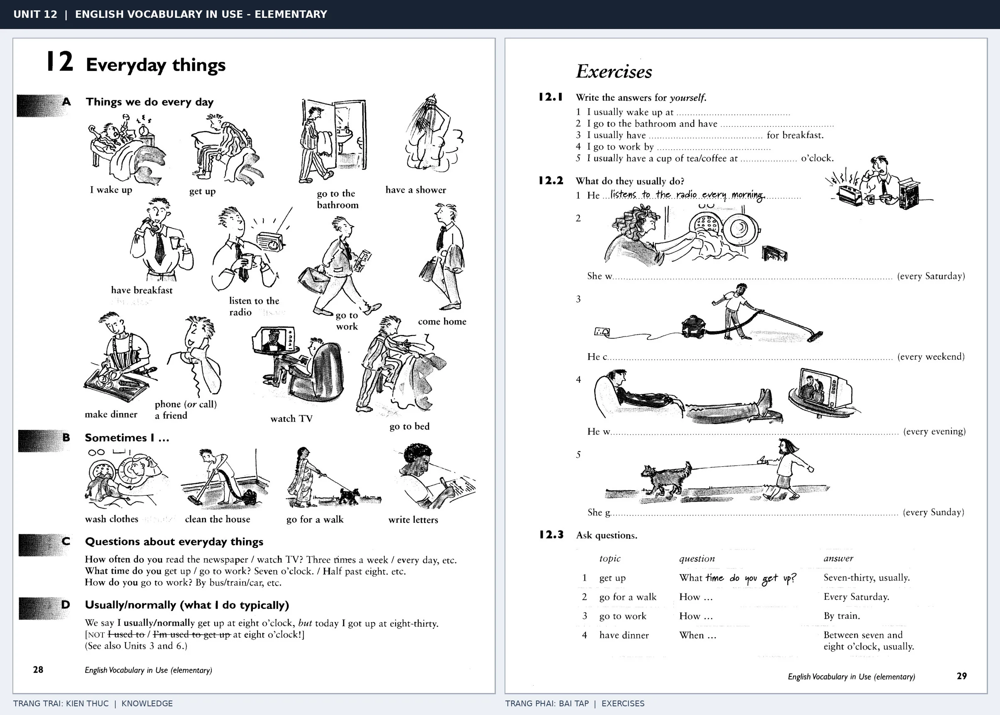

# Unit 12 — Everyday things: Các hoạt động hằng ngày

*Trang trái cung cấp kiến thức và ví dụ; trang phải là phần Exercises của Unit tương ứng. Có thể phóng to ảnh để làm bài tập gốc.*

> **Module 02:** Động từ trong đời sống  
> **Phạm vi:** English Vocabulary in Use — Elementary, Unit 12; trang in 28–29 (PDF trang 31–32).  
> **Hình thức:** Tự học từ vựng A1–A2 · Giảng giải tiếng Việt · Luyện câu và bài tập.

## 1. Tóm tắt và mục tiêu

Diễn đạt thói quen với hiện tại đơn và trạng từ/tần suất như usually, every day. Phân biệt wake up (tỉnh giấc) với get up (thức dậy khỏi giường), và go to bed (lên giường) với sleep (ngủ).

Sau bài này, bạn có thể:

- Giải thích nghĩa và cách sử dụng những từ, cụm từ cốt lõi của chủ đề **các hoạt động hằng ngày**.
- Chọn đúng cách diễn đạt trong câu tiếng Anh đơn giản thay vì dịch máy móc từng từ.
- Tự đặt ít nhất ba câu thực tế và hoàn thành phần Exercises ở trang sách bên phải.

## 2. Kiến thức và từ vựng cốt lõi

Đọc kỹ từng mục. Với từ nhiều nghĩa, nghĩa ghi trong bảng được giới hạn ở cách dùng cần cho bài học này.

| Từ/cụm từ tiếng Anh | Nghĩa tiếng Việt |
| --- | --- |
| **wake up** | tỉnh giấc |
| **get up** | ra khỏi giường |
| **have breakfast** | ăn sáng |
| **have a shower** | tắm vòi sen |
| **go to work** | đi làm |
| **come home** | về nhà |
| **make dinner** | nấu bữa tối |
| **watch TV** | xem tivi |
| **go to bed** | đi ngủ |
| **wash clothes** | giặt quần áo |
| **go for a walk** | đi dạo |
| **listen to the radio** | nghe đài |

### 2.1. Ghi nhớ theo nhóm và ngữ cảnh

**Nhóm từ thứ nhất:** wake up (tỉnh giấc), get up (ra khỏi giường), have breakfast (ăn sáng).

**Nhóm từ thứ hai:** come home (về nhà), make dinner (nấu bữa tối), watch TV (xem tivi).

Hãy ghép từ với tình huống sử dụng thực tế. Khi gặp cụm từ có nhiều thành phần, ưu tiên ghi cả cụm kèm một câu ví dụ trong sổ từ vựng.

### 2.2. Mẫu câu song ngữ

**Ví dụ 1.** I usually get up at seven.

→ Tôi thường dậy lúc bảy giờ.

**Ví dụ 2.** She watches TV every evening.

→ Cô ấy xem tivi mỗi tối.

Đọc từng câu thành tiếng, che phần dịch tiếng Việt và thử nói lại ý bằng lời của mình. Sau đó thay một chi tiết trong câu để tạo ví dụ mới.

## 3. Luyện tập ứng dụng

**Bài A — Nhớ từ trong ngữ cảnh.** Không nhìn bảng, hãy viết tiếng Anh tương ứng với các ý sau:

1. Tỉnh giấc: __________
2. Tắm vòi sen: __________
3. Xem tivi: __________

**Bài B — Dịch và biến đổi câu.** Dịch hai câu dưới đây sang tiếng Anh trước khi nhìn mẫu câu ở trên:

1. Tôi thường dậy lúc bảy giờ.
2. Cô ấy xem tivi mỗi tối.

**Bài C — Viết cho bản thân.** Viết ba câu mới về cuộc sống của bạn, mỗi câu sử dụng một từ/cụm từ khác nhau trong bảng. Đọc lại để kiểm tra giới từ, cách chia động từ và trật tự từ.

**Bài D — Thực hành theo sách.** Quan sát phần **Exercises (trang phải)** trong ảnh ghép: giải bài tập trên giấy hoặc một file riêng, sau đó so sánh với các ví dụ ở trang trái. Những bài yêu cầu thông tin cá nhân không nhất thiết có một đáp án cố định.

## 4. Câu hỏi ôn tập trắc nghiệm

*Mỗi câu có một đáp án phù hợp nhất. Hãy tự trả lời trước khi đọc phần giải thích.*

### Câu 1

Bạn muốn diễn đạt **“ra khỏi giường”** bằng tiếng Anh. Chọn cách nói phù hợp nhất.

A. get up

B. listen to the radio

C. make dinner

D. go for a walk

**Đáp án:** A. **Giải thích:** “get up” diễn đạt “ra khỏi giường” trong chủ đề này.

### Câu 2

Cụm từ **“come home”** có nghĩa nào trong bài học?

A. về nhà

B. xem tivi

C. nấu bữa tối

D. tỉnh giấc

**Đáp án:** A. **Giải thích:** “come home” được dùng với nghĩa “về nhà”.

### Câu 3

Khi cần nói **“đi ngủ”**, chọn từ/cụm từ nào?

A. make dinner

B. go to bed

C. wake up

D. have a shower

**Đáp án:** B. **Giải thích:** Cách dùng đúng trong bài là “go to bed”.

### Câu 4

Chọn câu tiếng Anh diễn đạt đúng nhất: **“Tôi thường dậy lúc bảy giờ.”**

A. She speaks English very well.

B. Can you tell me your name?

C. It is getting dark.

D. I usually get up at seven.

**Đáp án:** D. **Giải thích:** “I usually get up at seven.” là câu tương ứng với tình huống đã nêu.

### Câu 5

Ý nghĩa phù hợp nhất của câu **“She watches TV every evening.”** là gì?

A. Hãy mang đàn ghi-ta đến nhà tôi.

B. Mang theo ô vì trời đang mưa.

C. Chúng tôi ăn trưa lúc mười hai giờ.

D. Cô ấy xem tivi mỗi tối.

**Đáp án:** D. **Giải thích:** “She watches TV every evening.” có nghĩa là “Cô ấy xem tivi mỗi tối.”.

## 5. Tổng kết và kiểm tra hoàn thành

Bài **She watches TV every evening.** giúp bạn sử dụng vốn từ về **cô ấy xem tivi mỗi tối.** trong câu tiếng Anh thực tế. Giá trị quan trọng nhất không chỉ là biết nghĩa, mà là nhớ **cách kết hợp từ và ngữ cảnh sử dụng**.

- [ ] Tôi đã học bảng từ/cụm từ và đọc thành tiếng các ví dụ.
- [ ] Tôi đã hoàn thành ba phần luyện tập A, B, C.
- [ ] Tôi đã làm trang Exercises trong ảnh ghép và 5 câu trắc nghiệm.
- [ ] Tôi đã ghi các từ dễ nhầm vào sổ để ôn lại sau 1–3 ngày.

---

[← Unit 11: Cụm động từ](11-phrasal-verbs.md) · [Unit 13: Say, tell, ask và speak →](13-talking.md)

[↑ Trở về mục lục khóa học](../../MUC_LUC.md)
