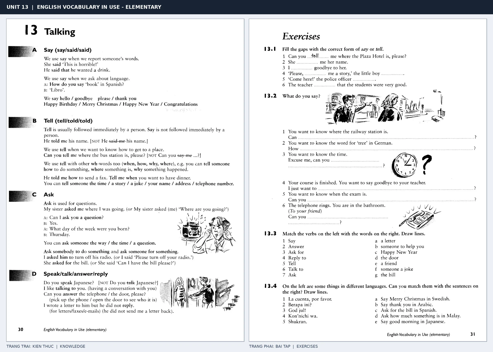

# Unit 13 — Talking: Say, tell, ask và speak

*Trang trái cung cấp kiến thức và ví dụ; trang phải là phần Exercises của Unit tương ứng. Có thể phóng to ảnh để làm bài tập gốc.*

> **Module 02:** Động từ trong đời sống  
> **Phạm vi:** English Vocabulary in Use — Elementary, Unit 13; trang in 30–31 (PDF trang 33–34).  
> **Hình thức:** Tự học từ vựng A1–A2 · Giảng giải tiếng Việt · Luyện câu và bài tập.

## 1. Tóm tắt và mục tiêu

Say tập trung vào lời nói, tell thường có người nghe theo sau (tell me), ask dùng để hỏi và speak/talk dùng với việc nói hoặc trò chuyện. Tránh dùng tell to me thay cho tell me.

Sau bài này, bạn có thể:

- Giải thích nghĩa và cách sử dụng những từ, cụm từ cốt lõi của chủ đề **say, tell, ask và speak**.
- Chọn đúng cách diễn đạt trong câu tiếng Anh đơn giản thay vì dịch máy móc từng từ.
- Tự đặt ít nhất ba câu thực tế và hoàn thành phần Exercises ở trang sách bên phải.

## 2. Kiến thức và từ vựng cốt lõi

Đọc kỹ từng mục. Với từ nhiều nghĩa, nghĩa ghi trong bảng được giới hạn ở cách dùng cần cho bài học này.

| Từ/cụm từ tiếng Anh | Nghĩa tiếng Việt |
| --- | --- |
| **say** | nói hoặc phát biểu |
| **tell** | kể hoặc bảo |
| **ask** | hỏi |
| **answer** | trả lời |
| **speak** | nói ngôn ngữ |
| **talk** | trò chuyện |
| **reply** | phản hồi |
| **tell a story** | kể chuyện |
| **tell a joke** | kể chuyện cười |
| **ask a question** | đặt câu hỏi |
| **speak English** | nói tiếng Anh |
| **talk to someone** | nói chuyện với ai |

### 2.1. Ghi nhớ theo nhóm và ngữ cảnh

**Nhóm từ thứ nhất:** say (nói hoặc phát biểu), tell (kể hoặc bảo), ask (hỏi).

**Nhóm từ thứ hai:** talk (trò chuyện), reply (phản hồi), tell a story (kể chuyện).

Hãy ghép từ với tình huống sử dụng thực tế. Khi gặp cụm từ có nhiều thành phần, ưu tiên ghi cả cụm kèm một câu ví dụ trong sổ từ vựng.

### 2.2. Mẫu câu song ngữ

**Ví dụ 1.** Can you tell me your name?

→ Bạn có thể cho tôi biết tên không?

**Ví dụ 2.** She speaks English very well.

→ Cô ấy nói tiếng Anh rất tốt.

Đọc từng câu thành tiếng, che phần dịch tiếng Việt và thử nói lại ý bằng lời của mình. Sau đó thay một chi tiết trong câu để tạo ví dụ mới.

## 3. Luyện tập ứng dụng

**Bài A — Nhớ từ trong ngữ cảnh.** Không nhìn bảng, hãy viết tiếng Anh tương ứng với các ý sau:

1. Nói hoặc phát biểu: __________
2. Trả lời: __________
3. Kể chuyện: __________

**Bài B — Dịch và biến đổi câu.** Dịch hai câu dưới đây sang tiếng Anh trước khi nhìn mẫu câu ở trên:

1. Bạn có thể cho tôi biết tên không?
2. Cô ấy nói tiếng Anh rất tốt.

**Bài C — Viết cho bản thân.** Viết ba câu mới về cuộc sống của bạn, mỗi câu sử dụng một từ/cụm từ khác nhau trong bảng. Đọc lại để kiểm tra giới từ, cách chia động từ và trật tự từ.

**Bài D — Thực hành theo sách.** Quan sát phần **Exercises (trang phải)** trong ảnh ghép: giải bài tập trên giấy hoặc một file riêng, sau đó so sánh với các ví dụ ở trang trái. Những bài yêu cầu thông tin cá nhân không nhất thiết có một đáp án cố định.

## 4. Câu hỏi ôn tập trắc nghiệm

*Mỗi câu có một đáp án phù hợp nhất. Hãy tự trả lời trước khi đọc phần giải thích.*

### Câu 1

Bạn muốn diễn đạt **“kể hoặc bảo”** bằng tiếng Anh. Chọn cách nói phù hợp nhất.

A. tell

B. talk to someone

C. tell a joke

D. say

**Đáp án:** A. **Giải thích:** “tell” diễn đạt “kể hoặc bảo” trong chủ đề này.

### Câu 2

Cụm từ **“talk”** có nghĩa nào trong bài học?

A. trò chuyện

B. nói ngôn ngữ

C. phản hồi

D. nói chuyện với ai

**Đáp án:** A. **Giải thích:** “talk” được dùng với nghĩa “trò chuyện”.

### Câu 3

Khi cần nói **“kể chuyện cười”**, chọn từ/cụm từ nào?

A. tell a joke

B. ask a question

C. tell a story

D. talk

**Đáp án:** A. **Giải thích:** Cách dùng đúng trong bài là “tell a joke”.

### Câu 4

Chọn câu tiếng Anh diễn đạt đúng nhất: **“Bạn có thể cho tôi biết tên không?”**

A. I do my homework every evening.

B. I go to work by bike.

C. Can you tell me your name?

D. She is making coffee.

**Đáp án:** C. **Giải thích:** “Can you tell me your name?” là câu tương ứng với tình huống đã nêu.

### Câu 5

Ý nghĩa phù hợp nhất của câu **“She speaks English very well.”** là gì?

A. Cô ấy nói tiếng Anh rất tốt.

B. Tin xấu khiến tôi buồn.

C. Chúng tôi đi bộ đến trường.

D. Bạn có thích quần vợt không?

**Đáp án:** A. **Giải thích:** “She speaks English very well.” có nghĩa là “Cô ấy nói tiếng Anh rất tốt.”.

## 5. Tổng kết và kiểm tra hoàn thành

Bài **She speaks English very well.** giúp bạn sử dụng vốn từ về **cô ấy nói tiếng anh rất tốt.** trong câu tiếng Anh thực tế. Giá trị quan trọng nhất không chỉ là biết nghĩa, mà là nhớ **cách kết hợp từ và ngữ cảnh sử dụng**.

- [ ] Tôi đã học bảng từ/cụm từ và đọc thành tiếng các ví dụ.
- [ ] Tôi đã hoàn thành ba phần luyện tập A, B, C.
- [ ] Tôi đã làm trang Exercises trong ảnh ghép và 5 câu trắc nghiệm.
- [ ] Tôi đã ghi các từ dễ nhầm vào sổ để ôn lại sau 1–3 ngày.

---

[← Unit 12: Các hoạt động hằng ngày](12-everyday-things.md) · [Unit 14: Động từ di chuyển và phương tiện →](14-moving.md)

[↑ Trở về mục lục khóa học](../../MUC_LUC.md)
