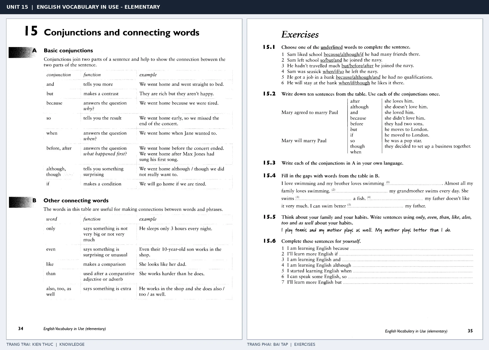

# Unit 15 — Conjunctions and connecting words: Từ nối và liên từ

*Trang trái cung cấp kiến thức và ví dụ; trang phải là phần Exercises của Unit tương ứng. Có thể phóng to ảnh để làm bài tập gốc.*

> **Module 03:** Từ vựng và ngữ pháp  
> **Phạm vi:** English Vocabulary in Use — Elementary, Unit 15; trang in 34–35 (PDF trang 37–38).  
> **Hình thức:** Tự học từ vựng A1–A2 · Giảng giải tiếng Việt · Luyện câu và bài tập.

## 1. Tóm tắt và mục tiêu

Từ nối làm rõ quan hệ giữa hai ý: and thêm thông tin, but/although tương phản, because nêu nguyên nhân, so nói kết quả. Tránh đặt because và so lặp lại không cần thiết trong cùng cấu trúc nguyên nhân–kết quả đơn giản.

Sau bài này, bạn có thể:

- Giải thích nghĩa và cách sử dụng những từ, cụm từ cốt lõi của chủ đề **từ nối và liên từ**.
- Chọn đúng cách diễn đạt trong câu tiếng Anh đơn giản thay vì dịch máy móc từng từ.
- Tự đặt ít nhất ba câu thực tế và hoàn thành phần Exercises ở trang sách bên phải.

## 2. Kiến thức và từ vựng cốt lõi

Đọc kỹ từng mục. Với từ nhiều nghĩa, nghĩa ghi trong bảng được giới hạn ở cách dùng cần cho bài học này.

| Từ/cụm từ tiếng Anh | Nghĩa tiếng Việt |
| --- | --- |
| **and** | và |
| **but** | nhưng |
| **because** | bởi vì |
| **so** | vì vậy |
| **when** | khi |
| **before** | trước khi |
| **after** | sau khi |
| **although** | mặc dù |
| **if** | nếu |
| **only** | chỉ |
| **even** | thậm chí |
| **also** | cũng |
| **too** | cũng |
| **than** | hơn |

### 2.1. Ghi nhớ theo nhóm và ngữ cảnh

**Nhóm từ thứ nhất:** and (và), but (nhưng), because (bởi vì).

**Nhóm từ thứ hai:** before (trước khi), after (sau khi), although (mặc dù).

Hãy ghép từ với tình huống sử dụng thực tế. Khi gặp cụm từ có nhiều thành phần, ưu tiên ghi cả cụm kèm một câu ví dụ trong sổ từ vựng.

### 2.2. Mẫu câu song ngữ

**Ví dụ 1.** We stayed home because it was raining.

→ Chúng tôi ở nhà vì trời mưa.

**Ví dụ 2.** She was tired but she kept working.

→ Cô ấy mệt nhưng vẫn tiếp tục làm việc.

Đọc từng câu thành tiếng, che phần dịch tiếng Việt và thử nói lại ý bằng lời của mình. Sau đó thay một chi tiết trong câu để tạo ví dụ mới.

## 3. Luyện tập ứng dụng

**Bài A — Nhớ từ trong ngữ cảnh.** Không nhìn bảng, hãy viết tiếng Anh tương ứng với các ý sau:

1. Và: __________
2. Vì vậy: __________
3. Mặc dù: __________

**Bài B — Dịch và biến đổi câu.** Dịch hai câu dưới đây sang tiếng Anh trước khi nhìn mẫu câu ở trên:

1. Chúng tôi ở nhà vì trời mưa.
2. Cô ấy mệt nhưng vẫn tiếp tục làm việc.

**Bài C — Viết cho bản thân.** Viết ba câu mới về cuộc sống của bạn, mỗi câu sử dụng một từ/cụm từ khác nhau trong bảng. Đọc lại để kiểm tra giới từ, cách chia động từ và trật tự từ.

**Bài D — Thực hành theo sách.** Quan sát phần **Exercises (trang phải)** trong ảnh ghép: giải bài tập trên giấy hoặc một file riêng, sau đó so sánh với các ví dụ ở trang trái. Những bài yêu cầu thông tin cá nhân không nhất thiết có một đáp án cố định.

## 4. Câu hỏi ôn tập trắc nghiệm

*Mỗi câu có một đáp án phù hợp nhất. Hãy tự trả lời trước khi đọc phần giải thích.*

### Câu 1

Bạn muốn diễn đạt **“nhưng”** bằng tiếng Anh. Chọn cách nói phù hợp nhất.

A. than

B. after

C. also

D. but

**Đáp án:** D. **Giải thích:** “but” diễn đạt “nhưng” trong chủ đề này.

### Câu 2

Cụm từ **“before”** có nghĩa nào trong bài học?

A. chỉ

B. sau khi

C. nếu

D. trước khi

**Đáp án:** D. **Giải thích:** “before” được dùng với nghĩa “trước khi”.

### Câu 3

Khi cần nói **“nếu”**, chọn từ/cụm từ nào?

A. if

B. after

C. because

D. although

**Đáp án:** A. **Giải thích:** Cách dùng đúng trong bài là “if”.

### Câu 4

Chọn câu tiếng Anh diễn đạt đúng nhất: **“Chúng tôi ở nhà vì trời mưa.”**

A. We stayed home because it was raining.

B. There are books everywhere in my room.

C. He often walks to work.

D. The cinema is on the left.

**Đáp án:** A. **Giải thích:** “We stayed home because it was raining.” là câu tương ứng với tình huống đã nêu.

### Câu 5

Ý nghĩa phù hợp nhất của câu **“She was tired but she kept working.”** là gì?

A. Cô ấy mệt nhưng vẫn tiếp tục làm việc.

B. Cô ấy giỏi toán.

C. Tôi gặp cô ấy hai ngày trước.

D. Cô ấy là một giáo viên tử tế.

**Đáp án:** A. **Giải thích:** “She was tired but she kept working.” có nghĩa là “Cô ấy mệt nhưng vẫn tiếp tục làm việc.”.

## 5. Tổng kết và kiểm tra hoàn thành

Bài **She was tired but she kept working.** giúp bạn sử dụng vốn từ về **cô ấy mệt nhưng vẫn tiếp tục làm việc.** trong câu tiếng Anh thực tế. Giá trị quan trọng nhất không chỉ là biết nghĩa, mà là nhớ **cách kết hợp từ và ngữ cảnh sử dụng**.

- [ ] Tôi đã học bảng từ/cụm từ và đọc thành tiếng các ví dụ.
- [ ] Tôi đã hoàn thành ba phần luyện tập A, B, C.
- [ ] Tôi đã làm trang Exercises trong ảnh ghép và 5 câu trắc nghiệm.
- [ ] Tôi đã ghi các từ dễ nhầm vào sổ để ôn lại sau 1–3 ngày.

---

[← Unit 14: Động từ di chuyển và phương tiện](../02-everyday-verbs/14-moving.md) · [Unit 16: Ngày, tháng và mùa →](16-time-words-1-days-months-and-seasons.md)

[↑ Trở về mục lục khóa học](../../MUC_LUC.md)
