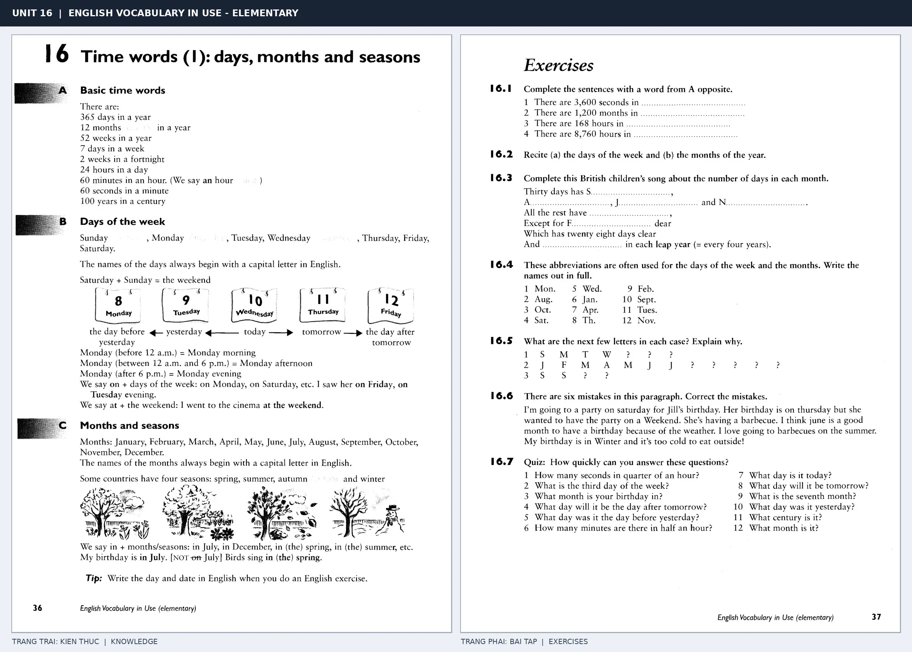

# Unit 16 — Time words (1): days, months and seasons: Ngày, tháng và mùa

*Trang trái cung cấp kiến thức và ví dụ; trang phải là phần Exercises của Unit tương ứng. Có thể phóng to ảnh để làm bài tập gốc.*

> **Module 03:** Từ vựng và ngữ pháp  
> **Phạm vi:** English Vocabulary in Use — Elementary, Unit 16; trang in 36–37 (PDF trang 39–40).  
> **Hình thức:** Tự học từ vựng A1–A2 · Giảng giải tiếng Việt · Luyện câu và bài tập.

## 1. Tóm tắt và mục tiêu

Ngày và tháng luôn viết hoa trong tiếng Anh, tên mùa thường không cần viết hoa. Dùng on với ngày cụ thể và in với tháng/mùa; sách còn giới thiệu các đơn vị thời gian từ second đến century.

Sau bài này, bạn có thể:

- Giải thích nghĩa và cách sử dụng những từ, cụm từ cốt lõi của chủ đề **ngày, tháng và mùa**.
- Chọn đúng cách diễn đạt trong câu tiếng Anh đơn giản thay vì dịch máy móc từng từ.
- Tự đặt ít nhất ba câu thực tế và hoàn thành phần Exercises ở trang sách bên phải.

## 2. Kiến thức và từ vựng cốt lõi

Đọc kỹ từng mục. Với từ nhiều nghĩa, nghĩa ghi trong bảng được giới hạn ở cách dùng cần cho bài học này.

| Từ/cụm từ tiếng Anh | Nghĩa tiếng Việt |
| --- | --- |
| **Monday** | thứ Hai |
| **Tuesday** | thứ Ba |
| **Wednesday** | thứ Tư |
| **Thursday** | thứ Năm |
| **Friday** | thứ Sáu |
| **Saturday** | thứ Bảy |
| **Sunday** | Chủ nhật |
| **January** | tháng Một |
| **February** | tháng Hai |
| **December** | tháng Mười Hai |
| **spring** | mùa xuân |
| **summer** | mùa hè |
| **autumn** | mùa thu |
| **winter** | mùa đông |

### 2.1. Ghi nhớ theo nhóm và ngữ cảnh

**Nhóm từ thứ nhất:** Monday (thứ Hai), Tuesday (thứ Ba), Wednesday (thứ Tư).

**Nhóm từ thứ hai:** Saturday (thứ Bảy), Sunday (Chủ nhật), January (tháng Một).

Hãy ghép từ với tình huống sử dụng thực tế. Khi gặp cụm từ có nhiều thành phần, ưu tiên ghi cả cụm kèm một câu ví dụ trong sổ từ vựng.

### 2.2. Mẫu câu song ngữ

**Ví dụ 1.** My birthday is in July.

→ Sinh nhật tôi vào tháng Bảy.

**Ví dụ 2.** We have English on Monday.

→ Chúng tôi có giờ tiếng Anh vào thứ Hai.

Đọc từng câu thành tiếng, che phần dịch tiếng Việt và thử nói lại ý bằng lời của mình. Sau đó thay một chi tiết trong câu để tạo ví dụ mới.

## 3. Luyện tập ứng dụng

**Bài A — Nhớ từ trong ngữ cảnh.** Không nhìn bảng, hãy viết tiếng Anh tương ứng với các ý sau:

1. Thứ hai: __________
2. Thứ năm: __________
3. Tháng một: __________

**Bài B — Dịch và biến đổi câu.** Dịch hai câu dưới đây sang tiếng Anh trước khi nhìn mẫu câu ở trên:

1. Sinh nhật tôi vào tháng Bảy.
2. Chúng tôi có giờ tiếng Anh vào thứ Hai.

**Bài C — Viết cho bản thân.** Viết ba câu mới về cuộc sống của bạn, mỗi câu sử dụng một từ/cụm từ khác nhau trong bảng. Đọc lại để kiểm tra giới từ, cách chia động từ và trật tự từ.

**Bài D — Thực hành theo sách.** Quan sát phần **Exercises (trang phải)** trong ảnh ghép: giải bài tập trên giấy hoặc một file riêng, sau đó so sánh với các ví dụ ở trang trái. Những bài yêu cầu thông tin cá nhân không nhất thiết có một đáp án cố định.

## 4. Câu hỏi ôn tập trắc nghiệm

*Mỗi câu có một đáp án phù hợp nhất. Hãy tự trả lời trước khi đọc phần giải thích.*

### Câu 1

Bạn muốn diễn đạt **“thứ Ba”** bằng tiếng Anh. Chọn cách nói phù hợp nhất.

A. Tuesday

B. summer

C. Sunday

D. Saturday

**Đáp án:** A. **Giải thích:** “Tuesday” diễn đạt “thứ Ba” trong chủ đề này.

### Câu 2

Cụm từ **“Saturday”** có nghĩa nào trong bài học?

A. Chủ nhật

B. thứ Bảy

C. thứ Tư

D. thứ Sáu

**Đáp án:** B. **Giải thích:** “Saturday” được dùng với nghĩa “thứ Bảy”.

### Câu 3

Khi cần nói **“tháng Hai”**, chọn từ/cụm từ nào?

A. Wednesday

B. February

C. autumn

D. January

**Đáp án:** B. **Giải thích:** Cách dùng đúng trong bài là “February”.

### Câu 4

Chọn câu tiếng Anh diễn đạt đúng nhất: **“Sinh nhật tôi vào tháng Bảy.”**

A. She is a kind teacher.

B. My birthday is in July.

C. The weather was terrible yesterday.

D. I have written the letter.

**Đáp án:** B. **Giải thích:** “My birthday is in July.” là câu tương ứng với tình huống đã nêu.

### Câu 5

Ý nghĩa phù hợp nhất của câu **“We have English on Monday.”** là gì?

A. Chúng tôi có giờ tiếng Anh vào thứ Hai.

B. Có sách khắp phòng tôi.

C. Câu trả lời không đúng.

D. Cuốn từ điển này hữu ích.

**Đáp án:** A. **Giải thích:** “We have English on Monday.” có nghĩa là “Chúng tôi có giờ tiếng Anh vào thứ Hai.”.

## 5. Tổng kết và kiểm tra hoàn thành

Bài **We have English on Monday.** giúp bạn sử dụng vốn từ về **chúng tôi có giờ tiếng anh vào thứ hai.** trong câu tiếng Anh thực tế. Giá trị quan trọng nhất không chỉ là biết nghĩa, mà là nhớ **cách kết hợp từ và ngữ cảnh sử dụng**.

- [ ] Tôi đã học bảng từ/cụm từ và đọc thành tiếng các ví dụ.
- [ ] Tôi đã hoàn thành ba phần luyện tập A, B, C.
- [ ] Tôi đã làm trang Exercises trong ảnh ghép và 5 câu trắc nghiệm.
- [ ] Tôi đã ghi các từ dễ nhầm vào sổ để ôn lại sau 1–3 ngày.

---

[← Unit 15: Từ nối và liên từ](15-conjunctions-and-connecting-words.md) · [Unit 17: Mốc thời gian và tần suất →](17-time-words-2.md)

[↑ Trở về mục lục khóa học](../../MUC_LUC.md)
