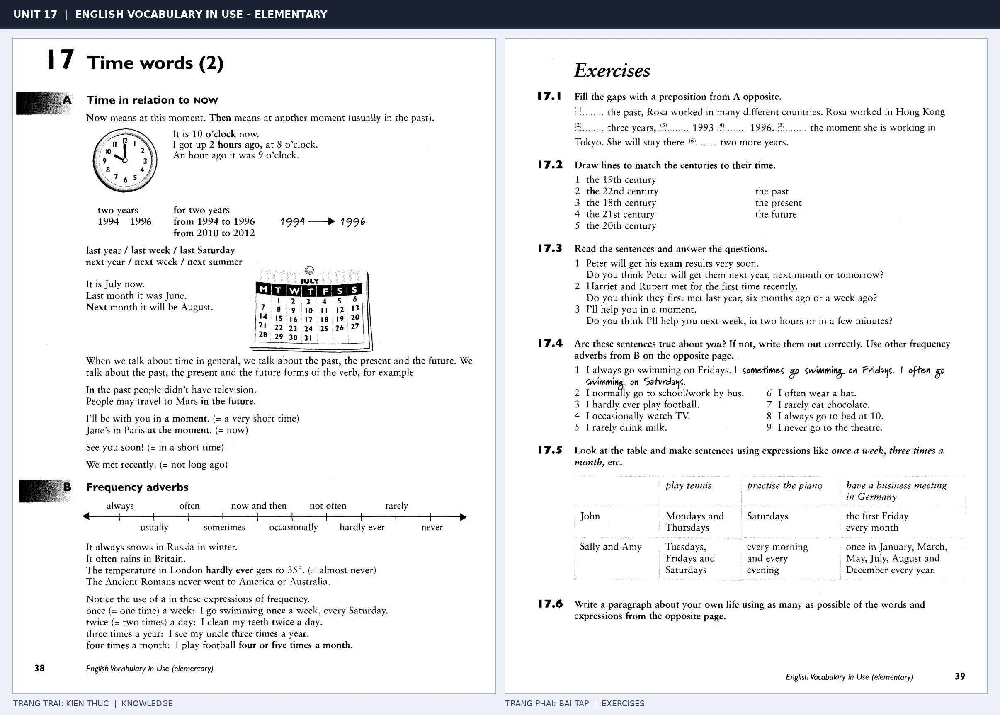

# Unit 17 — Time words (2): Mốc thời gian và tần suất

*Trang trái cung cấp kiến thức và ví dụ; trang phải là phần Exercises của Unit tương ứng. Có thể phóng to ảnh để làm bài tập gốc.*

> **Module 03:** Từ vựng và ngữ pháp  
> **Phạm vi:** English Vocabulary in Use — Elementary, Unit 17; trang in 38–39 (PDF trang 41–42).  
> **Hình thức:** Tự học từ vựng A1–A2 · Giảng giải tiếng Việt · Luyện câu và bài tập.

## 1. Tóm tắt và mục tiêu

Phân biệt now, then, ago và các mốc quá khứ/tương lai. Trạng từ tần suất có trục từ always đến never; vị trí trong câu thường trước động từ thường nhưng sau động từ be.

Sau bài này, bạn có thể:

- Giải thích nghĩa và cách sử dụng những từ, cụm từ cốt lõi của chủ đề **mốc thời gian và tần suất**.
- Chọn đúng cách diễn đạt trong câu tiếng Anh đơn giản thay vì dịch máy móc từng từ.
- Tự đặt ít nhất ba câu thực tế và hoàn thành phần Exercises ở trang sách bên phải.

## 2. Kiến thức và từ vựng cốt lõi

Đọc kỹ từng mục. Với từ nhiều nghĩa, nghĩa ghi trong bảng được giới hạn ở cách dùng cần cho bài học này.

| Từ/cụm từ tiếng Anh | Nghĩa tiếng Việt |
| --- | --- |
| **now** | bây giờ |
| **then** | khi đó |
| **ago** | trước đây |
| **last week** | tuần trước |
| **next year** | năm sau |
| **soon** | sớm |
| **recently** | gần đây |
| **always** | luôn luôn |
| **often** | thường xuyên |
| **sometimes** | đôi khi |
| **rarely** | hiếm khi |
| **never** | không bao giờ |

### 2.1. Ghi nhớ theo nhóm và ngữ cảnh

**Nhóm từ thứ nhất:** now (bây giờ), then (khi đó), ago (trước đây).

**Nhóm từ thứ hai:** soon (sớm), recently (gần đây), always (luôn luôn).

Hãy ghép từ với tình huống sử dụng thực tế. Khi gặp cụm từ có nhiều thành phần, ưu tiên ghi cả cụm kèm một câu ví dụ trong sổ từ vựng.

### 2.2. Mẫu câu song ngữ

**Ví dụ 1.** I met her two days ago.

→ Tôi gặp cô ấy hai ngày trước.

**Ví dụ 2.** He often walks to work.

→ Anh ấy thường đi bộ đến chỗ làm.

Đọc từng câu thành tiếng, che phần dịch tiếng Việt và thử nói lại ý bằng lời của mình. Sau đó thay một chi tiết trong câu để tạo ví dụ mới.

## 3. Luyện tập ứng dụng

**Bài A — Nhớ từ trong ngữ cảnh.** Không nhìn bảng, hãy viết tiếng Anh tương ứng với các ý sau:

1. Bây giờ: __________
2. Tuần trước: __________
3. Luôn luôn: __________

**Bài B — Dịch và biến đổi câu.** Dịch hai câu dưới đây sang tiếng Anh trước khi nhìn mẫu câu ở trên:

1. Tôi gặp cô ấy hai ngày trước.
2. Anh ấy thường đi bộ đến chỗ làm.

**Bài C — Viết cho bản thân.** Viết ba câu mới về cuộc sống của bạn, mỗi câu sử dụng một từ/cụm từ khác nhau trong bảng. Đọc lại để kiểm tra giới từ, cách chia động từ và trật tự từ.

**Bài D — Thực hành theo sách.** Quan sát phần **Exercises (trang phải)** trong ảnh ghép: giải bài tập trên giấy hoặc một file riêng, sau đó so sánh với các ví dụ ở trang trái. Những bài yêu cầu thông tin cá nhân không nhất thiết có một đáp án cố định.

## 4. Câu hỏi ôn tập trắc nghiệm

*Mỗi câu có một đáp án phù hợp nhất. Hãy tự trả lời trước khi đọc phần giải thích.*

### Câu 1

Bạn muốn diễn đạt **“khi đó”** bằng tiếng Anh. Chọn cách nói phù hợp nhất.

A. next year

B. always

C. often

D. then

**Đáp án:** D. **Giải thích:** “then” diễn đạt “khi đó” trong chủ đề này.

### Câu 2

Cụm từ **“soon”** có nghĩa nào trong bài học?

A. không bao giờ

B. hiếm khi

C. gần đây

D. sớm

**Đáp án:** D. **Giải thích:** “soon” được dùng với nghĩa “sớm”.

### Câu 3

Khi cần nói **“thường xuyên”**, chọn từ/cụm từ nào?

A. often

B. rarely

C. next year

D. now

**Đáp án:** A. **Giải thích:** Cách dùng đúng trong bài là “often”.

### Câu 4

Chọn câu tiếng Anh diễn đạt đúng nhất: **“Tôi gặp cô ấy hai ngày trước.”**

A. I met her two days ago.

B. I'm waiting for the bus.

C. We have English on Monday.

D. The answer is incorrect.

**Đáp án:** A. **Giải thích:** “I met her two days ago.” là câu tương ứng với tình huống đã nêu.

### Câu 5

Ý nghĩa phù hợp nhất của câu **“He often walks to work.”** là gì?

A. Cuốn từ điển này hữu ích.

B. Cô ấy giỏi toán.

C. Tôi đã viết xong lá thư.

D. Anh ấy thường đi bộ đến chỗ làm.

**Đáp án:** D. **Giải thích:** “He often walks to work.” có nghĩa là “Anh ấy thường đi bộ đến chỗ làm.”.

## 5. Tổng kết và kiểm tra hoàn thành

Bài **He often walks to work.** giúp bạn sử dụng vốn từ về **anh ấy thường đi bộ đến chỗ làm.** trong câu tiếng Anh thực tế. Giá trị quan trọng nhất không chỉ là biết nghĩa, mà là nhớ **cách kết hợp từ và ngữ cảnh sử dụng**.

- [ ] Tôi đã học bảng từ/cụm từ và đọc thành tiếng các ví dụ.
- [ ] Tôi đã hoàn thành ba phần luyện tập A, B, C.
- [ ] Tôi đã làm trang Exercises trong ảnh ghép và 5 câu trắc nghiệm.
- [ ] Tôi đã ghi các từ dễ nhầm vào sổ để ôn lại sau 1–3 ngày.

---

[← Unit 16: Ngày, tháng và mùa](16-time-words-1-days-months-and-seasons.md) · [Unit 18: Vị trí và phương hướng →](18-places.md)

[↑ Trở về mục lục khóa học](../../MUC_LUC.md)
