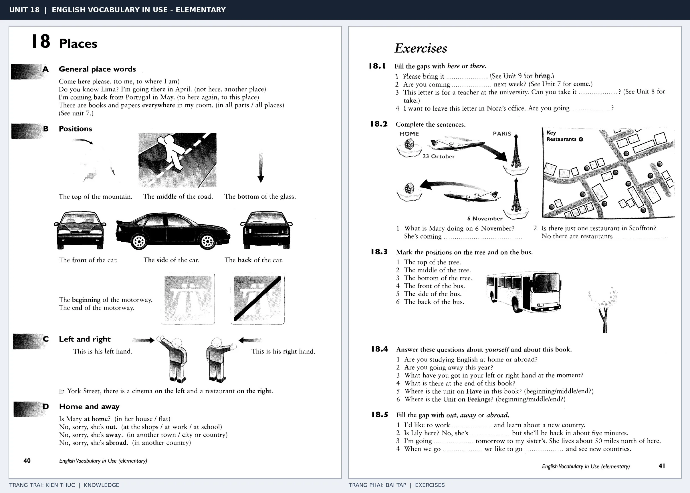

# Unit 18 — Places: Vị trí và phương hướng

*Trang trái cung cấp kiến thức và ví dụ; trang phải là phần Exercises của Unit tương ứng. Có thể phóng to ảnh để làm bài tập gốc.*

> **Module 03:** Từ vựng và ngữ pháp  
> **Phạm vi:** English Vocabulary in Use — Elementary, Unit 18; trang in 40–41 (PDF trang 43–44).  
> **Hình thức:** Tự học từ vựng A1–A2 · Giảng giải tiếng Việt · Luyện câu và bài tập.

## 1. Tóm tắt và mục tiêu

Từ chỉ nơi chốn giúp định vị vật thể. Cần phân biệt left/right, front/back, top/bottom và các trạng từ here/there/away tùy góc nhìn của người nói.

Sau bài này, bạn có thể:

- Giải thích nghĩa và cách sử dụng những từ, cụm từ cốt lõi của chủ đề **vị trí và phương hướng**.
- Chọn đúng cách diễn đạt trong câu tiếng Anh đơn giản thay vì dịch máy móc từng từ.
- Tự đặt ít nhất ba câu thực tế và hoàn thành phần Exercises ở trang sách bên phải.

## 2. Kiến thức và từ vựng cốt lõi

Đọc kỹ từng mục. Với từ nhiều nghĩa, nghĩa ghi trong bảng được giới hạn ở cách dùng cần cho bài học này.

| Từ/cụm từ tiếng Anh | Nghĩa tiếng Việt |
| --- | --- |
| **here** | ở đây |
| **there** | ở đó |
| **everywhere** | khắp nơi |
| **nowhere** | không đâu cả |
| **top** | đỉnh hoặc phía trên |
| **middle** | ở giữa |
| **bottom** | đáy hoặc phía dưới |
| **front** | phía trước |
| **back** | phía sau |
| **side** | bên cạnh hoặc mặt bên |
| **left** | bên trái |
| **right** | bên phải |
| **away** | đi xa |

### 2.1. Ghi nhớ theo nhóm và ngữ cảnh

**Nhóm từ thứ nhất:** here (ở đây), there (ở đó), everywhere (khắp nơi).

**Nhóm từ thứ hai:** middle (ở giữa), bottom (đáy hoặc phía dưới), front (phía trước).

Hãy ghép từ với tình huống sử dụng thực tế. Khi gặp cụm từ có nhiều thành phần, ưu tiên ghi cả cụm kèm một câu ví dụ trong sổ từ vựng.

### 2.2. Mẫu câu song ngữ

**Ví dụ 1.** The cinema is on the left.

→ Rạp phim nằm bên trái.

**Ví dụ 2.** There are books everywhere in my room.

→ Có sách khắp phòng tôi.

Đọc từng câu thành tiếng, che phần dịch tiếng Việt và thử nói lại ý bằng lời của mình. Sau đó thay một chi tiết trong câu để tạo ví dụ mới.

## 3. Luyện tập ứng dụng

**Bài A — Nhớ từ trong ngữ cảnh.** Không nhìn bảng, hãy viết tiếng Anh tương ứng với các ý sau:

1. Ở đây: __________
2. Không đâu cả: __________
3. Phía trước: __________

**Bài B — Dịch và biến đổi câu.** Dịch hai câu dưới đây sang tiếng Anh trước khi nhìn mẫu câu ở trên:

1. Rạp phim nằm bên trái.
2. Có sách khắp phòng tôi.

**Bài C — Viết cho bản thân.** Viết ba câu mới về cuộc sống của bạn, mỗi câu sử dụng một từ/cụm từ khác nhau trong bảng. Đọc lại để kiểm tra giới từ, cách chia động từ và trật tự từ.

**Bài D — Thực hành theo sách.** Quan sát phần **Exercises (trang phải)** trong ảnh ghép: giải bài tập trên giấy hoặc một file riêng, sau đó so sánh với các ví dụ ở trang trái. Những bài yêu cầu thông tin cá nhân không nhất thiết có một đáp án cố định.

## 4. Câu hỏi ôn tập trắc nghiệm

*Mỗi câu có một đáp án phù hợp nhất. Hãy tự trả lời trước khi đọc phần giải thích.*

### Câu 1

Bạn muốn diễn đạt **“ở đó”** bằng tiếng Anh. Chọn cách nói phù hợp nhất.

A. there

B. nowhere

C. back

D. right

**Đáp án:** A. **Giải thích:** “there” diễn đạt “ở đó” trong chủ đề này.

### Câu 2

Cụm từ **“middle”** có nghĩa nào trong bài học?

A. bên phải

B. bên cạnh hoặc mặt bên

C. ở giữa

D. phía sau

**Đáp án:** C. **Giải thích:** “middle” được dùng với nghĩa “ở giữa”.

### Câu 3

Khi cần nói **“phía sau”**, chọn từ/cụm từ nào?

A. top

B. right

C. back

D. here

**Đáp án:** C. **Giải thích:** Cách dùng đúng trong bài là “back”.

### Câu 4

Chọn câu tiếng Anh diễn đạt đúng nhất: **“Rạp phim nằm bên trái.”**

A. The answer is incorrect.

B. This ticket is half-price.

C. I met her two days ago.

D. The cinema is on the left.

**Đáp án:** D. **Giải thích:** “The cinema is on the left.” là câu tương ứng với tình huống đã nêu.

### Câu 5

Ý nghĩa phù hợp nhất của câu **“There are books everywhere in my room.”** là gì?

A. Cô ấy giỏi toán.

B. Có sách khắp phòng tôi.

C. Sinh nhật tôi vào tháng Bảy.

D. Cô ấy là một giáo viên tử tế.

**Đáp án:** B. **Giải thích:** “There are books everywhere in my room.” có nghĩa là “Có sách khắp phòng tôi.”.

## 5. Tổng kết và kiểm tra hoàn thành

Bài **There are books everywhere in my room.** giúp bạn sử dụng vốn từ về **có sách khắp phòng tôi.** trong câu tiếng Anh thực tế. Giá trị quan trọng nhất không chỉ là biết nghĩa, mà là nhớ **cách kết hợp từ và ngữ cảnh sử dụng**.

- [ ] Tôi đã học bảng từ/cụm từ và đọc thành tiếng các ví dụ.
- [ ] Tôi đã hoàn thành ba phần luyện tập A, B, C.
- [ ] Tôi đã làm trang Exercises trong ảnh ghép và 5 câu trắc nghiệm.
- [ ] Tôi đã ghi các từ dễ nhầm vào sổ để ôn lại sau 1–3 ngày.

---

[← Unit 17: Mốc thời gian và tần suất](17-time-words-2.md) · [Unit 19: Cách thức thực hiện hành động →](19-manner.md)

[↑ Trở về mục lục khóa học](../../MUC_LUC.md)
