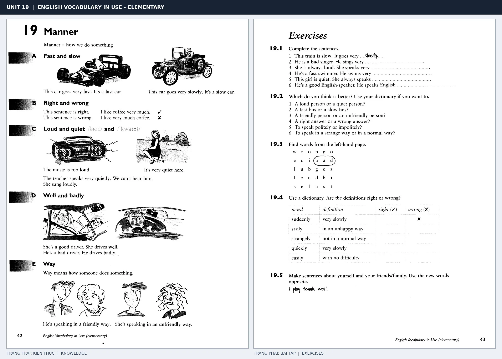

# Unit 19 — Manner: Cách thức thực hiện hành động

*Trang trái cung cấp kiến thức và ví dụ; trang phải là phần Exercises của Unit tương ứng. Có thể phóng to ảnh để làm bài tập gốc.*

> **Module 03:** Từ vựng và ngữ pháp  
> **Phạm vi:** English Vocabulary in Use — Elementary, Unit 19; trang in 42–43 (PDF trang 45–46).  
> **Hình thức:** Tự học từ vựng A1–A2 · Giảng giải tiếng Việt · Luyện câu và bài tập.

## 1. Tóm tắt và mục tiêu

Tính từ mô tả danh từ, còn nhiều trạng từ mô tả cách hành động diễn ra. Ví dụ good driver nhưng drives well; fast có thể dùng như tính từ và trạng từ trong nhiều trường hợp.

Sau bài này, bạn có thể:

- Giải thích nghĩa và cách sử dụng những từ, cụm từ cốt lõi của chủ đề **cách thức thực hiện hành động**.
- Chọn đúng cách diễn đạt trong câu tiếng Anh đơn giản thay vì dịch máy móc từng từ.
- Tự đặt ít nhất ba câu thực tế và hoàn thành phần Exercises ở trang sách bên phải.

## 2. Kiến thức và từ vựng cốt lõi

Đọc kỹ từng mục. Với từ nhiều nghĩa, nghĩa ghi trong bảng được giới hạn ở cách dùng cần cho bài học này.

| Từ/cụm từ tiếng Anh | Nghĩa tiếng Việt |
| --- | --- |
| **fast** | nhanh |
| **slowly** | chậm rãi |
| **quickly** | mau lẹ |
| **well** | tốt |
| **badly** | tồi |
| **right** | đúng |
| **wrong** | sai |
| **loudly** | to tiếng |
| **quietly** | nhỏ nhẹ |
| **carefully** | cẩn thận |
| **easily** | dễ dàng |
| **in a friendly way** | một cách thân thiện |

### 2.1. Ghi nhớ theo nhóm và ngữ cảnh

**Nhóm từ thứ nhất:** fast (nhanh), slowly (chậm rãi), quickly (mau lẹ).

**Nhóm từ thứ hai:** right (đúng), wrong (sai), loudly (to tiếng).

Hãy ghép từ với tình huống sử dụng thực tế. Khi gặp cụm từ có nhiều thành phần, ưu tiên ghi cả cụm kèm một câu ví dụ trong sổ từ vựng.

### 2.2. Mẫu câu song ngữ

**Ví dụ 1.** She drives carefully.

→ Cô ấy lái xe cẩn thận.

**Ví dụ 2.** He speaks English well.

→ Anh ấy nói tiếng Anh tốt.

Đọc từng câu thành tiếng, che phần dịch tiếng Việt và thử nói lại ý bằng lời của mình. Sau đó thay một chi tiết trong câu để tạo ví dụ mới.

## 3. Luyện tập ứng dụng

**Bài A — Nhớ từ trong ngữ cảnh.** Không nhìn bảng, hãy viết tiếng Anh tương ứng với các ý sau:

1. Nhanh: __________
2. Tốt: __________
3. To tiếng: __________

**Bài B — Dịch và biến đổi câu.** Dịch hai câu dưới đây sang tiếng Anh trước khi nhìn mẫu câu ở trên:

1. Cô ấy lái xe cẩn thận.
2. Anh ấy nói tiếng Anh tốt.

**Bài C — Viết cho bản thân.** Viết ba câu mới về cuộc sống của bạn, mỗi câu sử dụng một từ/cụm từ khác nhau trong bảng. Đọc lại để kiểm tra giới từ, cách chia động từ và trật tự từ.

**Bài D — Thực hành theo sách.** Quan sát phần **Exercises (trang phải)** trong ảnh ghép: giải bài tập trên giấy hoặc một file riêng, sau đó so sánh với các ví dụ ở trang trái. Những bài yêu cầu thông tin cá nhân không nhất thiết có một đáp án cố định.

## 4. Câu hỏi ôn tập trắc nghiệm

*Mỗi câu có một đáp án phù hợp nhất. Hãy tự trả lời trước khi đọc phần giải thích.*

### Câu 1

Bạn muốn diễn đạt **“chậm rãi”** bằng tiếng Anh. Chọn cách nói phù hợp nhất.

A. right

B. wrong

C. slowly

D. badly

**Đáp án:** C. **Giải thích:** “slowly” diễn đạt “chậm rãi” trong chủ đề này.

### Câu 2

Cụm từ **“right”** có nghĩa nào trong bài học?

A. đúng

B. sai

C. nhỏ nhẹ

D. tốt

**Đáp án:** A. **Giải thích:** “right” được dùng với nghĩa “đúng”.

### Câu 3

Khi cần nói **“nhỏ nhẹ”**, chọn từ/cụm từ nào?

A. easily

B. quietly

C. right

D. carefully

**Đáp án:** B. **Giải thích:** Cách dùng đúng trong bài là “quietly”.

### Câu 4

Chọn câu tiếng Anh diễn đạt đúng nhất: **“Cô ấy lái xe cẩn thận.”**

A. The cinema is on the left.

B. This restaurant is better than that one.

C. He often walks to work.

D. She drives carefully.

**Đáp án:** D. **Giải thích:** “She drives carefully.” là câu tương ứng với tình huống đã nêu.

### Câu 5

Ý nghĩa phù hợp nhất của câu **“He speaks English well.”** là gì?

A. Anh ấy nói tiếng Anh tốt.

B. Cô ấy là một giáo viên tử tế.

C. Hàng xóm của tôi rất thân thiện.

D. Anh ấy đi nhanh.

**Đáp án:** A. **Giải thích:** “He speaks English well.” có nghĩa là “Anh ấy nói tiếng Anh tốt.”.

## 5. Tổng kết và kiểm tra hoàn thành

Bài **He speaks English well.** giúp bạn sử dụng vốn từ về **anh ấy nói tiếng anh tốt.** trong câu tiếng Anh thực tế. Giá trị quan trọng nhất không chỉ là biết nghĩa, mà là nhớ **cách kết hợp từ và ngữ cảnh sử dụng**.

- [ ] Tôi đã học bảng từ/cụm từ và đọc thành tiếng các ví dụ.
- [ ] Tôi đã hoàn thành ba phần luyện tập A, B, C.
- [ ] Tôi đã làm trang Exercises trong ảnh ghép và 5 câu trắc nghiệm.
- [ ] Tôi đã ghi các từ dễ nhầm vào sổ để ôn lại sau 1–3 ngày.

---

[← Unit 18: Vị trí và phương hướng](18-places.md) · [Unit 20: Động từ bất quy tắc →](20-irregular-verbs.md)

[↑ Trở về mục lục khóa học](../../MUC_LUC.md)
