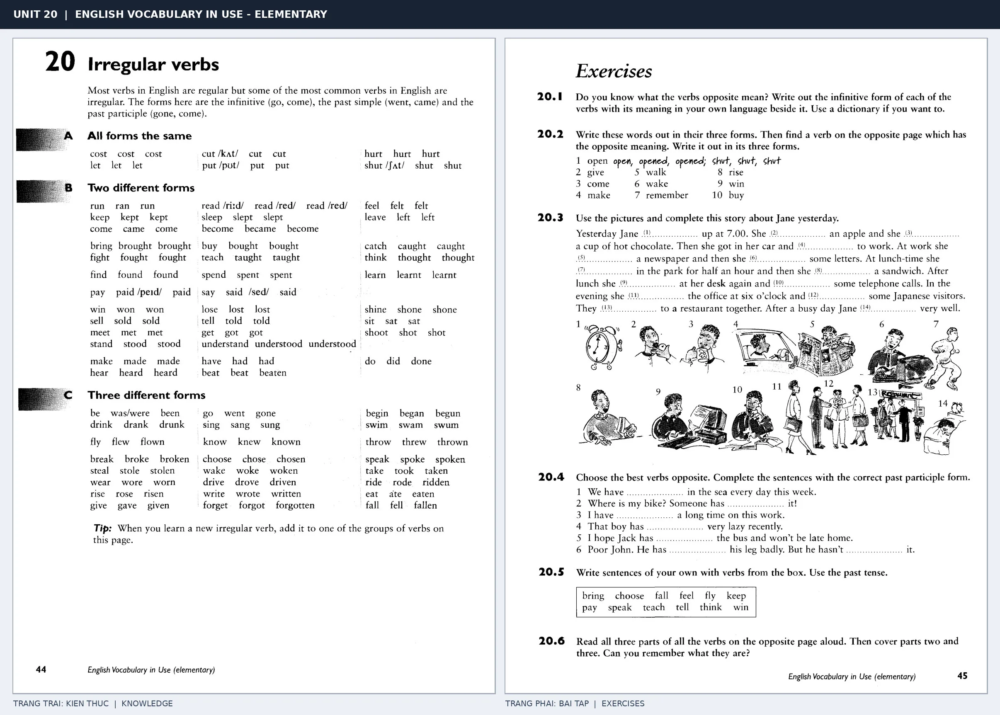

# Unit 20 — Irregular verbs: Động từ bất quy tắc

*Trang trái cung cấp kiến thức và ví dụ; trang phải là phần Exercises của Unit tương ứng. Có thể phóng to ảnh để làm bài tập gốc.*

> **Module 03:** Từ vựng và ngữ pháp  
> **Phạm vi:** English Vocabulary in Use — Elementary, Unit 20; trang in 44–45 (PDF trang 47–48).  
> **Hình thức:** Tự học từ vựng A1–A2 · Giảng giải tiếng Việt · Luyện câu và bài tập.

## 1. Tóm tắt và mục tiêu

Động từ bất quy tắc cần học đủ ba dạng: nguyên thể, quá khứ đơn, quá khứ phân từ. Có thể chia nhóm: ba dạng giống nhau, hai dạng giống nhau và ba dạng khác nhau để dễ nhớ.

Sau bài này, bạn có thể:

- Giải thích nghĩa và cách sử dụng những từ, cụm từ cốt lõi của chủ đề **động từ bất quy tắc**.
- Chọn đúng cách diễn đạt trong câu tiếng Anh đơn giản thay vì dịch máy móc từng từ.
- Tự đặt ít nhất ba câu thực tế và hoàn thành phần Exercises ở trang sách bên phải.

## 2. Kiến thức và từ vựng cốt lõi

Đọc kỹ từng mục. Với từ nhiều nghĩa, nghĩa ghi trong bảng được giới hạn ở cách dùng cần cho bài học này.

| Từ/cụm từ tiếng Anh | Nghĩa tiếng Việt |
| --- | --- |
| **go-went-gone** | đi |
| **come-came-come** | đến |
| **do-did-done** | làm |
| **have-had-had** | có |
| **make-made-made** | tạo hoặc làm |
| **take-took-taken** | lấy hoặc mang |
| **see-saw-seen** | nhìn thấy |
| **write-wrote-written** | viết |
| **buy-bought-bought** | mua |
| **eat-ate-eaten** | ăn |
| **speak-spoke-spoken** | nói |
| **put-put-put** | đặt |

### 2.1. Ghi nhớ theo nhóm và ngữ cảnh

**Nhóm từ thứ nhất:** go-went-gone (đi), come-came-come (đến), do-did-done (làm).

**Nhóm từ thứ hai:** take-took-taken (lấy hoặc mang), see-saw-seen (nhìn thấy), write-wrote-written (viết).

Hãy ghép từ với tình huống sử dụng thực tế. Khi gặp cụm từ có nhiều thành phần, ưu tiên ghi cả cụm kèm một câu ví dụ trong sổ từ vựng.

### 2.2. Mẫu câu song ngữ

**Ví dụ 1.** I went to school yesterday.

→ Hôm qua tôi đến trường.

**Ví dụ 2.** I have written the letter.

→ Tôi đã viết xong lá thư.

Đọc từng câu thành tiếng, che phần dịch tiếng Việt và thử nói lại ý bằng lời của mình. Sau đó thay một chi tiết trong câu để tạo ví dụ mới.

## 3. Luyện tập ứng dụng

**Bài A — Nhớ từ trong ngữ cảnh.** Không nhìn bảng, hãy viết tiếng Anh tương ứng với các ý sau:

1. Đi: __________
2. Có: __________
3. Viết: __________

**Bài B — Dịch và biến đổi câu.** Dịch hai câu dưới đây sang tiếng Anh trước khi nhìn mẫu câu ở trên:

1. Hôm qua tôi đến trường.
2. Tôi đã viết xong lá thư.

**Bài C — Viết cho bản thân.** Viết ba câu mới về cuộc sống của bạn, mỗi câu sử dụng một từ/cụm từ khác nhau trong bảng. Đọc lại để kiểm tra giới từ, cách chia động từ và trật tự từ.

**Bài D — Thực hành theo sách.** Quan sát phần **Exercises (trang phải)** trong ảnh ghép: giải bài tập trên giấy hoặc một file riêng, sau đó so sánh với các ví dụ ở trang trái. Những bài yêu cầu thông tin cá nhân không nhất thiết có một đáp án cố định.

## 4. Câu hỏi ôn tập trắc nghiệm

*Mỗi câu có một đáp án phù hợp nhất. Hãy tự trả lời trước khi đọc phần giải thích.*

### Câu 1

Bạn muốn diễn đạt **“đến”** bằng tiếng Anh. Chọn cách nói phù hợp nhất.

A. speak-spoke-spoken

B. buy-bought-bought

C. come-came-come

D. go-went-gone

**Đáp án:** C. **Giải thích:** “come-came-come” diễn đạt “đến” trong chủ đề này.

### Câu 2

Cụm từ **“take-took-taken”** có nghĩa nào trong bài học?

A. lấy hoặc mang

B. mua

C. viết

D. nhìn thấy

**Đáp án:** A. **Giải thích:** “take-took-taken” được dùng với nghĩa “lấy hoặc mang”.

### Câu 3

Khi cần nói **“mua”**, chọn từ/cụm từ nào?

A. do-did-done

B. buy-bought-bought

C. come-came-come

D. take-took-taken

**Đáp án:** B. **Giải thích:** Cách dùng đúng trong bài là “buy-bought-bought”.

### Câu 4

Chọn câu tiếng Anh diễn đạt đúng nhất: **“Hôm qua tôi đến trường.”**

A. I'm waiting for the bus.

B. I went to school yesterday.

C. We stayed home because it was raining.

D. The weather was terrible yesterday.

**Đáp án:** B. **Giải thích:** “I went to school yesterday.” là câu tương ứng với tình huống đã nêu.

### Câu 5

Ý nghĩa phù hợp nhất của câu **“I have written the letter.”** là gì?

A. Anh ấy nói tiếng Anh tốt.

B. Tôi đã viết xong lá thư.

C. Căn phòng này rất yên tĩnh.

D. Cô ấy là một giáo viên tử tế.

**Đáp án:** B. **Giải thích:** “I have written the letter.” có nghĩa là “Tôi đã viết xong lá thư.”.

## 5. Tổng kết và kiểm tra hoàn thành

Bài **I have written the letter.** giúp bạn sử dụng vốn từ về **tôi đã viết xong lá thư.** trong câu tiếng Anh thực tế. Giá trị quan trọng nhất không chỉ là biết nghĩa, mà là nhớ **cách kết hợp từ và ngữ cảnh sử dụng**.

- [ ] Tôi đã học bảng từ/cụm từ và đọc thành tiếng các ví dụ.
- [ ] Tôi đã hoàn thành ba phần luyện tập A, B, C.
- [ ] Tôi đã làm trang Exercises trong ảnh ghép và 5 câu trắc nghiệm.
- [ ] Tôi đã ghi các từ dễ nhầm vào sổ để ôn lại sau 1–3 ngày.

---

[← Unit 19: Cách thức thực hiện hành động](19-manner.md) · [Unit 21: Danh từ không đếm được →](21-common-uncountable-words.md)

[↑ Trở về mục lục khóa học](../../MUC_LUC.md)
