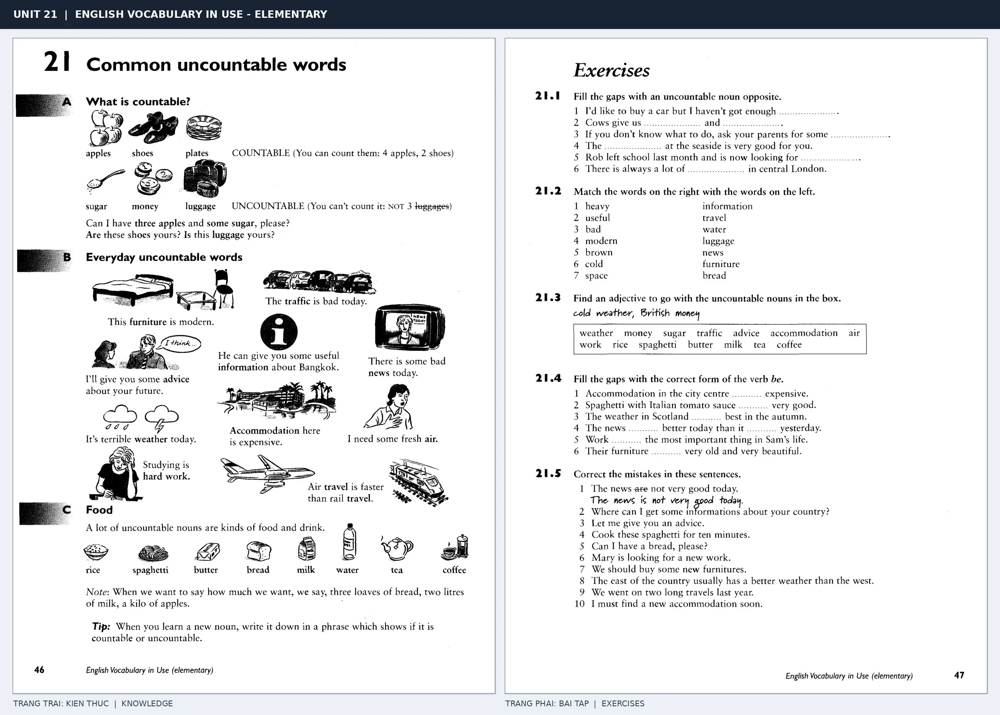

# Unit 21 — Common uncountable words: Danh từ không đếm được

*Trang trái cung cấp kiến thức và ví dụ; trang phải là phần Exercises của Unit tương ứng. Có thể phóng to ảnh để làm bài tập gốc.*

> **Module 03:** Từ vựng và ngữ pháp  
> **Phạm vi:** English Vocabulary in Use — Elementary, Unit 21; trang in 46–47 (PDF trang 49–50).  
> **Hình thức:** Tự học từ vựng A1–A2 · Giảng giải tiếng Việt · Luyện câu và bài tập.

## 1. Tóm tắt và mục tiêu

Các danh từ như money, luggage, information thường không dùng với a/an hoặc số đếm trực tiếp. Hãy dùng some, much hoặc đơn vị đếm như a piece of, a bottle of khi cần số lượng.

Sau bài này, bạn có thể:

- Giải thích nghĩa và cách sử dụng những từ, cụm từ cốt lõi của chủ đề **danh từ không đếm được**.
- Chọn đúng cách diễn đạt trong câu tiếng Anh đơn giản thay vì dịch máy móc từng từ.
- Tự đặt ít nhất ba câu thực tế và hoàn thành phần Exercises ở trang sách bên phải.

## 2. Kiến thức và từ vựng cốt lõi

Đọc kỹ từng mục. Với từ nhiều nghĩa, nghĩa ghi trong bảng được giới hạn ở cách dùng cần cho bài học này.

| Từ/cụm từ tiếng Anh | Nghĩa tiếng Việt |
| --- | --- |
| **bread** | bánh mì |
| **money** | tiền |
| **sugar** | đường |
| **rice** | gạo hoặc cơm |
| **water** | nước |
| **milk** | sữa |
| **cheese** | phô mai |
| **luggage** | hành lý |
| **information** | thông tin |
| **advice** | lời khuyên |
| **furniture** | đồ nội thất |
| **traffic** | giao thông |

### 2.1. Ghi nhớ theo nhóm và ngữ cảnh

**Nhóm từ thứ nhất:** bread (bánh mì), money (tiền), sugar (đường).

**Nhóm từ thứ hai:** milk (sữa), cheese (phô mai), luggage (hành lý).

Hãy ghép từ với tình huống sử dụng thực tế. Khi gặp cụm từ có nhiều thành phần, ưu tiên ghi cả cụm kèm một câu ví dụ trong sổ từ vựng.

### 2.2. Mẫu câu song ngữ

**Ví dụ 1.** Can I have some water, please?

→ Cho tôi xin ít nước được không?

**Ví dụ 2.** My luggage is heavy.

→ Hành lý của tôi nặng.

Đọc từng câu thành tiếng, che phần dịch tiếng Việt và thử nói lại ý bằng lời của mình. Sau đó thay một chi tiết trong câu để tạo ví dụ mới.

## 3. Luyện tập ứng dụng

**Bài A — Nhớ từ trong ngữ cảnh.** Không nhìn bảng, hãy viết tiếng Anh tương ứng với các ý sau:

1. Bánh mì: __________
2. Gạo hoặc cơm: __________
3. Hành lý: __________

**Bài B — Dịch và biến đổi câu.** Dịch hai câu dưới đây sang tiếng Anh trước khi nhìn mẫu câu ở trên:

1. Cho tôi xin ít nước được không?
2. Hành lý của tôi nặng.

**Bài C — Viết cho bản thân.** Viết ba câu mới về cuộc sống của bạn, mỗi câu sử dụng một từ/cụm từ khác nhau trong bảng. Đọc lại để kiểm tra giới từ, cách chia động từ và trật tự từ.

**Bài D — Thực hành theo sách.** Quan sát phần **Exercises (trang phải)** trong ảnh ghép: giải bài tập trên giấy hoặc một file riêng, sau đó so sánh với các ví dụ ở trang trái. Những bài yêu cầu thông tin cá nhân không nhất thiết có một đáp án cố định.

## 4. Câu hỏi ôn tập trắc nghiệm

*Mỗi câu có một đáp án phù hợp nhất. Hãy tự trả lời trước khi đọc phần giải thích.*

### Câu 1

Bạn muốn diễn đạt **“tiền”** bằng tiếng Anh. Chọn cách nói phù hợp nhất.

A. money

B. luggage

C. traffic

D. information

**Đáp án:** A. **Giải thích:** “money” diễn đạt “tiền” trong chủ đề này.

### Câu 2

Cụm từ **“milk”** có nghĩa nào trong bài học?

A. sữa

B. bánh mì

C. đường

D. nước

**Đáp án:** A. **Giải thích:** “milk” được dùng với nghĩa “sữa”.

### Câu 3

Khi cần nói **“thông tin”**, chọn từ/cụm từ nào?

A. information

B. money

C. bread

D. water

**Đáp án:** A. **Giải thích:** Cách dùng đúng trong bài là “information”.

### Câu 4

Chọn câu tiếng Anh diễn đạt đúng nhất: **“Cho tôi xin ít nước được không?”**

A. My neighbours are very friendly.

B. Can I have some water, please?

C. This dictionary is useful.

D. She is good at maths.

**Đáp án:** B. **Giải thích:** “Can I have some water, please?” là câu tương ứng với tình huống đã nêu.

### Câu 5

Ý nghĩa phù hợp nhất của câu **“My luggage is heavy.”** là gì?

A. Hôm qua tôi đến trường.

B. Vé này chỉ bằng nửa giá.

C. Cuốn từ điển này hữu ích.

D. Hành lý của tôi nặng.

**Đáp án:** D. **Giải thích:** “My luggage is heavy.” có nghĩa là “Hành lý của tôi nặng.”.

## 5. Tổng kết và kiểm tra hoàn thành

Bài **My luggage is heavy.** giúp bạn sử dụng vốn từ về **hành lý của tôi nặng.** trong câu tiếng Anh thực tế. Giá trị quan trọng nhất không chỉ là biết nghĩa, mà là nhớ **cách kết hợp từ và ngữ cảnh sử dụng**.

- [ ] Tôi đã học bảng từ/cụm từ và đọc thành tiếng các ví dụ.
- [ ] Tôi đã hoàn thành ba phần luyện tập A, B, C.
- [ ] Tôi đã làm trang Exercises trong ảnh ghép và 5 câu trắc nghiệm.
- [ ] Tôi đã ghi các từ dễ nhầm vào sổ để ôn lại sau 1–3 ngày.

---

[← Unit 20: Động từ bất quy tắc](20-irregular-verbs.md) · [Unit 22: Tính từ đánh giá sự vật →](22-common-adjectives-good-and-bad-things.md)

[↑ Trở về mục lục khóa học](../../MUC_LUC.md)
