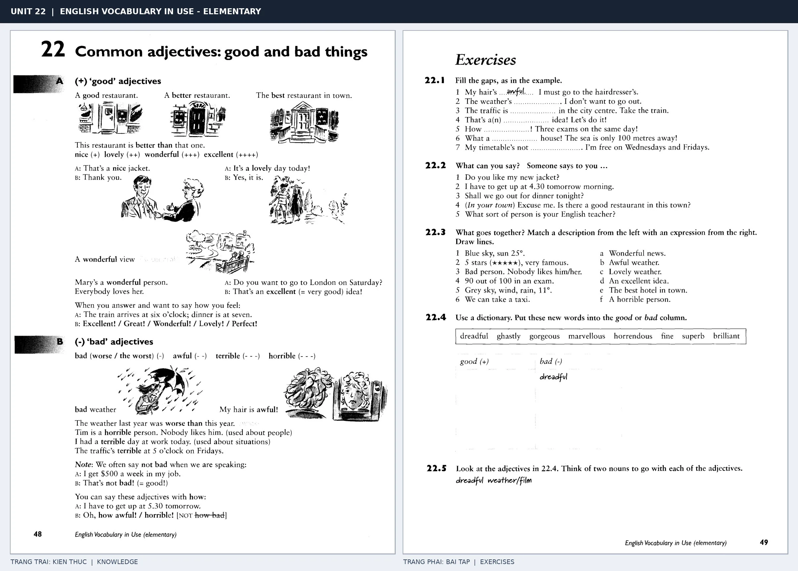

# Unit 22 — Common adjectives: good and bad things: Tính từ đánh giá sự vật

*Trang trái cung cấp kiến thức và ví dụ; trang phải là phần Exercises của Unit tương ứng. Có thể phóng to ảnh để làm bài tập gốc.*

> **Module 03:** Từ vựng và ngữ pháp  
> **Phạm vi:** English Vocabulary in Use — Elementary, Unit 22; trang in 48–49 (PDF trang 51–52).  
> **Hình thức:** Tự học từ vựng A1–A2 · Giảng giải tiếng Việt · Luyện câu và bài tập.

## 1. Tóm tắt và mục tiêu

Tính từ đánh giá mang sắc thái mạnh nhẹ: nice, lovely, wonderful, excellent thường tích cực; bad, awful, terrible thường tiêu cực. Tập dùng very hoặc so phù hợp, không phải từ nào cũng tăng cấp như nhau.

Sau bài này, bạn có thể:

- Giải thích nghĩa và cách sử dụng những từ, cụm từ cốt lõi của chủ đề **tính từ đánh giá sự vật**.
- Chọn đúng cách diễn đạt trong câu tiếng Anh đơn giản thay vì dịch máy móc từng từ.
- Tự đặt ít nhất ba câu thực tế và hoàn thành phần Exercises ở trang sách bên phải.

## 2. Kiến thức và từ vựng cốt lõi

Đọc kỹ từng mục. Với từ nhiều nghĩa, nghĩa ghi trong bảng được giới hạn ở cách dùng cần cho bài học này.

| Từ/cụm từ tiếng Anh | Nghĩa tiếng Việt |
| --- | --- |
| **good** | tốt |
| **better** | tốt hơn |
| **best** | tốt nhất |
| **nice** | dễ chịu hoặc tốt |
| **lovely** | rất đáng yêu |
| **wonderful** | tuyệt vời |
| **excellent** | xuất sắc |
| **bad** | tệ |
| **awful** | kinh khủng |
| **terrible** | rất tệ |
| **poor** | kém |
| **horrible** | khủng khiếp |

### 2.1. Ghi nhớ theo nhóm và ngữ cảnh

**Nhóm từ thứ nhất:** good (tốt), better (tốt hơn), best (tốt nhất).

**Nhóm từ thứ hai:** wonderful (tuyệt vời), excellent (xuất sắc), bad (tệ).

Hãy ghép từ với tình huống sử dụng thực tế. Khi gặp cụm từ có nhiều thành phần, ưu tiên ghi cả cụm kèm một câu ví dụ trong sổ từ vựng.

### 2.2. Mẫu câu song ngữ

**Ví dụ 1.** This restaurant is better than that one.

→ Nhà hàng này tốt hơn nhà hàng kia.

**Ví dụ 2.** The weather was terrible yesterday.

→ Thời tiết hôm qua thật tệ.

Đọc từng câu thành tiếng, che phần dịch tiếng Việt và thử nói lại ý bằng lời của mình. Sau đó thay một chi tiết trong câu để tạo ví dụ mới.

## 3. Luyện tập ứng dụng

**Bài A — Nhớ từ trong ngữ cảnh.** Không nhìn bảng, hãy viết tiếng Anh tương ứng với các ý sau:

1. Tốt: __________
2. Dễ chịu hoặc tốt: __________
3. Tệ: __________

**Bài B — Dịch và biến đổi câu.** Dịch hai câu dưới đây sang tiếng Anh trước khi nhìn mẫu câu ở trên:

1. Nhà hàng này tốt hơn nhà hàng kia.
2. Thời tiết hôm qua thật tệ.

**Bài C — Viết cho bản thân.** Viết ba câu mới về cuộc sống của bạn, mỗi câu sử dụng một từ/cụm từ khác nhau trong bảng. Đọc lại để kiểm tra giới từ, cách chia động từ và trật tự từ.

**Bài D — Thực hành theo sách.** Quan sát phần **Exercises (trang phải)** trong ảnh ghép: giải bài tập trên giấy hoặc một file riêng, sau đó so sánh với các ví dụ ở trang trái. Những bài yêu cầu thông tin cá nhân không nhất thiết có một đáp án cố định.

## 4. Câu hỏi ôn tập trắc nghiệm

*Mỗi câu có một đáp án phù hợp nhất. Hãy tự trả lời trước khi đọc phần giải thích.*

### Câu 1

Bạn muốn diễn đạt **“tốt hơn”** bằng tiếng Anh. Chọn cách nói phù hợp nhất.

A. lovely

B. excellent

C. better

D. awful

**Đáp án:** C. **Giải thích:** “better” diễn đạt “tốt hơn” trong chủ đề này.

### Câu 2

Cụm từ **“wonderful”** có nghĩa nào trong bài học?

A. khủng khiếp

B. tốt nhất

C. dễ chịu hoặc tốt

D. tuyệt vời

**Đáp án:** D. **Giải thích:** “wonderful” được dùng với nghĩa “tuyệt vời”.

### Câu 3

Khi cần nói **“kinh khủng”**, chọn từ/cụm từ nào?

A. better

B. awful

C. horrible

D. terrible

**Đáp án:** B. **Giải thích:** Cách dùng đúng trong bài là “awful”.

### Câu 4

Chọn câu tiếng Anh diễn đạt đúng nhất: **“Nhà hàng này tốt hơn nhà hàng kia.”**

A. He often walks to work.

B. This restaurant is better than that one.

C. We have English on Monday.

D. I'm waiting for the bus.

**Đáp án:** B. **Giải thích:** “This restaurant is better than that one.” là câu tương ứng với tình huống đã nêu.

### Câu 5

Ý nghĩa phù hợp nhất của câu **“The weather was terrible yesterday.”** là gì?

A. Chúng tôi ở nhà vì trời mưa.

B. Thời tiết hôm qua thật tệ.

C. Tôi đã viết xong lá thư.

D. Cho tôi xin ít nước được không?

**Đáp án:** B. **Giải thích:** “The weather was terrible yesterday.” có nghĩa là “Thời tiết hôm qua thật tệ.”.

## 5. Tổng kết và kiểm tra hoàn thành

Bài **The weather was terrible yesterday.** giúp bạn sử dụng vốn từ về **thời tiết hôm qua thật tệ.** trong câu tiếng Anh thực tế. Giá trị quan trọng nhất không chỉ là biết nghĩa, mà là nhớ **cách kết hợp từ và ngữ cảnh sử dụng**.

- [ ] Tôi đã học bảng từ/cụm từ và đọc thành tiếng các ví dụ.
- [ ] Tôi đã hoàn thành ba phần luyện tập A, B, C.
- [ ] Tôi đã làm trang Exercises trong ảnh ghép và 5 câu trắc nghiệm.
- [ ] Tôi đã ghi các từ dễ nhầm vào sổ để ôn lại sau 1–3 ngày.

---

[← Unit 21: Danh từ không đếm được](21-common-uncountable-words.md) · [Unit 23: Tính từ miêu tả tính cách →](23-common-adjectives-people.md)

[↑ Trở về mục lục khóa học](../../MUC_LUC.md)
