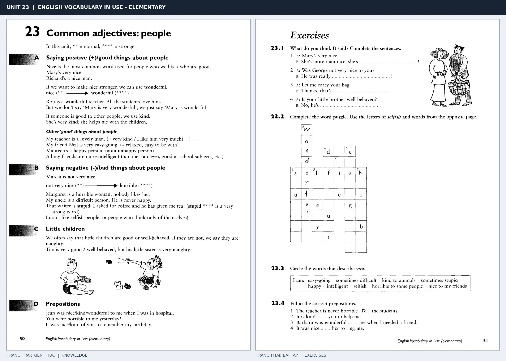

# Unit 23 — Common adjectives: people: Tính từ miêu tả tính cách

*Trang trái cung cấp kiến thức và ví dụ; trang phải là phần Exercises của Unit tương ứng. Có thể phóng to ảnh để làm bài tập gốc.*

> **Module 03:** Từ vựng và ngữ pháp  
> **Phạm vi:** English Vocabulary in Use — Elementary, Unit 23; trang in 50–51 (PDF trang 53–54).  
> **Hình thức:** Tự học từ vựng A1–A2 · Giảng giải tiếng Việt · Luyện câu và bài tập.

## 1. Tóm tắt và mục tiêu

Khi miêu tả người, nên chọn tính từ phù hợp mức độ đánh giá: nice và kind khá trung tính, wonderful tích cực mạnh, còn horrible rất tiêu cực. Phân biệt đánh giá tính cách với đánh giá ngoại hình.

Sau bài này, bạn có thể:

- Giải thích nghĩa và cách sử dụng những từ, cụm từ cốt lõi của chủ đề **tính từ miêu tả tính cách**.
- Chọn đúng cách diễn đạt trong câu tiếng Anh đơn giản thay vì dịch máy móc từng từ.
- Tự đặt ít nhất ba câu thực tế và hoàn thành phần Exercises ở trang sách bên phải.

## 2. Kiến thức và từ vựng cốt lõi

Đọc kỹ từng mục. Với từ nhiều nghĩa, nghĩa ghi trong bảng được giới hạn ở cách dùng cần cho bài học này.

| Từ/cụm từ tiếng Anh | Nghĩa tiếng Việt |
| --- | --- |
| **nice** | tốt bụng |
| **kind** | tử tế |
| **friendly** | thân thiện |
| **pleasant** | dễ mến |
| **wonderful** | tuyệt vời |
| **lovely** | đáng mến |
| **unfriendly** | không thân thiện |
| **unkind** | không tử tế |
| **horrible** | khó ưa |
| **unpleasant** | khó chịu |
| **clever** | thông minh |
| **stupid** | ngốc nghếch |

### 2.1. Ghi nhớ theo nhóm và ngữ cảnh

**Nhóm từ thứ nhất:** nice (tốt bụng), kind (tử tế), friendly (thân thiện).

**Nhóm từ thứ hai:** lovely (đáng mến), unfriendly (không thân thiện), unkind (không tử tế).

Hãy ghép từ với tình huống sử dụng thực tế. Khi gặp cụm từ có nhiều thành phần, ưu tiên ghi cả cụm kèm một câu ví dụ trong sổ từ vựng.

### 2.2. Mẫu câu song ngữ

**Ví dụ 1.** My neighbours are very friendly.

→ Hàng xóm của tôi rất thân thiện.

**Ví dụ 2.** She is a kind teacher.

→ Cô ấy là một giáo viên tử tế.

Đọc từng câu thành tiếng, che phần dịch tiếng Việt và thử nói lại ý bằng lời của mình. Sau đó thay một chi tiết trong câu để tạo ví dụ mới.

## 3. Luyện tập ứng dụng

**Bài A — Nhớ từ trong ngữ cảnh.** Không nhìn bảng, hãy viết tiếng Anh tương ứng với các ý sau:

1. Tốt bụng: __________
2. Dễ mến: __________
3. Không tử tế: __________

**Bài B — Dịch và biến đổi câu.** Dịch hai câu dưới đây sang tiếng Anh trước khi nhìn mẫu câu ở trên:

1. Hàng xóm của tôi rất thân thiện.
2. Cô ấy là một giáo viên tử tế.

**Bài C — Viết cho bản thân.** Viết ba câu mới về cuộc sống của bạn, mỗi câu sử dụng một từ/cụm từ khác nhau trong bảng. Đọc lại để kiểm tra giới từ, cách chia động từ và trật tự từ.

**Bài D — Thực hành theo sách.** Quan sát phần **Exercises (trang phải)** trong ảnh ghép: giải bài tập trên giấy hoặc một file riêng, sau đó so sánh với các ví dụ ở trang trái. Những bài yêu cầu thông tin cá nhân không nhất thiết có một đáp án cố định.

## 4. Câu hỏi ôn tập trắc nghiệm

*Mỗi câu có một đáp án phù hợp nhất. Hãy tự trả lời trước khi đọc phần giải thích.*

### Câu 1

Bạn muốn diễn đạt **“tử tế”** bằng tiếng Anh. Chọn cách nói phù hợp nhất.

A. lovely

B. pleasant

C. friendly

D. kind

**Đáp án:** D. **Giải thích:** “kind” diễn đạt “tử tế” trong chủ đề này.

### Câu 2

Cụm từ **“lovely”** có nghĩa nào trong bài học?

A. đáng mến

B. không tử tế

C. tuyệt vời

D. dễ mến

**Đáp án:** A. **Giải thích:** “lovely” được dùng với nghĩa “đáng mến”.

### Câu 3

Khi cần nói **“khó ưa”**, chọn từ/cụm từ nào?

A. horrible

B. unkind

C. nice

D. clever

**Đáp án:** A. **Giải thích:** Cách dùng đúng trong bài là “horrible”.

### Câu 4

Chọn câu tiếng Anh diễn đạt đúng nhất: **“Hàng xóm của tôi rất thân thiện.”**

A. She was tired but she kept working.

B. We have English on Monday.

C. My neighbours are very friendly.

D. This restaurant is better than that one.

**Đáp án:** C. **Giải thích:** “My neighbours are very friendly.” là câu tương ứng với tình huống đã nêu.

### Câu 5

Ý nghĩa phù hợp nhất của câu **“She is a kind teacher.”** là gì?

A. Cô ấy là một giáo viên tử tế.

B. Rạp phim nằm bên trái.

C. Nhà hàng này tốt hơn nhà hàng kia.

D. Thời tiết hôm qua thật tệ.

**Đáp án:** A. **Giải thích:** “She is a kind teacher.” có nghĩa là “Cô ấy là một giáo viên tử tế.”.

## 5. Tổng kết và kiểm tra hoàn thành

Bài **She is a kind teacher.** giúp bạn sử dụng vốn từ về **cô ấy là một giáo viên tử tế.** trong câu tiếng Anh thực tế. Giá trị quan trọng nhất không chỉ là biết nghĩa, mà là nhớ **cách kết hợp từ và ngữ cảnh sử dụng**.

- [ ] Tôi đã học bảng từ/cụm từ và đọc thành tiếng các ví dụ.
- [ ] Tôi đã hoàn thành ba phần luyện tập A, B, C.
- [ ] Tôi đã làm trang Exercises trong ảnh ghép và 5 câu trắc nghiệm.
- [ ] Tôi đã ghi các từ dễ nhầm vào sổ để ôn lại sau 1–3 ngày.

---

[← Unit 22: Tính từ đánh giá sự vật](22-common-adjectives-good-and-bad-things.md) · [Unit 24: Từ thường đi với giới từ →](24-words-and-prepositions.md)

[↑ Trở về mục lục khóa học](../../MUC_LUC.md)
