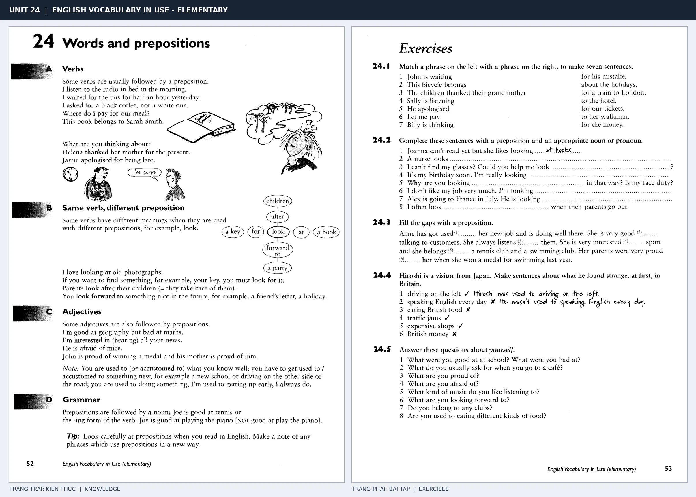

# Unit 24 — Words and prepositions: Từ thường đi với giới từ

*Trang trái cung cấp kiến thức và ví dụ; trang phải là phần Exercises của Unit tương ứng. Có thể phóng to ảnh để làm bài tập gốc.*

> **Module 03:** Từ vựng và ngữ pháp  
> **Phạm vi:** English Vocabulary in Use — Elementary, Unit 24; trang in 52–53 (PDF trang 55–56).  
> **Hình thức:** Tự học từ vựng A1–A2 · Giảng giải tiếng Việt · Luyện câu và bài tập.

## 1. Tóm tắt và mục tiêu

Một số động từ và tính từ chọn giới từ cố định, không thể dịch máy móc từng từ. Học listen to, wait for và good at như một đơn vị duy nhất.

Sau bài này, bạn có thể:

- Giải thích nghĩa và cách sử dụng những từ, cụm từ cốt lõi của chủ đề **từ thường đi với giới từ**.
- Chọn đúng cách diễn đạt trong câu tiếng Anh đơn giản thay vì dịch máy móc từng từ.
- Tự đặt ít nhất ba câu thực tế và hoàn thành phần Exercises ở trang sách bên phải.

## 2. Kiến thức và từ vựng cốt lõi

Đọc kỹ từng mục. Với từ nhiều nghĩa, nghĩa ghi trong bảng được giới hạn ở cách dùng cần cho bài học này.

| Từ/cụm từ tiếng Anh | Nghĩa tiếng Việt |
| --- | --- |
| **listen to** | nghe |
| **wait for** | chờ |
| **ask for** | yêu cầu |
| **pay for** | trả tiền cho |
| **belong to** | thuộc về |
| **good at** | giỏi về |
| **interested in** | quan tâm đến |
| **afraid of** | sợ |
| **talk to** | nói chuyện với |
| **depend on** | phụ thuộc vào |
| **look at** | nhìn vào |
| **think about** | suy nghĩ về |

### 2.1. Ghi nhớ theo nhóm và ngữ cảnh

**Nhóm từ thứ nhất:** listen to (nghe), wait for (chờ), ask for (yêu cầu).

**Nhóm từ thứ hai:** good at (giỏi về), interested in (quan tâm đến), afraid of (sợ).

Hãy ghép từ với tình huống sử dụng thực tế. Khi gặp cụm từ có nhiều thành phần, ưu tiên ghi cả cụm kèm một câu ví dụ trong sổ từ vựng.

### 2.2. Mẫu câu song ngữ

**Ví dụ 1.** I'm waiting for the bus.

→ Tôi đang chờ xe buýt.

**Ví dụ 2.** She is good at maths.

→ Cô ấy giỏi toán.

Đọc từng câu thành tiếng, che phần dịch tiếng Việt và thử nói lại ý bằng lời của mình. Sau đó thay một chi tiết trong câu để tạo ví dụ mới.

## 3. Luyện tập ứng dụng

**Bài A — Nhớ từ trong ngữ cảnh.** Không nhìn bảng, hãy viết tiếng Anh tương ứng với các ý sau:

1. Nghe: __________
2. Trả tiền cho: __________
3. Sợ: __________

**Bài B — Dịch và biến đổi câu.** Dịch hai câu dưới đây sang tiếng Anh trước khi nhìn mẫu câu ở trên:

1. Tôi đang chờ xe buýt.
2. Cô ấy giỏi toán.

**Bài C — Viết cho bản thân.** Viết ba câu mới về cuộc sống của bạn, mỗi câu sử dụng một từ/cụm từ khác nhau trong bảng. Đọc lại để kiểm tra giới từ, cách chia động từ và trật tự từ.

**Bài D — Thực hành theo sách.** Quan sát phần **Exercises (trang phải)** trong ảnh ghép: giải bài tập trên giấy hoặc một file riêng, sau đó so sánh với các ví dụ ở trang trái. Những bài yêu cầu thông tin cá nhân không nhất thiết có một đáp án cố định.

## 4. Câu hỏi ôn tập trắc nghiệm

*Mỗi câu có một đáp án phù hợp nhất. Hãy tự trả lời trước khi đọc phần giải thích.*

### Câu 1

Bạn muốn diễn đạt **“chờ”** bằng tiếng Anh. Chọn cách nói phù hợp nhất.

A. pay for

B. think about

C. depend on

D. wait for

**Đáp án:** D. **Giải thích:** “wait for” diễn đạt “chờ” trong chủ đề này.

### Câu 2

Cụm từ **“good at”** có nghĩa nào trong bài học?

A. nói chuyện với

B. nhìn vào

C. giỏi về

D. chờ

**Đáp án:** C. **Giải thích:** “good at” được dùng với nghĩa “giỏi về”.

### Câu 3

Khi cần nói **“nói chuyện với”**, chọn từ/cụm từ nào?

A. talk to

B. belong to

C. afraid of

D. good at

**Đáp án:** A. **Giải thích:** Cách dùng đúng trong bài là “talk to”.

### Câu 4

Chọn câu tiếng Anh diễn đạt đúng nhất: **“Tôi đang chờ xe buýt.”**

A. She is a kind teacher.

B. My neighbours are very friendly.

C. I'm waiting for the bus.

D. She drives carefully.

**Đáp án:** C. **Giải thích:** “I'm waiting for the bus.” là câu tương ứng với tình huống đã nêu.

### Câu 5

Ý nghĩa phù hợp nhất của câu **“She is good at maths.”** là gì?

A. Căn phòng này rất yên tĩnh.

B. Cô ấy giỏi toán.

C. Hàng xóm của tôi rất thân thiện.

D. Cô ấy là một giáo viên tử tế.

**Đáp án:** B. **Giải thích:** “She is good at maths.” có nghĩa là “Cô ấy giỏi toán.”.

## 5. Tổng kết và kiểm tra hoàn thành

Bài **She is good at maths.** giúp bạn sử dụng vốn từ về **cô ấy giỏi toán.** trong câu tiếng Anh thực tế. Giá trị quan trọng nhất không chỉ là biết nghĩa, mà là nhớ **cách kết hợp từ và ngữ cảnh sử dụng**.

- [ ] Tôi đã học bảng từ/cụm từ và đọc thành tiếng các ví dụ.
- [ ] Tôi đã hoàn thành ba phần luyện tập A, B, C.
- [ ] Tôi đã làm trang Exercises trong ảnh ghép và 5 câu trắc nghiệm.
- [ ] Tôi đã ghi các từ dễ nhầm vào sổ để ôn lại sau 1–3 ngày.

---

[← Unit 23: Tính từ miêu tả tính cách](23-common-adjectives-people.md) · [Unit 25: Tiền tố →](25-prefixes.md)

[↑ Trở về mục lục khóa học](../../MUC_LUC.md)
