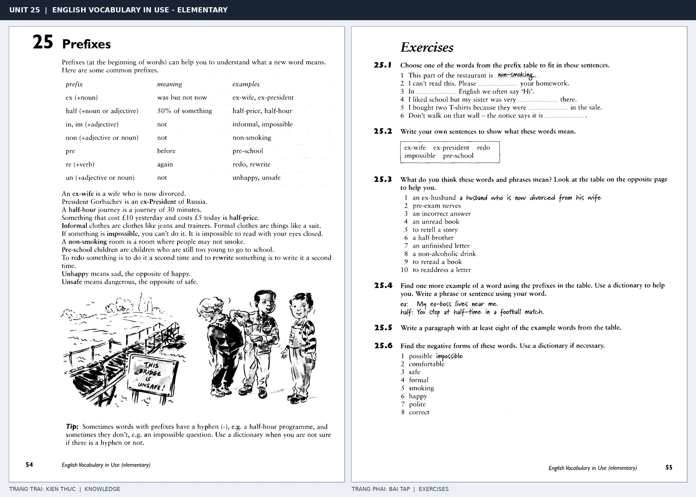

# Unit 25 — Prefixes: Tiền tố

*Trang trái cung cấp kiến thức và ví dụ; trang phải là phần Exercises của Unit tương ứng. Có thể phóng to ảnh để làm bài tập gốc.*

> **Module 03:** Từ vựng và ngữ pháp  
> **Phạm vi:** English Vocabulary in Use — Elementary, Unit 25; trang in 54–55 (PDF trang 57–58).  
> **Hình thức:** Tự học từ vựng A1–A2 · Giảng giải tiếng Việt · Luyện câu và bài tập.

## 1. Tóm tắt và mục tiêu

Tiền tố đứng trước từ gốc và thường làm đổi nghĩa, chẳng hạn un- hoặc in-/im- gợi ý phủ định, ex- chỉ trạng thái trước đây, half- chỉ một nửa. Không được tự động thêm mọi tiền tố vào mọi từ.

Sau bài này, bạn có thể:

- Giải thích nghĩa và cách sử dụng những từ, cụm từ cốt lõi của chủ đề **tiền tố**.
- Chọn đúng cách diễn đạt trong câu tiếng Anh đơn giản thay vì dịch máy móc từng từ.
- Tự đặt ít nhất ba câu thực tế và hoàn thành phần Exercises ở trang sách bên phải.

## 2. Kiến thức và từ vựng cốt lõi

Đọc kỹ từng mục. Với từ nhiều nghĩa, nghĩa ghi trong bảng được giới hạn ở cách dùng cần cho bài học này.

| Từ/cụm từ tiếng Anh | Nghĩa tiếng Việt |
| --- | --- |
| **unhappy** | không vui |
| **unfriendly** | không thân thiện |
| **impossible** | không thể |
| **incorrect** | không đúng |
| **illegal** | trái pháp luật |
| **ex-president** | cựu tổng thống |
| **ex-wife** | vợ cũ |
| **half-price** | nửa giá |
| **half-hour** | nửa giờ |
| **rewrite** | viết lại |
| **disagree** | không đồng ý |
| **unusual** | không bình thường |

### 2.1. Ghi nhớ theo nhóm và ngữ cảnh

**Nhóm từ thứ nhất:** unhappy (không vui), unfriendly (không thân thiện), impossible (không thể).

**Nhóm từ thứ hai:** ex-president (cựu tổng thống), ex-wife (vợ cũ), half-price (nửa giá).

Hãy ghép từ với tình huống sử dụng thực tế. Khi gặp cụm từ có nhiều thành phần, ưu tiên ghi cả cụm kèm một câu ví dụ trong sổ từ vựng.

### 2.2. Mẫu câu song ngữ

**Ví dụ 1.** The answer is incorrect.

→ Câu trả lời không đúng.

**Ví dụ 2.** This ticket is half-price.

→ Vé này chỉ bằng nửa giá.

Đọc từng câu thành tiếng, che phần dịch tiếng Việt và thử nói lại ý bằng lời của mình. Sau đó thay một chi tiết trong câu để tạo ví dụ mới.

## 3. Luyện tập ứng dụng

**Bài A — Nhớ từ trong ngữ cảnh.** Không nhìn bảng, hãy viết tiếng Anh tương ứng với các ý sau:

1. Không vui: __________
2. Không đúng: __________
3. Nửa giá: __________

**Bài B — Dịch và biến đổi câu.** Dịch hai câu dưới đây sang tiếng Anh trước khi nhìn mẫu câu ở trên:

1. Câu trả lời không đúng.
2. Vé này chỉ bằng nửa giá.

**Bài C — Viết cho bản thân.** Viết ba câu mới về cuộc sống của bạn, mỗi câu sử dụng một từ/cụm từ khác nhau trong bảng. Đọc lại để kiểm tra giới từ, cách chia động từ và trật tự từ.

**Bài D — Thực hành theo sách.** Quan sát phần **Exercises (trang phải)** trong ảnh ghép: giải bài tập trên giấy hoặc một file riêng, sau đó so sánh với các ví dụ ở trang trái. Những bài yêu cầu thông tin cá nhân không nhất thiết có một đáp án cố định.

## 4. Câu hỏi ôn tập trắc nghiệm

*Mỗi câu có một đáp án phù hợp nhất. Hãy tự trả lời trước khi đọc phần giải thích.*

### Câu 1

Bạn muốn diễn đạt **“không thân thiện”** bằng tiếng Anh. Chọn cách nói phù hợp nhất.

A. half-hour

B. unfriendly

C. unusual

D. half-price

**Đáp án:** B. **Giải thích:** “unfriendly” diễn đạt “không thân thiện” trong chủ đề này.

### Câu 2

Cụm từ **“ex-president”** có nghĩa nào trong bài học?

A. nửa giá

B. cựu tổng thống

C. không thể

D. không bình thường

**Đáp án:** B. **Giải thích:** “ex-president” được dùng với nghĩa “cựu tổng thống”.

### Câu 3

Khi cần nói **“nửa giờ”**, chọn từ/cụm từ nào?

A. half-hour

B. impossible

C. rewrite

D. unfriendly

**Đáp án:** A. **Giải thích:** Cách dùng đúng trong bài là “half-hour”.

### Câu 4

Chọn câu tiếng Anh diễn đạt đúng nhất: **“Câu trả lời không đúng.”**

A. The answer is incorrect.

B. I met her two days ago.

C. Can I borrow your pen?

D. My birthday is in July.

**Đáp án:** A. **Giải thích:** “The answer is incorrect.” là câu tương ứng với tình huống đã nêu.

### Câu 5

Ý nghĩa phù hợp nhất của câu **“This ticket is half-price.”** là gì?

A. Anh ấy nói tiếng Anh tốt.

B. Hành lý của tôi nặng.

C. Hôm qua tôi đến trường.

D. Vé này chỉ bằng nửa giá.

**Đáp án:** D. **Giải thích:** “This ticket is half-price.” có nghĩa là “Vé này chỉ bằng nửa giá.”.

## 5. Tổng kết và kiểm tra hoàn thành

Bài **This ticket is half-price.** giúp bạn sử dụng vốn từ về **vé này chỉ bằng nửa giá.** trong câu tiếng Anh thực tế. Giá trị quan trọng nhất không chỉ là biết nghĩa, mà là nhớ **cách kết hợp từ và ngữ cảnh sử dụng**.

- [ ] Tôi đã học bảng từ/cụm từ và đọc thành tiếng các ví dụ.
- [ ] Tôi đã hoàn thành ba phần luyện tập A, B, C.
- [ ] Tôi đã làm trang Exercises trong ảnh ghép và 5 câu trắc nghiệm.
- [ ] Tôi đã ghi các từ dễ nhầm vào sổ để ôn lại sau 1–3 ngày.

---

[← Unit 24: Từ thường đi với giới từ](24-words-and-prepositions.md) · [Unit 26: Hậu tố →](26-suffixes.md)

[↑ Trở về mục lục khóa học](../../MUC_LUC.md)
