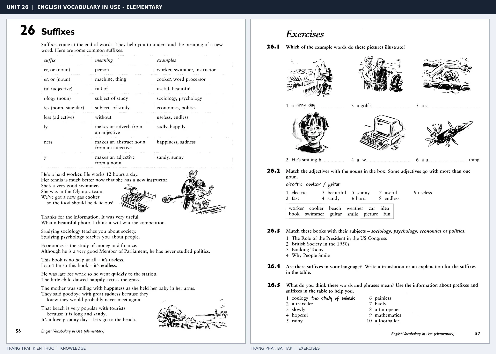

# Unit 26 — Suffixes: Hậu tố

*Trang trái cung cấp kiến thức và ví dụ; trang phải là phần Exercises của Unit tương ứng. Có thể phóng to ảnh để làm bài tập gốc.*

> **Module 03:** Từ vựng và ngữ pháp  
> **Phạm vi:** English Vocabulary in Use — Elementary, Unit 26; trang in 56–57 (PDF trang 59–60).  
> **Hình thức:** Tự học từ vựng A1–A2 · Giảng giải tiếng Việt · Luyện câu và bài tập.

## 1. Tóm tắt và mục tiêu

Hậu tố nằm ở cuối từ và có thể tạo danh từ, tính từ hoặc trạng từ. Chẳng hạn -er/-or thường chỉ người làm, -ful mang nghĩa có, -less mang nghĩa thiếu, -ly thường tạo trạng từ.

Sau bài này, bạn có thể:

- Giải thích nghĩa và cách sử dụng những từ, cụm từ cốt lõi của chủ đề **hậu tố**.
- Chọn đúng cách diễn đạt trong câu tiếng Anh đơn giản thay vì dịch máy móc từng từ.
- Tự đặt ít nhất ba câu thực tế và hoàn thành phần Exercises ở trang sách bên phải.

## 2. Kiến thức và từ vựng cốt lõi

Đọc kỹ từng mục. Với từ nhiều nghĩa, nghĩa ghi trong bảng được giới hạn ở cách dùng cần cho bài học này.

| Từ/cụm từ tiếng Anh | Nghĩa tiếng Việt |
| --- | --- |
| **worker** | người lao động |
| **teacher** | giáo viên |
| **swimmer** | người bơi |
| **instructor** | người hướng dẫn |
| **useful** | hữu ích |
| **useless** | vô dụng |
| **careful** | cẩn thận |
| **careless** | bất cẩn |
| **happiness** | hạnh phúc |
| **darkness** | bóng tối |
| **friendly** | thân thiện |
| **quickly** | một cách nhanh chóng |

### 2.1. Ghi nhớ theo nhóm và ngữ cảnh

**Nhóm từ thứ nhất:** worker (người lao động), teacher (giáo viên), swimmer (người bơi).

**Nhóm từ thứ hai:** useless (vô dụng), careful (cẩn thận), careless (bất cẩn).

Hãy ghép từ với tình huống sử dụng thực tế. Khi gặp cụm từ có nhiều thành phần, ưu tiên ghi cả cụm kèm một câu ví dụ trong sổ từ vựng.

### 2.2. Mẫu câu song ngữ

**Ví dụ 1.** This dictionary is useful.

→ Cuốn từ điển này hữu ích.

**Ví dụ 2.** He walks quickly.

→ Anh ấy đi nhanh.

Đọc từng câu thành tiếng, che phần dịch tiếng Việt và thử nói lại ý bằng lời của mình. Sau đó thay một chi tiết trong câu để tạo ví dụ mới.

## 3. Luyện tập ứng dụng

**Bài A — Nhớ từ trong ngữ cảnh.** Không nhìn bảng, hãy viết tiếng Anh tương ứng với các ý sau:

1. Người lao động: __________
2. Người hướng dẫn: __________
3. Bất cẩn: __________

**Bài B — Dịch và biến đổi câu.** Dịch hai câu dưới đây sang tiếng Anh trước khi nhìn mẫu câu ở trên:

1. Cuốn từ điển này hữu ích.
2. Anh ấy đi nhanh.

**Bài C — Viết cho bản thân.** Viết ba câu mới về cuộc sống của bạn, mỗi câu sử dụng một từ/cụm từ khác nhau trong bảng. Đọc lại để kiểm tra giới từ, cách chia động từ và trật tự từ.

**Bài D — Thực hành theo sách.** Quan sát phần **Exercises (trang phải)** trong ảnh ghép: giải bài tập trên giấy hoặc một file riêng, sau đó so sánh với các ví dụ ở trang trái. Những bài yêu cầu thông tin cá nhân không nhất thiết có một đáp án cố định.

## 4. Câu hỏi ôn tập trắc nghiệm

*Mỗi câu có một đáp án phù hợp nhất. Hãy tự trả lời trước khi đọc phần giải thích.*

### Câu 1

Bạn muốn diễn đạt **“giáo viên”** bằng tiếng Anh. Chọn cách nói phù hợp nhất.

A. worker

B. useful

C. happiness

D. teacher

**Đáp án:** D. **Giải thích:** “teacher” diễn đạt “giáo viên” trong chủ đề này.

### Câu 2

Cụm từ **“useless”** có nghĩa nào trong bài học?

A. người lao động

B. vô dụng

C. bất cẩn

D. thân thiện

**Đáp án:** B. **Giải thích:** “useless” được dùng với nghĩa “vô dụng”.

### Câu 3

Khi cần nói **“hạnh phúc”**, chọn từ/cụm từ nào?

A. useful

B. careless

C. happiness

D. instructor

**Đáp án:** C. **Giải thích:** Cách dùng đúng trong bài là “happiness”.

### Câu 4

Chọn câu tiếng Anh diễn đạt đúng nhất: **“Cuốn từ điển này hữu ích.”**

A. This room is very quiet.

B. We stayed home because it was raining.

C. He speaks English well.

D. This dictionary is useful.

**Đáp án:** D. **Giải thích:** “This dictionary is useful.” là câu tương ứng với tình huống đã nêu.

### Câu 5

Ý nghĩa phù hợp nhất của câu **“He walks quickly.”** là gì?

A. Chúng tôi ở nhà vì trời mưa.

B. Cô ấy lái xe cẩn thận.

C. Anh ấy đi nhanh.

D. Cho tôi xin ít nước được không?

**Đáp án:** C. **Giải thích:** “He walks quickly.” có nghĩa là “Anh ấy đi nhanh.”.

## 5. Tổng kết và kiểm tra hoàn thành

Bài **He walks quickly.** giúp bạn sử dụng vốn từ về **anh ấy đi nhanh.** trong câu tiếng Anh thực tế. Giá trị quan trọng nhất không chỉ là biết nghĩa, mà là nhớ **cách kết hợp từ và ngữ cảnh sử dụng**.

- [ ] Tôi đã học bảng từ/cụm từ và đọc thành tiếng các ví dụ.
- [ ] Tôi đã hoàn thành ba phần luyện tập A, B, C.
- [ ] Tôi đã làm trang Exercises trong ảnh ghép và 5 câu trắc nghiệm.
- [ ] Tôi đã ghi các từ dễ nhầm vào sổ để ôn lại sau 1–3 ngày.

---

[← Unit 25: Tiền tố](25-prefixes.md) · [Unit 27: Những cặp từ dễ nhầm →](27-words-you-may-confuse.md)

[↑ Trở về mục lục khóa học](../../MUC_LUC.md)
