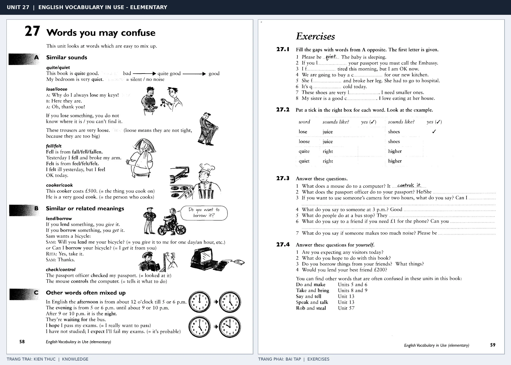

# Unit 27 — Words you may confuse: Những cặp từ dễ nhầm

*Trang trái cung cấp kiến thức và ví dụ; trang phải là phần Exercises của Unit tương ứng. Có thể phóng to ảnh để làm bài tập gốc.*

> **Module 03:** Từ vựng và ngữ pháp  
> **Phạm vi:** English Vocabulary in Use — Elementary, Unit 27; trang in 58–59 (PDF trang 61–62).  
> **Hình thức:** Tự học từ vựng A1–A2 · Giảng giải tiếng Việt · Luyện câu và bài tập.

## 1. Tóm tắt và mục tiêu

Các cặp khá giống âm hoặc nghĩa dễ dẫn đến sai ngữ cảnh. Kiểm tra vị trí người nói, chủ thể hành động và giới từ: borrow from someone nhưng lend to someone.

Sau bài này, bạn có thể:

- Giải thích nghĩa và cách sử dụng những từ, cụm từ cốt lõi của chủ đề **những cặp từ dễ nhầm**.
- Chọn đúng cách diễn đạt trong câu tiếng Anh đơn giản thay vì dịch máy móc từng từ.
- Tự đặt ít nhất ba câu thực tế và hoàn thành phần Exercises ở trang sách bên phải.

## 2. Kiến thức và từ vựng cốt lõi

Đọc kỹ từng mục. Với từ nhiều nghĩa, nghĩa ghi trong bảng được giới hạn ở cách dùng cần cho bài học này.

| Từ/cụm từ tiếng Anh | Nghĩa tiếng Việt |
| --- | --- |
| **quiet** | yên tĩnh |
| **quite** | khá |
| **lose** | đánh mất |
| **loose** | lỏng |
| **lend** | cho mượn |
| **borrow** | mượn |
| **bring** | mang đến |
| **take** | mang đi |
| **hear** | nghe thấy |
| **listen to** | lắng nghe |
| **say** | nói |
| **tell** | kể hoặc nói cho ai |
| **wear** | mặc |
| **carry** | mang vác |

### 2.1. Ghi nhớ theo nhóm và ngữ cảnh

**Nhóm từ thứ nhất:** quiet (yên tĩnh), quite (khá), lose (đánh mất).

**Nhóm từ thứ hai:** borrow (mượn), bring (mang đến), take (mang đi).

Hãy ghép từ với tình huống sử dụng thực tế. Khi gặp cụm từ có nhiều thành phần, ưu tiên ghi cả cụm kèm một câu ví dụ trong sổ từ vựng.

### 2.2. Mẫu câu song ngữ

**Ví dụ 1.** Can I borrow your pen?

→ Tôi có thể mượn bút của bạn không?

**Ví dụ 2.** This room is very quiet.

→ Căn phòng này rất yên tĩnh.

Đọc từng câu thành tiếng, che phần dịch tiếng Việt và thử nói lại ý bằng lời của mình. Sau đó thay một chi tiết trong câu để tạo ví dụ mới.

## 3. Luyện tập ứng dụng

**Bài A — Nhớ từ trong ngữ cảnh.** Không nhìn bảng, hãy viết tiếng Anh tương ứng với các ý sau:

1. Yên tĩnh: __________
2. Lỏng: __________
3. Mang đi: __________

**Bài B — Dịch và biến đổi câu.** Dịch hai câu dưới đây sang tiếng Anh trước khi nhìn mẫu câu ở trên:

1. Tôi có thể mượn bút của bạn không?
2. Căn phòng này rất yên tĩnh.

**Bài C — Viết cho bản thân.** Viết ba câu mới về cuộc sống của bạn, mỗi câu sử dụng một từ/cụm từ khác nhau trong bảng. Đọc lại để kiểm tra giới từ, cách chia động từ và trật tự từ.

**Bài D — Thực hành theo sách.** Quan sát phần **Exercises (trang phải)** trong ảnh ghép: giải bài tập trên giấy hoặc một file riêng, sau đó so sánh với các ví dụ ở trang trái. Những bài yêu cầu thông tin cá nhân không nhất thiết có một đáp án cố định.

## 4. Câu hỏi ôn tập trắc nghiệm

*Mỗi câu có một đáp án phù hợp nhất. Hãy tự trả lời trước khi đọc phần giải thích.*

### Câu 1

Bạn muốn diễn đạt **“khá”** bằng tiếng Anh. Chọn cách nói phù hợp nhất.

A. bring

B. wear

C. quite

D. carry

**Đáp án:** C. **Giải thích:** “quite” diễn đạt “khá” trong chủ đề này.

### Câu 2

Cụm từ **“borrow”** có nghĩa nào trong bài học?

A. mang đến

B. mang đi

C. nghe thấy

D. mượn

**Đáp án:** D. **Giải thích:** “borrow” được dùng với nghĩa “mượn”.

### Câu 3

Khi cần nói **“nghe thấy”**, chọn từ/cụm từ nào?

A. hear

B. bring

C. quite

D. say

**Đáp án:** A. **Giải thích:** Cách dùng đúng trong bài là “hear”.

### Câu 4

Chọn câu tiếng Anh diễn đạt đúng nhất: **“Tôi có thể mượn bút của bạn không?”**

A. I have written the letter.

B. The answer is incorrect.

C. My luggage is heavy.

D. Can I borrow your pen?

**Đáp án:** D. **Giải thích:** “Can I borrow your pen?” là câu tương ứng với tình huống đã nêu.

### Câu 5

Ý nghĩa phù hợp nhất của câu **“This room is very quiet.”** là gì?

A. Căn phòng này rất yên tĩnh.

B. Chúng tôi ở nhà vì trời mưa.

C. Tôi gặp cô ấy hai ngày trước.

D. Cuốn từ điển này hữu ích.

**Đáp án:** A. **Giải thích:** “This room is very quiet.” có nghĩa là “Căn phòng này rất yên tĩnh.”.

## 5. Tổng kết và kiểm tra hoàn thành

Bài **This room is very quiet.** giúp bạn sử dụng vốn từ về **căn phòng này rất yên tĩnh.** trong câu tiếng Anh thực tế. Giá trị quan trọng nhất không chỉ là biết nghĩa, mà là nhớ **cách kết hợp từ và ngữ cảnh sử dụng**.

- [ ] Tôi đã học bảng từ/cụm từ và đọc thành tiếng các ví dụ.
- [ ] Tôi đã hoàn thành ba phần luyện tập A, B, C.
- [ ] Tôi đã làm trang Exercises trong ảnh ghép và 5 câu trắc nghiệm.
- [ ] Tôi đã ghi các từ dễ nhầm vào sổ để ôn lại sau 1–3 ngày.

---

[← Unit 26: Hậu tố](26-suffixes.md) · [Unit 28: Sinh, kết hôn và qua đời →](../04-people/28-birth-marriage-and-death.md)

[↑ Trở về mục lục khóa học](../../MUC_LUC.md)
