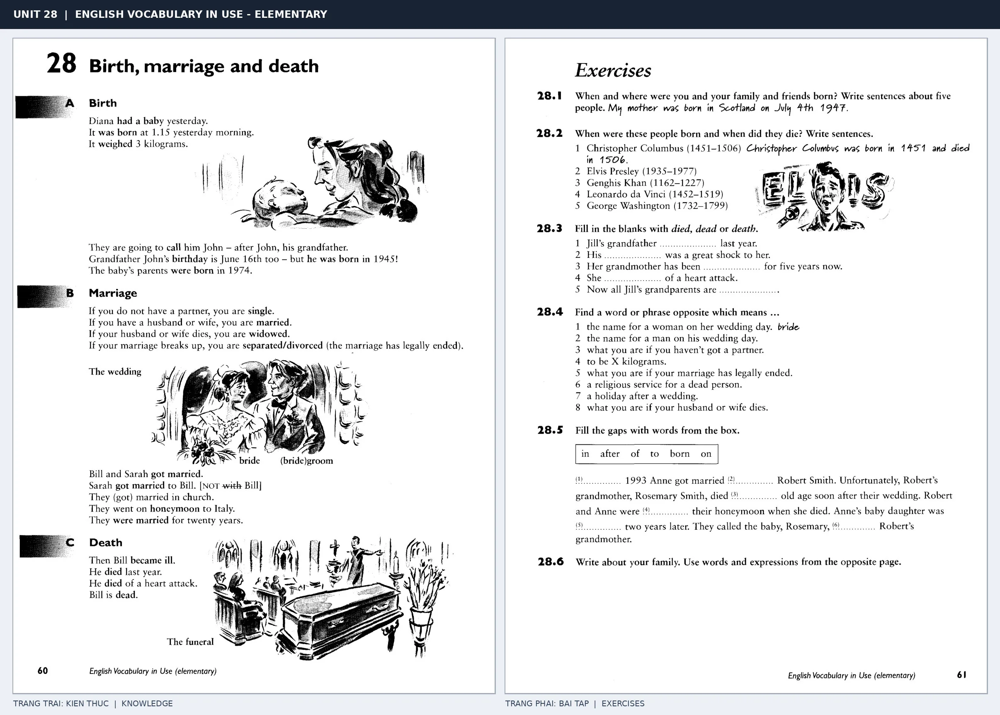

# Unit 28 — Birth, marriage and death: Sinh, kết hôn và qua đời

*Trang trái cung cấp kiến thức và ví dụ; trang phải là phần Exercises của Unit tương ứng. Có thể phóng to ảnh để làm bài tập gốc.*

> **Module 04:** Con người  
> **Phạm vi:** English Vocabulary in Use — Elementary, Unit 28; trang in 60–61 (PDF trang 63–64).  
> **Hình thức:** Tự học từ vựng A1–A2 · Giảng giải tiếng Việt · Luyện câu và bài tập.

## 1. Tóm tắt và mục tiêu

Các mốc đời người đi cùng cấu trúc khác nhau: be born + thời gian/địa điểm; get married chỉ sự kiện kết hôn; married mô tả tình trạng; die là động từ còn dead là tính từ.

Sau bài này, bạn có thể:

- Giải thích nghĩa và cách sử dụng những từ, cụm từ cốt lõi của chủ đề **sinh, kết hôn và qua đời**.
- Chọn đúng cách diễn đạt trong câu tiếng Anh đơn giản thay vì dịch máy móc từng từ.
- Tự đặt ít nhất ba câu thực tế và hoàn thành phần Exercises ở trang sách bên phải.

## 2. Kiến thức và từ vựng cốt lõi

Đọc kỹ từng mục. Với từ nhiều nghĩa, nghĩa ghi trong bảng được giới hạn ở cách dùng cần cho bài học này.

| Từ/cụm từ tiếng Anh | Nghĩa tiếng Việt |
| --- | --- |
| **be born** | được sinh ra |
| **birthday** | sinh nhật |
| **baby** | em bé |
| **weigh** | nặng bao nhiêu |
| **grow up** | lớn lên |
| **get married** | kết hôn |
| **wedding** | lễ cưới |
| **husband** | chồng |
| **wife** | vợ |
| **die** | qua đời |
| **dead** | đã chết |
| **funeral** | tang lễ |

### 2.1. Ghi nhớ theo nhóm và ngữ cảnh

**Nhóm từ thứ nhất:** be born (được sinh ra), birthday (sinh nhật), baby (em bé).

**Nhóm từ thứ hai:** get married (kết hôn), wedding (lễ cưới), husband (chồng).

Hãy ghép từ với tình huống sử dụng thực tế. Khi gặp cụm từ có nhiều thành phần, ưu tiên ghi cả cụm kèm một câu ví dụ trong sổ từ vựng.

### 2.2. Mẫu câu song ngữ

**Ví dụ 1.** She was born in 1998.

→ Cô ấy sinh năm 1998.

**Ví dụ 2.** They got married last year.

→ Họ kết hôn năm ngoái.

Đọc từng câu thành tiếng, che phần dịch tiếng Việt và thử nói lại ý bằng lời của mình. Sau đó thay một chi tiết trong câu để tạo ví dụ mới.

## 3. Luyện tập ứng dụng

**Bài A — Nhớ từ trong ngữ cảnh.** Không nhìn bảng, hãy viết tiếng Anh tương ứng với các ý sau:

1. Được sinh ra: __________
2. Nặng bao nhiêu: __________
3. Chồng: __________

**Bài B — Dịch và biến đổi câu.** Dịch hai câu dưới đây sang tiếng Anh trước khi nhìn mẫu câu ở trên:

1. Cô ấy sinh năm 1998.
2. Họ kết hôn năm ngoái.

**Bài C — Viết cho bản thân.** Viết ba câu mới về cuộc sống của bạn, mỗi câu sử dụng một từ/cụm từ khác nhau trong bảng. Đọc lại để kiểm tra giới từ, cách chia động từ và trật tự từ.

**Bài D — Thực hành theo sách.** Quan sát phần **Exercises (trang phải)** trong ảnh ghép: giải bài tập trên giấy hoặc một file riêng, sau đó so sánh với các ví dụ ở trang trái. Những bài yêu cầu thông tin cá nhân không nhất thiết có một đáp án cố định.

## 4. Câu hỏi ôn tập trắc nghiệm

*Mỗi câu có một đáp án phù hợp nhất. Hãy tự trả lời trước khi đọc phần giải thích.*

### Câu 1

Bạn muốn diễn đạt **“sinh nhật”** bằng tiếng Anh. Chọn cách nói phù hợp nhất.

A. funeral

B. dead

C. birthday

D. get married

**Đáp án:** C. **Giải thích:** “birthday” diễn đạt “sinh nhật” trong chủ đề này.

### Câu 2

Cụm từ **“get married”** có nghĩa nào trong bài học?

A. kết hôn

B. đã chết

C. lớn lên

D. em bé

**Đáp án:** A. **Giải thích:** “get married” được dùng với nghĩa “kết hôn”.

### Câu 3

Khi cần nói **“vợ”**, chọn từ/cụm từ nào?

A. wedding

B. be born

C. wife

D. husband

**Đáp án:** C. **Giải thích:** Cách dùng đúng trong bài là “wife”.

### Câu 4

Chọn câu tiếng Anh diễn đạt đúng nhất: **“Cô ấy sinh năm 1998.”**

A. She was born in 1998.

B. She has two sisters.

C. You should go home and rest.

D. Thank you very much.

**Đáp án:** A. **Giải thích:** “She was born in 1998.” là câu tương ứng với tình huống đã nêu.

### Câu 5

Ý nghĩa phù hợp nhất của câu **“They got married last year.”** là gì?

A. Cô ấy lo lắng về kỳ thi.

B. Cô ấy có mái tóc dài màu sẫm.

C. Anh ấy cao và mảnh mai.

D. Họ kết hôn năm ngoái.

**Đáp án:** D. **Giải thích:** “They got married last year.” có nghĩa là “Họ kết hôn năm ngoái.”.

## 5. Tổng kết và kiểm tra hoàn thành

Bài **They got married last year.** giúp bạn sử dụng vốn từ về **họ kết hôn năm ngoái.** trong câu tiếng Anh thực tế. Giá trị quan trọng nhất không chỉ là biết nghĩa, mà là nhớ **cách kết hợp từ và ngữ cảnh sử dụng**.

- [ ] Tôi đã học bảng từ/cụm từ và đọc thành tiếng các ví dụ.
- [ ] Tôi đã hoàn thành ba phần luyện tập A, B, C.
- [ ] Tôi đã làm trang Exercises trong ảnh ghép và 5 câu trắc nghiệm.
- [ ] Tôi đã ghi các từ dễ nhầm vào sổ để ôn lại sau 1–3 ngày.

---

[← Unit 27: Những cặp từ dễ nhầm](../03-words-and-grammar/27-words-you-may-confuse.md) · [Unit 29: Gia đình và họ hàng →](29-the-family.md)

[↑ Trở về mục lục khóa học](../../MUC_LUC.md)
