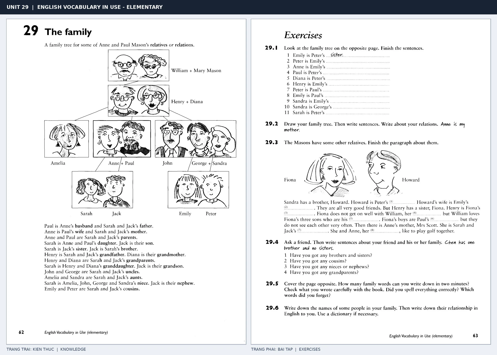

# Unit 29 — The family: Gia đình và họ hàng

*Trang trái cung cấp kiến thức và ví dụ; trang phải là phần Exercises của Unit tương ứng. Có thể phóng to ảnh để làm bài tập gốc.*

> **Module 04:** Con người  
> **Phạm vi:** English Vocabulary in Use — Elementary, Unit 29; trang in 62–63 (PDF trang 65–66).  
> **Hình thức:** Tự học từ vựng A1–A2 · Giảng giải tiếng Việt · Luyện câu và bài tập.

## 1. Tóm tắt và mục tiêu

Mô tả quan hệ gia đình bằng tính sở hữu: Anne's husband, Paul's daughter. Sơ đồ family tree giúp nhìn quan hệ theo thế hệ, tránh nhầm uncle với cousin.

Sau bài này, bạn có thể:

- Giải thích nghĩa và cách sử dụng những từ, cụm từ cốt lõi của chủ đề **gia đình và họ hàng**.
- Chọn đúng cách diễn đạt trong câu tiếng Anh đơn giản thay vì dịch máy móc từng từ.
- Tự đặt ít nhất ba câu thực tế và hoàn thành phần Exercises ở trang sách bên phải.

## 2. Kiến thức và từ vựng cốt lõi

Đọc kỹ từng mục. Với từ nhiều nghĩa, nghĩa ghi trong bảng được giới hạn ở cách dùng cần cho bài học này.

| Từ/cụm từ tiếng Anh | Nghĩa tiếng Việt |
| --- | --- |
| **mother** | mẹ |
| **father** | cha |
| **parent** | cha hoặc mẹ |
| **son** | con trai |
| **daughter** | con gái |
| **brother** | anh hoặc em trai |
| **sister** | chị hoặc em gái |
| **husband** | chồng |
| **wife** | vợ |
| **uncle** | chú bác cậu |
| **aunt** | cô dì bác gái |
| **cousin** | anh chị em họ |
| **grandmother** | bà |
| **grandfather** | ông |

### 2.1. Ghi nhớ theo nhóm và ngữ cảnh

**Nhóm từ thứ nhất:** mother (mẹ), father (cha), parent (cha hoặc mẹ).

**Nhóm từ thứ hai:** brother (anh hoặc em trai), sister (chị hoặc em gái), husband (chồng).

Hãy ghép từ với tình huống sử dụng thực tế. Khi gặp cụm từ có nhiều thành phần, ưu tiên ghi cả cụm kèm một câu ví dụ trong sổ từ vựng.

### 2.2. Mẫu câu song ngữ

**Ví dụ 1.** My uncle lives in London.

→ Chú tôi sống ở London.

**Ví dụ 2.** She has two sisters.

→ Cô ấy có hai chị em gái.

Đọc từng câu thành tiếng, che phần dịch tiếng Việt và thử nói lại ý bằng lời của mình. Sau đó thay một chi tiết trong câu để tạo ví dụ mới.

## 3. Luyện tập ứng dụng

**Bài A — Nhớ từ trong ngữ cảnh.** Không nhìn bảng, hãy viết tiếng Anh tương ứng với các ý sau:

1. Mẹ: __________
2. Con trai: __________
3. Chồng: __________

**Bài B — Dịch và biến đổi câu.** Dịch hai câu dưới đây sang tiếng Anh trước khi nhìn mẫu câu ở trên:

1. Chú tôi sống ở London.
2. Cô ấy có hai chị em gái.

**Bài C — Viết cho bản thân.** Viết ba câu mới về cuộc sống của bạn, mỗi câu sử dụng một từ/cụm từ khác nhau trong bảng. Đọc lại để kiểm tra giới từ, cách chia động từ và trật tự từ.

**Bài D — Thực hành theo sách.** Quan sát phần **Exercises (trang phải)** trong ảnh ghép: giải bài tập trên giấy hoặc một file riêng, sau đó so sánh với các ví dụ ở trang trái. Những bài yêu cầu thông tin cá nhân không nhất thiết có một đáp án cố định.

## 4. Câu hỏi ôn tập trắc nghiệm

*Mỗi câu có một đáp án phù hợp nhất. Hãy tự trả lời trước khi đọc phần giải thích.*

### Câu 1

Bạn muốn diễn đạt **“cha”** bằng tiếng Anh. Chọn cách nói phù hợp nhất.

A. husband

B. grandfather

C. wife

D. father

**Đáp án:** D. **Giải thích:** “father” diễn đạt “cha” trong chủ đề này.

### Câu 2

Cụm từ **“brother”** có nghĩa nào trong bài học?

A. chú bác cậu

B. cô dì bác gái

C. anh hoặc em trai

D. chị hoặc em gái

**Đáp án:** C. **Giải thích:** “brother” được dùng với nghĩa “anh hoặc em trai”.

### Câu 3

Khi cần nói **“vợ”**, chọn từ/cụm từ nào?

A. son

B. husband

C. mother

D. wife

**Đáp án:** D. **Giải thích:** Cách dùng đúng trong bài là “wife”.

### Câu 4

Chọn câu tiếng Anh diễn đạt đúng nhất: **“Chú tôi sống ở London.”**

A. She has blue eyes.

B. My left foot hurts.

C. They got married last year.

D. My uncle lives in London.

**Đáp án:** D. **Giải thích:** “My uncle lives in London.” là câu tương ứng với tình huống đã nêu.

### Câu 5

Ý nghĩa phù hợp nhất của câu **“She has two sisters.”** là gì?

A. Cô ấy có hai chị em gái.

B. Bàn chân trái của tôi đau.

C. Cô ấy có mái tóc dài màu sẫm.

D. Hôm nay tôi bị đau đầu.

**Đáp án:** A. **Giải thích:** “She has two sisters.” có nghĩa là “Cô ấy có hai chị em gái.”.

## 5. Tổng kết và kiểm tra hoàn thành

Bài **She has two sisters.** giúp bạn sử dụng vốn từ về **cô ấy có hai chị em gái.** trong câu tiếng Anh thực tế. Giá trị quan trọng nhất không chỉ là biết nghĩa, mà là nhớ **cách kết hợp từ và ngữ cảnh sử dụng**.

- [ ] Tôi đã học bảng từ/cụm từ và đọc thành tiếng các ví dụ.
- [ ] Tôi đã hoàn thành ba phần luyện tập A, B, C.
- [ ] Tôi đã làm trang Exercises trong ảnh ghép và 5 câu trắc nghiệm.
- [ ] Tôi đã ghi các từ dễ nhầm vào sổ để ôn lại sau 1–3 ngày.

---

[← Unit 28: Sinh, kết hôn và qua đời](28-birth-marriage-and-death.md) · [Unit 30: Các bộ phận cơ thể →](30-parts-of-the-body.md)

[↑ Trở về mục lục khóa học](../../MUC_LUC.md)
