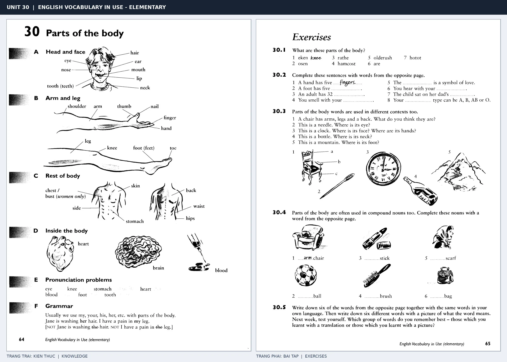

# Unit 30 — Parts of the body: Các bộ phận cơ thể

*Trang trái cung cấp kiến thức và ví dụ; trang phải là phần Exercises của Unit tương ứng. Có thể phóng to ảnh để làm bài tập gốc.*

> **Module 04:** Con người  
> **Phạm vi:** English Vocabulary in Use — Elementary, Unit 30; trang in 64–65 (PDF trang 67–68).  
> **Hình thức:** Tự học từ vựng A1–A2 · Giảng giải tiếng Việt · Luyện câu và bài tập.

## 1. Tóm tắt và mục tiêu

Nhóm từ theo vị trí: đầu–mặt, tay–chân và phần thân. Chú ý số nhiều bất quy tắc tooth–teeth và foot–feet. Khi mô tả bộ phận bị đau có thể dùng my head hurts hoặc have a headache.

Sau bài này, bạn có thể:

- Giải thích nghĩa và cách sử dụng những từ, cụm từ cốt lõi của chủ đề **các bộ phận cơ thể**.
- Chọn đúng cách diễn đạt trong câu tiếng Anh đơn giản thay vì dịch máy móc từng từ.
- Tự đặt ít nhất ba câu thực tế và hoàn thành phần Exercises ở trang sách bên phải.

## 2. Kiến thức và từ vựng cốt lõi

Đọc kỹ từng mục. Với từ nhiều nghĩa, nghĩa ghi trong bảng được giới hạn ở cách dùng cần cho bài học này.

| Từ/cụm từ tiếng Anh | Nghĩa tiếng Việt |
| --- | --- |
| **head** | đầu |
| **hair** | tóc |
| **eye** | mắt |
| **ear** | tai |
| **nose** | mũi |
| **mouth** | miệng |
| **tooth** | răng |
| **teeth** | các răng |
| **neck** | cổ |
| **shoulder** | vai |
| **arm** | cánh tay |
| **hand** | bàn tay |
| **leg** | chân |
| **foot** | bàn chân |
| **feet** | các bàn chân |

### 2.1. Ghi nhớ theo nhóm và ngữ cảnh

**Nhóm từ thứ nhất:** head (đầu), hair (tóc), eye (mắt).

**Nhóm từ thứ hai:** mouth (miệng), tooth (răng), teeth (các răng).

Hãy ghép từ với tình huống sử dụng thực tế. Khi gặp cụm từ có nhiều thành phần, ưu tiên ghi cả cụm kèm một câu ví dụ trong sổ từ vựng.

### 2.2. Mẫu câu song ngữ

**Ví dụ 1.** My left foot hurts.

→ Bàn chân trái của tôi đau.

**Ví dụ 2.** She has blue eyes.

→ Cô ấy có đôi mắt xanh.

Đọc từng câu thành tiếng, che phần dịch tiếng Việt và thử nói lại ý bằng lời của mình. Sau đó thay một chi tiết trong câu để tạo ví dụ mới.

## 3. Luyện tập ứng dụng

**Bài A — Nhớ từ trong ngữ cảnh.** Không nhìn bảng, hãy viết tiếng Anh tương ứng với các ý sau:

1. Đầu: __________
2. Tai: __________
3. Các răng: __________

**Bài B — Dịch và biến đổi câu.** Dịch hai câu dưới đây sang tiếng Anh trước khi nhìn mẫu câu ở trên:

1. Bàn chân trái của tôi đau.
2. Cô ấy có đôi mắt xanh.

**Bài C — Viết cho bản thân.** Viết ba câu mới về cuộc sống của bạn, mỗi câu sử dụng một từ/cụm từ khác nhau trong bảng. Đọc lại để kiểm tra giới từ, cách chia động từ và trật tự từ.

**Bài D — Thực hành theo sách.** Quan sát phần **Exercises (trang phải)** trong ảnh ghép: giải bài tập trên giấy hoặc một file riêng, sau đó so sánh với các ví dụ ở trang trái. Những bài yêu cầu thông tin cá nhân không nhất thiết có một đáp án cố định.

## 4. Câu hỏi ôn tập trắc nghiệm

*Mỗi câu có một đáp án phù hợp nhất. Hãy tự trả lời trước khi đọc phần giải thích.*

### Câu 1

Bạn muốn diễn đạt **“tóc”** bằng tiếng Anh. Chọn cách nói phù hợp nhất.

A. arm

B. head

C. hair

D. foot

**Đáp án:** C. **Giải thích:** “hair” diễn đạt “tóc” trong chủ đề này.

### Câu 2

Cụm từ **“mouth”** có nghĩa nào trong bài học?

A. mắt

B. miệng

C. tai

D. các răng

**Đáp án:** B. **Giải thích:** “mouth” được dùng với nghĩa “miệng”.

### Câu 3

Khi cần nói **“cổ”**, chọn từ/cụm từ nào?

A. foot

B. arm

C. neck

D. nose

**Đáp án:** C. **Giải thích:** Cách dùng đúng trong bài là “neck”.

### Câu 4

Chọn câu tiếng Anh diễn đạt đúng nhất: **“Bàn chân trái của tôi đau.”**

A. My uncle lives in London.

B. They got married last year.

C. My left foot hurts.

D. He is tall and slim.

**Đáp án:** C. **Giải thích:** “My left foot hurts.” là câu tương ứng với tình huống đã nêu.

### Câu 5

Ý nghĩa phù hợp nhất của câu **“She has blue eyes.”** là gì?

A. Bạn nên về nhà nghỉ ngơi.

B. Cô ấy có đôi mắt xanh.

C. Hôm nay tôi bị đau đầu.

D. Cô ấy lo lắng về kỳ thi.

**Đáp án:** B. **Giải thích:** “She has blue eyes.” có nghĩa là “Cô ấy có đôi mắt xanh.”.

## 5. Tổng kết và kiểm tra hoàn thành

Bài **She has blue eyes.** giúp bạn sử dụng vốn từ về **cô ấy có đôi mắt xanh.** trong câu tiếng Anh thực tế. Giá trị quan trọng nhất không chỉ là biết nghĩa, mà là nhớ **cách kết hợp từ và ngữ cảnh sử dụng**.

- [ ] Tôi đã học bảng từ/cụm từ và đọc thành tiếng các ví dụ.
- [ ] Tôi đã hoàn thành ba phần luyện tập A, B, C.
- [ ] Tôi đã làm trang Exercises trong ảnh ghép và 5 câu trắc nghiệm.
- [ ] Tôi đã ghi các từ dễ nhầm vào sổ để ôn lại sau 1–3 ngày.

---

[← Unit 29: Gia đình và họ hàng](29-the-family.md) · [Unit 31: Trang phục →](31-clothes.md)

[↑ Trở về mục lục khóa học](../../MUC_LUC.md)
