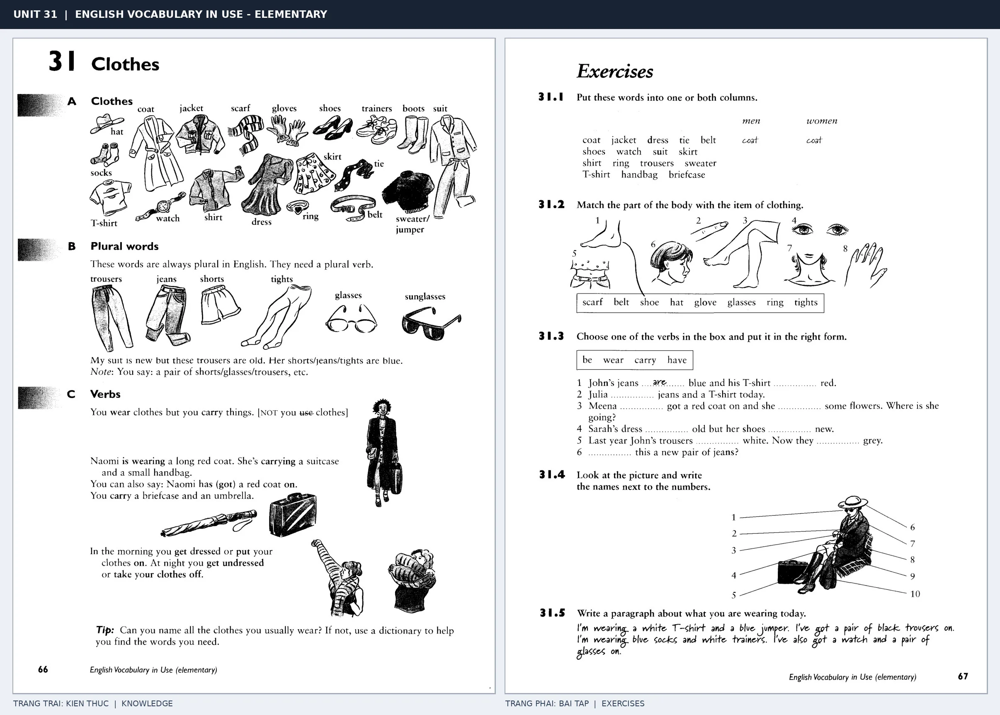

# Unit 31 — Clothes: Trang phục

*Trang trái cung cấp kiến thức và ví dụ; trang phải là phần Exercises của Unit tương ứng. Có thể phóng to ảnh để làm bài tập gốc.*

> **Module 04:** Con người  
> **Phạm vi:** English Vocabulary in Use — Elementary, Unit 31; trang in 66–67 (PDF trang 69–70).  
> **Hình thức:** Tự học từ vựng A1–A2 · Giảng giải tiếng Việt · Luyện câu và bài tập.

## 1. Tóm tắt và mục tiêu

Một số tên trang phục đi số nhiều, chẳng hạn trousers, shorts, glasses; cần dùng are hoặc a pair of. Phân biệt wear (đang mặc), put on (mặc vào) và take off (cởi ra).

Sau bài này, bạn có thể:

- Giải thích nghĩa và cách sử dụng những từ, cụm từ cốt lõi của chủ đề **trang phục**.
- Chọn đúng cách diễn đạt trong câu tiếng Anh đơn giản thay vì dịch máy móc từng từ.
- Tự đặt ít nhất ba câu thực tế và hoàn thành phần Exercises ở trang sách bên phải.

## 2. Kiến thức và từ vựng cốt lõi

Đọc kỹ từng mục. Với từ nhiều nghĩa, nghĩa ghi trong bảng được giới hạn ở cách dùng cần cho bài học này.

| Từ/cụm từ tiếng Anh | Nghĩa tiếng Việt |
| --- | --- |
| **coat** | áo khoác ngoài |
| **jacket** | áo khoác |
| **sweater** | áo len |
| **shirt** | áo sơ mi |
| **T-shirt** | áo thun |
| **dress** | váy liền |
| **skirt** | chân váy |
| **trousers** | quần dài |
| **shorts** | quần đùi |
| **shoes** | giày |
| **trainers** | giày thể thao |
| **boots** | ủng |
| **gloves** | găng tay |
| **scarf** | khăn quàng |

### 2.1. Ghi nhớ theo nhóm và ngữ cảnh

**Nhóm từ thứ nhất:** coat (áo khoác ngoài), jacket (áo khoác), sweater (áo len).

**Nhóm từ thứ hai:** dress (váy liền), skirt (chân váy), trousers (quần dài).

Hãy ghép từ với tình huống sử dụng thực tế. Khi gặp cụm từ có nhiều thành phần, ưu tiên ghi cả cụm kèm một câu ví dụ trong sổ từ vựng.

### 2.2. Mẫu câu song ngữ

**Ví dụ 1.** She is wearing a blue dress.

→ Cô ấy đang mặc một chiếc váy xanh.

**Ví dụ 2.** These trousers are new.

→ Chiếc quần dài này mới.

Đọc từng câu thành tiếng, che phần dịch tiếng Việt và thử nói lại ý bằng lời của mình. Sau đó thay một chi tiết trong câu để tạo ví dụ mới.

## 3. Luyện tập ứng dụng

**Bài A — Nhớ từ trong ngữ cảnh.** Không nhìn bảng, hãy viết tiếng Anh tương ứng với các ý sau:

1. Áo khoác ngoài: __________
2. Áo sơ mi: __________
3. Quần dài: __________

**Bài B — Dịch và biến đổi câu.** Dịch hai câu dưới đây sang tiếng Anh trước khi nhìn mẫu câu ở trên:

1. Cô ấy đang mặc một chiếc váy xanh.
2. Chiếc quần dài này mới.

**Bài C — Viết cho bản thân.** Viết ba câu mới về cuộc sống của bạn, mỗi câu sử dụng một từ/cụm từ khác nhau trong bảng. Đọc lại để kiểm tra giới từ, cách chia động từ và trật tự từ.

**Bài D — Thực hành theo sách.** Quan sát phần **Exercises (trang phải)** trong ảnh ghép: giải bài tập trên giấy hoặc một file riêng, sau đó so sánh với các ví dụ ở trang trái. Những bài yêu cầu thông tin cá nhân không nhất thiết có một đáp án cố định.

## 4. Câu hỏi ôn tập trắc nghiệm

*Mỗi câu có một đáp án phù hợp nhất. Hãy tự trả lời trước khi đọc phần giải thích.*

### Câu 1

Bạn muốn diễn đạt **“áo khoác”** bằng tiếng Anh. Chọn cách nói phù hợp nhất.

A. jacket

B. sweater

C. T-shirt

D. shorts

**Đáp án:** A. **Giải thích:** “jacket” diễn đạt “áo khoác” trong chủ đề này.

### Câu 2

Cụm từ **“dress”** có nghĩa nào trong bài học?

A. găng tay

B. áo khoác ngoài

C. váy liền

D. áo len

**Đáp án:** C. **Giải thích:** “dress” được dùng với nghĩa “váy liền”.

### Câu 3

Khi cần nói **“quần đùi”**, chọn từ/cụm từ nào?

A. T-shirt

B. shorts

C. scarf

D. shirt

**Đáp án:** B. **Giải thích:** Cách dùng đúng trong bài là “shorts”.

### Câu 4

Chọn câu tiếng Anh diễn đạt đúng nhất: **“Cô ấy đang mặc một chiếc váy xanh.”**

A. My left foot hurts.

B. She is wearing a blue dress.

C. He is tall and slim.

D. You should go home and rest.

**Đáp án:** B. **Giải thích:** “She is wearing a blue dress.” là câu tương ứng với tình huống đã nêu.

### Câu 5

Ý nghĩa phù hợp nhất của câu **“These trousers are new.”** là gì?

A. Bàn chân trái của tôi đau.

B. Cô ấy lo lắng về kỳ thi.

C. Cô ấy có hai chị em gái.

D. Chiếc quần dài này mới.

**Đáp án:** D. **Giải thích:** “These trousers are new.” có nghĩa là “Chiếc quần dài này mới.”.

## 5. Tổng kết và kiểm tra hoàn thành

Bài **These trousers are new.** giúp bạn sử dụng vốn từ về **chiếc quần dài này mới.** trong câu tiếng Anh thực tế. Giá trị quan trọng nhất không chỉ là biết nghĩa, mà là nhớ **cách kết hợp từ và ngữ cảnh sử dụng**.

- [ ] Tôi đã học bảng từ/cụm từ và đọc thành tiếng các ví dụ.
- [ ] Tôi đã hoàn thành ba phần luyện tập A, B, C.
- [ ] Tôi đã làm trang Exercises trong ảnh ghép và 5 câu trắc nghiệm.
- [ ] Tôi đã ghi các từ dễ nhầm vào sổ để ôn lại sau 1–3 ngày.

---

[← Unit 30: Các bộ phận cơ thể](30-parts-of-the-body.md) · [Unit 32: Miêu tả ngoại hình →](32-describing-people.md)

[↑ Trở về mục lục khóa học](../../MUC_LUC.md)
