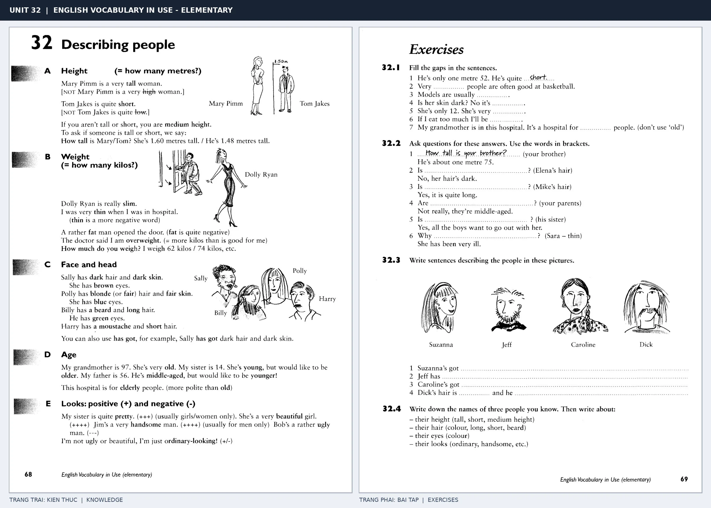

# Unit 32 — Describing people: Miêu tả ngoại hình

*Trang trái cung cấp kiến thức và ví dụ; trang phải là phần Exercises của Unit tương ứng. Có thể phóng to ảnh để làm bài tập gốc.*

> **Module 04:** Con người  
> **Phạm vi:** English Vocabulary in Use — Elementary, Unit 32; trang in 68–69 (PDF trang 71–72).  
> **Hình thức:** Tự học từ vựng A1–A2 · Giảng giải tiếng Việt · Luyện câu và bài tập.

## 1. Tóm tắt và mục tiêu

Height dùng tall/short, không dùng high/low cho chiều cao người. Khi hỏi ngoại hình dùng What does he/she look like?, còn tính cách dùng What is he/she like?

Sau bài này, bạn có thể:

- Giải thích nghĩa và cách sử dụng những từ, cụm từ cốt lõi của chủ đề **miêu tả ngoại hình**.
- Chọn đúng cách diễn đạt trong câu tiếng Anh đơn giản thay vì dịch máy móc từng từ.
- Tự đặt ít nhất ba câu thực tế và hoàn thành phần Exercises ở trang sách bên phải.

## 2. Kiến thức và từ vựng cốt lõi

Đọc kỹ từng mục. Với từ nhiều nghĩa, nghĩa ghi trong bảng được giới hạn ở cách dùng cần cho bài học này.

| Từ/cụm từ tiếng Anh | Nghĩa tiếng Việt |
| --- | --- |
| **tall** | cao |
| **short** | thấp |
| **medium height** | cao trung bình |
| **slim** | mảnh mai |
| **thin** | gầy |
| **fat** | béo |
| **young** | trẻ |
| **old** | già |
| **dark hair** | tóc sẫm màu |
| **fair hair** | tóc sáng màu |
| **long hair** | tóc dài |
| **beard** | râu |
| **handsome** | đẹp trai |
| **pretty** | xinh xắn |

### 2.1. Ghi nhớ theo nhóm và ngữ cảnh

**Nhóm từ thứ nhất:** tall (cao), short (thấp), medium height (cao trung bình).

**Nhóm từ thứ hai:** fat (béo), young (trẻ), old (già).

Hãy ghép từ với tình huống sử dụng thực tế. Khi gặp cụm từ có nhiều thành phần, ưu tiên ghi cả cụm kèm một câu ví dụ trong sổ từ vựng.

### 2.2. Mẫu câu song ngữ

**Ví dụ 1.** He is tall and slim.

→ Anh ấy cao và mảnh mai.

**Ví dụ 2.** She has long dark hair.

→ Cô ấy có mái tóc dài màu sẫm.

Đọc từng câu thành tiếng, che phần dịch tiếng Việt và thử nói lại ý bằng lời của mình. Sau đó thay một chi tiết trong câu để tạo ví dụ mới.

## 3. Luyện tập ứng dụng

**Bài A — Nhớ từ trong ngữ cảnh.** Không nhìn bảng, hãy viết tiếng Anh tương ứng với các ý sau:

1. Cao: __________
2. Mảnh mai: __________
3. Già: __________

**Bài B — Dịch và biến đổi câu.** Dịch hai câu dưới đây sang tiếng Anh trước khi nhìn mẫu câu ở trên:

1. Anh ấy cao và mảnh mai.
2. Cô ấy có mái tóc dài màu sẫm.

**Bài C — Viết cho bản thân.** Viết ba câu mới về cuộc sống của bạn, mỗi câu sử dụng một từ/cụm từ khác nhau trong bảng. Đọc lại để kiểm tra giới từ, cách chia động từ và trật tự từ.

**Bài D — Thực hành theo sách.** Quan sát phần **Exercises (trang phải)** trong ảnh ghép: giải bài tập trên giấy hoặc một file riêng, sau đó so sánh với các ví dụ ở trang trái. Những bài yêu cầu thông tin cá nhân không nhất thiết có một đáp án cố định.

## 4. Câu hỏi ôn tập trắc nghiệm

*Mỗi câu có một đáp án phù hợp nhất. Hãy tự trả lời trước khi đọc phần giải thích.*

### Câu 1

Bạn muốn diễn đạt **“thấp”** bằng tiếng Anh. Chọn cách nói phù hợp nhất.

A. fat

B. long hair

C. short

D. tall

**Đáp án:** C. **Giải thích:** “short” diễn đạt “thấp” trong chủ đề này.

### Câu 2

Cụm từ **“fat”** có nghĩa nào trong bài học?

A. râu

B. xinh xắn

C. béo

D. trẻ

**Đáp án:** C. **Giải thích:** “fat” được dùng với nghĩa “béo”.

### Câu 3

Khi cần nói **“tóc sẫm màu”**, chọn từ/cụm từ nào?

A. pretty

B. fat

C. dark hair

D. beard

**Đáp án:** C. **Giải thích:** Cách dùng đúng trong bài là “dark hair”.

### Câu 4

Chọn câu tiếng Anh diễn đạt đúng nhất: **“Anh ấy cao và mảnh mai.”**

A. He is tall and slim.

B. You should go home and rest.

C. Good evening. How are you?

D. I have a headache today.

**Đáp án:** A. **Giải thích:** “He is tall and slim.” là câu tương ứng với tình huống đã nêu.

### Câu 5

Ý nghĩa phù hợp nhất của câu **“She has long dark hair.”** là gì?

A. Bàn chân trái của tôi đau.

B. Cô ấy sinh năm 1998.

C. Chú tôi sống ở London.

D. Cô ấy có mái tóc dài màu sẫm.

**Đáp án:** D. **Giải thích:** “She has long dark hair.” có nghĩa là “Cô ấy có mái tóc dài màu sẫm.”.

## 5. Tổng kết và kiểm tra hoàn thành

Bài **She has long dark hair.** giúp bạn sử dụng vốn từ về **cô ấy có mái tóc dài màu sẫm.** trong câu tiếng Anh thực tế. Giá trị quan trọng nhất không chỉ là biết nghĩa, mà là nhớ **cách kết hợp từ và ngữ cảnh sử dụng**.

- [ ] Tôi đã học bảng từ/cụm từ và đọc thành tiếng các ví dụ.
- [ ] Tôi đã hoàn thành ba phần luyện tập A, B, C.
- [ ] Tôi đã làm trang Exercises trong ảnh ghép và 5 câu trắc nghiệm.
- [ ] Tôi đã ghi các từ dễ nhầm vào sổ để ôn lại sau 1–3 ngày.

---

[← Unit 31: Trang phục](31-clothes.md) · [Unit 33: Sức khỏe và bệnh tật →](33-health-and-illness.md)

[↑ Trở về mục lục khóa học](../../MUC_LUC.md)
