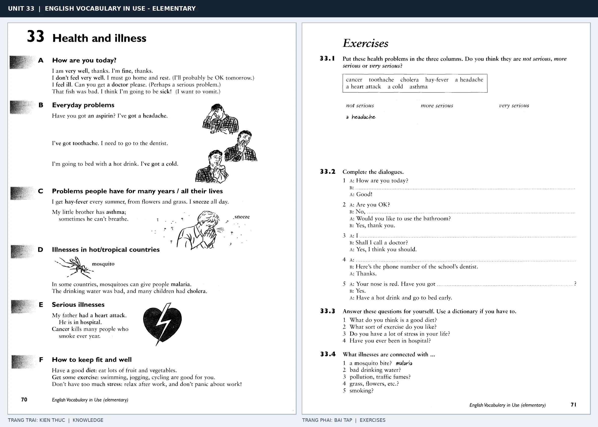

# Unit 33 — Health and illness: Sức khỏe và bệnh tật

*Trang trái cung cấp kiến thức và ví dụ; trang phải là phần Exercises của Unit tương ứng. Có thể phóng to ảnh để làm bài tập gốc.*

> **Module 04:** Con người  
> **Phạm vi:** English Vocabulary in Use — Elementary, Unit 33; trang in 70–71 (PDF trang 73–74).  
> **Hình thức:** Tự học từ vựng A1–A2 · Giảng giải tiếng Việt · Luyện câu và bài tập.

## 1. Tóm tắt và mục tiêu

Diễn đạt triệu chứng bằng have a headache, have a cold hoặc feel ill. Well là tính từ chỉ sức khỏe tốt; sau get thường là get better. Những câu hỏi giao tiếp như How are you today? giúp kiểm tra tình trạng.

Sau bài này, bạn có thể:

- Giải thích nghĩa và cách sử dụng những từ, cụm từ cốt lõi của chủ đề **sức khỏe và bệnh tật**.
- Chọn đúng cách diễn đạt trong câu tiếng Anh đơn giản thay vì dịch máy móc từng từ.
- Tự đặt ít nhất ba câu thực tế và hoàn thành phần Exercises ở trang sách bên phải.

## 2. Kiến thức và từ vựng cốt lõi

Đọc kỹ từng mục. Với từ nhiều nghĩa, nghĩa ghi trong bảng được giới hạn ở cách dùng cần cho bài học này.

| Từ/cụm từ tiếng Anh | Nghĩa tiếng Việt |
| --- | --- |
| **well** | khỏe |
| **ill** | bị ốm |
| **sick** | bị bệnh |
| **headache** | đau đầu |
| **toothache** | đau răng |
| **stomach ache** | đau bụng |
| **temperature** | bị sốt hoặc nhiệt độ |
| **cold** | cảm lạnh |
| **cough** | ho |
| **doctor** | bác sĩ |
| **medicine** | thuốc |
| **rest** | nghỉ ngơi |
| **feel better** | cảm thấy đỡ hơn |

### 2.1. Ghi nhớ theo nhóm và ngữ cảnh

**Nhóm từ thứ nhất:** well (khỏe), ill (bị ốm), sick (bị bệnh).

**Nhóm từ thứ hai:** stomach ache (đau bụng), temperature (bị sốt hoặc nhiệt độ), cold (cảm lạnh).

Hãy ghép từ với tình huống sử dụng thực tế. Khi gặp cụm từ có nhiều thành phần, ưu tiên ghi cả cụm kèm một câu ví dụ trong sổ từ vựng.

### 2.2. Mẫu câu song ngữ

**Ví dụ 1.** I have a headache today.

→ Hôm nay tôi bị đau đầu.

**Ví dụ 2.** You should go home and rest.

→ Bạn nên về nhà nghỉ ngơi.

Đọc từng câu thành tiếng, che phần dịch tiếng Việt và thử nói lại ý bằng lời của mình. Sau đó thay một chi tiết trong câu để tạo ví dụ mới.

## 3. Luyện tập ứng dụng

**Bài A — Nhớ từ trong ngữ cảnh.** Không nhìn bảng, hãy viết tiếng Anh tương ứng với các ý sau:

1. Khỏe: __________
2. Đau đầu: __________
3. Cảm lạnh: __________

**Bài B — Dịch và biến đổi câu.** Dịch hai câu dưới đây sang tiếng Anh trước khi nhìn mẫu câu ở trên:

1. Hôm nay tôi bị đau đầu.
2. Bạn nên về nhà nghỉ ngơi.

**Bài C — Viết cho bản thân.** Viết ba câu mới về cuộc sống của bạn, mỗi câu sử dụng một từ/cụm từ khác nhau trong bảng. Đọc lại để kiểm tra giới từ, cách chia động từ và trật tự từ.

**Bài D — Thực hành theo sách.** Quan sát phần **Exercises (trang phải)** trong ảnh ghép: giải bài tập trên giấy hoặc một file riêng, sau đó so sánh với các ví dụ ở trang trái. Những bài yêu cầu thông tin cá nhân không nhất thiết có một đáp án cố định.

## 4. Câu hỏi ôn tập trắc nghiệm

*Mỗi câu có một đáp án phù hợp nhất. Hãy tự trả lời trước khi đọc phần giải thích.*

### Câu 1

Bạn muốn diễn đạt **“bị ốm”** bằng tiếng Anh. Chọn cách nói phù hợp nhất.

A. headache

B. toothache

C. ill

D. medicine

**Đáp án:** C. **Giải thích:** “ill” diễn đạt “bị ốm” trong chủ đề này.

### Câu 2

Cụm từ **“stomach ache”** có nghĩa nào trong bài học?

A. đau bụng

B. bị ốm

C. đau răng

D. bị bệnh

**Đáp án:** A. **Giải thích:** “stomach ache” được dùng với nghĩa “đau bụng”.

### Câu 3

Khi cần nói **“ho”**, chọn từ/cụm từ nào?

A. doctor

B. sick

C. cough

D. medicine

**Đáp án:** C. **Giải thích:** Cách dùng đúng trong bài là “cough”.

### Câu 4

Chọn câu tiếng Anh diễn đạt đúng nhất: **“Hôm nay tôi bị đau đầu.”**

A. These trousers are new.

B. She has long dark hair.

C. I have a headache today.

D. My uncle lives in London.

**Đáp án:** C. **Giải thích:** “I have a headache today.” là câu tương ứng với tình huống đã nêu.

### Câu 5

Ý nghĩa phù hợp nhất của câu **“You should go home and rest.”** là gì?

A. Cô ấy lo lắng về kỳ thi.

B. Cô ấy sinh năm 1998.

C. Bạn nên về nhà nghỉ ngơi.

D. Chào buổi tối. Bạn khỏe không?

**Đáp án:** C. **Giải thích:** “You should go home and rest.” có nghĩa là “Bạn nên về nhà nghỉ ngơi.”.

## 5. Tổng kết và kiểm tra hoàn thành

Bài **You should go home and rest.** giúp bạn sử dụng vốn từ về **bạn nên về nhà nghỉ ngơi.** trong câu tiếng Anh thực tế. Giá trị quan trọng nhất không chỉ là biết nghĩa, mà là nhớ **cách kết hợp từ và ngữ cảnh sử dụng**.

- [ ] Tôi đã học bảng từ/cụm từ và đọc thành tiếng các ví dụ.
- [ ] Tôi đã hoàn thành ba phần luyện tập A, B, C.
- [ ] Tôi đã làm trang Exercises trong ảnh ghép và 5 câu trắc nghiệm.
- [ ] Tôi đã ghi các từ dễ nhầm vào sổ để ôn lại sau 1–3 ngày.

---

[← Unit 32: Miêu tả ngoại hình](32-describing-people.md) · [Unit 34: Cảm xúc →](34-feelings.md)

[↑ Trở về mục lục khóa học](../../MUC_LUC.md)
