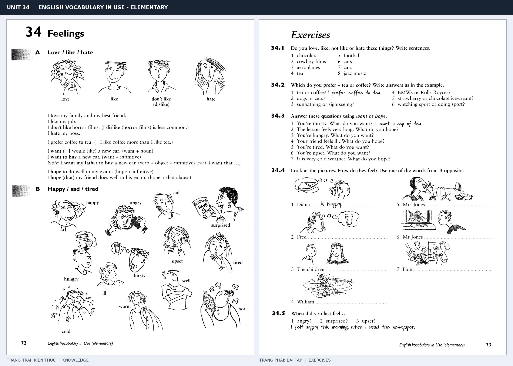

# Unit 34 — Feelings: Cảm xúc

*Trang trái cung cấp kiến thức và ví dụ; trang phải là phần Exercises của Unit tương ứng. Có thể phóng to ảnh để làm bài tập gốc.*

> **Module 04:** Con người  
> **Phạm vi:** English Vocabulary in Use — Elementary, Unit 34; trang in 72–73 (PDF trang 75–76).  
> **Hình thức:** Tự học từ vựng A1–A2 · Giảng giải tiếng Việt · Luyện câu và bài tập.

## 1. Tóm tắt và mục tiêu

Cảm xúc có thể thể hiện bằng động từ like/love/hate/prefer và tính từ happy, worried, tired. Học cấu trúc prefer A to B; phân biệt tính từ mô tả cảm xúc của người (bored) và thứ gây cảm xúc (boring).

Sau bài này, bạn có thể:

- Giải thích nghĩa và cách sử dụng những từ, cụm từ cốt lõi của chủ đề **cảm xúc**.
- Chọn đúng cách diễn đạt trong câu tiếng Anh đơn giản thay vì dịch máy móc từng từ.
- Tự đặt ít nhất ba câu thực tế và hoàn thành phần Exercises ở trang sách bên phải.

## 2. Kiến thức và từ vựng cốt lõi

Đọc kỹ từng mục. Với từ nhiều nghĩa, nghĩa ghi trong bảng được giới hạn ở cách dùng cần cho bài học này.

| Từ/cụm từ tiếng Anh | Nghĩa tiếng Việt |
| --- | --- |
| **love** | yêu hoặc rất thích |
| **like** | thích |
| **hate** | ghét |
| **prefer** | thích hơn |
| **happy** | vui |
| **unhappy** | không vui |
| **sad** | buồn |
| **tired** | mệt |
| **worried** | lo lắng |
| **angry** | tức giận |
| **excited** | háo hức |
| **bored** | chán |
| **afraid** | sợ |

### 2.1. Ghi nhớ theo nhóm và ngữ cảnh

**Nhóm từ thứ nhất:** love (yêu hoặc rất thích), like (thích), hate (ghét).

**Nhóm từ thứ hai:** unhappy (không vui), sad (buồn), tired (mệt).

Hãy ghép từ với tình huống sử dụng thực tế. Khi gặp cụm từ có nhiều thành phần, ưu tiên ghi cả cụm kèm một câu ví dụ trong sổ từ vựng.

### 2.2. Mẫu câu song ngữ

**Ví dụ 1.** I prefer coffee to tea.

→ Tôi thích cà phê hơn trà.

**Ví dụ 2.** She is worried about the exam.

→ Cô ấy lo lắng về kỳ thi.

Đọc từng câu thành tiếng, che phần dịch tiếng Việt và thử nói lại ý bằng lời của mình. Sau đó thay một chi tiết trong câu để tạo ví dụ mới.

## 3. Luyện tập ứng dụng

**Bài A — Nhớ từ trong ngữ cảnh.** Không nhìn bảng, hãy viết tiếng Anh tương ứng với các ý sau:

1. Yêu hoặc rất thích: __________
2. Thích hơn: __________
3. Mệt: __________

**Bài B — Dịch và biến đổi câu.** Dịch hai câu dưới đây sang tiếng Anh trước khi nhìn mẫu câu ở trên:

1. Tôi thích cà phê hơn trà.
2. Cô ấy lo lắng về kỳ thi.

**Bài C — Viết cho bản thân.** Viết ba câu mới về cuộc sống của bạn, mỗi câu sử dụng một từ/cụm từ khác nhau trong bảng. Đọc lại để kiểm tra giới từ, cách chia động từ và trật tự từ.

**Bài D — Thực hành theo sách.** Quan sát phần **Exercises (trang phải)** trong ảnh ghép: giải bài tập trên giấy hoặc một file riêng, sau đó so sánh với các ví dụ ở trang trái. Những bài yêu cầu thông tin cá nhân không nhất thiết có một đáp án cố định.

## 4. Câu hỏi ôn tập trắc nghiệm

*Mỗi câu có một đáp án phù hợp nhất. Hãy tự trả lời trước khi đọc phần giải thích.*

### Câu 1

Bạn muốn diễn đạt **“thích”** bằng tiếng Anh. Chọn cách nói phù hợp nhất.

A. tired

B. like

C. unhappy

D. afraid

**Đáp án:** B. **Giải thích:** “like” diễn đạt “thích” trong chủ đề này.

### Câu 2

Cụm từ **“unhappy”** có nghĩa nào trong bài học?

A. tức giận

B. mệt

C. buồn

D. không vui

**Đáp án:** D. **Giải thích:** “unhappy” được dùng với nghĩa “không vui”.

### Câu 3

Khi cần nói **“lo lắng”**, chọn từ/cụm từ nào?

A. love

B. sad

C. hate

D. worried

**Đáp án:** D. **Giải thích:** Cách dùng đúng trong bài là “worried”.

### Câu 4

Chọn câu tiếng Anh diễn đạt đúng nhất: **“Tôi thích cà phê hơn trà.”**

A. She has blue eyes.

B. My uncle lives in London.

C. I prefer coffee to tea.

D. You should go home and rest.

**Đáp án:** C. **Giải thích:** “I prefer coffee to tea.” là câu tương ứng với tình huống đã nêu.

### Câu 5

Ý nghĩa phù hợp nhất của câu **“She is worried about the exam.”** là gì?

A. Chú tôi sống ở London.

B. Cô ấy lo lắng về kỳ thi.

C. Chiếc quần dài này mới.

D. Bàn chân trái của tôi đau.

**Đáp án:** B. **Giải thích:** “She is worried about the exam.” có nghĩa là “Cô ấy lo lắng về kỳ thi.”.

## 5. Tổng kết và kiểm tra hoàn thành

Bài **She is worried about the exam.** giúp bạn sử dụng vốn từ về **cô ấy lo lắng về kỳ thi.** trong câu tiếng Anh thực tế. Giá trị quan trọng nhất không chỉ là biết nghĩa, mà là nhớ **cách kết hợp từ và ngữ cảnh sử dụng**.

- [ ] Tôi đã học bảng từ/cụm từ và đọc thành tiếng các ví dụ.
- [ ] Tôi đã hoàn thành ba phần luyện tập A, B, C.
- [ ] Tôi đã làm trang Exercises trong ảnh ghép và 5 câu trắc nghiệm.
- [ ] Tôi đã ghi các từ dễ nhầm vào sổ để ôn lại sau 1–3 ngày.

---

[← Unit 33: Sức khỏe và bệnh tật](33-health-and-illness.md) · [Unit 35: Chào hỏi và các câu giao tiếp →](35-greetings-and-other-useful-phrases.md)

[↑ Trở về mục lục khóa học](../../MUC_LUC.md)
