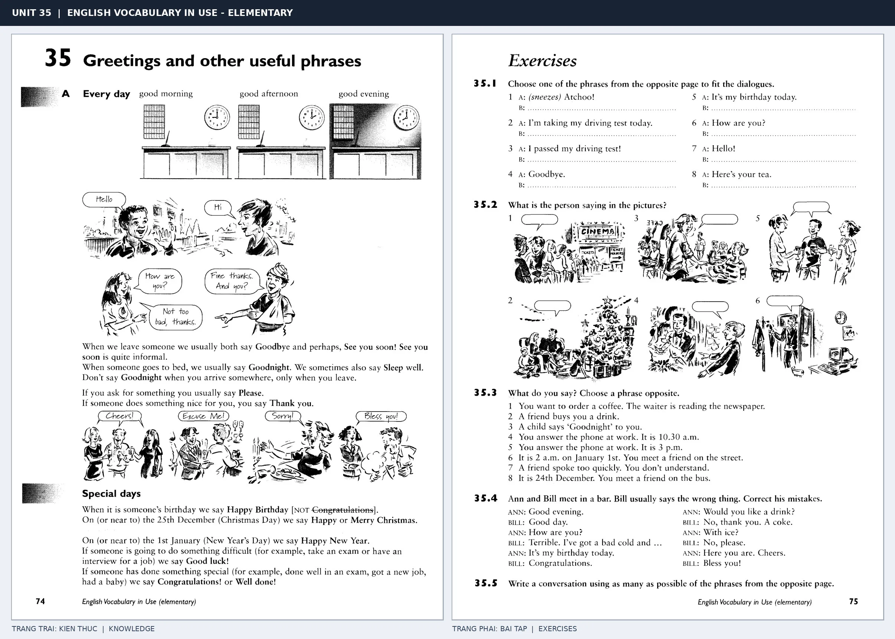

# Unit 35 — Greetings and other useful phrases: Chào hỏi và các câu giao tiếp

*Trang trái cung cấp kiến thức và ví dụ; trang phải là phần Exercises của Unit tương ứng. Có thể phóng to ảnh để làm bài tập gốc.*

> **Module 04:** Con người  
> **Phạm vi:** English Vocabulary in Use — Elementary, Unit 35; trang in 74–75 (PDF trang 77–78).  
> **Hình thức:** Tự học từ vựng A1–A2 · Giảng giải tiếng Việt · Luyện câu và bài tập.

## 1. Tóm tắt và mục tiêu

Lời chào phải phù hợp thời điểm và tình huống: good evening khi gặp buổi tối, good night khi chia tay để đi ngủ. Excuse me dùng để thu hút chú ý, sorry để xin lỗi.

Sau bài này, bạn có thể:

- Giải thích nghĩa và cách sử dụng những từ, cụm từ cốt lõi của chủ đề **chào hỏi và các câu giao tiếp**.
- Chọn đúng cách diễn đạt trong câu tiếng Anh đơn giản thay vì dịch máy móc từng từ.
- Tự đặt ít nhất ba câu thực tế và hoàn thành phần Exercises ở trang sách bên phải.

## 2. Kiến thức và từ vựng cốt lõi

Đọc kỹ từng mục. Với từ nhiều nghĩa, nghĩa ghi trong bảng được giới hạn ở cách dùng cần cho bài học này.

| Từ/cụm từ tiếng Anh | Nghĩa tiếng Việt |
| --- | --- |
| **good morning** | chào buổi sáng |
| **good afternoon** | chào buổi chiều |
| **good evening** | chào buổi tối |
| **good night** | chúc ngủ ngon |
| **goodbye** | tạm biệt |
| **see you soon** | hẹn sớm gặp lại |
| **thank you** | cảm ơn |
| **you're welcome** | không có gì |
| **sorry** | xin lỗi |
| **excuse me** | xin phép hoặc làm phiền |
| **congratulations** | chúc mừng |
| **happy birthday** | chúc mừng sinh nhật |

### 2.1. Ghi nhớ theo nhóm và ngữ cảnh

**Nhóm từ thứ nhất:** good morning (chào buổi sáng), good afternoon (chào buổi chiều), good evening (chào buổi tối).

**Nhóm từ thứ hai:** see you soon (hẹn sớm gặp lại), thank you (cảm ơn), you're welcome (không có gì).

Hãy ghép từ với tình huống sử dụng thực tế. Khi gặp cụm từ có nhiều thành phần, ưu tiên ghi cả cụm kèm một câu ví dụ trong sổ từ vựng.

### 2.2. Mẫu câu song ngữ

**Ví dụ 1.** Good evening. How are you?

→ Chào buổi tối. Bạn khỏe không?

**Ví dụ 2.** Thank you very much.

→ Cảm ơn bạn rất nhiều.

Đọc từng câu thành tiếng, che phần dịch tiếng Việt và thử nói lại ý bằng lời của mình. Sau đó thay một chi tiết trong câu để tạo ví dụ mới.

## 3. Luyện tập ứng dụng

**Bài A — Nhớ từ trong ngữ cảnh.** Không nhìn bảng, hãy viết tiếng Anh tương ứng với các ý sau:

1. Chào buổi sáng: __________
2. Chúc ngủ ngon: __________
3. Không có gì: __________

**Bài B — Dịch và biến đổi câu.** Dịch hai câu dưới đây sang tiếng Anh trước khi nhìn mẫu câu ở trên:

1. Chào buổi tối. Bạn khỏe không?
2. Cảm ơn bạn rất nhiều.

**Bài C — Viết cho bản thân.** Viết ba câu mới về cuộc sống của bạn, mỗi câu sử dụng một từ/cụm từ khác nhau trong bảng. Đọc lại để kiểm tra giới từ, cách chia động từ và trật tự từ.

**Bài D — Thực hành theo sách.** Quan sát phần **Exercises (trang phải)** trong ảnh ghép: giải bài tập trên giấy hoặc một file riêng, sau đó so sánh với các ví dụ ở trang trái. Những bài yêu cầu thông tin cá nhân không nhất thiết có một đáp án cố định.

## 4. Câu hỏi ôn tập trắc nghiệm

*Mỗi câu có một đáp án phù hợp nhất. Hãy tự trả lời trước khi đọc phần giải thích.*

### Câu 1

Bạn muốn diễn đạt **“chào buổi chiều”** bằng tiếng Anh. Chọn cách nói phù hợp nhất.

A. sorry

B. you're welcome

C. good afternoon

D. happy birthday

**Đáp án:** C. **Giải thích:** “good afternoon” diễn đạt “chào buổi chiều” trong chủ đề này.

### Câu 2

Cụm từ **“see you soon”** có nghĩa nào trong bài học?

A. chào buổi chiều

B. hẹn sớm gặp lại

C. chúc mừng

D. chúc ngủ ngon

**Đáp án:** B. **Giải thích:** “see you soon” được dùng với nghĩa “hẹn sớm gặp lại”.

### Câu 3

Khi cần nói **“xin lỗi”**, chọn từ/cụm từ nào?

A. excuse me

B. goodbye

C. happy birthday

D. sorry

**Đáp án:** D. **Giải thích:** Cách dùng đúng trong bài là “sorry”.

### Câu 4

Chọn câu tiếng Anh diễn đạt đúng nhất: **“Chào buổi tối. Bạn khỏe không?”**

A. She is wearing a blue dress.

B. She has blue eyes.

C. She has two sisters.

D. Good evening. How are you?

**Đáp án:** D. **Giải thích:** “Good evening. How are you?” là câu tương ứng với tình huống đã nêu.

### Câu 5

Ý nghĩa phù hợp nhất của câu **“Thank you very much.”** là gì?

A. Cảm ơn bạn rất nhiều.

B. Tôi thích cà phê hơn trà.

C. Cô ấy lo lắng về kỳ thi.

D. Bạn nên về nhà nghỉ ngơi.

**Đáp án:** A. **Giải thích:** “Thank you very much.” có nghĩa là “Cảm ơn bạn rất nhiều.”.

## 5. Tổng kết và kiểm tra hoàn thành

Bài **Thank you very much.** giúp bạn sử dụng vốn từ về **cảm ơn bạn rất nhiều.** trong câu tiếng Anh thực tế. Giá trị quan trọng nhất không chỉ là biết nghĩa, mà là nhớ **cách kết hợp từ và ngữ cảnh sử dụng**.

- [ ] Tôi đã học bảng từ/cụm từ và đọc thành tiếng các ví dụ.
- [ ] Tôi đã hoàn thành ba phần luyện tập A, B, C.
- [ ] Tôi đã làm trang Exercises trong ảnh ghép và 5 câu trắc nghiệm.
- [ ] Tôi đã ghi các từ dễ nhầm vào sổ để ôn lại sau 1–3 ngày.

---

[← Unit 34: Cảm xúc](34-feelings.md) · [Unit 36: Quốc gia, ngôn ngữ và quốc tịch →](../05-the-world/36-countries-languages-and-people.md)

[↑ Trở về mục lục khóa học](../../MUC_LUC.md)
