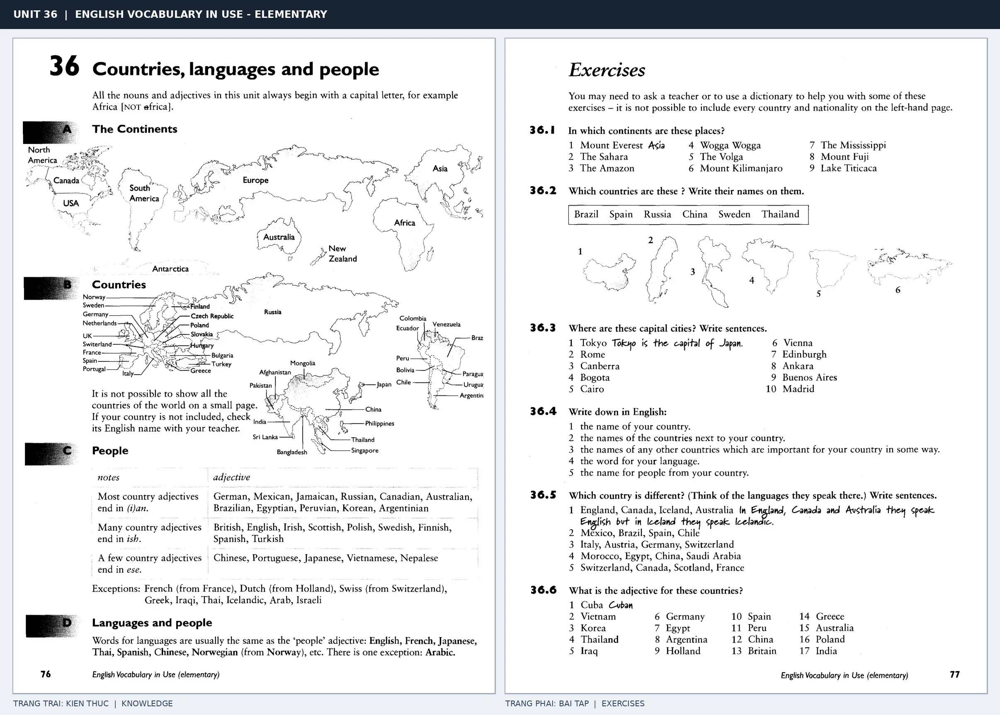

# Unit 36 — Countries, languages and people: Quốc gia, ngôn ngữ và quốc tịch

*Trang trái cung cấp kiến thức và ví dụ; trang phải là phần Exercises của Unit tương ứng. Có thể phóng to ảnh để làm bài tập gốc.*

> **Module 05:** Thế giới xung quanh  
> **Phạm vi:** English Vocabulary in Use — Elementary, Unit 36; trang in 76–77 (PDF trang 79–80).  
> **Hình thức:** Tự học từ vựng A1–A2 · Giảng giải tiếng Việt · Luyện câu và bài tập.

## 1. Tóm tắt và mục tiêu

Viết hoa tên quốc gia, châu lục, ngôn ngữ và quốc tịch. Một số tính từ quốc tịch đồng thời là tên ngôn ngữ; không phải lúc nào cũng hình thành bằng cách thêm cùng một hậu tố.

Sau bài này, bạn có thể:

- Giải thích nghĩa và cách sử dụng những từ, cụm từ cốt lõi của chủ đề **quốc gia, ngôn ngữ và quốc tịch**.
- Chọn đúng cách diễn đạt trong câu tiếng Anh đơn giản thay vì dịch máy móc từng từ.
- Tự đặt ít nhất ba câu thực tế và hoàn thành phần Exercises ở trang sách bên phải.

## 2. Kiến thức và từ vựng cốt lõi

Đọc kỹ từng mục. Với từ nhiều nghĩa, nghĩa ghi trong bảng được giới hạn ở cách dùng cần cho bài học này.

| Từ/cụm từ tiếng Anh | Nghĩa tiếng Việt |
| --- | --- |
| **country** | quốc gia |
| **continent** | châu lục |
| **Europe** | châu Âu |
| **Asia** | châu Á |
| **Africa** | châu Phi |
| **America** | châu Mỹ |
| **China** | Trung Quốc |
| **Chinese** | tiếng Trung hoặc người Trung Quốc |
| **Japan** | Nhật Bản |
| **Japanese** | tiếng Nhật hoặc người Nhật |
| **France** | Pháp |
| **French** | tiếng Pháp hoặc người Pháp |
| **Greece** | Hy Lạp |
| **Greek** | tiếng Hy Lạp hoặc người Hy Lạp |

### 2.1. Ghi nhớ theo nhóm và ngữ cảnh

**Nhóm từ thứ nhất:** country (quốc gia), continent (châu lục), Europe (châu Âu).

**Nhóm từ thứ hai:** America (châu Mỹ), China (Trung Quốc), Chinese (tiếng Trung hoặc người Trung Quốc).

Hãy ghép từ với tình huống sử dụng thực tế. Khi gặp cụm từ có nhiều thành phần, ưu tiên ghi cả cụm kèm một câu ví dụ trong sổ từ vựng.

### 2.2. Mẫu câu song ngữ

**Ví dụ 1.** She is from Japan and speaks Japanese.

→ Cô ấy đến từ Nhật Bản và nói tiếng Nhật.

**Ví dụ 2.** English is spoken in many countries.

→ Tiếng Anh được dùng tại nhiều quốc gia.

Đọc từng câu thành tiếng, che phần dịch tiếng Việt và thử nói lại ý bằng lời của mình. Sau đó thay một chi tiết trong câu để tạo ví dụ mới.

## 3. Luyện tập ứng dụng

**Bài A — Nhớ từ trong ngữ cảnh.** Không nhìn bảng, hãy viết tiếng Anh tương ứng với các ý sau:

1. Quốc gia: __________
2. Châu á: __________
3. Tiếng trung hoặc người trung quốc: __________

**Bài B — Dịch và biến đổi câu.** Dịch hai câu dưới đây sang tiếng Anh trước khi nhìn mẫu câu ở trên:

1. Cô ấy đến từ Nhật Bản và nói tiếng Nhật.
2. Tiếng Anh được dùng tại nhiều quốc gia.

**Bài C — Viết cho bản thân.** Viết ba câu mới về cuộc sống của bạn, mỗi câu sử dụng một từ/cụm từ khác nhau trong bảng. Đọc lại để kiểm tra giới từ, cách chia động từ và trật tự từ.

**Bài D — Thực hành theo sách.** Quan sát phần **Exercises (trang phải)** trong ảnh ghép: giải bài tập trên giấy hoặc một file riêng, sau đó so sánh với các ví dụ ở trang trái. Những bài yêu cầu thông tin cá nhân không nhất thiết có một đáp án cố định.

## 4. Câu hỏi ôn tập trắc nghiệm

*Mỗi câu có một đáp án phù hợp nhất. Hãy tự trả lời trước khi đọc phần giải thích.*

### Câu 1

Bạn muốn diễn đạt **“châu lục”** bằng tiếng Anh. Chọn cách nói phù hợp nhất.

A. Japan

B. country

C. Asia

D. continent

**Đáp án:** D. **Giải thích:** “continent” diễn đạt “châu lục” trong chủ đề này.

### Câu 2

Cụm từ **“America”** có nghĩa nào trong bài học?

A. tiếng Trung hoặc người Trung Quốc

B. châu Phi

C. châu Mỹ

D. tiếng Pháp hoặc người Pháp

**Đáp án:** C. **Giải thích:** “America” được dùng với nghĩa “châu Mỹ”.

### Câu 3

Khi cần nói **“Nhật Bản”**, chọn từ/cụm từ nào?

A. Greek

B. continent

C. Greece

D. Japan

**Đáp án:** D. **Giải thích:** Cách dùng đúng trong bài là “Japan”.

### Câu 4

Chọn câu tiếng Anh diễn đạt đúng nhất: **“Cô ấy đến từ Nhật Bản và nói tiếng Nhật.”**

A. It's raining, so take an umbrella.

B. She is from Japan and speaks Japanese.

C. I'd like a return ticket, please.

D. There is a river near the village.

**Đáp án:** B. **Giải thích:** “She is from Japan and speaks Japanese.” là câu tương ứng với tình huống đã nêu.

### Câu 5

Ý nghĩa phù hợp nhất của câu **“English is spoken in many countries.”** là gì?

A. Vui lòng sử dụng lối vào bên trái.

B. Hôm nay trời nắng.

C. Tiếng Anh được dùng tại nhiều quốc gia.

D. Cho tôi mua một vé khứ hồi.

**Đáp án:** C. **Giải thích:** “English is spoken in many countries.” có nghĩa là “Tiếng Anh được dùng tại nhiều quốc gia.”.

## 5. Tổng kết và kiểm tra hoàn thành

Bài **English is spoken in many countries.** giúp bạn sử dụng vốn từ về **tiếng anh được dùng tại nhiều quốc gia.** trong câu tiếng Anh thực tế. Giá trị quan trọng nhất không chỉ là biết nghĩa, mà là nhớ **cách kết hợp từ và ngữ cảnh sử dụng**.

- [ ] Tôi đã học bảng từ/cụm từ và đọc thành tiếng các ví dụ.
- [ ] Tôi đã hoàn thành ba phần luyện tập A, B, C.
- [ ] Tôi đã làm trang Exercises trong ảnh ghép và 5 câu trắc nghiệm.
- [ ] Tôi đã ghi các từ dễ nhầm vào sổ để ôn lại sau 1–3 ngày.

---

[← Unit 35: Chào hỏi và các câu giao tiếp](../04-people/35-greetings-and-other-useful-phrases.md) · [Unit 37: Thời tiết →](37-weather.md)

[↑ Trở về mục lục khóa học](../../MUC_LUC.md)
