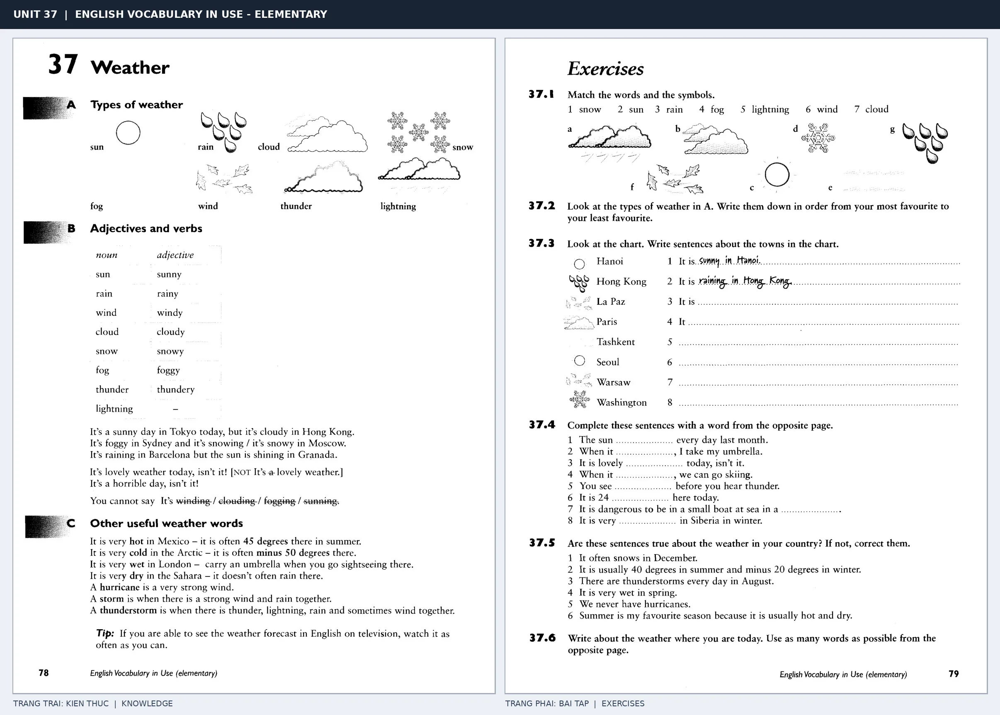

# Unit 37 — Weather: Thời tiết

*Trang trái cung cấp kiến thức và ví dụ; trang phải là phần Exercises của Unit tương ứng. Có thể phóng to ảnh để làm bài tập gốc.*

> **Module 05:** Thế giới xung quanh  
> **Phạm vi:** English Vocabulary in Use — Elementary, Unit 37; trang in 78–79 (PDF trang 81–82).  
> **Hình thức:** Tự học từ vựng A1–A2 · Giảng giải tiếng Việt · Luyện câu và bài tập.

## 1. Tóm tắt và mục tiêu

Khi nói thời tiết dùng It's + adjective hoặc It's raining/snowing. Hãy phân biệt danh từ rain, wind, cloud và tính từ rainy, windy, cloudy; trạng thái thời tiết thay đổi theo ngày hoặc mùa.

Sau bài này, bạn có thể:

- Giải thích nghĩa và cách sử dụng những từ, cụm từ cốt lõi của chủ đề **thời tiết**.
- Chọn đúng cách diễn đạt trong câu tiếng Anh đơn giản thay vì dịch máy móc từng từ.
- Tự đặt ít nhất ba câu thực tế và hoàn thành phần Exercises ở trang sách bên phải.

## 2. Kiến thức và từ vựng cốt lõi

Đọc kỹ từng mục. Với từ nhiều nghĩa, nghĩa ghi trong bảng được giới hạn ở cách dùng cần cho bài học này.

| Từ/cụm từ tiếng Anh | Nghĩa tiếng Việt |
| --- | --- |
| **sun** | mặt trời |
| **sunny** | có nắng |
| **rain** | mưa |
| **rainy** | có mưa |
| **wind** | gió |
| **windy** | có gió |
| **cloud** | mây |
| **cloudy** | nhiều mây |
| **fog** | sương mù |
| **foggy** | có sương mù |
| **snow** | tuyết |
| **snowy** | có tuyết |
| **hot** | nóng |
| **cold** | lạnh |

### 2.1. Ghi nhớ theo nhóm và ngữ cảnh

**Nhóm từ thứ nhất:** sun (mặt trời), sunny (có nắng), rain (mưa).

**Nhóm từ thứ hai:** windy (có gió), cloud (mây), cloudy (nhiều mây).

Hãy ghép từ với tình huống sử dụng thực tế. Khi gặp cụm từ có nhiều thành phần, ưu tiên ghi cả cụm kèm một câu ví dụ trong sổ từ vựng.

### 2.2. Mẫu câu song ngữ

**Ví dụ 1.** It's sunny today.

→ Hôm nay trời nắng.

**Ví dụ 2.** It's raining, so take an umbrella.

→ Trời đang mưa nên hãy mang ô.

Đọc từng câu thành tiếng, che phần dịch tiếng Việt và thử nói lại ý bằng lời của mình. Sau đó thay một chi tiết trong câu để tạo ví dụ mới.

## 3. Luyện tập ứng dụng

**Bài A — Nhớ từ trong ngữ cảnh.** Không nhìn bảng, hãy viết tiếng Anh tương ứng với các ý sau:

1. Mặt trời: __________
2. Có mưa: __________
3. Nhiều mây: __________

**Bài B — Dịch và biến đổi câu.** Dịch hai câu dưới đây sang tiếng Anh trước khi nhìn mẫu câu ở trên:

1. Hôm nay trời nắng.
2. Trời đang mưa nên hãy mang ô.

**Bài C — Viết cho bản thân.** Viết ba câu mới về cuộc sống của bạn, mỗi câu sử dụng một từ/cụm từ khác nhau trong bảng. Đọc lại để kiểm tra giới từ, cách chia động từ và trật tự từ.

**Bài D — Thực hành theo sách.** Quan sát phần **Exercises (trang phải)** trong ảnh ghép: giải bài tập trên giấy hoặc một file riêng, sau đó so sánh với các ví dụ ở trang trái. Những bài yêu cầu thông tin cá nhân không nhất thiết có một đáp án cố định.

## 4. Câu hỏi ôn tập trắc nghiệm

*Mỗi câu có một đáp án phù hợp nhất. Hãy tự trả lời trước khi đọc phần giải thích.*

### Câu 1

Bạn muốn diễn đạt **“có nắng”** bằng tiếng Anh. Chọn cách nói phù hợp nhất.

A. sunny

B. cloudy

C. foggy

D. hot

**Đáp án:** A. **Giải thích:** “sunny” diễn đạt “có nắng” trong chủ đề này.

### Câu 2

Cụm từ **“windy”** có nghĩa nào trong bài học?

A. có tuyết

B. có sương mù

C. có gió

D. sương mù

**Đáp án:** C. **Giải thích:** “windy” được dùng với nghĩa “có gió”.

### Câu 3

Khi cần nói **“sương mù”**, chọn từ/cụm từ nào?

A. snow

B. fog

C. sun

D. sunny

**Đáp án:** B. **Giải thích:** Cách dùng đúng trong bài là “fog”.

### Câu 4

Chọn câu tiếng Anh diễn đạt đúng nhất: **“Hôm nay trời nắng.”**

A. It's sunny today.

B. She is from Japan and speaks Japanese.

C. You can borrow books from the library.

D. The children have a pet rabbit.

**Đáp án:** A. **Giải thích:** “It's sunny today.” là câu tương ứng với tình huống đã nêu.

### Câu 5

Ý nghĩa phù hợp nhất của câu **“It's raining, so take an umbrella.”** là gì?

A. Vui lòng sử dụng lối vào bên trái.

B. Trời đang mưa nên hãy mang ô.

C. Tiếng Anh được dùng tại nhiều quốc gia.

D. Ngân hàng gần bưu điện.

**Đáp án:** B. **Giải thích:** “It's raining, so take an umbrella.” có nghĩa là “Trời đang mưa nên hãy mang ô.”.

## 5. Tổng kết và kiểm tra hoàn thành

Bài **It's raining, so take an umbrella.** giúp bạn sử dụng vốn từ về **trời đang mưa nên hãy mang ô.** trong câu tiếng Anh thực tế. Giá trị quan trọng nhất không chỉ là biết nghĩa, mà là nhớ **cách kết hợp từ và ngữ cảnh sử dụng**.

- [ ] Tôi đã học bảng từ/cụm từ và đọc thành tiếng các ví dụ.
- [ ] Tôi đã hoàn thành ba phần luyện tập A, B, C.
- [ ] Tôi đã làm trang Exercises trong ảnh ghép và 5 câu trắc nghiệm.
- [ ] Tôi đã ghi các từ dễ nhầm vào sổ để ôn lại sau 1–3 ngày.

---

[← Unit 36: Quốc gia, ngôn ngữ và quốc tịch](36-countries-languages-and-people.md) · [Unit 38: Các địa điểm trong thành phố →](38-in-the-town.md)

[↑ Trở về mục lục khóa học](../../MUC_LUC.md)
