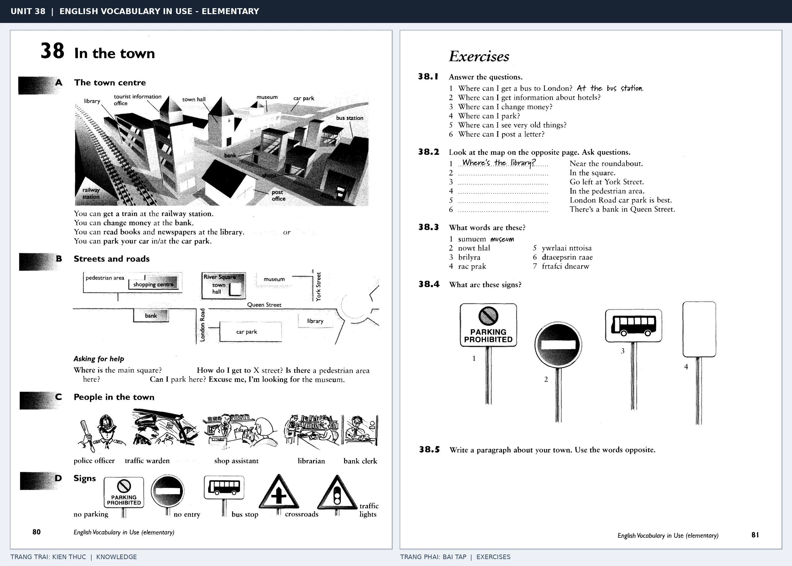

# Unit 38 — In the town: Các địa điểm trong thành phố

*Trang trái cung cấp kiến thức và ví dụ; trang phải là phần Exercises của Unit tương ứng. Có thể phóng to ảnh để làm bài tập gốc.*

> **Module 05:** Thế giới xung quanh  
> **Phạm vi:** English Vocabulary in Use — Elementary, Unit 38; trang in 80–81 (PDF trang 83–84).  
> **Hình thức:** Tự học từ vựng A1–A2 · Giảng giải tiếng Việt · Luyện câu và bài tập.

## 1. Tóm tắt và mục tiêu

Gắn địa điểm với mục đích thực tế: đổi tiền ở bank, đọc sách ở library, bắt tàu ở railway station. Luyện cấu trúc There is/are và hỏi đường Where is the ...?

Sau bài này, bạn có thể:

- Giải thích nghĩa và cách sử dụng những từ, cụm từ cốt lõi của chủ đề **các địa điểm trong thành phố**.
- Chọn đúng cách diễn đạt trong câu tiếng Anh đơn giản thay vì dịch máy móc từng từ.
- Tự đặt ít nhất ba câu thực tế và hoàn thành phần Exercises ở trang sách bên phải.

## 2. Kiến thức và từ vựng cốt lõi

Đọc kỹ từng mục. Với từ nhiều nghĩa, nghĩa ghi trong bảng được giới hạn ở cách dùng cần cho bài học này.

| Từ/cụm từ tiếng Anh | Nghĩa tiếng Việt |
| --- | --- |
| **railway station** | ga tàu |
| **bus station** | bến xe buýt |
| **bank** | ngân hàng |
| **library** | thư viện |
| **museum** | bảo tàng |
| **post office** | bưu điện |
| **car park** | bãi đỗ xe |
| **hospital** | bệnh viện |
| **police station** | đồn cảnh sát |
| **supermarket** | siêu thị |
| **cinema** | rạp chiếu phim |
| **town centre** | trung tâm thành phố |

### 2.1. Ghi nhớ theo nhóm và ngữ cảnh

**Nhóm từ thứ nhất:** railway station (ga tàu), bus station (bến xe buýt), bank (ngân hàng).

**Nhóm từ thứ hai:** post office (bưu điện), car park (bãi đỗ xe), hospital (bệnh viện).

Hãy ghép từ với tình huống sử dụng thực tế. Khi gặp cụm từ có nhiều thành phần, ưu tiên ghi cả cụm kèm một câu ví dụ trong sổ từ vựng.

### 2.2. Mẫu câu song ngữ

**Ví dụ 1.** You can borrow books from the library.

→ Bạn có thể mượn sách ở thư viện.

**Ví dụ 2.** The bank is near the post office.

→ Ngân hàng gần bưu điện.

Đọc từng câu thành tiếng, che phần dịch tiếng Việt và thử nói lại ý bằng lời của mình. Sau đó thay một chi tiết trong câu để tạo ví dụ mới.

## 3. Luyện tập ứng dụng

**Bài A — Nhớ từ trong ngữ cảnh.** Không nhìn bảng, hãy viết tiếng Anh tương ứng với các ý sau:

1. Ga tàu: __________
2. Thư viện: __________
3. Bệnh viện: __________

**Bài B — Dịch và biến đổi câu.** Dịch hai câu dưới đây sang tiếng Anh trước khi nhìn mẫu câu ở trên:

1. Bạn có thể mượn sách ở thư viện.
2. Ngân hàng gần bưu điện.

**Bài C — Viết cho bản thân.** Viết ba câu mới về cuộc sống của bạn, mỗi câu sử dụng một từ/cụm từ khác nhau trong bảng. Đọc lại để kiểm tra giới từ, cách chia động từ và trật tự từ.

**Bài D — Thực hành theo sách.** Quan sát phần **Exercises (trang phải)** trong ảnh ghép: giải bài tập trên giấy hoặc một file riêng, sau đó so sánh với các ví dụ ở trang trái. Những bài yêu cầu thông tin cá nhân không nhất thiết có một đáp án cố định.

## 4. Câu hỏi ôn tập trắc nghiệm

*Mỗi câu có một đáp án phù hợp nhất. Hãy tự trả lời trước khi đọc phần giải thích.*

### Câu 1

Bạn muốn diễn đạt **“bến xe buýt”** bằng tiếng Anh. Chọn cách nói phù hợp nhất.

A. cinema

B. car park

C. bus station

D. library

**Đáp án:** C. **Giải thích:** “bus station” diễn đạt “bến xe buýt” trong chủ đề này.

### Câu 2

Cụm từ **“post office”** có nghĩa nào trong bài học?

A. bến xe buýt

B. thư viện

C. ga tàu

D. bưu điện

**Đáp án:** D. **Giải thích:** “post office” được dùng với nghĩa “bưu điện”.

### Câu 3

Khi cần nói **“đồn cảnh sát”**, chọn từ/cụm từ nào?

A. library

B. town centre

C. post office

D. police station

**Đáp án:** D. **Giải thích:** Cách dùng đúng trong bài là “police station”.

### Câu 4

Chọn câu tiếng Anh diễn đạt đúng nhất: **“Bạn có thể mượn sách ở thư viện.”**

A. I'd like a return ticket, please.

B. The lift is out of order.

C. Please use the entrance on the left.

D. You can borrow books from the library.

**Đáp án:** D. **Giải thích:** “You can borrow books from the library.” là câu tương ứng với tình huống đã nêu.

### Câu 5

Ý nghĩa phù hợp nhất của câu **“The bank is near the post office.”** là gì?

A. Có con sông gần ngôi làng.

B. Tàu khởi hành lúc mấy giờ?

C. Bọn trẻ nuôi một con thỏ.

D. Ngân hàng gần bưu điện.

**Đáp án:** D. **Giải thích:** “The bank is near the post office.” có nghĩa là “Ngân hàng gần bưu điện.”.

## 5. Tổng kết và kiểm tra hoàn thành

Bài **The bank is near the post office.** giúp bạn sử dụng vốn từ về **ngân hàng gần bưu điện.** trong câu tiếng Anh thực tế. Giá trị quan trọng nhất không chỉ là biết nghĩa, mà là nhớ **cách kết hợp từ và ngữ cảnh sử dụng**.

- [ ] Tôi đã học bảng từ/cụm từ và đọc thành tiếng các ví dụ.
- [ ] Tôi đã hoàn thành ba phần luyện tập A, B, C.
- [ ] Tôi đã làm trang Exercises trong ảnh ghép và 5 câu trắc nghiệm.
- [ ] Tôi đã ghi các từ dễ nhầm vào sổ để ôn lại sau 1–3 ngày.

---

[← Unit 37: Thời tiết](37-weather.md) · [Unit 39: Vùng nông thôn →](39-in-the-countryside.md)

[↑ Trở về mục lục khóa học](../../MUC_LUC.md)
