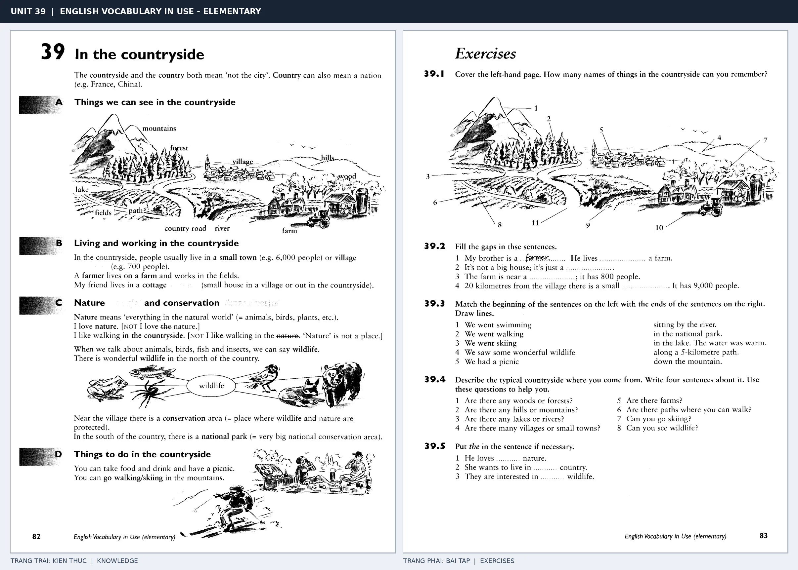

# Unit 39 — In the countryside: Vùng nông thôn

*Trang trái cung cấp kiến thức và ví dụ; trang phải là phần Exercises của Unit tương ứng. Có thể phóng to ảnh để làm bài tập gốc.*

> **Module 05:** Thế giới xung quanh  
> **Phạm vi:** English Vocabulary in Use — Elementary, Unit 39; trang in 82–83 (PDF trang 85–86).  
> **Hình thức:** Tự học từ vựng A1–A2 · Giảng giải tiếng Việt · Luyện câu và bài tập.

## 1. Tóm tắt và mục tiêu

Countryside là vùng ngoài đô thị, còn country còn có nghĩa quốc gia. Miêu tả phong cảnh bằng there is/there are, giới từ vị trí và động từ can see.

Sau bài này, bạn có thể:

- Giải thích nghĩa và cách sử dụng những từ, cụm từ cốt lõi của chủ đề **vùng nông thôn**.
- Chọn đúng cách diễn đạt trong câu tiếng Anh đơn giản thay vì dịch máy móc từng từ.
- Tự đặt ít nhất ba câu thực tế và hoàn thành phần Exercises ở trang sách bên phải.

## 2. Kiến thức và từ vựng cốt lõi

Đọc kỹ từng mục. Với từ nhiều nghĩa, nghĩa ghi trong bảng được giới hạn ở cách dùng cần cho bài học này.

| Từ/cụm từ tiếng Anh | Nghĩa tiếng Việt |
| --- | --- |
| **countryside** | nông thôn |
| **village** | làng |
| **farm** | nông trại |
| **field** | cánh đồng |
| **hill** | đồi |
| **mountain** | núi |
| **river** | sông |
| **lake** | hồ |
| **forest** | rừng |
| **wood** | khu rừng nhỏ |
| **grass** | cỏ |
| **tree** | cây |
| **path** | đường mòn |
| **bridge** | cầu |

### 2.1. Ghi nhớ theo nhóm và ngữ cảnh

**Nhóm từ thứ nhất:** countryside (nông thôn), village (làng), farm (nông trại).

**Nhóm từ thứ hai:** mountain (núi), river (sông), lake (hồ).

Hãy ghép từ với tình huống sử dụng thực tế. Khi gặp cụm từ có nhiều thành phần, ưu tiên ghi cả cụm kèm một câu ví dụ trong sổ từ vựng.

### 2.2. Mẫu câu song ngữ

**Ví dụ 1.** There is a river near the village.

→ Có con sông gần ngôi làng.

**Ví dụ 2.** The cows are in the field.

→ Đàn bò ở ngoài đồng.

Đọc từng câu thành tiếng, che phần dịch tiếng Việt và thử nói lại ý bằng lời của mình. Sau đó thay một chi tiết trong câu để tạo ví dụ mới.

## 3. Luyện tập ứng dụng

**Bài A — Nhớ từ trong ngữ cảnh.** Không nhìn bảng, hãy viết tiếng Anh tương ứng với các ý sau:

1. Nông thôn: __________
2. Cánh đồng: __________
3. Hồ: __________

**Bài B — Dịch và biến đổi câu.** Dịch hai câu dưới đây sang tiếng Anh trước khi nhìn mẫu câu ở trên:

1. Có con sông gần ngôi làng.
2. Đàn bò ở ngoài đồng.

**Bài C — Viết cho bản thân.** Viết ba câu mới về cuộc sống của bạn, mỗi câu sử dụng một từ/cụm từ khác nhau trong bảng. Đọc lại để kiểm tra giới từ, cách chia động từ và trật tự từ.

**Bài D — Thực hành theo sách.** Quan sát phần **Exercises (trang phải)** trong ảnh ghép: giải bài tập trên giấy hoặc một file riêng, sau đó so sánh với các ví dụ ở trang trái. Những bài yêu cầu thông tin cá nhân không nhất thiết có một đáp án cố định.

## 4. Câu hỏi ôn tập trắc nghiệm

*Mỗi câu có một đáp án phù hợp nhất. Hãy tự trả lời trước khi đọc phần giải thích.*

### Câu 1

Bạn muốn diễn đạt **“làng”** bằng tiếng Anh. Chọn cách nói phù hợp nhất.

A. hill

B. countryside

C. village

D. forest

**Đáp án:** C. **Giải thích:** “village” diễn đạt “làng” trong chủ đề này.

### Câu 2

Cụm từ **“mountain”** có nghĩa nào trong bài học?

A. núi

B. đường mòn

C. đồi

D. cây

**Đáp án:** A. **Giải thích:** “mountain” được dùng với nghĩa “núi”.

### Câu 3

Khi cần nói **“rừng”**, chọn từ/cụm từ nào?

A. hill

B. bridge

C. forest

D. village

**Đáp án:** C. **Giải thích:** Cách dùng đúng trong bài là “forest”.

### Câu 4

Chọn câu tiếng Anh diễn đạt đúng nhất: **“Có con sông gần ngôi làng.”**

A. English is spoken in many countries.

B. There is a river near the village.

C. What time does the train leave?

D. It's raining, so take an umbrella.

**Đáp án:** B. **Giải thích:** “There is a river near the village.” là câu tương ứng với tình huống đã nêu.

### Câu 5

Ý nghĩa phù hợp nhất của câu **“The cows are in the field.”** là gì?

A. Bọn trẻ nuôi một con thỏ.

B. Ngân hàng gần bưu điện.

C. Đàn bò ở ngoài đồng.

D. Bò cho chúng ta sữa.

**Đáp án:** C. **Giải thích:** “The cows are in the field.” có nghĩa là “Đàn bò ở ngoài đồng.”.

## 5. Tổng kết và kiểm tra hoàn thành

Bài **The cows are in the field.** giúp bạn sử dụng vốn từ về **đàn bò ở ngoài đồng.** trong câu tiếng Anh thực tế. Giá trị quan trọng nhất không chỉ là biết nghĩa, mà là nhớ **cách kết hợp từ và ngữ cảnh sử dụng**.

- [ ] Tôi đã học bảng từ/cụm từ và đọc thành tiếng các ví dụ.
- [ ] Tôi đã hoàn thành ba phần luyện tập A, B, C.
- [ ] Tôi đã làm trang Exercises trong ảnh ghép và 5 câu trắc nghiệm.
- [ ] Tôi đã ghi các từ dễ nhầm vào sổ để ôn lại sau 1–3 ngày.

---

[← Unit 38: Các địa điểm trong thành phố](38-in-the-town.md) · [Unit 40: Động vật và thú cưng →](40-animals-and-pets.md)

[↑ Trở về mục lục khóa học](../../MUC_LUC.md)
