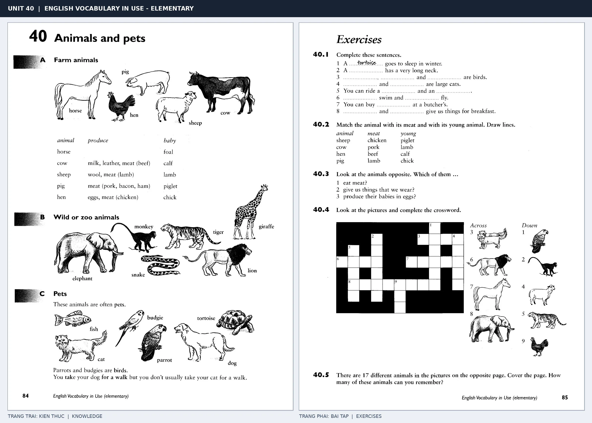

# Unit 40 — Animals and pets: Động vật và thú cưng

*Trang trái cung cấp kiến thức và ví dụ; trang phải là phần Exercises của Unit tương ứng. Có thể phóng to ảnh để làm bài tập gốc.*

> **Module 05:** Thế giới xung quanh  
> **Phạm vi:** English Vocabulary in Use — Elementary, Unit 40; trang in 84–85 (PDF trang 87–88).  
> **Hình thức:** Tự học từ vựng A1–A2 · Giảng giải tiếng Việt · Luyện câu và bài tập.

## 1. Tóm tắt và mục tiêu

Có thể phân nhóm động vật trang trại, thú cưng và động vật hoang dã; nối con vật với con non hoặc sản phẩm như cow–milk, sheep–wool. Một số danh từ có số nhiều đặc biệt như sheep.

Sau bài này, bạn có thể:

- Giải thích nghĩa và cách sử dụng những từ, cụm từ cốt lõi của chủ đề **động vật và thú cưng**.
- Chọn đúng cách diễn đạt trong câu tiếng Anh đơn giản thay vì dịch máy móc từng từ.
- Tự đặt ít nhất ba câu thực tế và hoàn thành phần Exercises ở trang sách bên phải.

## 2. Kiến thức và từ vựng cốt lõi

Đọc kỹ từng mục. Với từ nhiều nghĩa, nghĩa ghi trong bảng được giới hạn ở cách dùng cần cho bài học này.

| Từ/cụm từ tiếng Anh | Nghĩa tiếng Việt |
| --- | --- |
| **cow** | bò |
| **sheep** | cừu |
| **horse** | ngựa |
| **pig** | lợn |
| **chicken** | gà |
| **dog** | chó |
| **cat** | mèo |
| **rabbit** | thỏ |
| **bird** | chim |
| **fish** | cá |
| **elephant** | voi |
| **giraffe** | hươu cao cổ |
| **lion** | sư tử |
| **snake** | rắn |

### 2.1. Ghi nhớ theo nhóm và ngữ cảnh

**Nhóm từ thứ nhất:** cow (bò), sheep (cừu), horse (ngựa).

**Nhóm từ thứ hai:** dog (chó), cat (mèo), rabbit (thỏ).

Hãy ghép từ với tình huống sử dụng thực tế. Khi gặp cụm từ có nhiều thành phần, ưu tiên ghi cả cụm kèm một câu ví dụ trong sổ từ vựng.

### 2.2. Mẫu câu song ngữ

**Ví dụ 1.** A cow gives us milk.

→ Bò cho chúng ta sữa.

**Ví dụ 2.** The children have a pet rabbit.

→ Bọn trẻ nuôi một con thỏ.

Đọc từng câu thành tiếng, che phần dịch tiếng Việt và thử nói lại ý bằng lời của mình. Sau đó thay một chi tiết trong câu để tạo ví dụ mới.

## 3. Luyện tập ứng dụng

**Bài A — Nhớ từ trong ngữ cảnh.** Không nhìn bảng, hãy viết tiếng Anh tương ứng với các ý sau:

1. Bò: __________
2. Lợn: __________
3. Thỏ: __________

**Bài B — Dịch và biến đổi câu.** Dịch hai câu dưới đây sang tiếng Anh trước khi nhìn mẫu câu ở trên:

1. Bò cho chúng ta sữa.
2. Bọn trẻ nuôi một con thỏ.

**Bài C — Viết cho bản thân.** Viết ba câu mới về cuộc sống của bạn, mỗi câu sử dụng một từ/cụm từ khác nhau trong bảng. Đọc lại để kiểm tra giới từ, cách chia động từ và trật tự từ.

**Bài D — Thực hành theo sách.** Quan sát phần **Exercises (trang phải)** trong ảnh ghép: giải bài tập trên giấy hoặc một file riêng, sau đó so sánh với các ví dụ ở trang trái. Những bài yêu cầu thông tin cá nhân không nhất thiết có một đáp án cố định.

## 4. Câu hỏi ôn tập trắc nghiệm

*Mỗi câu có một đáp án phù hợp nhất. Hãy tự trả lời trước khi đọc phần giải thích.*

### Câu 1

Bạn muốn diễn đạt **“cừu”** bằng tiếng Anh. Chọn cách nói phù hợp nhất.

A. sheep

B. cat

C. lion

D. pig

**Đáp án:** A. **Giải thích:** “sheep” diễn đạt “cừu” trong chủ đề này.

### Câu 2

Cụm từ **“dog”** có nghĩa nào trong bài học?

A. rắn

B. chó

C. ngựa

D. mèo

**Đáp án:** B. **Giải thích:** “dog” được dùng với nghĩa “chó”.

### Câu 3

Khi cần nói **“chim”**, chọn từ/cụm từ nào?

A. bird

B. chicken

C. rabbit

D. fish

**Đáp án:** A. **Giải thích:** Cách dùng đúng trong bài là “bird”.

### Câu 4

Chọn câu tiếng Anh diễn đạt đúng nhất: **“Bò cho chúng ta sữa.”**

A. The lift is out of order.

B. The cows are in the field.

C. A cow gives us milk.

D. You can borrow books from the library.

**Đáp án:** C. **Giải thích:** “A cow gives us milk.” là câu tương ứng với tình huống đã nêu.

### Câu 5

Ý nghĩa phù hợp nhất của câu **“The children have a pet rabbit.”** là gì?

A. Tiếng Anh được dùng tại nhiều quốc gia.

B. Cô ấy đến từ Nhật Bản và nói tiếng Nhật.

C. Trời đang mưa nên hãy mang ô.

D. Bọn trẻ nuôi một con thỏ.

**Đáp án:** D. **Giải thích:** “The children have a pet rabbit.” có nghĩa là “Bọn trẻ nuôi một con thỏ.”.

## 5. Tổng kết và kiểm tra hoàn thành

Bài **The children have a pet rabbit.** giúp bạn sử dụng vốn từ về **bọn trẻ nuôi một con thỏ.** trong câu tiếng Anh thực tế. Giá trị quan trọng nhất không chỉ là biết nghĩa, mà là nhớ **cách kết hợp từ và ngữ cảnh sử dụng**.

- [ ] Tôi đã học bảng từ/cụm từ và đọc thành tiếng các ví dụ.
- [ ] Tôi đã hoàn thành ba phần luyện tập A, B, C.
- [ ] Tôi đã làm trang Exercises trong ảnh ghép và 5 câu trắc nghiệm.
- [ ] Tôi đã ghi các từ dễ nhầm vào sổ để ôn lại sau 1–3 ngày.

---

[← Unit 39: Vùng nông thôn](39-in-the-countryside.md) · [Unit 41: Đi lại và du lịch →](41-travelling.md)

[↑ Trở về mục lục khóa học](../../MUC_LUC.md)
