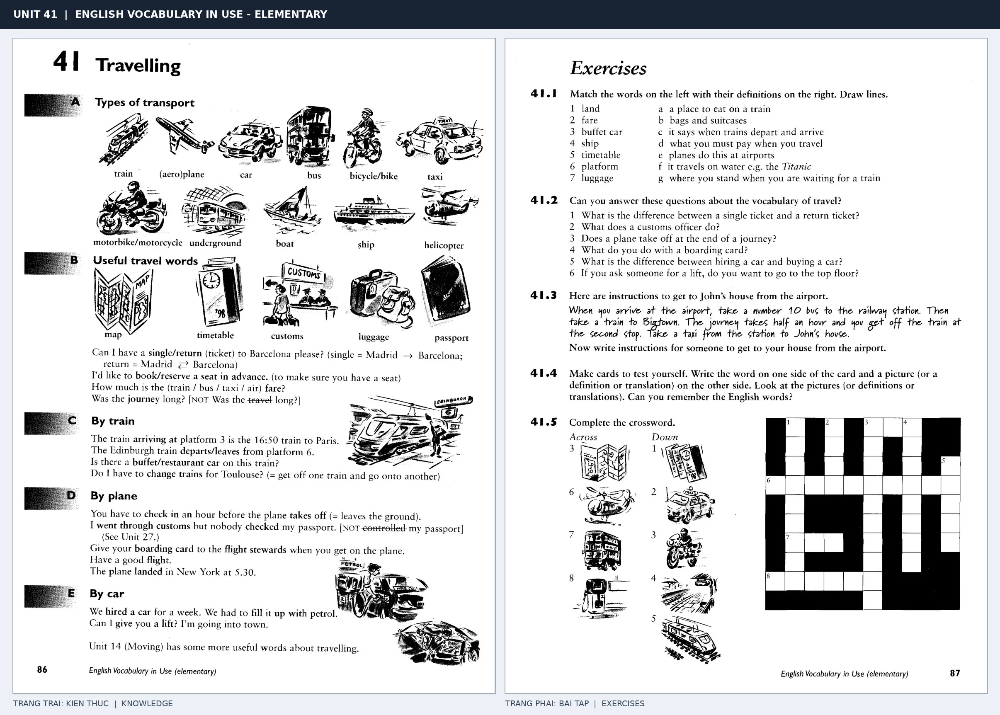

# Unit 41 — Travelling: Đi lại và du lịch

*Trang trái cung cấp kiến thức và ví dụ; trang phải là phần Exercises của Unit tương ứng. Có thể phóng to ảnh để làm bài tập gốc.*

> **Module 05:** Thế giới xung quanh  
> **Phạm vi:** English Vocabulary in Use — Elementary, Unit 41; trang in 86–87 (PDF trang 89–90).  
> **Hình thức:** Tự học từ vựng A1–A2 · Giảng giải tiếng Việt · Luyện câu và bài tập.

## 1. Tóm tắt và mục tiêu

Học từ vựng theo trình tự chuyến đi: chọn phương tiện, mua vé, đọc lịch trình, tới sân ga hoặc sân bay. Phân biệt single với return và hỏi thời gian khởi hành/đến nơi.

Sau bài này, bạn có thể:

- Giải thích nghĩa và cách sử dụng những từ, cụm từ cốt lõi của chủ đề **đi lại và du lịch**.
- Chọn đúng cách diễn đạt trong câu tiếng Anh đơn giản thay vì dịch máy móc từng từ.
- Tự đặt ít nhất ba câu thực tế và hoàn thành phần Exercises ở trang sách bên phải.

## 2. Kiến thức và từ vựng cốt lõi

Đọc kỹ từng mục. Với từ nhiều nghĩa, nghĩa ghi trong bảng được giới hạn ở cách dùng cần cho bài học này.

| Từ/cụm từ tiếng Anh | Nghĩa tiếng Việt |
| --- | --- |
| **train** | tàu hỏa |
| **plane** | máy bay |
| **ship** | tàu thủy |
| **bus** | xe buýt |
| **taxi** | taxi |
| **underground** | tàu điện ngầm |
| **ticket** | vé |
| **single ticket** | vé một chiều |
| **return ticket** | vé khứ hồi |
| **journey** | chuyến đi |
| **map** | bản đồ |
| **passport** | hộ chiếu |
| **luggage** | hành lý |
| **platform** | sân ga |

### 2.1. Ghi nhớ theo nhóm và ngữ cảnh

**Nhóm từ thứ nhất:** train (tàu hỏa), plane (máy bay), ship (tàu thủy).

**Nhóm từ thứ hai:** underground (tàu điện ngầm), ticket (vé), single ticket (vé một chiều).

Hãy ghép từ với tình huống sử dụng thực tế. Khi gặp cụm từ có nhiều thành phần, ưu tiên ghi cả cụm kèm một câu ví dụ trong sổ từ vựng.

### 2.2. Mẫu câu song ngữ

**Ví dụ 1.** I'd like a return ticket, please.

→ Cho tôi mua một vé khứ hồi.

**Ví dụ 2.** What time does the train leave?

→ Tàu khởi hành lúc mấy giờ?

Đọc từng câu thành tiếng, che phần dịch tiếng Việt và thử nói lại ý bằng lời của mình. Sau đó thay một chi tiết trong câu để tạo ví dụ mới.

## 3. Luyện tập ứng dụng

**Bài A — Nhớ từ trong ngữ cảnh.** Không nhìn bảng, hãy viết tiếng Anh tương ứng với các ý sau:

1. Tàu hỏa: __________
2. Xe buýt: __________
3. Vé một chiều: __________

**Bài B — Dịch và biến đổi câu.** Dịch hai câu dưới đây sang tiếng Anh trước khi nhìn mẫu câu ở trên:

1. Cho tôi mua một vé khứ hồi.
2. Tàu khởi hành lúc mấy giờ?

**Bài C — Viết cho bản thân.** Viết ba câu mới về cuộc sống của bạn, mỗi câu sử dụng một từ/cụm từ khác nhau trong bảng. Đọc lại để kiểm tra giới từ, cách chia động từ và trật tự từ.

**Bài D — Thực hành theo sách.** Quan sát phần **Exercises (trang phải)** trong ảnh ghép: giải bài tập trên giấy hoặc một file riêng, sau đó so sánh với các ví dụ ở trang trái. Những bài yêu cầu thông tin cá nhân không nhất thiết có một đáp án cố định.

## 4. Câu hỏi ôn tập trắc nghiệm

*Mỗi câu có một đáp án phù hợp nhất. Hãy tự trả lời trước khi đọc phần giải thích.*

### Câu 1

Bạn muốn diễn đạt **“máy bay”** bằng tiếng Anh. Chọn cách nói phù hợp nhất.

A. single ticket

B. underground

C. plane

D. ship

**Đáp án:** C. **Giải thích:** “plane” diễn đạt “máy bay” trong chủ đề này.

### Câu 2

Cụm từ **“underground”** có nghĩa nào trong bài học?

A. xe buýt

B. tàu điện ngầm

C. vé

D. bản đồ

**Đáp án:** B. **Giải thích:** “underground” được dùng với nghĩa “tàu điện ngầm”.

### Câu 3

Khi cần nói **“vé khứ hồi”**, chọn từ/cụm từ nào?

A. journey

B. ship

C. return ticket

D. ticket

**Đáp án:** C. **Giải thích:** Cách dùng đúng trong bài là “return ticket”.

### Câu 4

Chọn câu tiếng Anh diễn đạt đúng nhất: **“Cho tôi mua một vé khứ hồi.”**

A. The cows are in the field.

B. It's raining, so take an umbrella.

C. English is spoken in many countries.

D. I'd like a return ticket, please.

**Đáp án:** D. **Giải thích:** “I'd like a return ticket, please.” là câu tương ứng với tình huống đã nêu.

### Câu 5

Ý nghĩa phù hợp nhất của câu **“What time does the train leave?”** là gì?

A. Tàu khởi hành lúc mấy giờ?

B. Vui lòng sử dụng lối vào bên trái.

C. Cô ấy đến từ Nhật Bản và nói tiếng Nhật.

D. Thang máy đang hỏng.

**Đáp án:** A. **Giải thích:** “What time does the train leave?” có nghĩa là “Tàu khởi hành lúc mấy giờ?”.

## 5. Tổng kết và kiểm tra hoàn thành

Bài **What time does the train leave?** giúp bạn sử dụng vốn từ về **tàu khởi hành lúc mấy giờ?** trong câu tiếng Anh thực tế. Giá trị quan trọng nhất không chỉ là biết nghĩa, mà là nhớ **cách kết hợp từ và ngữ cảnh sử dụng**.

- [ ] Tôi đã học bảng từ/cụm từ và đọc thành tiếng các ví dụ.
- [ ] Tôi đã hoàn thành ba phần luyện tập A, B, C.
- [ ] Tôi đã làm trang Exercises trong ảnh ghép và 5 câu trắc nghiệm.
- [ ] Tôi đã ghi các từ dễ nhầm vào sổ để ôn lại sau 1–3 ngày.

---

[← Unit 40: Động vật và thú cưng](40-animals-and-pets.md) · [Unit 42: Các biển báo và thông báo →](42-notices.md)

[↑ Trở về mục lục khóa học](../../MUC_LUC.md)
