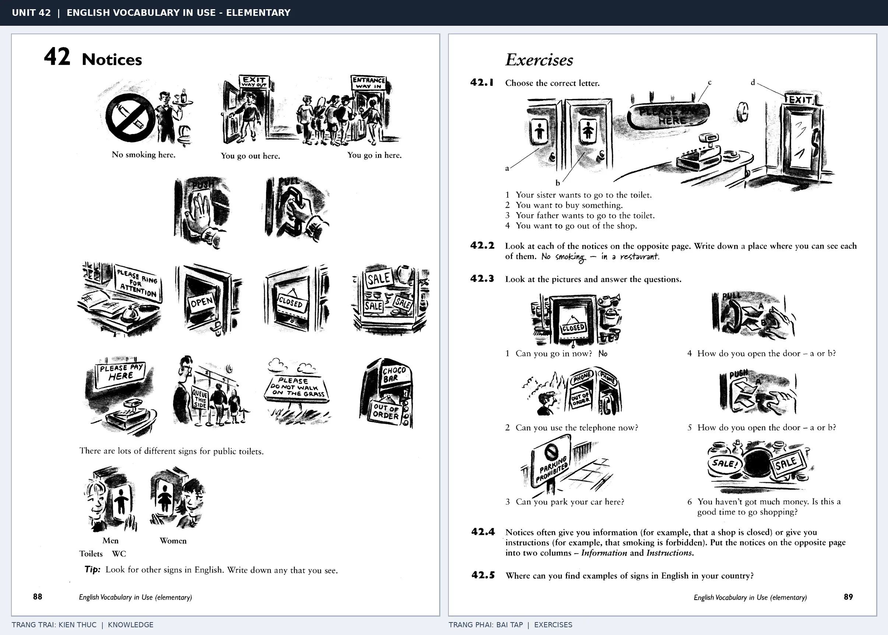

# Unit 42 — Notices: Các biển báo và thông báo

*Trang trái cung cấp kiến thức và ví dụ; trang phải là phần Exercises của Unit tương ứng. Có thể phóng to ảnh để làm bài tập gốc.*

> **Module 05:** Thế giới xung quanh  
> **Phạm vi:** English Vocabulary in Use — Elementary, Unit 42; trang in 88–89 (PDF trang 91–92).  
> **Hình thức:** Tự học từ vựng A1–A2 · Giảng giải tiếng Việt · Luyện câu và bài tập.

## 1. Tóm tắt và mục tiêu

Biển báo dùng ngôn ngữ cực ngắn, thường lược chủ ngữ: No smoking, Push, Pull. Hãy hiểu chức năng thông báo thay vì dịch từng từ; Out of order là thiết bị không sử dụng được.

Sau bài này, bạn có thể:

- Giải thích nghĩa và cách sử dụng những từ, cụm từ cốt lõi của chủ đề **các biển báo và thông báo**.
- Chọn đúng cách diễn đạt trong câu tiếng Anh đơn giản thay vì dịch máy móc từng từ.
- Tự đặt ít nhất ba câu thực tế và hoàn thành phần Exercises ở trang sách bên phải.

## 2. Kiến thức và từ vựng cốt lõi

Đọc kỹ từng mục. Với từ nhiều nghĩa, nghĩa ghi trong bảng được giới hạn ở cách dùng cần cho bài học này.

| Từ/cụm từ tiếng Anh | Nghĩa tiếng Việt |
| --- | --- |
| **no smoking** | cấm hút thuốc |
| **out of order** | hỏng hoặc không hoạt động |
| **no parking** | cấm đỗ xe |
| **entrance** | lối vào |
| **exit** | lối ra |
| **keep off the grass** | không giẫm lên cỏ |
| **pull** | kéo |
| **push** | đẩy |
| **toilets** | nhà vệ sinh |
| **closed** | đóng cửa |
| **open** | mở cửa |
| **danger** | nguy hiểm |

### 2.1. Ghi nhớ theo nhóm và ngữ cảnh

**Nhóm từ thứ nhất:** no smoking (cấm hút thuốc), out of order (hỏng hoặc không hoạt động), no parking (cấm đỗ xe).

**Nhóm từ thứ hai:** keep off the grass (không giẫm lên cỏ), pull (kéo), push (đẩy).

Hãy ghép từ với tình huống sử dụng thực tế. Khi gặp cụm từ có nhiều thành phần, ưu tiên ghi cả cụm kèm một câu ví dụ trong sổ từ vựng.

### 2.2. Mẫu câu song ngữ

**Ví dụ 1.** The lift is out of order.

→ Thang máy đang hỏng.

**Ví dụ 2.** Please use the entrance on the left.

→ Vui lòng sử dụng lối vào bên trái.

Đọc từng câu thành tiếng, che phần dịch tiếng Việt và thử nói lại ý bằng lời của mình. Sau đó thay một chi tiết trong câu để tạo ví dụ mới.

## 3. Luyện tập ứng dụng

**Bài A — Nhớ từ trong ngữ cảnh.** Không nhìn bảng, hãy viết tiếng Anh tương ứng với các ý sau:

1. Cấm hút thuốc: __________
2. Lối vào: __________
3. Đẩy: __________

**Bài B — Dịch và biến đổi câu.** Dịch hai câu dưới đây sang tiếng Anh trước khi nhìn mẫu câu ở trên:

1. Thang máy đang hỏng.
2. Vui lòng sử dụng lối vào bên trái.

**Bài C — Viết cho bản thân.** Viết ba câu mới về cuộc sống của bạn, mỗi câu sử dụng một từ/cụm từ khác nhau trong bảng. Đọc lại để kiểm tra giới từ, cách chia động từ và trật tự từ.

**Bài D — Thực hành theo sách.** Quan sát phần **Exercises (trang phải)** trong ảnh ghép: giải bài tập trên giấy hoặc một file riêng, sau đó so sánh với các ví dụ ở trang trái. Những bài yêu cầu thông tin cá nhân không nhất thiết có một đáp án cố định.

## 4. Câu hỏi ôn tập trắc nghiệm

*Mỗi câu có một đáp án phù hợp nhất. Hãy tự trả lời trước khi đọc phần giải thích.*

### Câu 1

Bạn muốn diễn đạt **“hỏng hoặc không hoạt động”** bằng tiếng Anh. Chọn cách nói phù hợp nhất.

A. no parking

B. keep off the grass

C. open

D. out of order

**Đáp án:** D. **Giải thích:** “out of order” diễn đạt “hỏng hoặc không hoạt động” trong chủ đề này.

### Câu 2

Cụm từ **“keep off the grass”** có nghĩa nào trong bài học?

A. nguy hiểm

B. không giẫm lên cỏ

C. nhà vệ sinh

D. hỏng hoặc không hoạt động

**Đáp án:** B. **Giải thích:** “keep off the grass” được dùng với nghĩa “không giẫm lên cỏ”.

### Câu 3

Khi cần nói **“nhà vệ sinh”**, chọn từ/cụm từ nào?

A. open

B. keep off the grass

C. toilets

D. danger

**Đáp án:** C. **Giải thích:** Cách dùng đúng trong bài là “toilets”.

### Câu 4

Chọn câu tiếng Anh diễn đạt đúng nhất: **“Thang máy đang hỏng.”**

A. You can borrow books from the library.

B. The lift is out of order.

C. The cows are in the field.

D. The bank is near the post office.

**Đáp án:** B. **Giải thích:** “The lift is out of order.” là câu tương ứng với tình huống đã nêu.

### Câu 5

Ý nghĩa phù hợp nhất của câu **“Please use the entrance on the left.”** là gì?

A. Trời đang mưa nên hãy mang ô.

B. Tàu khởi hành lúc mấy giờ?

C. Vui lòng sử dụng lối vào bên trái.

D. Tiếng Anh được dùng tại nhiều quốc gia.

**Đáp án:** C. **Giải thích:** “Please use the entrance on the left.” có nghĩa là “Vui lòng sử dụng lối vào bên trái.”.

## 5. Tổng kết và kiểm tra hoàn thành

Bài **Please use the entrance on the left.** giúp bạn sử dụng vốn từ về **vui lòng sử dụng lối vào bên trái.** trong câu tiếng Anh thực tế. Giá trị quan trọng nhất không chỉ là biết nghĩa, mà là nhớ **cách kết hợp từ và ngữ cảnh sử dụng**.

- [ ] Tôi đã học bảng từ/cụm từ và đọc thành tiếng các ví dụ.
- [ ] Tôi đã hoàn thành ba phần luyện tập A, B, C.
- [ ] Tôi đã làm trang Exercises trong ảnh ghép và 5 câu trắc nghiệm.
- [ ] Tôi đã ghi các từ dễ nhầm vào sổ để ôn lại sau 1–3 ngày.

---

[← Unit 41: Đi lại và du lịch](41-travelling.md) · [Unit 43: Đồ ăn và thức uống →](../06-at-home/43-food-and-drink.md)

[↑ Trở về mục lục khóa học](../../MUC_LUC.md)
