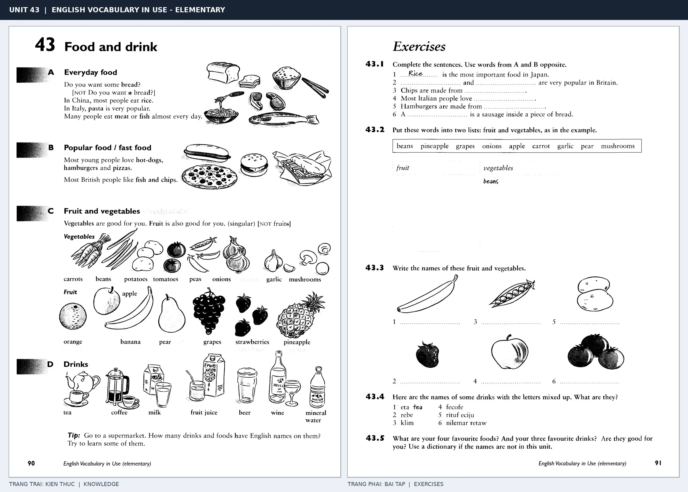

# Unit 43 — Food and drink: Đồ ăn và thức uống

*Trang trái cung cấp kiến thức và ví dụ; trang phải là phần Exercises của Unit tương ứng. Có thể phóng to ảnh để làm bài tập gốc.*

> **Module 06:** Không gian trong nhà  
> **Phạm vi:** English Vocabulary in Use — Elementary, Unit 43; trang in 90–91 (PDF trang 93–94).  
> **Hình thức:** Tự học từ vựng A1–A2 · Giảng giải tiếng Việt · Luyện câu và bài tập.

## 1. Tóm tắt và mục tiêu

Phân loại món ăn, đồ uống và bữa ăn; luyện some/any với thức ăn và các danh từ không đếm được như rice, bread. Có thể nêu sở thích với like/love, và mời ăn uống bằng Would you like ...?

Sau bài này, bạn có thể:

- Giải thích nghĩa và cách sử dụng những từ, cụm từ cốt lõi của chủ đề **đồ ăn và thức uống**.
- Chọn đúng cách diễn đạt trong câu tiếng Anh đơn giản thay vì dịch máy móc từng từ.
- Tự đặt ít nhất ba câu thực tế và hoàn thành phần Exercises ở trang sách bên phải.

## 2. Kiến thức và từ vựng cốt lõi

Đọc kỹ từng mục. Với từ nhiều nghĩa, nghĩa ghi trong bảng được giới hạn ở cách dùng cần cho bài học này.

| Từ/cụm từ tiếng Anh | Nghĩa tiếng Việt |
| --- | --- |
| **bread** | bánh mì |
| **rice** | cơm hoặc gạo |
| **pasta** | mì Ý |
| **meat** | thịt |
| **fish** | cá |
| **egg** | trứng |
| **cheese** | phô mai |
| **vegetables** | rau củ |
| **fruit** | trái cây |
| **tea** | trà |
| **coffee** | cà phê |
| **water** | nước |
| **hamburger** | bánh hamburger |
| **breakfast** | bữa sáng |

### 2.1. Ghi nhớ theo nhóm và ngữ cảnh

**Nhóm từ thứ nhất:** bread (bánh mì), rice (cơm hoặc gạo), pasta (mì Ý).

**Nhóm từ thứ hai:** egg (trứng), cheese (phô mai), vegetables (rau củ).

Hãy ghép từ với tình huống sử dụng thực tế. Khi gặp cụm từ có nhiều thành phần, ưu tiên ghi cả cụm kèm một câu ví dụ trong sổ từ vựng.

### 2.2. Mẫu câu song ngữ

**Ví dụ 1.** Would you like some tea?

→ Bạn có muốn uống chút trà không?

**Ví dụ 2.** We eat rice every day.

→ Chúng tôi ăn cơm hằng ngày.

Đọc từng câu thành tiếng, che phần dịch tiếng Việt và thử nói lại ý bằng lời của mình. Sau đó thay một chi tiết trong câu để tạo ví dụ mới.

## 3. Luyện tập ứng dụng

**Bài A — Nhớ từ trong ngữ cảnh.** Không nhìn bảng, hãy viết tiếng Anh tương ứng với các ý sau:

1. Bánh mì: __________
2. Thịt: __________
3. Rau củ: __________

**Bài B — Dịch và biến đổi câu.** Dịch hai câu dưới đây sang tiếng Anh trước khi nhìn mẫu câu ở trên:

1. Bạn có muốn uống chút trà không?
2. Chúng tôi ăn cơm hằng ngày.

**Bài C — Viết cho bản thân.** Viết ba câu mới về cuộc sống của bạn, mỗi câu sử dụng một từ/cụm từ khác nhau trong bảng. Đọc lại để kiểm tra giới từ, cách chia động từ và trật tự từ.

**Bài D — Thực hành theo sách.** Quan sát phần **Exercises (trang phải)** trong ảnh ghép: giải bài tập trên giấy hoặc một file riêng, sau đó so sánh với các ví dụ ở trang trái. Những bài yêu cầu thông tin cá nhân không nhất thiết có một đáp án cố định.

## 4. Câu hỏi ôn tập trắc nghiệm

*Mỗi câu có một đáp án phù hợp nhất. Hãy tự trả lời trước khi đọc phần giải thích.*

### Câu 1

Bạn muốn diễn đạt **“cơm hoặc gạo”** bằng tiếng Anh. Chọn cách nói phù hợp nhất.

A. water

B. coffee

C. rice

D. bread

**Đáp án:** C. **Giải thích:** “rice” diễn đạt “cơm hoặc gạo” trong chủ đề này.

### Câu 2

Cụm từ **“egg”** có nghĩa nào trong bài học?

A. mì Ý

B. trứng

C. thịt

D. nước

**Đáp án:** B. **Giải thích:** “egg” được dùng với nghĩa “trứng”.

### Câu 3

Khi cần nói **“trái cây”**, chọn từ/cụm từ nào?

A. water

B. egg

C. fruit

D. coffee

**Đáp án:** C. **Giải thích:** Cách dùng đúng trong bài là “fruit”.

### Câu 4

Chọn câu tiếng Anh diễn đạt đúng nhất: **“Bạn có muốn uống chút trà không?”**

A. I brush my teeth every morning.

B. The lamp is on the bedside table.

C. We need a knife and a fork.

D. Would you like some tea?

**Đáp án:** D. **Giải thích:** “Would you like some tea?” là câu tương ứng với tình huống đã nêu.

### Câu 5

Ý nghĩa phù hợp nhất của câu **“We eat rice every day.”** là gì?

A. Chúng ta cần dao và nĩa.

B. Những cuốn sách ở trên giá sách.

C. Chúng tôi ăn cơm hằng ngày.

D. Có một ghế sofa trong phòng khách.

**Đáp án:** C. **Giải thích:** “We eat rice every day.” có nghĩa là “Chúng tôi ăn cơm hằng ngày.”.

## 5. Tổng kết và kiểm tra hoàn thành

Bài **We eat rice every day.** giúp bạn sử dụng vốn từ về **chúng tôi ăn cơm hằng ngày.** trong câu tiếng Anh thực tế. Giá trị quan trọng nhất không chỉ là biết nghĩa, mà là nhớ **cách kết hợp từ và ngữ cảnh sử dụng**.

- [ ] Tôi đã học bảng từ/cụm từ và đọc thành tiếng các ví dụ.
- [ ] Tôi đã hoàn thành ba phần luyện tập A, B, C.
- [ ] Tôi đã làm trang Exercises trong ảnh ghép và 5 câu trắc nghiệm.
- [ ] Tôi đã ghi các từ dễ nhầm vào sổ để ôn lại sau 1–3 ngày.

---

[← Unit 42: Các biển báo và thông báo](../05-the-world/42-notices.md) · [Unit 44: Đồ dùng trong bếp →](44-in-the-kitchen.md)

[↑ Trở về mục lục khóa học](../../MUC_LUC.md)
