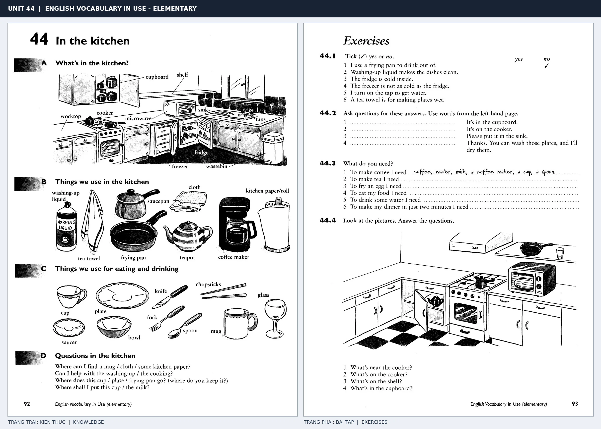

# Unit 44 — In the kitchen: Đồ dùng trong bếp

## Sơ đồ mô tả nội dung theo ảnh

~~~mermaid
flowchart LR
  subgraph LEFT["Trang trái · Từ vựng và hội thoại"]
    K1["A · Đồ vật và vị trí trong bếp cupboard · shelf · worktop · cooker · microwave sink · taps · fridge · freezer · wastebin Tranh bếp góc chữ L, có tủ mở, bếp nấu và bồn rửa"]
    K2["B · Dụng cụ làm bếp washing-up liquid · tea towel · saucepan · frying pan cloth · teapot · coffee maker · kitchen paper / roll"]
    K3["C · Đồ ăn uống dùng trên bàn cup · plate · saucer · bowl · glass · mug knife · fork · spoon · chopsticks"]
    K4["D · Câu hỏi giao tiếp Tìm đồ ở đâu? · giúp rửa bát hay nấu ăn? Cất cốc / đĩa / chảo ở đâu? · đặt cốc / sữa ở đâu?"]
  end
  subgraph RIGHT["Trang phải · Bài tập"]
    E1["44.1 · Đánh dấu đúng / sai về công dụng đồ bếp"]
    E2["44.2 · Đặt câu hỏi cho đáp án: trong cupboard · trên cooker · trong sink · rửa và lau đĩa"]
    E3["44.3 · Kể đồ cần để pha coffee / tea, rán trứng, ăn, uống nước và làm bữa tối nhanh"]
    E4["44.4 · Quan sát tranh bếp; tìm vật ở gần cooker, trên cooker, trên shelf và trong cupboard"]
  end
  K1 --> E1
  K2 --> E1
  K4 --> E2
  K2 --> E3
  K3 --> E3
  K1 --> E4
~~~

*Bố cục ảnh: trang trái đặt sơ đồ căn bếp ở trên, nhóm dụng cụ và đồ dùng ăn uống ở giữa, rồi đến các mẫu câu hỏi ở cuối trang; trang phải có bài đúng/sai, đặt câu hỏi, liệt kê đồ cần dùng và đọc vị trí trong một bức tranh bếp khác.*

## Bản chép đầy đủ chữ trong ảnh

### Trang trái · Trang sách 92

**Đầu trang:** UNIT 44 | ENGLISH VOCABULARY IN USE - ELEMENTARY

**Tiêu đề:** 44 In the kitchen

#### A · What’s in the kitchen?

**Nhãn trong tranh bếp:** cupboard · shelf · worktop · cooker · microwave · sink · taps · freezer · fridge · wastebin

#### B · Things we use in the kitchen

**Nhãn hình:** washing-up liquid · tea towel · saucepan · frying pan · cloth · kitchen paper/roll · teapot · coffee maker

#### C · Things we use for eating and drinking

**Nhãn hình:** cup · plate · knife · chopsticks · saucer · bowl · fork · spoon · mug · glass

#### D · Questions in the kitchen

Where can I find a mug / cloth / some kitchen paper?
Can I help with the washing-up / the cooking?
Where does this cup / plate / frying pan go? (where do you keep it?)
Where shall I put this cup / the milk?

### Trang phải · Trang sách 93 · Exercises

#### 44.1

Tick (✓) yes or no.

| # | Câu trong ảnh | Dấu viết tay |
| --- | --- | --- |
| 1 | I use a frying pan to drink out of. | no |
| 2 | Washing-up liquid makes the dishes clean. | — |
| 3 | The fridge is cold inside. | — |
| 4 | The freezer is not as cold as the fridge. | — |
| 5 | I turn on the tap to get water. | — |
| 6 | A tea towel is for making plates wet. | — |

#### 44.2

Ask questions for these answers. Use words from the left-hand page.

1. ______ It’s in the cupboard.
2. ______ It’s on the cooker.
3. ______ Please put it in the sink.
4. ______ Thanks. You can wash those plates, and I’ll dry them.

#### 44.3 · What do you need?

1. To make coffee I need … *(viết tay: coffee, water, milk, a coffee maker, a cup, a spoon.)*
2. To make tea I need …
3. To fry an egg I need …
4. To eat my food I need …
5. To drink some water I need …
6. To make my dinner in just two minutes I need …

#### 44.4

Look at the pictures. Answer the questions.

1. What’s near the cooker?
2. What’s on the cooker?
3. What’s on the shelf?
4. What’s in the cupboard?

**Chữ chân trang:** English Vocabulary in Use (elementary) · trang 92 và 93.  
**Nhãn khung ảnh ghép:** TRANG TRAI: KIEN THUC | KNOWLEDGE · TRANG PHAI: BAI TAP | EXERCISES.

*Trang trái cung cấp kiến thức và ví dụ; trang phải là phần Exercises của Unit tương ứng. Có thể phóng to ảnh để làm bài tập gốc.*

> **Module 06:** Không gian trong nhà  
> **Phạm vi:** English Vocabulary in Use — Elementary, Unit 44; trang in 92–93 (PDF trang 95–96).  
> **Hình thức:** Tự học từ vựng A1–A2 · Giảng giải tiếng Việt · Luyện câu và bài tập.

## 1. Tóm tắt và mục tiêu

Nhóm vật dụng theo ba công việc: cất đồ ăn, nấu và ăn/uống. Học collocation wash the dishes, put food in the fridge, cook in a pan, và chú ý glass vừa là ly vừa là chất liệu kính.

Sau bài này, bạn có thể:

- Giải thích nghĩa và cách sử dụng những từ, cụm từ cốt lõi của chủ đề **đồ dùng trong bếp**.
- Chọn đúng cách diễn đạt trong câu tiếng Anh đơn giản thay vì dịch máy móc từng từ.
- Tự đặt ít nhất ba câu thực tế và hoàn thành phần Exercises ở trang sách bên phải.

## 2. Kiến thức và từ vựng cốt lõi

Đọc kỹ từng mục. Với từ nhiều nghĩa, nghĩa ghi trong bảng được giới hạn ở cách dùng cần cho bài học này.

| Từ/cụm từ tiếng Anh | Nghĩa tiếng Việt |
| --- | --- |
| **fridge** | tủ lạnh |
| **cooker** | bếp nấu |
| **oven** | lò nướng |
| **frying pan** | chảo rán |
| **saucepan** | nồi nhỏ |
| **knife** | dao |
| **fork** | nĩa |
| **spoon** | thìa |
| **plate** | đĩa |
| **bowl** | bát |
| **cup** | tách |
| **glass** | ly |
| **teapot** | ấm trà |
| **washing-up liquid** | nước rửa chén |

### 2.1. Ghi nhớ theo nhóm và ngữ cảnh

**Nhóm từ thứ nhất:** fridge (tủ lạnh), cooker (bếp nấu), oven (lò nướng).

**Nhóm từ thứ hai:** knife (dao), fork (nĩa), spoon (thìa).

Hãy ghép từ với tình huống sử dụng thực tế. Khi gặp cụm từ có nhiều thành phần, ưu tiên ghi cả cụm kèm một câu ví dụ trong sổ từ vựng.

### 2.2. Mẫu câu song ngữ

**Ví dụ 1.** The milk is in the fridge.

→ Sữa ở trong tủ lạnh.

**Ví dụ 2.** We need a knife and a fork.

→ Chúng ta cần dao và nĩa.

Đọc từng câu thành tiếng, che phần dịch tiếng Việt và thử nói lại ý bằng lời của mình. Sau đó thay một chi tiết trong câu để tạo ví dụ mới.

## 3. Luyện tập ứng dụng

**Bài A — Nhớ từ trong ngữ cảnh.** Không nhìn bảng, hãy viết tiếng Anh tương ứng với các ý sau:

1. Tủ lạnh: __________
2. Chảo rán: __________
3. Thìa: __________

**Bài B — Dịch và biến đổi câu.** Dịch hai câu dưới đây sang tiếng Anh trước khi nhìn mẫu câu ở trên:

1. Sữa ở trong tủ lạnh.
2. Chúng ta cần dao và nĩa.

**Bài C — Viết cho bản thân.** Viết ba câu mới về cuộc sống của bạn, mỗi câu sử dụng một từ/cụm từ khác nhau trong bảng. Đọc lại để kiểm tra giới từ, cách chia động từ và trật tự từ.

**Bài D — Thực hành theo sách.** Quan sát phần **Exercises (trang phải)** trong ảnh ghép: giải bài tập trên giấy hoặc một file riêng, sau đó so sánh với các ví dụ ở trang trái. Những bài yêu cầu thông tin cá nhân không nhất thiết có một đáp án cố định.

## 4. Câu hỏi ôn tập trắc nghiệm

*Mỗi câu có một đáp án phù hợp nhất. Hãy tự trả lời trước khi đọc phần giải thích.*

### Câu 1

Bạn muốn diễn đạt **“bếp nấu”** bằng tiếng Anh. Chọn cách nói phù hợp nhất.

A. cooker

B. fridge

C. knife

D. fork

**Đáp án:** A. **Giải thích:** “cooker” diễn đạt “bếp nấu” trong chủ đề này.

### Câu 2

Cụm từ **“knife”** có nghĩa nào trong bài học?

A. bát

B. đĩa

C. ly

D. dao

**Đáp án:** D. **Giải thích:** “knife” được dùng với nghĩa “dao”.

### Câu 3

Khi cần nói **“đĩa”**, chọn từ/cụm từ nào?

A. spoon

B. cup

C. washing-up liquid

D. plate

**Đáp án:** D. **Giải thích:** Cách dùng đúng trong bài là “plate”.

### Câu 4

Chọn câu tiếng Anh diễn đạt đúng nhất: **“Sữa ở trong tủ lạnh.”**

A. I brush my teeth every morning.

B. The books are on the bookshelf.

C. The milk is in the fridge.

D. There is a sofa in the living room.

**Đáp án:** C. **Giải thích:** “The milk is in the fridge.” là câu tương ứng với tình huống đã nêu.

### Câu 5

Ý nghĩa phù hợp nhất của câu **“We need a knife and a fork.”** là gì?

A. Tôi đánh răng mỗi sáng.

B. Chúng ta cần dao và nĩa.

C. Đèn nằm trên tủ đầu giường.

D. Có một ghế sofa trong phòng khách.

**Đáp án:** B. **Giải thích:** “We need a knife and a fork.” có nghĩa là “Chúng ta cần dao và nĩa.”.

## 5. Tổng kết và kiểm tra hoàn thành

Bài **We need a knife and a fork.** giúp bạn sử dụng vốn từ về **chúng ta cần dao và nĩa.** trong câu tiếng Anh thực tế. Giá trị quan trọng nhất không chỉ là biết nghĩa, mà là nhớ **cách kết hợp từ và ngữ cảnh sử dụng**.

- [ ] Tôi đã học bảng từ/cụm từ và đọc thành tiếng các ví dụ.
- [ ] Tôi đã hoàn thành ba phần luyện tập A, B, C.
- [ ] Tôi đã làm trang Exercises trong ảnh ghép và 5 câu trắc nghiệm.
- [ ] Tôi đã ghi các từ dễ nhầm vào sổ để ôn lại sau 1–3 ngày.

---

[← Unit 43: Đồ ăn và thức uống](43-food-and-drink.md) · [Unit 45: Đồ dùng phòng ngủ và phòng tắm →](45-in-the-bedroom-and-bathroom.md)

[↑ Trở về mục lục khóa học](../../MUC_LUC.md)
