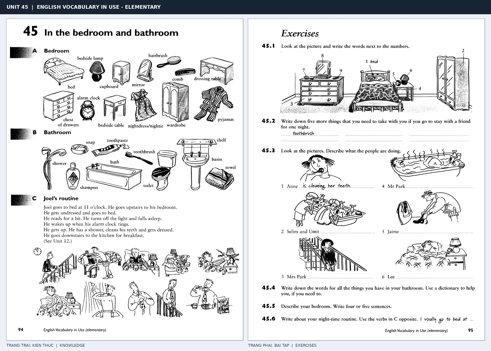

# Unit 45 — In the bedroom and bathroom: Đồ dùng phòng ngủ và phòng tắm

## Sơ đồ mô tả nội dung theo ảnh

~~~mermaid
flowchart LR
  subgraph LEFT["Trang trái · Từ vựng và thói quen"]
    K1["A · Phòng ngủ bed · bedside lamp · cupboard · mirror · hairbrush · comb dressing table · chest of drawers · alarm clock · bedside table nightdress / nightie · wardrobe · pyjamas"]
    K2["B · Phòng tắm shower · shampoo · bath · soap · toothpaste · toothbrush toilet · shelf · basin · towel"]
    K3["C · Thói quen của Joel 11 giờ: lên phòng, thay đồ, đi ngủ → đọc một lúc, tắt đèn, ngủ Sáng: chuông báo thức → thức dậy, tắm, đánh răng, mặc quần áo → xuống bếp ăn sáng"]
  end
  subgraph RIGHT["Trang phải · Bài tập"]
    E1["45.1 · Điền tên cho các đồ vật được đánh số trong tranh phòng ngủ"]
    E2["45.2 · Liệt kê đồ cần mang khi ngủ lại nhà bạn một đêm"]
    E3["45.3 · Mô tả 6 tranh: đánh răng · tắm / rửa em bé · đi xuống cầu thang · tắm bồn · là quần áo · ngủ"]
    E4["45.4 · Ghi tên các đồ vật có trong phòng tắm của mình"]
    E5["45.5–45.6 · Viết vài câu về phòng ngủ và thói quen buổi tối"]
  end
  K1 --> E1
  K1 --> E2
  K2 --> E3
  K3 --> E3
  K1 --> E5
  K3 --> E5
~~~

*Bố cục ảnh: trang trái lần lượt minh họa đồ phòng ngủ, đồ phòng tắm và chuỗi hoạt động sáng–tối của Joel bằng hình nhỏ; trang phải có tranh phòng ngủ đánh số cùng sáu tình huống sinh hoạt để người học gọi tên và mô tả hành động.*

## Bản chép đầy đủ chữ trong ảnh

### Trang trái · Trang sách 94

**Đầu trang:** UNIT 45 | ENGLISH VOCABULARY IN USE - ELEMENTARY

**Tiêu đề:** 45 In the bedroom and bathroom

#### A · Bedroom

**Nhãn hình:** bed · bedside lamp · cupboard · mirror · hairbrush · comb · dressing table · chest of drawers · alarm clock · bedside table · nightdress/nightie · wardrobe · pyjamas

#### B · Bathroom

**Nhãn hình:** shower · soap · toothpaste · toothbrush · shelf · basin · towel · shampoo · bath · toilet

#### C · Joel’s routine

Joel goes to bed at 11 o’clock. He goes upstairs to his bedroom.
He gets undressed and goes to bed.
He reads for a bit. He turns off the light and falls asleep.
He wakes up when his alarm clock rings.
He gets up. He has a shower, cleans his teeth and gets dressed.
He goes downstairs to the kitchen for breakfast.
(See Unit 12.)

### Trang phải · Trang sách 95 · Exercises

#### 45.1

Look at the picture and write the words next to the numbers.

1. ______ *(viết tay: bed)*
2. ______
3. ______
4. ______
5. ______
6. ______
7. ______
8. ______
9. ______

#### 45.2

Write down five more things that you need to take with you if you go to stay with a friend for one night.

*(Có chữ viết tay: toothbrush.)*

#### 45.3

Look at the pictures. Describe what the people are doing.

1. Anne ______ *(viết tay: is cleaning her teeth.)*
2. Selim and Umit ______
3. Mrs Park ______
4. Mr Park ______
5. Jaime ______
6. Lee ______

#### 45.4

Write down the words for all the things you have in your bathroom. Use a dictionary to help you, if you need to.

#### 45.5

Describe your bedroom. Write four or five sentences.

#### 45.6

Write about your night-time routine. Use the verbs in C opposite.

*(Có chữ viết tay: I usually go to bed at …)*

**Chữ chân trang:** English Vocabulary in Use (elementary) · trang 94 và 95.  
**Nhãn khung ảnh ghép:** TRANG TRAI: KIEN THUC | KNOWLEDGE · TRANG PHAI: BAI TAP | EXERCISES.

*Trang trái cung cấp kiến thức và ví dụ; trang phải là phần Exercises của Unit tương ứng. Có thể phóng to ảnh để làm bài tập gốc.*

> **Module 06:** Không gian trong nhà  
> **Phạm vi:** English Vocabulary in Use — Elementary, Unit 45; trang in 94–95 (PDF trang 97–98).  
> **Hình thức:** Tự học từ vựng A1–A2 · Giảng giải tiếng Việt · Luyện câu và bài tập.

## 1. Tóm tắt và mục tiêu

Phân biệt đồ đạc phòng ngủ và phòng tắm. Dùng in, on, next to, under để nói vị trí và have a shower, brush your teeth khi mô tả thói quen.

Sau bài này, bạn có thể:

- Giải thích nghĩa và cách sử dụng những từ, cụm từ cốt lõi của chủ đề **đồ dùng phòng ngủ và phòng tắm**.
- Chọn đúng cách diễn đạt trong câu tiếng Anh đơn giản thay vì dịch máy móc từng từ.
- Tự đặt ít nhất ba câu thực tế và hoàn thành phần Exercises ở trang sách bên phải.

## 2. Kiến thức và từ vựng cốt lõi

Đọc kỹ từng mục. Với từ nhiều nghĩa, nghĩa ghi trong bảng được giới hạn ở cách dùng cần cho bài học này.

| Từ/cụm từ tiếng Anh | Nghĩa tiếng Việt |
| --- | --- |
| **bed** | giường |
| **pillow** | gối |
| **blanket** | chăn |
| **wardrobe** | tủ quần áo |
| **chest of drawers** | tủ ngăn kéo |
| **bedside table** | tủ đầu giường |
| **lamp** | đèn |
| **mirror** | gương |
| **toothbrush** | bàn chải đánh răng |
| **toothpaste** | kem đánh răng |
| **shampoo** | dầu gội |
| **soap** | xà phòng |
| **towel** | khăn tắm |
| **hairbrush** | lược chải tóc |

### 2.1. Ghi nhớ theo nhóm và ngữ cảnh

**Nhóm từ thứ nhất:** bed (giường), pillow (gối), blanket (chăn).

**Nhóm từ thứ hai:** bedside table (tủ đầu giường), lamp (đèn), mirror (gương).

Hãy ghép từ với tình huống sử dụng thực tế. Khi gặp cụm từ có nhiều thành phần, ưu tiên ghi cả cụm kèm một câu ví dụ trong sổ từ vựng.

### 2.2. Mẫu câu song ngữ

**Ví dụ 1.** The lamp is on the bedside table.

→ Đèn nằm trên tủ đầu giường.

**Ví dụ 2.** I brush my teeth every morning.

→ Tôi đánh răng mỗi sáng.

Đọc từng câu thành tiếng, che phần dịch tiếng Việt và thử nói lại ý bằng lời của mình. Sau đó thay một chi tiết trong câu để tạo ví dụ mới.

## 3. Luyện tập ứng dụng

**Bài A — Nhớ từ trong ngữ cảnh.** Không nhìn bảng, hãy viết tiếng Anh tương ứng với các ý sau:

1. Giường: __________
2. Tủ quần áo: __________
3. Gương: __________

**Bài B — Dịch và biến đổi câu.** Dịch hai câu dưới đây sang tiếng Anh trước khi nhìn mẫu câu ở trên:

1. Đèn nằm trên tủ đầu giường.
2. Tôi đánh răng mỗi sáng.

**Bài C — Viết cho bản thân.** Viết ba câu mới về cuộc sống của bạn, mỗi câu sử dụng một từ/cụm từ khác nhau trong bảng. Đọc lại để kiểm tra giới từ, cách chia động từ và trật tự từ.

**Bài D — Thực hành theo sách.** Quan sát phần **Exercises (trang phải)** trong ảnh ghép: giải bài tập trên giấy hoặc một file riêng, sau đó so sánh với các ví dụ ở trang trái. Những bài yêu cầu thông tin cá nhân không nhất thiết có một đáp án cố định.

## 4. Câu hỏi ôn tập trắc nghiệm

*Mỗi câu có một đáp án phù hợp nhất. Hãy tự trả lời trước khi đọc phần giải thích.*

### Câu 1

Bạn muốn diễn đạt **“gối”** bằng tiếng Anh. Chọn cách nói phù hợp nhất.

A. hairbrush

B. towel

C. pillow

D. mirror

**Đáp án:** C. **Giải thích:** “pillow” diễn đạt “gối” trong chủ đề này.

### Câu 2

Cụm từ **“bedside table”** có nghĩa nào trong bài học?

A. xà phòng

B. dầu gội

C. tủ quần áo

D. tủ đầu giường

**Đáp án:** D. **Giải thích:** “bedside table” được dùng với nghĩa “tủ đầu giường”.

### Câu 3

Khi cần nói **“bàn chải đánh răng”**, chọn từ/cụm từ nào?

A. mirror

B. bed

C. toothbrush

D. wardrobe

**Đáp án:** C. **Giải thích:** Cách dùng đúng trong bài là “toothbrush”.

### Câu 4

Chọn câu tiếng Anh diễn đạt đúng nhất: **“Đèn nằm trên tủ đầu giường.”**

A. The milk is in the fridge.

B. The lamp is on the bedside table.

C. We need a knife and a fork.

D. We eat rice every day.

**Đáp án:** B. **Giải thích:** “The lamp is on the bedside table.” là câu tương ứng với tình huống đã nêu.

### Câu 5

Ý nghĩa phù hợp nhất của câu **“I brush my teeth every morning.”** là gì?

A. Chúng tôi ăn cơm hằng ngày.

B. Sữa ở trong tủ lạnh.

C. Những cuốn sách ở trên giá sách.

D. Tôi đánh răng mỗi sáng.

**Đáp án:** D. **Giải thích:** “I brush my teeth every morning.” có nghĩa là “Tôi đánh răng mỗi sáng.”.

## 5. Tổng kết và kiểm tra hoàn thành

Bài **I brush my teeth every morning.** giúp bạn sử dụng vốn từ về **tôi đánh răng mỗi sáng.** trong câu tiếng Anh thực tế. Giá trị quan trọng nhất không chỉ là biết nghĩa, mà là nhớ **cách kết hợp từ và ngữ cảnh sử dụng**.

- [ ] Tôi đã học bảng từ/cụm từ và đọc thành tiếng các ví dụ.
- [ ] Tôi đã hoàn thành ba phần luyện tập A, B, C.
- [ ] Tôi đã làm trang Exercises trong ảnh ghép và 5 câu trắc nghiệm.
- [ ] Tôi đã ghi các từ dễ nhầm vào sổ để ôn lại sau 1–3 ngày.

---

[← Unit 44: Đồ dùng trong bếp](44-in-the-kitchen.md) · [Unit 46: Đồ dùng phòng khách →](46-in-the-living-room.md)

[↑ Trở về mục lục khóa học](../../MUC_LUC.md)
