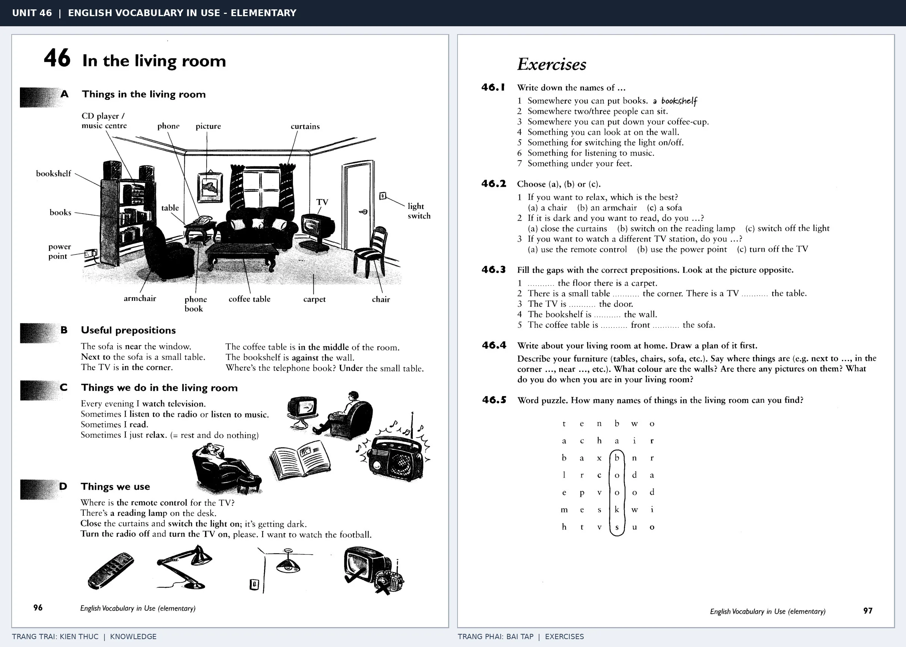

# Unit 46 — In the living room: Đồ dùng phòng khách

*Trang trái cung cấp kiến thức và ví dụ; trang phải là phần Exercises của Unit tương ứng. Có thể phóng to ảnh để làm bài tập gốc.*

> **Module 06:** Không gian trong nhà  
> **Phạm vi:** English Vocabulary in Use — Elementary, Unit 46; trang in 96–97 (PDF trang 99–100).  
> **Hình thức:** Tự học từ vựng A1–A2 · Giảng giải tiếng Việt · Luyện câu và bài tập.

## 1. Tóm tắt và mục tiêu

Miêu tả phòng khách qua đồ vật, vị trí và hoạt động: sit on the sofa, turn on the light, put books on the bookshelf. Phân biệt on (tiếp xúc bề mặt) và in (ở bên trong).

Sau bài này, bạn có thể:

- Giải thích nghĩa và cách sử dụng những từ, cụm từ cốt lõi của chủ đề **đồ dùng phòng khách**.
- Chọn đúng cách diễn đạt trong câu tiếng Anh đơn giản thay vì dịch máy móc từng từ.
- Tự đặt ít nhất ba câu thực tế và hoàn thành phần Exercises ở trang sách bên phải.

## 2. Kiến thức và từ vựng cốt lõi

Đọc kỹ từng mục. Với từ nhiều nghĩa, nghĩa ghi trong bảng được giới hạn ở cách dùng cần cho bài học này.

| Từ/cụm từ tiếng Anh | Nghĩa tiếng Việt |
| --- | --- |
| **sofa** | ghế sofa |
| **armchair** | ghế bành |
| **coffee table** | bàn trà |
| **bookshelf** | giá sách |
| **carpet** | thảm |
| **curtains** | rèm cửa |
| **light switch** | công tắc đèn |
| **power point** | ổ cắm điện |
| **picture** | tranh |
| **television** | tivi |
| **phone** | điện thoại |
| **CD player** | máy phát đĩa CD |
| **lamp** | đèn |
| **battery** | pin |

### 2.1. Ghi nhớ theo nhóm và ngữ cảnh

**Nhóm từ thứ nhất:** sofa (ghế sofa), armchair (ghế bành), coffee table (bàn trà).

**Nhóm từ thứ hai:** curtains (rèm cửa), light switch (công tắc đèn), power point (ổ cắm điện).

Hãy ghép từ với tình huống sử dụng thực tế. Khi gặp cụm từ có nhiều thành phần, ưu tiên ghi cả cụm kèm một câu ví dụ trong sổ từ vựng.

### 2.2. Mẫu câu song ngữ

**Ví dụ 1.** There is a sofa in the living room.

→ Có một ghế sofa trong phòng khách.

**Ví dụ 2.** The books are on the bookshelf.

→ Những cuốn sách ở trên giá sách.

Đọc từng câu thành tiếng, che phần dịch tiếng Việt và thử nói lại ý bằng lời của mình. Sau đó thay một chi tiết trong câu để tạo ví dụ mới.

## 3. Luyện tập ứng dụng

**Bài A — Nhớ từ trong ngữ cảnh.** Không nhìn bảng, hãy viết tiếng Anh tương ứng với các ý sau:

1. Ghế sofa: __________
2. Giá sách: __________
3. Ổ cắm điện: __________

**Bài B — Dịch và biến đổi câu.** Dịch hai câu dưới đây sang tiếng Anh trước khi nhìn mẫu câu ở trên:

1. Có một ghế sofa trong phòng khách.
2. Những cuốn sách ở trên giá sách.

**Bài C — Viết cho bản thân.** Viết ba câu mới về cuộc sống của bạn, mỗi câu sử dụng một từ/cụm từ khác nhau trong bảng. Đọc lại để kiểm tra giới từ, cách chia động từ và trật tự từ.

**Bài D — Thực hành theo sách.** Quan sát phần **Exercises (trang phải)** trong ảnh ghép: giải bài tập trên giấy hoặc một file riêng, sau đó so sánh với các ví dụ ở trang trái. Những bài yêu cầu thông tin cá nhân không nhất thiết có một đáp án cố định.

## 4. Câu hỏi ôn tập trắc nghiệm

*Mỗi câu có một đáp án phù hợp nhất. Hãy tự trả lời trước khi đọc phần giải thích.*

### Câu 1

Bạn muốn diễn đạt **“ghế bành”** bằng tiếng Anh. Chọn cách nói phù hợp nhất.

A. armchair

B. power point

C. sofa

D. battery

**Đáp án:** A. **Giải thích:** “armchair” diễn đạt “ghế bành” trong chủ đề này.

### Câu 2

Cụm từ **“curtains”** có nghĩa nào trong bài học?

A. rèm cửa

B. ổ cắm điện

C. pin

D. máy phát đĩa CD

**Đáp án:** A. **Giải thích:** “curtains” được dùng với nghĩa “rèm cửa”.

### Câu 3

Khi cần nói **“tranh”**, chọn từ/cụm từ nào?

A. television

B. carpet

C. curtains

D. picture

**Đáp án:** D. **Giải thích:** Cách dùng đúng trong bài là “picture”.

### Câu 4

Chọn câu tiếng Anh diễn đạt đúng nhất: **“Có một ghế sofa trong phòng khách.”**

A. We need a knife and a fork.

B. Would you like some tea?

C. There is a sofa in the living room.

D. We eat rice every day.

**Đáp án:** C. **Giải thích:** “There is a sofa in the living room.” là câu tương ứng với tình huống đã nêu.

### Câu 5

Ý nghĩa phù hợp nhất của câu **“The books are on the bookshelf.”** là gì?

A. Chúng tôi ăn cơm hằng ngày.

B. Chúng ta cần dao và nĩa.

C. Những cuốn sách ở trên giá sách.

D. Đèn nằm trên tủ đầu giường.

**Đáp án:** C. **Giải thích:** “The books are on the bookshelf.” có nghĩa là “Những cuốn sách ở trên giá sách.”.

## 5. Tổng kết và kiểm tra hoàn thành

Bài **The books are on the bookshelf.** giúp bạn sử dụng vốn từ về **những cuốn sách ở trên giá sách.** trong câu tiếng Anh thực tế. Giá trị quan trọng nhất không chỉ là biết nghĩa, mà là nhớ **cách kết hợp từ và ngữ cảnh sử dụng**.

- [ ] Tôi đã học bảng từ/cụm từ và đọc thành tiếng các ví dụ.
- [ ] Tôi đã hoàn thành ba phần luyện tập A, B, C.
- [ ] Tôi đã làm trang Exercises trong ảnh ghép và 5 câu trắc nghiệm.
- [ ] Tôi đã ghi các từ dễ nhầm vào sổ để ôn lại sau 1–3 ngày.

---

[← Unit 45: Đồ dùng phòng ngủ và phòng tắm](45-in-the-bedroom-and-bathroom.md) · [Unit 47: Nghề nghiệp và công việc →](../07-school-and-workplace/47-jobs.md)

[↑ Trở về mục lục khóa học](../../MUC_LUC.md)
