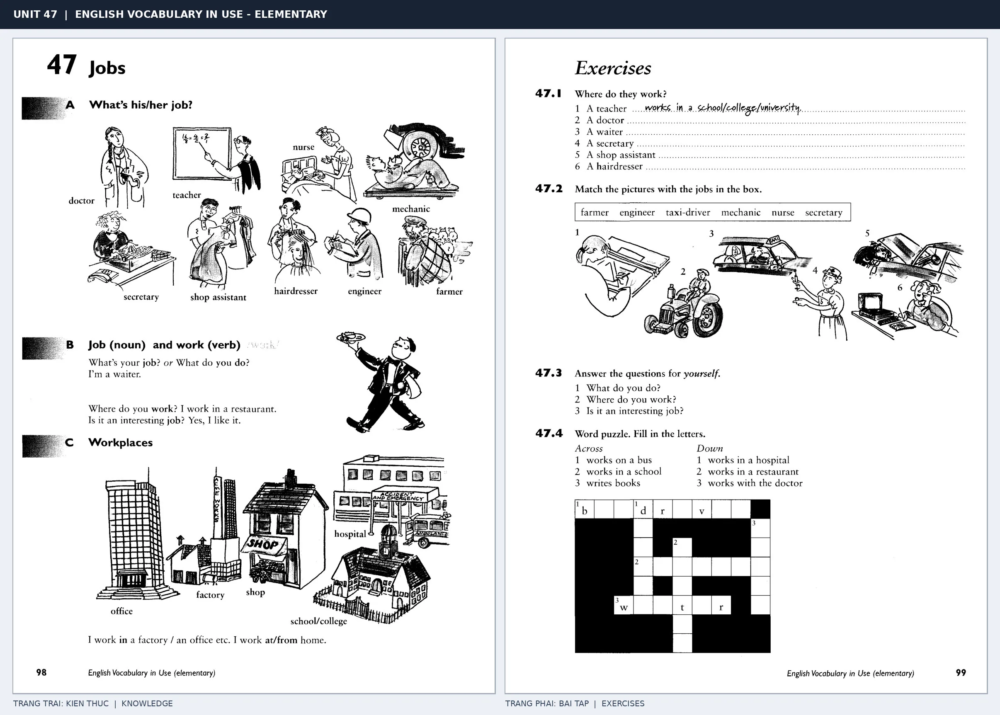

# Unit 47 — Jobs: Nghề nghiệp và công việc

*Trang trái cung cấp kiến thức và ví dụ; trang phải là phần Exercises của Unit tương ứng. Có thể phóng to ảnh để làm bài tập gốc.*

> **Module 07:** Trường học và công việc  
> **Phạm vi:** English Vocabulary in Use — Elementary, Unit 47; trang in 98–99 (PDF trang 101–102).  
> **Hình thức:** Tự học từ vựng A1–A2 · Giảng giải tiếng Việt · Luyện câu và bài tập.

## 1. Tóm tắt và mục tiêu

Hỏi nghề nghiệp bằng What do you do? hoặc What's your job?; trả lời I'm a/an + danh từ nghề. Job là danh từ đếm được, work thường là động từ hoặc danh từ không đếm được.

Sau bài này, bạn có thể:

- Giải thích nghĩa và cách sử dụng những từ, cụm từ cốt lõi của chủ đề **nghề nghiệp và công việc**.
- Chọn đúng cách diễn đạt trong câu tiếng Anh đơn giản thay vì dịch máy móc từng từ.
- Tự đặt ít nhất ba câu thực tế và hoàn thành phần Exercises ở trang sách bên phải.

## 2. Kiến thức và từ vựng cốt lõi

Đọc kỹ từng mục. Với từ nhiều nghĩa, nghĩa ghi trong bảng được giới hạn ở cách dùng cần cho bài học này.

| Từ/cụm từ tiếng Anh | Nghĩa tiếng Việt |
| --- | --- |
| **doctor** | bác sĩ |
| **teacher** | giáo viên |
| **secretary** | thư ký |
| **waiter** | nam phục vụ |
| **waitress** | nữ phục vụ |
| **hairdresser** | thợ làm tóc |
| **shop assistant** | nhân viên bán hàng |
| **factory worker** | công nhân nhà máy |
| **engineer** | kỹ sư |
| **nurse** | y tá |
| **office** | văn phòng |
| **salary** | lương |
| **job** | nghề hoặc công việc |
| **work** | làm việc |

### 2.1. Ghi nhớ theo nhóm và ngữ cảnh

**Nhóm từ thứ nhất:** doctor (bác sĩ), teacher (giáo viên), secretary (thư ký).

**Nhóm từ thứ hai:** hairdresser (thợ làm tóc), shop assistant (nhân viên bán hàng), factory worker (công nhân nhà máy).

Hãy ghép từ với tình huống sử dụng thực tế. Khi gặp cụm từ có nhiều thành phần, ưu tiên ghi cả cụm kèm một câu ví dụ trong sổ từ vựng.

### 2.2. Mẫu câu song ngữ

**Ví dụ 1.** What do you do? I'm an engineer.

→ Bạn làm nghề gì? Tôi là kỹ sư.

**Ví dụ 2.** She works in a hospital.

→ Cô ấy làm việc ở bệnh viện.

Đọc từng câu thành tiếng, che phần dịch tiếng Việt và thử nói lại ý bằng lời của mình. Sau đó thay một chi tiết trong câu để tạo ví dụ mới.

## 3. Luyện tập ứng dụng

**Bài A — Nhớ từ trong ngữ cảnh.** Không nhìn bảng, hãy viết tiếng Anh tương ứng với các ý sau:

1. Bác sĩ: __________
2. Nam phục vụ: __________
3. Công nhân nhà máy: __________

**Bài B — Dịch và biến đổi câu.** Dịch hai câu dưới đây sang tiếng Anh trước khi nhìn mẫu câu ở trên:

1. Bạn làm nghề gì? Tôi là kỹ sư.
2. Cô ấy làm việc ở bệnh viện.

**Bài C — Viết cho bản thân.** Viết ba câu mới về cuộc sống của bạn, mỗi câu sử dụng một từ/cụm từ khác nhau trong bảng. Đọc lại để kiểm tra giới từ, cách chia động từ và trật tự từ.

**Bài D — Thực hành theo sách.** Quan sát phần **Exercises (trang phải)** trong ảnh ghép: giải bài tập trên giấy hoặc một file riêng, sau đó so sánh với các ví dụ ở trang trái. Những bài yêu cầu thông tin cá nhân không nhất thiết có một đáp án cố định.

## 4. Câu hỏi ôn tập trắc nghiệm

*Mỗi câu có một đáp án phù hợp nhất. Hãy tự trả lời trước khi đọc phần giải thích.*

### Câu 1

Bạn muốn diễn đạt **“giáo viên”** bằng tiếng Anh. Chọn cách nói phù hợp nhất.

A. teacher

B. salary

C. factory worker

D. job

**Đáp án:** A. **Giải thích:** “teacher” diễn đạt “giáo viên” trong chủ đề này.

### Câu 2

Cụm từ **“hairdresser”** có nghĩa nào trong bài học?

A. thợ làm tóc

B. nhân viên bán hàng

C. giáo viên

D. nữ phục vụ

**Đáp án:** A. **Giải thích:** “hairdresser” được dùng với nghĩa “thợ làm tóc”.

### Câu 3

Khi cần nói **“kỹ sư”**, chọn từ/cụm từ nào?

A. shop assistant

B. engineer

C. nurse

D. hairdresser

**Đáp án:** B. **Giải thích:** Cách dùng đúng trong bài là “engineer”.

### Câu 4

Chọn câu tiếng Anh diễn đạt đúng nhất: **“Bạn làm nghề gì? Tôi là kỹ sư.”**

A. What do you do? I'm an engineer.

B. We have an exam on Friday.

C. Don't forget to put a stamp on the envelope.

D. I'll send you an email.

**Đáp án:** A. **Giải thích:** “What do you do? I'm an engineer.” là câu tương ứng với tình huống đã nêu.

### Câu 5

Ý nghĩa phù hợp nhất của câu **“She works in a hospital.”** là gì?

A. Chúng tôi có kỳ thi vào thứ Sáu.

B. Đừng quên dán tem lên phong bì.

C. Tôi sẽ gửi email cho bạn.

D. Cô ấy làm việc ở bệnh viện.

**Đáp án:** D. **Giải thích:** “She works in a hospital.” có nghĩa là “Cô ấy làm việc ở bệnh viện.”.

## 5. Tổng kết và kiểm tra hoàn thành

Bài **She works in a hospital.** giúp bạn sử dụng vốn từ về **cô ấy làm việc ở bệnh viện.** trong câu tiếng Anh thực tế. Giá trị quan trọng nhất không chỉ là biết nghĩa, mà là nhớ **cách kết hợp từ và ngữ cảnh sử dụng**.

- [ ] Tôi đã học bảng từ/cụm từ và đọc thành tiếng các ví dụ.
- [ ] Tôi đã hoàn thành ba phần luyện tập A, B, C.
- [ ] Tôi đã làm trang Exercises trong ảnh ghép và 5 câu trắc nghiệm.
- [ ] Tôi đã ghi các từ dễ nhầm vào sổ để ôn lại sau 1–3 ngày.

---

[← Unit 46: Đồ dùng phòng khách](../06-at-home/46-in-the-living-room.md) · [Unit 48: Ở trường học và đại học →](48-at-school-and-university.md)

[↑ Trở về mục lục khóa học](../../MUC_LUC.md)
