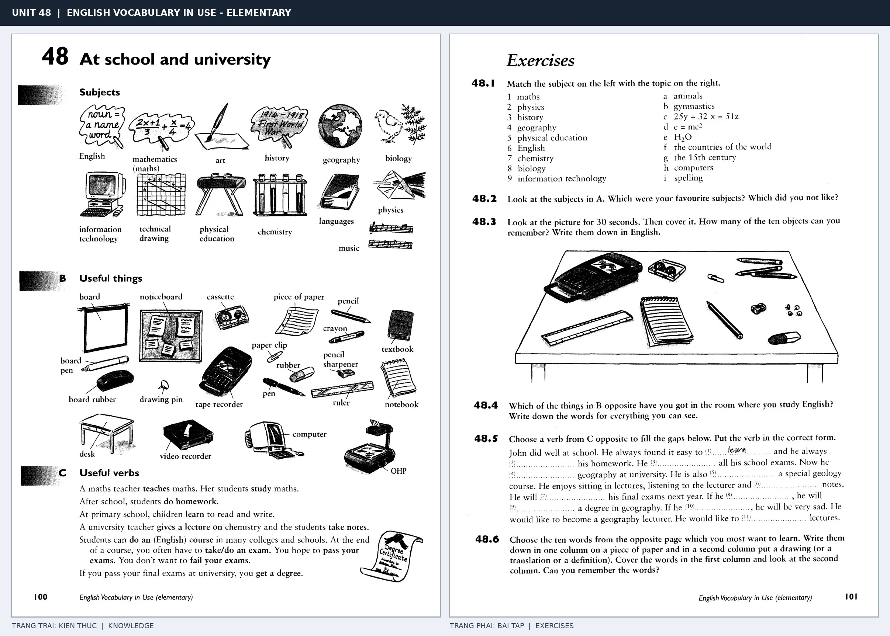

# Unit 48 — At school and university: Ở trường học và đại học

*Trang trái cung cấp kiến thức và ví dụ; trang phải là phần Exercises của Unit tương ứng. Có thể phóng to ảnh để làm bài tập gốc.*

> **Module 07:** Trường học và công việc  
> **Phạm vi:** English Vocabulary in Use — Elementary, Unit 48; trang in 100–101 (PDF trang 103–104).  
> **Hình thức:** Tự học từ vựng A1–A2 · Giảng giải tiếng Việt · Luyện câu và bài tập.

## 1. Tóm tắt và mục tiêu

Gắn môn học với hoạt động study, learn, teach và take an exam. Trong giao tiếp, phân biệt lesson (buổi/bài học), subject (môn học) và course (khóa học).

Sau bài này, bạn có thể:

- Giải thích nghĩa và cách sử dụng những từ, cụm từ cốt lõi của chủ đề **ở trường học và đại học**.
- Chọn đúng cách diễn đạt trong câu tiếng Anh đơn giản thay vì dịch máy móc từng từ.
- Tự đặt ít nhất ba câu thực tế và hoàn thành phần Exercises ở trang sách bên phải.

## 2. Kiến thức và từ vựng cốt lõi

Đọc kỹ từng mục. Với từ nhiều nghĩa, nghĩa ghi trong bảng được giới hạn ở cách dùng cần cho bài học này.

| Từ/cụm từ tiếng Anh | Nghĩa tiếng Việt |
| --- | --- |
| **school** | trường phổ thông |
| **university** | đại học |
| **teacher** | giáo viên |
| **student** | học sinh hoặc sinh viên |
| **subject** | môn học |
| **maths** | toán học |
| **history** | lịch sử |
| **geography** | địa lý |
| **biology** | sinh học |
| **chemistry** | hóa học |
| **physics** | vật lý |
| **notebook** | vở ghi |
| **exam** | kỳ thi |
| **lesson** | bài học hoặc tiết học |

### 2.1. Ghi nhớ theo nhóm và ngữ cảnh

**Nhóm từ thứ nhất:** school (trường phổ thông), university (đại học), teacher (giáo viên).

**Nhóm từ thứ hai:** maths (toán học), history (lịch sử), geography (địa lý).

Hãy ghép từ với tình huống sử dụng thực tế. Khi gặp cụm từ có nhiều thành phần, ưu tiên ghi cả cụm kèm một câu ví dụ trong sổ từ vựng.

### 2.2. Mẫu câu song ngữ

**Ví dụ 1.** I study biology at university.

→ Tôi học sinh học ở đại học.

**Ví dụ 2.** We have an exam on Friday.

→ Chúng tôi có kỳ thi vào thứ Sáu.

Đọc từng câu thành tiếng, che phần dịch tiếng Việt và thử nói lại ý bằng lời của mình. Sau đó thay một chi tiết trong câu để tạo ví dụ mới.

## 3. Luyện tập ứng dụng

**Bài A — Nhớ từ trong ngữ cảnh.** Không nhìn bảng, hãy viết tiếng Anh tương ứng với các ý sau:

1. Trường phổ thông: __________
2. Học sinh hoặc sinh viên: __________
3. Địa lý: __________

**Bài B — Dịch và biến đổi câu.** Dịch hai câu dưới đây sang tiếng Anh trước khi nhìn mẫu câu ở trên:

1. Tôi học sinh học ở đại học.
2. Chúng tôi có kỳ thi vào thứ Sáu.

**Bài C — Viết cho bản thân.** Viết ba câu mới về cuộc sống của bạn, mỗi câu sử dụng một từ/cụm từ khác nhau trong bảng. Đọc lại để kiểm tra giới từ, cách chia động từ và trật tự từ.

**Bài D — Thực hành theo sách.** Quan sát phần **Exercises (trang phải)** trong ảnh ghép: giải bài tập trên giấy hoặc một file riêng, sau đó so sánh với các ví dụ ở trang trái. Những bài yêu cầu thông tin cá nhân không nhất thiết có một đáp án cố định.

## 4. Câu hỏi ôn tập trắc nghiệm

*Mỗi câu có một đáp án phù hợp nhất. Hãy tự trả lời trước khi đọc phần giải thích.*

### Câu 1

Bạn muốn diễn đạt **“đại học”** bằng tiếng Anh. Chọn cách nói phù hợp nhất.

A. university

B. lesson

C. history

D. maths

**Đáp án:** A. **Giải thích:** “university” diễn đạt “đại học” trong chủ đề này.

### Câu 2

Cụm từ **“maths”** có nghĩa nào trong bài học?

A. kỳ thi

B. lịch sử

C. môn học

D. toán học

**Đáp án:** D. **Giải thích:** “maths” được dùng với nghĩa “toán học”.

### Câu 3

Khi cần nói **“sinh học”**, chọn từ/cụm từ nào?

A. subject

B. biology

C. notebook

D. school

**Đáp án:** B. **Giải thích:** Cách dùng đúng trong bài là “biology”.

### Câu 4

Chọn câu tiếng Anh diễn đạt đúng nhất: **“Tôi học sinh học ở đại học.”**

A. I study biology at university.

B. I'll send you an email.

C. Don't forget to put a stamp on the envelope.

D. What do you do? I'm an engineer.

**Đáp án:** A. **Giải thích:** “I study biology at university.” là câu tương ứng với tình huống đã nêu.

### Câu 5

Ý nghĩa phù hợp nhất của câu **“We have an exam on Friday.”** là gì?

A. Tôi sẽ gửi email cho bạn.

B. Bạn làm nghề gì? Tôi là kỹ sư.

C. Chúng tôi có kỳ thi vào thứ Sáu.

D. Đừng quên dán tem lên phong bì.

**Đáp án:** C. **Giải thích:** “We have an exam on Friday.” có nghĩa là “Chúng tôi có kỳ thi vào thứ Sáu.”.

## 5. Tổng kết và kiểm tra hoàn thành

Bài **We have an exam on Friday.** giúp bạn sử dụng vốn từ về **chúng tôi có kỳ thi vào thứ sáu.** trong câu tiếng Anh thực tế. Giá trị quan trọng nhất không chỉ là biết nghĩa, mà là nhớ **cách kết hợp từ và ngữ cảnh sử dụng**.

- [ ] Tôi đã học bảng từ/cụm từ và đọc thành tiếng các ví dụ.
- [ ] Tôi đã hoàn thành ba phần luyện tập A, B, C.
- [ ] Tôi đã làm trang Exercises trong ảnh ghép và 5 câu trắc nghiệm.
- [ ] Tôi đã ghi các từ dễ nhầm vào sổ để ôn lại sau 1–3 ngày.

---

[← Unit 47: Nghề nghiệp và công việc](47-jobs.md) · [Unit 49: Giao tiếp qua thư từ và công nghệ →](49-communications.md)

[↑ Trở về mục lục khóa học](../../MUC_LUC.md)
