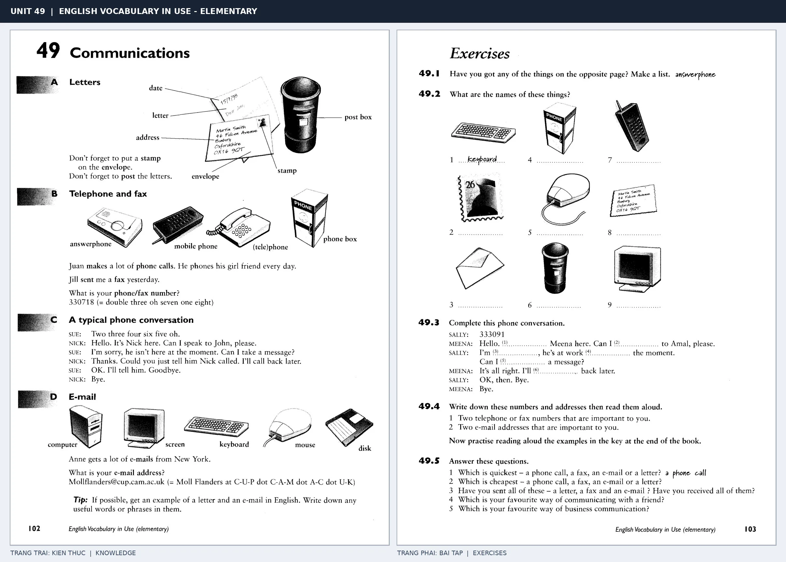

# Unit 49 — Communications: Giao tiếp qua thư từ và công nghệ

*Trang trái cung cấp kiến thức và ví dụ; trang phải là phần Exercises của Unit tương ứng. Có thể phóng to ảnh để làm bài tập gốc.*

> **Module 07:** Trường học và công việc  
> **Phạm vi:** English Vocabulary in Use — Elementary, Unit 49; trang in 102–103 (PDF trang 105–106).  
> **Hình thức:** Tự học từ vựng A1–A2 · Giảng giải tiếng Việt · Luyện câu và bài tập.

## 1. Tóm tắt và mục tiêu

Mô tả quy trình gửi thư: viết địa chỉ, dán tem, bỏ thư vào thùng. Khi dùng công nghệ, phân biệt send và receive, phone someone và talk to someone on the phone.

Sau bài này, bạn có thể:

- Giải thích nghĩa và cách sử dụng những từ, cụm từ cốt lõi của chủ đề **giao tiếp qua thư từ và công nghệ**.
- Chọn đúng cách diễn đạt trong câu tiếng Anh đơn giản thay vì dịch máy móc từng từ.
- Tự đặt ít nhất ba câu thực tế và hoàn thành phần Exercises ở trang sách bên phải.

## 2. Kiến thức và từ vựng cốt lõi

Đọc kỹ từng mục. Với từ nhiều nghĩa, nghĩa ghi trong bảng được giới hạn ở cách dùng cần cho bài học này.

| Từ/cụm từ tiếng Anh | Nghĩa tiếng Việt |
| --- | --- |
| **letter** | lá thư |
| **envelope** | phong bì |
| **stamp** | tem |
| **address** | địa chỉ |
| **post box** | thùng thư |
| **post office** | bưu điện |
| **phone** | điện thoại |
| **call** | gọi điện |
| **email** | thư điện tử |
| **computer** | máy tính |
| **message** | tin nhắn |
| **telephone number** | số điện thoại |
| **send** | gửi |
| **receive** | nhận |

### 2.1. Ghi nhớ theo nhóm và ngữ cảnh

**Nhóm từ thứ nhất:** letter (lá thư), envelope (phong bì), stamp (tem).

**Nhóm từ thứ hai:** post office (bưu điện), phone (điện thoại), call (gọi điện).

Hãy ghép từ với tình huống sử dụng thực tế. Khi gặp cụm từ có nhiều thành phần, ưu tiên ghi cả cụm kèm một câu ví dụ trong sổ từ vựng.

### 2.2. Mẫu câu song ngữ

**Ví dụ 1.** Don't forget to put a stamp on the envelope.

→ Đừng quên dán tem lên phong bì.

**Ví dụ 2.** I'll send you an email.

→ Tôi sẽ gửi email cho bạn.

Đọc từng câu thành tiếng, che phần dịch tiếng Việt và thử nói lại ý bằng lời của mình. Sau đó thay một chi tiết trong câu để tạo ví dụ mới.

## 3. Luyện tập ứng dụng

**Bài A — Nhớ từ trong ngữ cảnh.** Không nhìn bảng, hãy viết tiếng Anh tương ứng với các ý sau:

1. Lá thư: __________
2. Địa chỉ: __________
3. Gọi điện: __________

**Bài B — Dịch và biến đổi câu.** Dịch hai câu dưới đây sang tiếng Anh trước khi nhìn mẫu câu ở trên:

1. Đừng quên dán tem lên phong bì.
2. Tôi sẽ gửi email cho bạn.

**Bài C — Viết cho bản thân.** Viết ba câu mới về cuộc sống của bạn, mỗi câu sử dụng một từ/cụm từ khác nhau trong bảng. Đọc lại để kiểm tra giới từ, cách chia động từ và trật tự từ.

**Bài D — Thực hành theo sách.** Quan sát phần **Exercises (trang phải)** trong ảnh ghép: giải bài tập trên giấy hoặc một file riêng, sau đó so sánh với các ví dụ ở trang trái. Những bài yêu cầu thông tin cá nhân không nhất thiết có một đáp án cố định.

## 4. Câu hỏi ôn tập trắc nghiệm

*Mỗi câu có một đáp án phù hợp nhất. Hãy tự trả lời trước khi đọc phần giải thích.*

### Câu 1

Bạn muốn diễn đạt **“phong bì”** bằng tiếng Anh. Chọn cách nói phù hợp nhất.

A. receive

B. envelope

C. letter

D. send

**Đáp án:** B. **Giải thích:** “envelope” diễn đạt “phong bì” trong chủ đề này.

### Câu 2

Cụm từ **“post office”** có nghĩa nào trong bài học?

A. tin nhắn

B. thùng thư

C. số điện thoại

D. bưu điện

**Đáp án:** D. **Giải thích:** “post office” được dùng với nghĩa “bưu điện”.

### Câu 3

Khi cần nói **“thư điện tử”**, chọn từ/cụm từ nào?

A. email

B. letter

C. stamp

D. post box

**Đáp án:** A. **Giải thích:** Cách dùng đúng trong bài là “email”.

### Câu 4

Chọn câu tiếng Anh diễn đạt đúng nhất: **“Đừng quên dán tem lên phong bì.”**

A. I study biology at university.

B. Don't forget to put a stamp on the envelope.

C. She works in a hospital.

D. We have an exam on Friday.

**Đáp án:** B. **Giải thích:** “Don't forget to put a stamp on the envelope.” là câu tương ứng với tình huống đã nêu.

### Câu 5

Ý nghĩa phù hợp nhất của câu **“I'll send you an email.”** là gì?

A. Tôi học sinh học ở đại học.

B. Tôi sẽ gửi email cho bạn.

C. Bạn làm nghề gì? Tôi là kỹ sư.

D. Cô ấy làm việc ở bệnh viện.

**Đáp án:** B. **Giải thích:** “I'll send you an email.” có nghĩa là “Tôi sẽ gửi email cho bạn.”.

## 5. Tổng kết và kiểm tra hoàn thành

Bài **I'll send you an email.** giúp bạn sử dụng vốn từ về **tôi sẽ gửi email cho bạn.** trong câu tiếng Anh thực tế. Giá trị quan trọng nhất không chỉ là biết nghĩa, mà là nhớ **cách kết hợp từ và ngữ cảnh sử dụng**.

- [ ] Tôi đã học bảng từ/cụm từ và đọc thành tiếng các ví dụ.
- [ ] Tôi đã hoàn thành ba phần luyện tập A, B, C.
- [ ] Tôi đã làm trang Exercises trong ảnh ghép và 5 câu trắc nghiệm.
- [ ] Tôi đã ghi các từ dễ nhầm vào sổ để ôn lại sau 1–3 ngày.

---

[← Unit 48: Ở trường học và đại học](48-at-school-and-university.md) · [Unit 50: Kỳ nghỉ →](../08-leisure/50-holidays.md)

[↑ Trở về mục lục khóa học](../../MUC_LUC.md)
