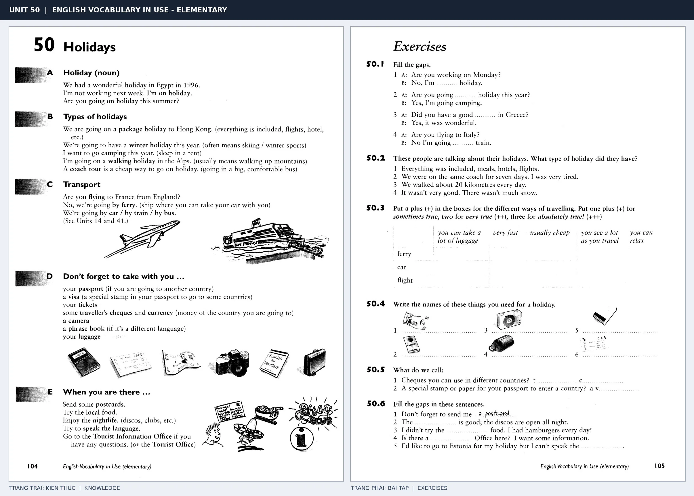

# Unit 50 — Holidays: Kỳ nghỉ

*Trang trái cung cấp kiến thức và ví dụ; trang phải là phần Exercises của Unit tương ứng. Có thể phóng to ảnh để làm bài tập gốc.*

> **Module 08:** Giải trí, mua sắm và du lịch  
> **Phạm vi:** English Vocabulary in Use — Elementary, Unit 50; trang in 104–105 (PDF trang 107–108).  
> **Hình thức:** Tự học từ vựng A1–A2 · Giảng giải tiếng Việt · Luyện câu và bài tập.

## 1. Tóm tắt và mục tiêu

Phân biệt have a holiday, go on holiday và be on holiday. Từ vựng mô tả loại kỳ nghỉ, địa điểm, đồ mang theo và hoạt động trong chuyến đi.

Sau bài này, bạn có thể:

- Giải thích nghĩa và cách sử dụng những từ, cụm từ cốt lõi của chủ đề **kỳ nghỉ**.
- Chọn đúng cách diễn đạt trong câu tiếng Anh đơn giản thay vì dịch máy móc từng từ.
- Tự đặt ít nhất ba câu thực tế và hoàn thành phần Exercises ở trang sách bên phải.

## 2. Kiến thức và từ vựng cốt lõi

Đọc kỹ từng mục. Với từ nhiều nghĩa, nghĩa ghi trong bảng được giới hạn ở cách dùng cần cho bài học này.

| Từ/cụm từ tiếng Anh | Nghĩa tiếng Việt |
| --- | --- |
| **holiday** | kỳ nghỉ |
| **on holiday** | đang nghỉ |
| **package holiday** | chuyến du lịch trọn gói |
| **beach** | bãi biển |
| **hotel** | khách sạn |
| **sightseeing** | tham quan |
| **travel** | du lịch |
| **trip** | chuyến đi |
| **phrase book** | sách mẫu câu |
| **postcard** | bưu thiếp |
| **sunbathe** | tắm nắng |
| **swim** | bơi |
| **camping** | cắm trại |
| **holidaymaker** | khách đi nghỉ |

### 2.1. Ghi nhớ theo nhóm và ngữ cảnh

**Nhóm từ thứ nhất:** holiday (kỳ nghỉ), on holiday (đang nghỉ), package holiday (chuyến du lịch trọn gói).

**Nhóm từ thứ hai:** sightseeing (tham quan), travel (du lịch), trip (chuyến đi).

Hãy ghép từ với tình huống sử dụng thực tế. Khi gặp cụm từ có nhiều thành phần, ưu tiên ghi cả cụm kèm một câu ví dụ trong sổ từ vựng.

### 2.2. Mẫu câu song ngữ

**Ví dụ 1.** We are going on holiday next week.

→ Tuần sau chúng tôi sẽ đi nghỉ.

**Ví dụ 2.** They went sightseeing in Paris.

→ Họ đã đi tham quan ở Paris.

Đọc từng câu thành tiếng, che phần dịch tiếng Việt và thử nói lại ý bằng lời của mình. Sau đó thay một chi tiết trong câu để tạo ví dụ mới.

## 3. Luyện tập ứng dụng

**Bài A — Nhớ từ trong ngữ cảnh.** Không nhìn bảng, hãy viết tiếng Anh tương ứng với các ý sau:

1. Kỳ nghỉ: __________
2. Bãi biển: __________
3. Chuyến đi: __________

**Bài B — Dịch và biến đổi câu.** Dịch hai câu dưới đây sang tiếng Anh trước khi nhìn mẫu câu ở trên:

1. Tuần sau chúng tôi sẽ đi nghỉ.
2. Họ đã đi tham quan ở Paris.

**Bài C — Viết cho bản thân.** Viết ba câu mới về cuộc sống của bạn, mỗi câu sử dụng một từ/cụm từ khác nhau trong bảng. Đọc lại để kiểm tra giới từ, cách chia động từ và trật tự từ.

**Bài D — Thực hành theo sách.** Quan sát phần **Exercises (trang phải)** trong ảnh ghép: giải bài tập trên giấy hoặc một file riêng, sau đó so sánh với các ví dụ ở trang trái. Những bài yêu cầu thông tin cá nhân không nhất thiết có một đáp án cố định.

## 4. Câu hỏi ôn tập trắc nghiệm

*Mỗi câu có một đáp án phù hợp nhất. Hãy tự trả lời trước khi đọc phần giải thích.*

### Câu 1

Bạn muốn diễn đạt **“đang nghỉ”** bằng tiếng Anh. Chọn cách nói phù hợp nhất.

A. beach

B. on holiday

C. holiday

D. travel

**Đáp án:** B. **Giải thích:** “on holiday” diễn đạt “đang nghỉ” trong chủ đề này.

### Câu 2

Cụm từ **“sightseeing”** có nghĩa nào trong bài học?

A. chuyến du lịch trọn gói

B. sách mẫu câu

C. tham quan

D. khách đi nghỉ

**Đáp án:** C. **Giải thích:** “sightseeing” được dùng với nghĩa “tham quan”.

### Câu 3

Khi cần nói **“sách mẫu câu”**, chọn từ/cụm từ nào?

A. hotel

B. sunbathe

C. phrase book

D. camping

**Đáp án:** C. **Giải thích:** Cách dùng đúng trong bài là “phrase book”.

### Câu 4

Chọn câu tiếng Anh diễn đạt đúng nhất: **“Tuần sau chúng tôi sẽ đi nghỉ.”**

A. We are going on holiday next week.

B. My father enjoys gardening.

C. We went to the cinema last night.

D. Can I have the bill, please?

**Đáp án:** A. **Giải thích:** “We are going on holiday next week.” là câu tương ứng với tình huống đã nêu.

### Câu 5

Ý nghĩa phù hợp nhất của câu **“They went sightseeing in Paris.”** là gì?

A. Cuối tuần nào chúng tôi cũng đi bơi.

B. Tôi có thể thử nó không?

C. Bạn có chơi cầu lông không?

D. Họ đã đi tham quan ở Paris.

**Đáp án:** D. **Giải thích:** “They went sightseeing in Paris.” có nghĩa là “Họ đã đi tham quan ở Paris.”.

## 5. Tổng kết và kiểm tra hoàn thành

Bài **They went sightseeing in Paris.** giúp bạn sử dụng vốn từ về **họ đã đi tham quan ở paris.** trong câu tiếng Anh thực tế. Giá trị quan trọng nhất không chỉ là biết nghĩa, mà là nhớ **cách kết hợp từ và ngữ cảnh sử dụng**.

- [ ] Tôi đã học bảng từ/cụm từ và đọc thành tiếng các ví dụ.
- [ ] Tôi đã hoàn thành ba phần luyện tập A, B, C.
- [ ] Tôi đã làm trang Exercises trong ảnh ghép và 5 câu trắc nghiệm.
- [ ] Tôi đã ghi các từ dễ nhầm vào sổ để ôn lại sau 1–3 ngày.

---

[← Unit 49: Giao tiếp qua thư từ và công nghệ](../07-school-and-workplace/49-communications.md) · [Unit 51: Cửa hàng và mua sắm →](51-shops-and-shopping.md)

[↑ Trở về mục lục khóa học](../../MUC_LUC.md)
