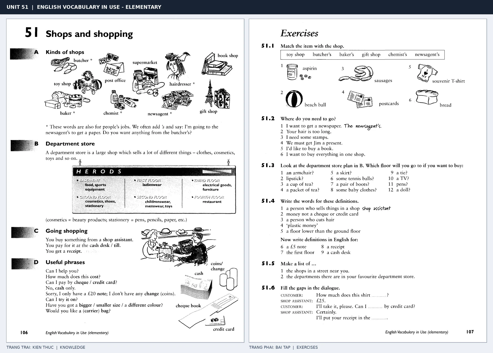

# Unit 51 — Shops and shopping: Cửa hàng và mua sắm

*Trang trái cung cấp kiến thức và ví dụ; trang phải là phần Exercises của Unit tương ứng. Có thể phóng to ảnh để làm bài tập gốc.*

> **Module 08:** Giải trí, mua sắm và du lịch  
> **Phạm vi:** English Vocabulary in Use — Elementary, Unit 51; trang in 106–107 (PDF trang 109–110).  
> **Hình thức:** Tự học từ vựng A1–A2 · Giảng giải tiếng Việt · Luyện câu và bài tập.

## 1. Tóm tắt và mục tiêu

Tên một số cửa hàng thường dùng dạng sở hữu butcher's, chemist's. Khi mua sắm cần biết hỏi giá, cỡ, thử đồ và thanh toán; don't confuse cost (có giá) với pay (trả tiền).

Sau bài này, bạn có thể:

- Giải thích nghĩa và cách sử dụng những từ, cụm từ cốt lõi của chủ đề **cửa hàng và mua sắm**.
- Chọn đúng cách diễn đạt trong câu tiếng Anh đơn giản thay vì dịch máy móc từng từ.
- Tự đặt ít nhất ba câu thực tế và hoàn thành phần Exercises ở trang sách bên phải.

## 2. Kiến thức và từ vựng cốt lõi

Đọc kỹ từng mục. Với từ nhiều nghĩa, nghĩa ghi trong bảng được giới hạn ở cách dùng cần cho bài học này.

| Từ/cụm từ tiếng Anh | Nghĩa tiếng Việt |
| --- | --- |
| **supermarket** | siêu thị |
| **chemist's** | hiệu thuốc |
| **butcher's** | cửa hàng thịt |
| **newsagent's** | quầy báo |
| **department store** | cửa hàng bách hóa |
| **gift shop** | cửa hàng quà tặng |
| **shop assistant** | nhân viên bán hàng |
| **price** | giá |
| **cash** | tiền mặt |
| **change** | tiền thối lại |
| **receipt** | hóa đơn |
| **size** | cỡ |
| **try on** | thử đồ |
| **buy** | mua |

### 2.1. Ghi nhớ theo nhóm và ngữ cảnh

**Nhóm từ thứ nhất:** supermarket (siêu thị), chemist's (hiệu thuốc), butcher's (cửa hàng thịt).

**Nhóm từ thứ hai:** gift shop (cửa hàng quà tặng), shop assistant (nhân viên bán hàng), price (giá).

Hãy ghép từ với tình huống sử dụng thực tế. Khi gặp cụm từ có nhiều thành phần, ưu tiên ghi cả cụm kèm một câu ví dụ trong sổ từ vựng.

### 2.2. Mẫu câu song ngữ

**Ví dụ 1.** How much does this jacket cost?

→ Chiếc áo khoác này giá bao nhiêu?

**Ví dụ 2.** Can I try it on?

→ Tôi có thể thử nó không?

Đọc từng câu thành tiếng, che phần dịch tiếng Việt và thử nói lại ý bằng lời của mình. Sau đó thay một chi tiết trong câu để tạo ví dụ mới.

## 3. Luyện tập ứng dụng

**Bài A — Nhớ từ trong ngữ cảnh.** Không nhìn bảng, hãy viết tiếng Anh tương ứng với các ý sau:

1. Siêu thị: __________
2. Quầy báo: __________
3. Giá: __________

**Bài B — Dịch và biến đổi câu.** Dịch hai câu dưới đây sang tiếng Anh trước khi nhìn mẫu câu ở trên:

1. Chiếc áo khoác này giá bao nhiêu?
2. Tôi có thể thử nó không?

**Bài C — Viết cho bản thân.** Viết ba câu mới về cuộc sống của bạn, mỗi câu sử dụng một từ/cụm từ khác nhau trong bảng. Đọc lại để kiểm tra giới từ, cách chia động từ và trật tự từ.

**Bài D — Thực hành theo sách.** Quan sát phần **Exercises (trang phải)** trong ảnh ghép: giải bài tập trên giấy hoặc một file riêng, sau đó so sánh với các ví dụ ở trang trái. Những bài yêu cầu thông tin cá nhân không nhất thiết có một đáp án cố định.

## 4. Câu hỏi ôn tập trắc nghiệm

*Mỗi câu có một đáp án phù hợp nhất. Hãy tự trả lời trước khi đọc phần giải thích.*

### Câu 1

Bạn muốn diễn đạt **“hiệu thuốc”** bằng tiếng Anh. Chọn cách nói phù hợp nhất.

A. butcher's

B. chemist's

C. buy

D. try on

**Đáp án:** B. **Giải thích:** “chemist's” diễn đạt “hiệu thuốc” trong chủ đề này.

### Câu 2

Cụm từ **“gift shop”** có nghĩa nào trong bài học?

A. cửa hàng quà tặng

B. cửa hàng bách hóa

C. hiệu thuốc

D. quầy báo

**Đáp án:** A. **Giải thích:** “gift shop” được dùng với nghĩa “cửa hàng quà tặng”.

### Câu 3

Khi cần nói **“tiền mặt”**, chọn từ/cụm từ nào?

A. cash

B. department store

C. size

D. shop assistant

**Đáp án:** A. **Giải thích:** Cách dùng đúng trong bài là “cash”.

### Câu 4

Chọn câu tiếng Anh diễn đạt đúng nhất: **“Chiếc áo khoác này giá bao nhiêu?”**

A. My father enjoys gardening.

B. I'd like a single room, please.

C. I listen to music in the evening.

D. How much does this jacket cost?

**Đáp án:** D. **Giải thích:** “How much does this jacket cost?” là câu tương ứng với tình huống đã nêu.

### Câu 5

Ý nghĩa phù hợp nhất của câu **“Can I try it on?”** là gì?

A. Tôi muốn một phòng đơn.

B. Tôi nghe nhạc vào buổi tối.

C. Bố tôi thích làm vườn.

D. Tôi có thể thử nó không?

**Đáp án:** D. **Giải thích:** “Can I try it on?” có nghĩa là “Tôi có thể thử nó không?”.

## 5. Tổng kết và kiểm tra hoàn thành

Bài **Can I try it on?** giúp bạn sử dụng vốn từ về **tôi có thể thử nó không?** trong câu tiếng Anh thực tế. Giá trị quan trọng nhất không chỉ là biết nghĩa, mà là nhớ **cách kết hợp từ và ngữ cảnh sử dụng**.

- [ ] Tôi đã học bảng từ/cụm từ và đọc thành tiếng các ví dụ.
- [ ] Tôi đã hoàn thành ba phần luyện tập A, B, C.
- [ ] Tôi đã làm trang Exercises trong ảnh ghép và 5 câu trắc nghiệm.
- [ ] Tôi đã ghi các từ dễ nhầm vào sổ để ôn lại sau 1–3 ngày.

---

[← Unit 50: Kỳ nghỉ](50-holidays.md) · [Unit 52: Ở khách sạn →](52-in-a-hotel.md)

[↑ Trở về mục lục khóa học](../../MUC_LUC.md)
