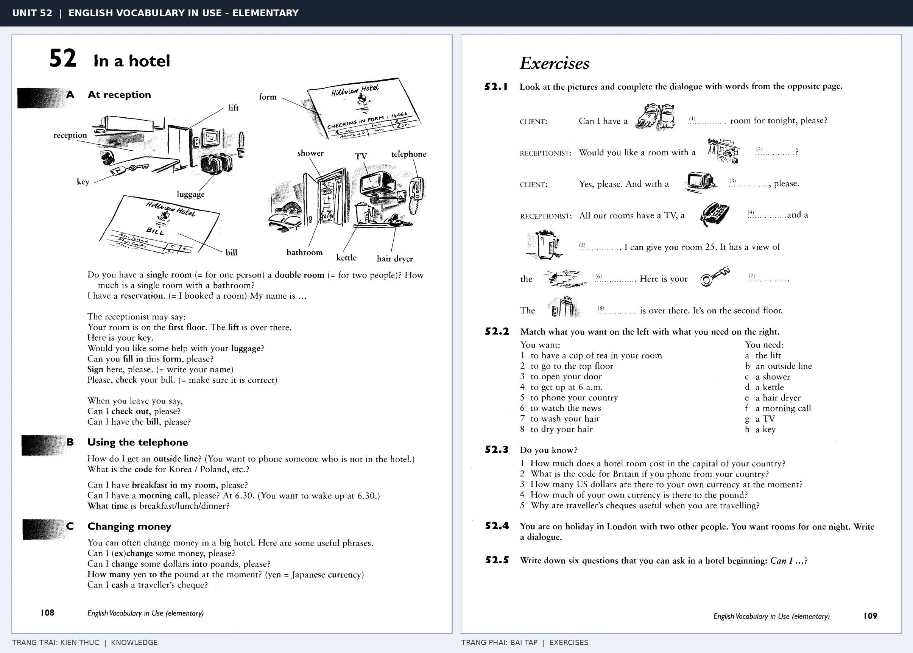

# Unit 52 — In a hotel: Ở khách sạn

*Trang trái cung cấp kiến thức và ví dụ; trang phải là phần Exercises của Unit tương ứng. Có thể phóng to ảnh để làm bài tập gốc.*

> **Module 08:** Giải trí, mua sắm và du lịch  
> **Phạm vi:** English Vocabulary in Use — Elementary, Unit 52; trang in 108–109 (PDF trang 111–112).  
> **Hình thức:** Tự học từ vựng A1–A2 · Giảng giải tiếng Việt · Luyện câu và bài tập.

## 1. Tóm tắt và mục tiêu

Các câu giao tiếp khách sạn thường hỏi phòng, giá, bữa sáng và chìa khóa. Phân biệt single room và double room; check in và check out là hai bước đầu/cuối khi lưu trú.

Sau bài này, bạn có thể:

- Giải thích nghĩa và cách sử dụng những từ, cụm từ cốt lõi của chủ đề **ở khách sạn**.
- Chọn đúng cách diễn đạt trong câu tiếng Anh đơn giản thay vì dịch máy móc từng từ.
- Tự đặt ít nhất ba câu thực tế và hoàn thành phần Exercises ở trang sách bên phải.

## 2. Kiến thức và từ vựng cốt lõi

Đọc kỹ từng mục. Với từ nhiều nghĩa, nghĩa ghi trong bảng được giới hạn ở cách dùng cần cho bài học này.

| Từ/cụm từ tiếng Anh | Nghĩa tiếng Việt |
| --- | --- |
| **reception** | quầy lễ tân |
| **receptionist** | nhân viên lễ tân |
| **single room** | phòng đơn |
| **double room** | phòng đôi |
| **reservation** | đặt trước |
| **key** | chìa khóa |
| **lift** | thang máy |
| **luggage** | hành lý |
| **shower** | vòi sen |
| **breakfast** | bữa sáng |
| **check in** | nhận phòng |
| **check out** | trả phòng |
| **bill** | hóa đơn |
| **room number** | số phòng |

### 2.1. Ghi nhớ theo nhóm và ngữ cảnh

**Nhóm từ thứ nhất:** reception (quầy lễ tân), receptionist (nhân viên lễ tân), single room (phòng đơn).

**Nhóm từ thứ hai:** key (chìa khóa), lift (thang máy), luggage (hành lý).

Hãy ghép từ với tình huống sử dụng thực tế. Khi gặp cụm từ có nhiều thành phần, ưu tiên ghi cả cụm kèm một câu ví dụ trong sổ từ vựng.

### 2.2. Mẫu câu song ngữ

**Ví dụ 1.** I'd like a single room, please.

→ Tôi muốn một phòng đơn.

**Ví dụ 2.** What time is breakfast?

→ Bữa sáng lúc mấy giờ?

Đọc từng câu thành tiếng, che phần dịch tiếng Việt và thử nói lại ý bằng lời của mình. Sau đó thay một chi tiết trong câu để tạo ví dụ mới.

## 3. Luyện tập ứng dụng

**Bài A — Nhớ từ trong ngữ cảnh.** Không nhìn bảng, hãy viết tiếng Anh tương ứng với các ý sau:

1. Quầy lễ tân: __________
2. Phòng đôi: __________
3. Hành lý: __________

**Bài B — Dịch và biến đổi câu.** Dịch hai câu dưới đây sang tiếng Anh trước khi nhìn mẫu câu ở trên:

1. Tôi muốn một phòng đơn.
2. Bữa sáng lúc mấy giờ?

**Bài C — Viết cho bản thân.** Viết ba câu mới về cuộc sống của bạn, mỗi câu sử dụng một từ/cụm từ khác nhau trong bảng. Đọc lại để kiểm tra giới từ, cách chia động từ và trật tự từ.

**Bài D — Thực hành theo sách.** Quan sát phần **Exercises (trang phải)** trong ảnh ghép: giải bài tập trên giấy hoặc một file riêng, sau đó so sánh với các ví dụ ở trang trái. Những bài yêu cầu thông tin cá nhân không nhất thiết có một đáp án cố định.

## 4. Câu hỏi ôn tập trắc nghiệm

*Mỗi câu có một đáp án phù hợp nhất. Hãy tự trả lời trước khi đọc phần giải thích.*

### Câu 1

Bạn muốn diễn đạt **“nhân viên lễ tân”** bằng tiếng Anh. Chọn cách nói phù hợp nhất.

A. luggage

B. check in

C. single room

D. receptionist

**Đáp án:** D. **Giải thích:** “receptionist” diễn đạt “nhân viên lễ tân” trong chủ đề này.

### Câu 2

Cụm từ **“key”** có nghĩa nào trong bài học?

A. chìa khóa

B. nhận phòng

C. hành lý

D. nhân viên lễ tân

**Đáp án:** A. **Giải thích:** “key” được dùng với nghĩa “chìa khóa”.

### Câu 3

Khi cần nói **“vòi sen”**, chọn từ/cụm từ nào?

A. room number

B. lift

C. check out

D. shower

**Đáp án:** D. **Giải thích:** Cách dùng đúng trong bài là “shower”.

### Câu 4

Chọn câu tiếng Anh diễn đạt đúng nhất: **“Tôi muốn một phòng đơn.”**

A. How much does this jacket cost?

B. Can I try it on?

C. I'd like a single room, please.

D. We are going on holiday next week.

**Đáp án:** C. **Giải thích:** “I'd like a single room, please.” là câu tương ứng với tình huống đã nêu.

### Câu 5

Ý nghĩa phù hợp nhất của câu **“What time is breakfast?”** là gì?

A. Bạn có chơi cầu lông không?

B. Tối qua chúng tôi đi xem phim.

C. Bữa sáng lúc mấy giờ?

D. Bố tôi thích làm vườn.

**Đáp án:** C. **Giải thích:** “What time is breakfast?” có nghĩa là “Bữa sáng lúc mấy giờ?”.

## 5. Tổng kết và kiểm tra hoàn thành

Bài **What time is breakfast?** giúp bạn sử dụng vốn từ về **bữa sáng lúc mấy giờ?** trong câu tiếng Anh thực tế. Giá trị quan trọng nhất không chỉ là biết nghĩa, mà là nhớ **cách kết hợp từ và ngữ cảnh sử dụng**.

- [ ] Tôi đã học bảng từ/cụm từ và đọc thành tiếng các ví dụ.
- [ ] Tôi đã hoàn thành ba phần luyện tập A, B, C.
- [ ] Tôi đã làm trang Exercises trong ảnh ghép và 5 câu trắc nghiệm.
- [ ] Tôi đã ghi các từ dễ nhầm vào sổ để ôn lại sau 1–3 ngày.

---

[← Unit 51: Cửa hàng và mua sắm](51-shops-and-shopping.md) · [Unit 53: Đi ăn ngoài →](53-eating-out.md)

[↑ Trở về mục lục khóa học](../../MUC_LUC.md)
