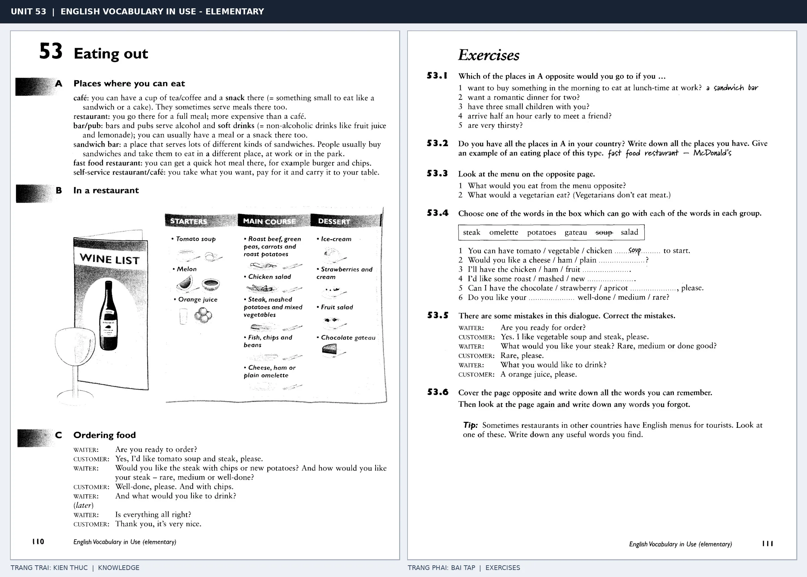

# Unit 53 — Eating out: Đi ăn ngoài

*Trang trái cung cấp kiến thức và ví dụ; trang phải là phần Exercises của Unit tương ứng. Có thể phóng to ảnh để làm bài tập gốc.*

> **Module 08:** Giải trí, mua sắm và du lịch  
> **Phạm vi:** English Vocabulary in Use — Elementary, Unit 53; trang in 110–111 (PDF trang 113–114).  
> **Hình thức:** Tự học từ vựng A1–A2 · Giảng giải tiếng Việt · Luyện câu và bài tập.

## 1. Tóm tắt và mục tiêu

Tại nhà hàng, học hỏi menu, gọi món theo trình tự starter–main course–dessert và xin hóa đơn. Phân biệt một café cho đồ uống/bữa nhẹ với restaurant cho bữa ăn đầy đủ.

Sau bài này, bạn có thể:

- Giải thích nghĩa và cách sử dụng những từ, cụm từ cốt lõi của chủ đề **đi ăn ngoài**.
- Chọn đúng cách diễn đạt trong câu tiếng Anh đơn giản thay vì dịch máy móc từng từ.
- Tự đặt ít nhất ba câu thực tế và hoàn thành phần Exercises ở trang sách bên phải.

## 2. Kiến thức và từ vựng cốt lõi

Đọc kỹ từng mục. Với từ nhiều nghĩa, nghĩa ghi trong bảng được giới hạn ở cách dùng cần cho bài học này.

| Từ/cụm từ tiếng Anh | Nghĩa tiếng Việt |
| --- | --- |
| **café** | quán cà phê |
| **restaurant** | nhà hàng |
| **pub** | quán rượu kiểu Anh |
| **menu** | thực đơn |
| **waiter** | nam phục vụ |
| **waitress** | nữ phục vụ |
| **order** | gọi món |
| **starter** | món khai vị |
| **main course** | món chính |
| **dessert** | món tráng miệng |
| **bill** | hóa đơn |
| **tip** | tiền boa |
| **snack** | bữa ăn nhẹ |
| **drink** | đồ uống |

### 2.1. Ghi nhớ theo nhóm và ngữ cảnh

**Nhóm từ thứ nhất:** café (quán cà phê), restaurant (nhà hàng), pub (quán rượu kiểu Anh).

**Nhóm từ thứ hai:** waitress (nữ phục vụ), order (gọi món), starter (món khai vị).

Hãy ghép từ với tình huống sử dụng thực tế. Khi gặp cụm từ có nhiều thành phần, ưu tiên ghi cả cụm kèm một câu ví dụ trong sổ từ vựng.

### 2.2. Mẫu câu song ngữ

**Ví dụ 1.** Could we have the menu, please?

→ Cho chúng tôi xin thực đơn được không?

**Ví dụ 2.** Can I have the bill, please?

→ Cho tôi xin hóa đơn được không?

Đọc từng câu thành tiếng, che phần dịch tiếng Việt và thử nói lại ý bằng lời của mình. Sau đó thay một chi tiết trong câu để tạo ví dụ mới.

## 3. Luyện tập ứng dụng

**Bài A — Nhớ từ trong ngữ cảnh.** Không nhìn bảng, hãy viết tiếng Anh tương ứng với các ý sau:

1. Quán cà phê: __________
2. Thực đơn: __________
3. Món khai vị: __________

**Bài B — Dịch và biến đổi câu.** Dịch hai câu dưới đây sang tiếng Anh trước khi nhìn mẫu câu ở trên:

1. Cho chúng tôi xin thực đơn được không?
2. Cho tôi xin hóa đơn được không?

**Bài C — Viết cho bản thân.** Viết ba câu mới về cuộc sống của bạn, mỗi câu sử dụng một từ/cụm từ khác nhau trong bảng. Đọc lại để kiểm tra giới từ, cách chia động từ và trật tự từ.

**Bài D — Thực hành theo sách.** Quan sát phần **Exercises (trang phải)** trong ảnh ghép: giải bài tập trên giấy hoặc một file riêng, sau đó so sánh với các ví dụ ở trang trái. Những bài yêu cầu thông tin cá nhân không nhất thiết có một đáp án cố định.

## 4. Câu hỏi ôn tập trắc nghiệm

*Mỗi câu có một đáp án phù hợp nhất. Hãy tự trả lời trước khi đọc phần giải thích.*

### Câu 1

Bạn muốn diễn đạt **“nhà hàng”** bằng tiếng Anh. Chọn cách nói phù hợp nhất.

A. restaurant

B. bill

C. snack

D. café

**Đáp án:** A. **Giải thích:** “restaurant” diễn đạt “nhà hàng” trong chủ đề này.

### Câu 2

Cụm từ **“waitress”** có nghĩa nào trong bài học?

A. món chính

B. món khai vị

C. tiền boa

D. nữ phục vụ

**Đáp án:** D. **Giải thích:** “waitress” được dùng với nghĩa “nữ phục vụ”.

### Câu 3

Khi cần nói **“món chính”**, chọn từ/cụm từ nào?

A. tip

B. starter

C. bill

D. main course

**Đáp án:** D. **Giải thích:** Cách dùng đúng trong bài là “main course”.

### Câu 4

Chọn câu tiếng Anh diễn đạt đúng nhất: **“Cho chúng tôi xin thực đơn được không?”**

A. Could we have the menu, please?

B. My father enjoys gardening.

C. We go swimming every weekend.

D. We went to the cinema last night.

**Đáp án:** A. **Giải thích:** “Could we have the menu, please?” là câu tương ứng với tình huống đã nêu.

### Câu 5

Ý nghĩa phù hợp nhất của câu **“Can I have the bill, please?”** là gì?

A. Cho tôi xin hóa đơn được không?

B. Bữa sáng lúc mấy giờ?

C. Chiếc áo khoác này giá bao nhiêu?

D. Tối qua chúng tôi đi xem phim.

**Đáp án:** A. **Giải thích:** “Can I have the bill, please?” có nghĩa là “Cho tôi xin hóa đơn được không?”.

## 5. Tổng kết và kiểm tra hoàn thành

Bài **Can I have the bill, please?** giúp bạn sử dụng vốn từ về **cho tôi xin hóa đơn được không?** trong câu tiếng Anh thực tế. Giá trị quan trọng nhất không chỉ là biết nghĩa, mà là nhớ **cách kết hợp từ và ngữ cảnh sử dụng**.

- [ ] Tôi đã học bảng từ/cụm từ và đọc thành tiếng các ví dụ.
- [ ] Tôi đã hoàn thành ba phần luyện tập A, B, C.
- [ ] Tôi đã làm trang Exercises trong ảnh ghép và 5 câu trắc nghiệm.
- [ ] Tôi đã ghi các từ dễ nhầm vào sổ để ôn lại sau 1–3 ngày.

---

[← Unit 52: Ở khách sạn](52-in-a-hotel.md) · [Unit 54: Thể thao →](54-sports.md)

[↑ Trở về mục lục khóa học](../../MUC_LUC.md)
