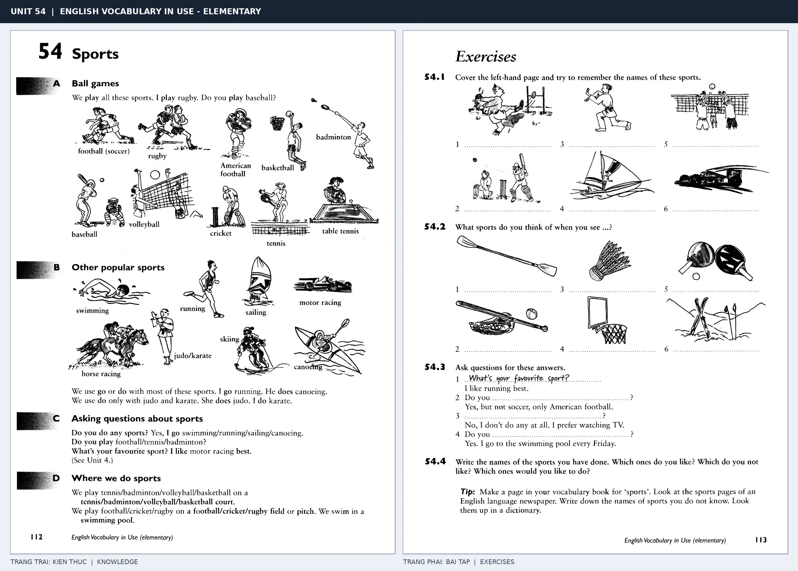

# Unit 54 — Sports: Thể thao

*Trang trái cung cấp kiến thức và ví dụ; trang phải là phần Exercises của Unit tương ứng. Có thể phóng to ảnh để làm bài tập gốc.*

> **Module 08:** Giải trí, mua sắm và du lịch  
> **Phạm vi:** English Vocabulary in Use — Elementary, Unit 54; trang in 112–113 (PDF trang 115–116).  
> **Hình thức:** Tự học từ vựng A1–A2 · Giảng giải tiếng Việt · Luyện câu và bài tập.

## 1. Tóm tắt và mục tiêu

Các môn bóng thường đi với play, hoạt động -ing như swimming/skiing thường đi với go, và một số môn như judo đi với do. Đây là collocation quan trọng hơn việc học tên môn đơn lẻ.

Sau bài này, bạn có thể:

- Giải thích nghĩa và cách sử dụng những từ, cụm từ cốt lõi của chủ đề **thể thao**.
- Chọn đúng cách diễn đạt trong câu tiếng Anh đơn giản thay vì dịch máy móc từng từ.
- Tự đặt ít nhất ba câu thực tế và hoàn thành phần Exercises ở trang sách bên phải.

## 2. Kiến thức và từ vựng cốt lõi

Đọc kỹ từng mục. Với từ nhiều nghĩa, nghĩa ghi trong bảng được giới hạn ở cách dùng cần cho bài học này.

| Từ/cụm từ tiếng Anh | Nghĩa tiếng Việt |
| --- | --- |
| **football** | bóng đá |
| **basketball** | bóng rổ |
| **volleyball** | bóng chuyền |
| **tennis** | quần vợt |
| **badminton** | cầu lông |
| **table tennis** | bóng bàn |
| **rugby** | bóng bầu dục |
| **swimming** | bơi lội |
| **skiing** | trượt tuyết |
| **judo** | nhu đạo |
| **run** | chạy |
| **play** | chơi |
| **do** | tập hoặc chơi |
| **go** | đi tham gia hoạt động |

### 2.1. Ghi nhớ theo nhóm và ngữ cảnh

**Nhóm từ thứ nhất:** football (bóng đá), basketball (bóng rổ), volleyball (bóng chuyền).

**Nhóm từ thứ hai:** table tennis (bóng bàn), rugby (bóng bầu dục), swimming (bơi lội).

Hãy ghép từ với tình huống sử dụng thực tế. Khi gặp cụm từ có nhiều thành phần, ưu tiên ghi cả cụm kèm một câu ví dụ trong sổ từ vựng.

### 2.2. Mẫu câu song ngữ

**Ví dụ 1.** Do you play badminton?

→ Bạn có chơi cầu lông không?

**Ví dụ 2.** We go swimming every weekend.

→ Cuối tuần nào chúng tôi cũng đi bơi.

Đọc từng câu thành tiếng, che phần dịch tiếng Việt và thử nói lại ý bằng lời của mình. Sau đó thay một chi tiết trong câu để tạo ví dụ mới.

## 3. Luyện tập ứng dụng

**Bài A — Nhớ từ trong ngữ cảnh.** Không nhìn bảng, hãy viết tiếng Anh tương ứng với các ý sau:

1. Bóng đá: __________
2. Quần vợt: __________
3. Bơi lội: __________

**Bài B — Dịch và biến đổi câu.** Dịch hai câu dưới đây sang tiếng Anh trước khi nhìn mẫu câu ở trên:

1. Bạn có chơi cầu lông không?
2. Cuối tuần nào chúng tôi cũng đi bơi.

**Bài C — Viết cho bản thân.** Viết ba câu mới về cuộc sống của bạn, mỗi câu sử dụng một từ/cụm từ khác nhau trong bảng. Đọc lại để kiểm tra giới từ, cách chia động từ và trật tự từ.

**Bài D — Thực hành theo sách.** Quan sát phần **Exercises (trang phải)** trong ảnh ghép: giải bài tập trên giấy hoặc một file riêng, sau đó so sánh với các ví dụ ở trang trái. Những bài yêu cầu thông tin cá nhân không nhất thiết có một đáp án cố định.

## 4. Câu hỏi ôn tập trắc nghiệm

*Mỗi câu có một đáp án phù hợp nhất. Hãy tự trả lời trước khi đọc phần giải thích.*

### Câu 1

Bạn muốn diễn đạt **“bóng rổ”** bằng tiếng Anh. Chọn cách nói phù hợp nhất.

A. skiing

B. badminton

C. judo

D. basketball

**Đáp án:** D. **Giải thích:** “basketball” diễn đạt “bóng rổ” trong chủ đề này.

### Câu 2

Cụm từ **“table tennis”** có nghĩa nào trong bài học?

A. trượt tuyết

B. cầu lông

C. bóng bàn

D. chơi

**Đáp án:** C. **Giải thích:** “table tennis” được dùng với nghĩa “bóng bàn”.

### Câu 3

Khi cần nói **“trượt tuyết”**, chọn từ/cụm từ nào?

A. skiing

B. do

C. tennis

D. basketball

**Đáp án:** A. **Giải thích:** Cách dùng đúng trong bài là “skiing”.

### Câu 4

Chọn câu tiếng Anh diễn đạt đúng nhất: **“Bạn có chơi cầu lông không?”**

A. They went sightseeing in Paris.

B. Do you play badminton?

C. Can I try it on?

D. My father enjoys gardening.

**Đáp án:** B. **Giải thích:** “Do you play badminton?” là câu tương ứng với tình huống đã nêu.

### Câu 5

Ý nghĩa phù hợp nhất của câu **“We go swimming every weekend.”** là gì?

A. Tôi có thể thử nó không?

B. Cuối tuần nào chúng tôi cũng đi bơi.

C. Cho chúng tôi xin thực đơn được không?

D. Tôi thích phim khoa học viễn tưởng nhất.

**Đáp án:** B. **Giải thích:** “We go swimming every weekend.” có nghĩa là “Cuối tuần nào chúng tôi cũng đi bơi.”.

## 5. Tổng kết và kiểm tra hoàn thành

Bài **We go swimming every weekend.** giúp bạn sử dụng vốn từ về **cuối tuần nào chúng tôi cũng đi bơi.** trong câu tiếng Anh thực tế. Giá trị quan trọng nhất không chỉ là biết nghĩa, mà là nhớ **cách kết hợp từ và ngữ cảnh sử dụng**.

- [ ] Tôi đã học bảng từ/cụm từ và đọc thành tiếng các ví dụ.
- [ ] Tôi đã hoàn thành ba phần luyện tập A, B, C.
- [ ] Tôi đã làm trang Exercises trong ảnh ghép và 5 câu trắc nghiệm.
- [ ] Tôi đã ghi các từ dễ nhầm vào sổ để ôn lại sau 1–3 ngày.

---

[← Unit 53: Đi ăn ngoài](53-eating-out.md) · [Unit 55: Phim ảnh và điện ảnh →](55-cinema.md)

[↑ Trở về mục lục khóa học](../../MUC_LUC.md)
