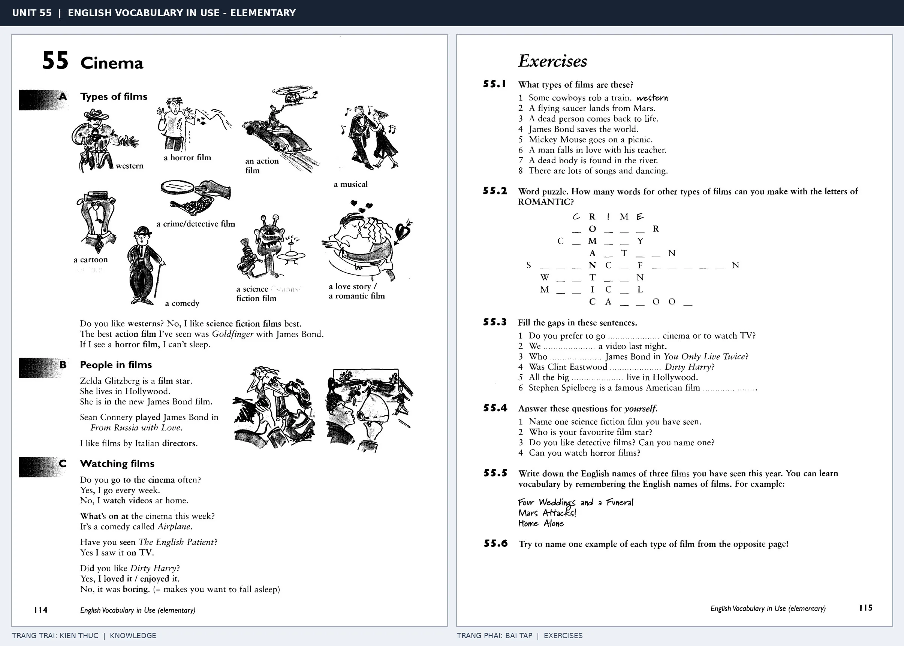

# Unit 55 — Cinema: Phim ảnh và điện ảnh

*Trang trái cung cấp kiến thức và ví dụ; trang phải là phần Exercises của Unit tương ứng. Có thể phóng to ảnh để làm bài tập gốc.*

> **Module 08:** Giải trí, mua sắm và du lịch  
> **Phạm vi:** English Vocabulary in Use — Elementary, Unit 55; trang in 114–115 (PDF trang 117–118).  
> **Hình thức:** Tự học từ vựng A1–A2 · Giảng giải tiếng Việt · Luyện câu và bài tập.

## 1. Tóm tắt và mục tiêu

Miêu tả thể loại và sở thích: I like comedies, What's your favourite film?; phân biệt film/movie với cinema là nơi xem phim. Tập đánh giá phim bằng exciting, funny, boring.

Sau bài này, bạn có thể:

- Giải thích nghĩa và cách sử dụng những từ, cụm từ cốt lõi của chủ đề **phim ảnh và điện ảnh**.
- Chọn đúng cách diễn đạt trong câu tiếng Anh đơn giản thay vì dịch máy móc từng từ.
- Tự đặt ít nhất ba câu thực tế và hoàn thành phần Exercises ở trang sách bên phải.

## 2. Kiến thức và từ vựng cốt lõi

Đọc kỹ từng mục. Với từ nhiều nghĩa, nghĩa ghi trong bảng được giới hạn ở cách dùng cần cho bài học này.

| Từ/cụm từ tiếng Anh | Nghĩa tiếng Việt |
| --- | --- |
| **film** | bộ phim |
| **cinema** | rạp chiếu phim |
| **actor** | nam diễn viên |
| **actress** | nữ diễn viên |
| **film star** | ngôi sao điện ảnh |
| **comedy** | phim hài |
| **cartoon** | phim hoạt hình |
| **western** | phim miền Tây |
| **science fiction** | phim khoa học viễn tưởng |
| **action film** | phim hành động |
| **horror film** | phim kinh dị |
| **romantic film** | phim tình cảm |
| **director** | đạo diễn |
| **screen** | màn ảnh |

### 2.1. Ghi nhớ theo nhóm và ngữ cảnh

**Nhóm từ thứ nhất:** film (bộ phim), cinema (rạp chiếu phim), actor (nam diễn viên).

**Nhóm từ thứ hai:** comedy (phim hài), cartoon (phim hoạt hình), western (phim miền Tây).

Hãy ghép từ với tình huống sử dụng thực tế. Khi gặp cụm từ có nhiều thành phần, ưu tiên ghi cả cụm kèm một câu ví dụ trong sổ từ vựng.

### 2.2. Mẫu câu song ngữ

**Ví dụ 1.** I like science fiction films best.

→ Tôi thích phim khoa học viễn tưởng nhất.

**Ví dụ 2.** We went to the cinema last night.

→ Tối qua chúng tôi đi xem phim.

Đọc từng câu thành tiếng, che phần dịch tiếng Việt và thử nói lại ý bằng lời của mình. Sau đó thay một chi tiết trong câu để tạo ví dụ mới.

## 3. Luyện tập ứng dụng

**Bài A — Nhớ từ trong ngữ cảnh.** Không nhìn bảng, hãy viết tiếng Anh tương ứng với các ý sau:

1. Bộ phim: __________
2. Nữ diễn viên: __________
3. Phim miền tây: __________

**Bài B — Dịch và biến đổi câu.** Dịch hai câu dưới đây sang tiếng Anh trước khi nhìn mẫu câu ở trên:

1. Tôi thích phim khoa học viễn tưởng nhất.
2. Tối qua chúng tôi đi xem phim.

**Bài C — Viết cho bản thân.** Viết ba câu mới về cuộc sống của bạn, mỗi câu sử dụng một từ/cụm từ khác nhau trong bảng. Đọc lại để kiểm tra giới từ, cách chia động từ và trật tự từ.

**Bài D — Thực hành theo sách.** Quan sát phần **Exercises (trang phải)** trong ảnh ghép: giải bài tập trên giấy hoặc một file riêng, sau đó so sánh với các ví dụ ở trang trái. Những bài yêu cầu thông tin cá nhân không nhất thiết có một đáp án cố định.

## 4. Câu hỏi ôn tập trắc nghiệm

*Mỗi câu có một đáp án phù hợp nhất. Hãy tự trả lời trước khi đọc phần giải thích.*

### Câu 1

Bạn muốn diễn đạt **“rạp chiếu phim”** bằng tiếng Anh. Chọn cách nói phù hợp nhất.

A. screen

B. director

C. film

D. cinema

**Đáp án:** D. **Giải thích:** “cinema” diễn đạt “rạp chiếu phim” trong chủ đề này.

### Câu 2

Cụm từ **“comedy”** có nghĩa nào trong bài học?

A. phim khoa học viễn tưởng

B. phim hành động

C. bộ phim

D. phim hài

**Đáp án:** D. **Giải thích:** “comedy” được dùng với nghĩa “phim hài”.

### Câu 3

Khi cần nói **“phim khoa học viễn tưởng”**, chọn từ/cụm từ nào?

A. cartoon

B. science fiction

C. romantic film

D. actress

**Đáp án:** B. **Giải thích:** Cách dùng đúng trong bài là “science fiction”.

### Câu 4

Chọn câu tiếng Anh diễn đạt đúng nhất: **“Tôi thích phim khoa học viễn tưởng nhất.”**

A. Can I have the bill, please?

B. I'd like a single room, please.

C. I like science fiction films best.

D. Can I try it on?

**Đáp án:** C. **Giải thích:** “I like science fiction films best.” là câu tương ứng với tình huống đã nêu.

### Câu 5

Ý nghĩa phù hợp nhất của câu **“We went to the cinema last night.”** là gì?

A. Tối qua chúng tôi đi xem phim.

B. Tôi muốn một phòng đơn.

C. Họ đã đi tham quan ở Paris.

D. Tuần sau chúng tôi sẽ đi nghỉ.

**Đáp án:** A. **Giải thích:** “We went to the cinema last night.” có nghĩa là “Tối qua chúng tôi đi xem phim.”.

## 5. Tổng kết và kiểm tra hoàn thành

Bài **We went to the cinema last night.** giúp bạn sử dụng vốn từ về **tối qua chúng tôi đi xem phim.** trong câu tiếng Anh thực tế. Giá trị quan trọng nhất không chỉ là biết nghĩa, mà là nhớ **cách kết hợp từ và ngữ cảnh sử dụng**.

- [ ] Tôi đã học bảng từ/cụm từ và đọc thành tiếng các ví dụ.
- [ ] Tôi đã hoàn thành ba phần luyện tập A, B, C.
- [ ] Tôi đã làm trang Exercises trong ảnh ghép và 5 câu trắc nghiệm.
- [ ] Tôi đã ghi các từ dễ nhầm vào sổ để ôn lại sau 1–3 ngày.

---

[← Unit 54: Thể thao](54-sports.md) · [Unit 56: Giải trí tại nhà →](56-leisure-at-home.md)

[↑ Trở về mục lục khóa học](../../MUC_LUC.md)
