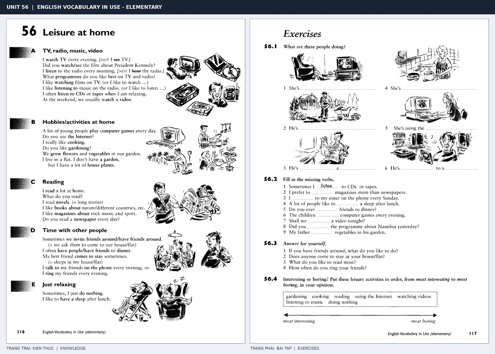

# Unit 56 — Leisure at home: Giải trí tại nhà

*Trang trái cung cấp kiến thức và ví dụ; trang phải là phần Exercises của Unit tương ứng. Có thể phóng to ảnh để làm bài tập gốc.*

> **Module 08:** Giải trí, mua sắm và du lịch  
> **Phạm vi:** English Vocabulary in Use — Elementary, Unit 56; trang in 116–117 (PDF trang 119–120).  
> **Hình thức:** Tự học từ vựng A1–A2 · Giảng giải tiếng Việt · Luyện câu và bài tập.

## 1. Tóm tắt và mục tiêu

Các hoạt động ở nhà thường đi với watch, listen to, read, play hoặc do. Phân biệt watch TV với see a film, listen to music với hear a sound.

Sau bài này, bạn có thể:

- Giải thích nghĩa và cách sử dụng những từ, cụm từ cốt lõi của chủ đề **giải trí tại nhà**.
- Chọn đúng cách diễn đạt trong câu tiếng Anh đơn giản thay vì dịch máy móc từng từ.
- Tự đặt ít nhất ba câu thực tế và hoàn thành phần Exercises ở trang sách bên phải.

## 2. Kiến thức và từ vựng cốt lõi

Đọc kỹ từng mục. Với từ nhiều nghĩa, nghĩa ghi trong bảng được giới hạn ở cách dùng cần cho bài học này.

| Từ/cụm từ tiếng Anh | Nghĩa tiếng Việt |
| --- | --- |
| **watch TV** | xem tivi |
| **listen to the radio** | nghe đài |
| **listen to music** | nghe nhạc |
| **read a book** | đọc sách |
| **play the piano** | chơi đàn piano |
| **gardening** | làm vườn |
| **draw** | vẽ |
| **paint** | vẽ tranh |
| **collect stamps** | sưu tầm tem |
| **play computer games** | chơi game máy tính |
| **listen to CDs** | nghe đĩa CD |
| **do puzzles** | giải câu đố |

### 2.1. Ghi nhớ theo nhóm và ngữ cảnh

**Nhóm từ thứ nhất:** watch TV (xem tivi), listen to the radio (nghe đài), listen to music (nghe nhạc).

**Nhóm từ thứ hai:** gardening (làm vườn), draw (vẽ), paint (vẽ tranh).

Hãy ghép từ với tình huống sử dụng thực tế. Khi gặp cụm từ có nhiều thành phần, ưu tiên ghi cả cụm kèm một câu ví dụ trong sổ từ vựng.

### 2.2. Mẫu câu song ngữ

**Ví dụ 1.** I listen to music in the evening.

→ Tôi nghe nhạc vào buổi tối.

**Ví dụ 2.** My father enjoys gardening.

→ Bố tôi thích làm vườn.

Đọc từng câu thành tiếng, che phần dịch tiếng Việt và thử nói lại ý bằng lời của mình. Sau đó thay một chi tiết trong câu để tạo ví dụ mới.

## 3. Luyện tập ứng dụng

**Bài A — Nhớ từ trong ngữ cảnh.** Không nhìn bảng, hãy viết tiếng Anh tương ứng với các ý sau:

1. Xem tivi: __________
2. Đọc sách: __________
3. Vẽ tranh: __________

**Bài B — Dịch và biến đổi câu.** Dịch hai câu dưới đây sang tiếng Anh trước khi nhìn mẫu câu ở trên:

1. Tôi nghe nhạc vào buổi tối.
2. Bố tôi thích làm vườn.

**Bài C — Viết cho bản thân.** Viết ba câu mới về cuộc sống của bạn, mỗi câu sử dụng một từ/cụm từ khác nhau trong bảng. Đọc lại để kiểm tra giới từ, cách chia động từ và trật tự từ.

**Bài D — Thực hành theo sách.** Quan sát phần **Exercises (trang phải)** trong ảnh ghép: giải bài tập trên giấy hoặc một file riêng, sau đó so sánh với các ví dụ ở trang trái. Những bài yêu cầu thông tin cá nhân không nhất thiết có một đáp án cố định.

## 4. Câu hỏi ôn tập trắc nghiệm

*Mỗi câu có một đáp án phù hợp nhất. Hãy tự trả lời trước khi đọc phần giải thích.*

### Câu 1

Bạn muốn diễn đạt **“nghe đài”** bằng tiếng Anh. Chọn cách nói phù hợp nhất.

A. listen to music

B. collect stamps

C. watch TV

D. listen to the radio

**Đáp án:** D. **Giải thích:** “listen to the radio” diễn đạt “nghe đài” trong chủ đề này.

### Câu 2

Cụm từ **“gardening”** có nghĩa nào trong bài học?

A. làm vườn

B. nghe nhạc

C. vẽ

D. giải câu đố

**Đáp án:** A. **Giải thích:** “gardening” được dùng với nghĩa “làm vườn”.

### Câu 3

Khi cần nói **“sưu tầm tem”**, chọn từ/cụm từ nào?

A. paint

B. play the piano

C. collect stamps

D. watch TV

**Đáp án:** C. **Giải thích:** Cách dùng đúng trong bài là “collect stamps”.

### Câu 4

Chọn câu tiếng Anh diễn đạt đúng nhất: **“Tôi nghe nhạc vào buổi tối.”**

A. Could we have the menu, please?

B. We are going on holiday next week.

C. I like science fiction films best.

D. I listen to music in the evening.

**Đáp án:** D. **Giải thích:** “I listen to music in the evening.” là câu tương ứng với tình huống đã nêu.

### Câu 5

Ý nghĩa phù hợp nhất của câu **“My father enjoys gardening.”** là gì?

A. Tuần sau chúng tôi sẽ đi nghỉ.

B. Bạn có chơi cầu lông không?

C. Bố tôi thích làm vườn.

D. Chiếc áo khoác này giá bao nhiêu?

**Đáp án:** C. **Giải thích:** “My father enjoys gardening.” có nghĩa là “Bố tôi thích làm vườn.”.

## 5. Tổng kết và kiểm tra hoàn thành

Bài **My father enjoys gardening.** giúp bạn sử dụng vốn từ về **bố tôi thích làm vườn.** trong câu tiếng Anh thực tế. Giá trị quan trọng nhất không chỉ là biết nghĩa, mà là nhớ **cách kết hợp từ và ngữ cảnh sử dụng**.

- [ ] Tôi đã học bảng từ/cụm từ và đọc thành tiếng các ví dụ.
- [ ] Tôi đã hoàn thành ba phần luyện tập A, B, C.
- [ ] Tôi đã làm trang Exercises trong ảnh ghép và 5 câu trắc nghiệm.
- [ ] Tôi đã ghi các từ dễ nhầm vào sổ để ôn lại sau 1–3 ngày.

---

[← Unit 55: Phim ảnh và điện ảnh](55-cinema.md) · [Unit 57: Từ vựng về tội phạm →](../09-social-issues/57-crime.md)

[↑ Trở về mục lục khóa học](../../MUC_LUC.md)
